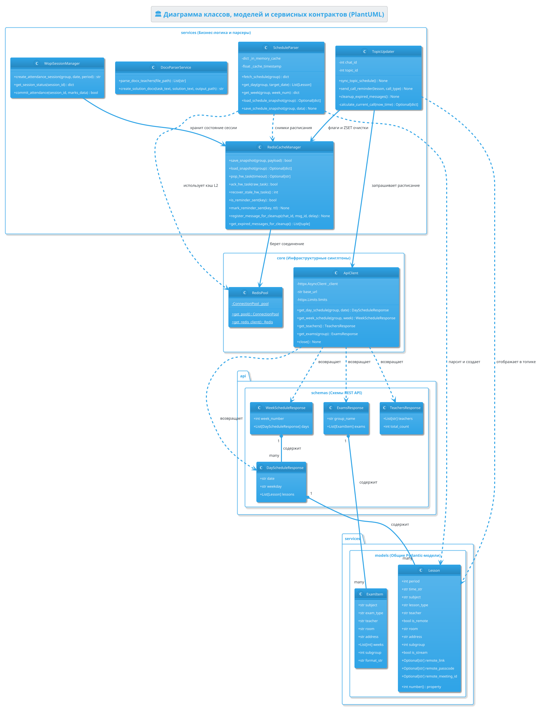
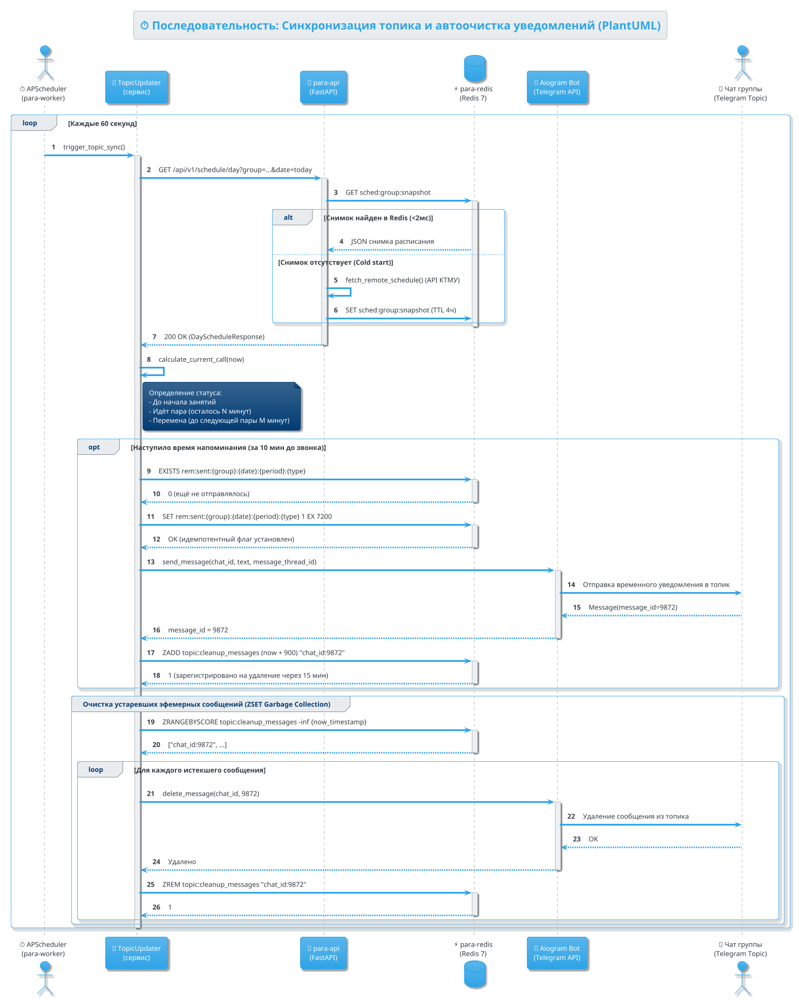
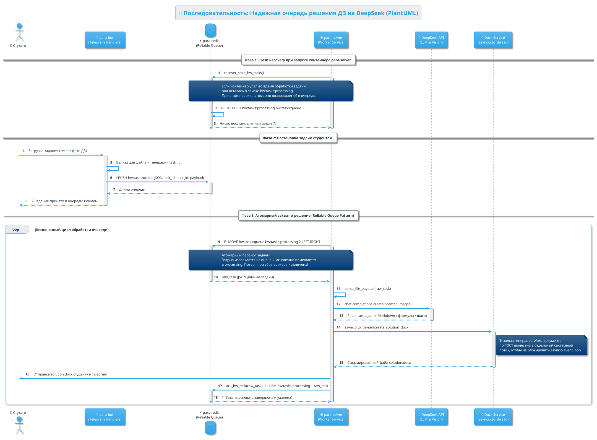
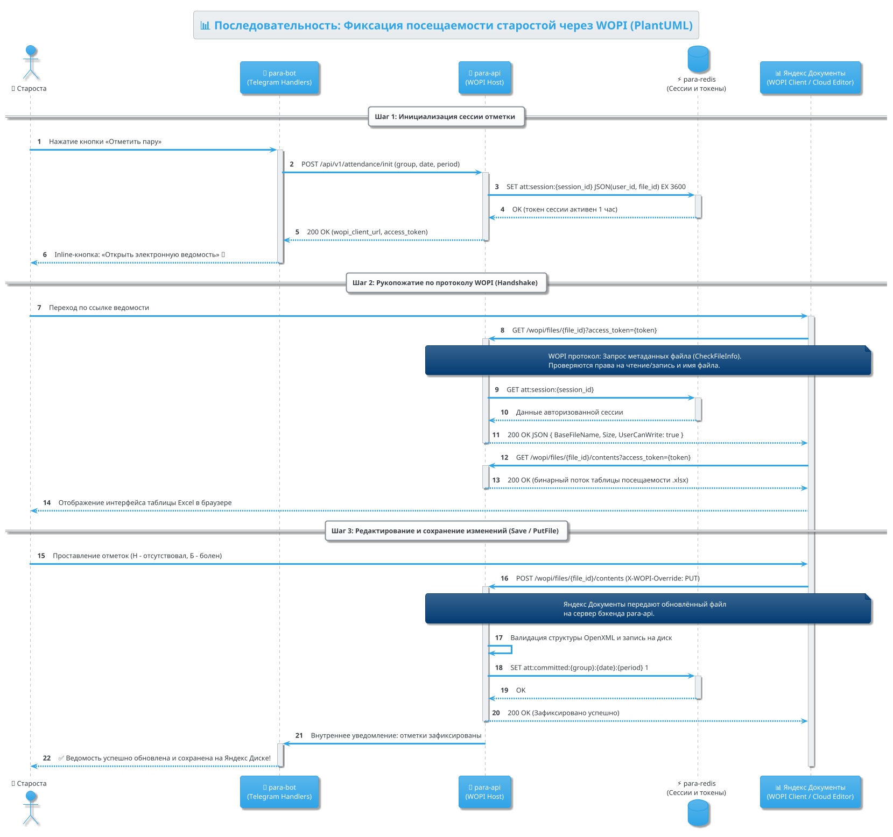
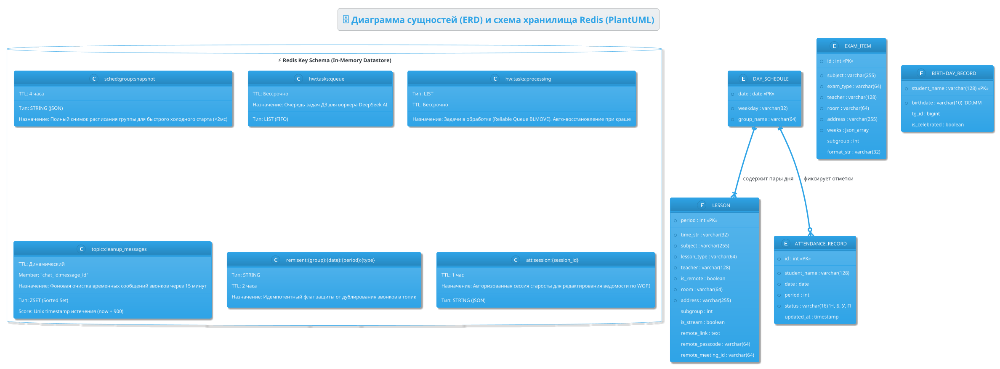

# 🏛️ Архитектурная UML-документация проекта «para» (PlantUML)

Документация архитектуры, структуры классов, очередей сообщений и сценариев взаимодействия Telegram-бота расписания КТМУ, REST API и сервисов обработки на базе стандарта **PlantUML** с использованием специализированного скилла `plantuml` ([SpillwaveSolutions/plantuml](https://github.com/SpillwaveSolutions/plantuml)).

---

## 📑 Содержание

1. [Архитектура развертывания и компонентов (Deployment & Containers)](#1-архитектура-развертывания-и-компонентов)
2. [Диаграмма классов и контрактов данных (Class Diagram)](#2-диаграмма-классов-и-контрактов-данных)
3. [Сценарий: Синхронизация топика и автоочистка уведомлений (Sequence)](#3-сценарий-синхронизация-топика-и-автоочистка-уведомлений)
4. [Сценарий: Надежная очередь решения ДЗ на DeepSeek (Sequence)](#4-сценарий-надежная-очередь-решения-дз-на-deepseek)
5. [Сценарий: Фиксация посещаемости через WOPI Яндекс Документов (Sequence)](#5-сценарий-фиксация-посещаемости-через-wopi)
6. [Модели данных и структура ключей Redis (ERD & Key Storage)](#6-модели-данных-и-структура-ключей-redis)

---

## 1. Архитектура развертывания и компонентов

> 📄 **Исходный файл:** [`docs/puml/01_deployment_and_containers.puml`](file:///home/u/Рабочий%20стол/para/docs/puml/01_deployment_and_containers.puml)  
> 🖼️ **SVG векторная диаграмма:** [`docs/puml/01_deployment_and_containers.svg`](file:///home/u/Рабочий%20стол/para/docs/puml/01_deployment_and_containers.svg)

Диаграмма иллюстрирует 5 микросервисов в составе Docker Compose, постоянные тома данных и внешние облачные интеграции.

```plantuml
@startuml 01_deployment_and_containers
!theme cerulean

skinparam defaultFontName "sans-serif"
skinparam roundCorner 10
skinparam shadowing true
skinparam packageTitleAlignment left

title 🐳 Архитектура развертывания и компонентов проекта «para» (PlantUML)

cloud "🌐 Внешние сервисы и платформы" as external_cloud {
  actor "👤 Пользователь / Студент" as user
  actor "👑 Староста / Администратор" as admin
  node "✈️ Telegram Bot API" as tg_api
  node "🏫 API расписания КТМУ\n(timetable-ktmu.ru)" as ktmu_api
  node "📂 Яндекс Диск API" as yd_api
  node "📊 Яндекс Документы (WOPI)" as yd_wopi
  node "🧠 DeepSeek API (LLM/Vision)" as deepseek_api
}

node "🖥️ Продакшн сервер (ssh home)" as host_server {
  
  folder "📁 Монтируемые тома (Host Volumes)" as host_storage {
    storage "./data\n(Расписания, ДЗ, конфиги)" as vol_data
    storage "./data/redis\n(AOF/RDB персистентность)" as vol_redis
    storage "./logs\n(Логи сервисов)" as vol_logs
  }

  package "🐳 Docker Compose Стек (сеть: internal_bridge)" as docker_network {
    
    database "⚡ para-redis\n(Redis 7 Alpine)" as c_redis {
      component "Кэш снимков расписания\n(sched:group:snapshot)" as r_snap
      component "Надежная очередь ДЗ\n(hw:tasks:queue / processing)" as r_queue
      component "ZSET очистки топика\n(topic:cleanup_messages)" as r_zset
      component "Сессии посещаемости\n(att:session:*)" as r_sess
      component "Идемпотентные флаги\n(rem:sent:*, topic:*)" as r_flags
    }

    node "🚀 para-api\n(FastAPI + Uvicorn :8000)" as c_api {
      component "Schedule Router\n(/api/v1/schedule)" as api_sched
      component "Teachers Router\n(/api/v1/teachers)" as api_teach
      component "Exams Router\n(/api/v1/exams)" as api_exams
      component "WOPI Controller\n(/wopi/files/*)" as api_wopi
      component "HTTP Client Pool\n(Keepalive=10, Max=20)" as api_pool
    }

    node "🤖 para-bot\n(Aiogram 3 Dispatcher)" as c_bot {
      component "SOCKS5 Proxy Client" as bot_proxy
      component "User Handlers\n(Команды, inline-кнопки)" as bot_user
      component "Admin Handlers\n(Опросы, отметки пар)" as bot_admin
      component "FSM & Local States" as bot_fsm
    }

    node "⏱️ para-worker\n(APScheduler Tasks)" as c_worker {
      component "Topic Sync Task (каждые 60с)\n(Расписание и таймеры пар)" as worker_topic
      component "ZSET Cleaner Task (каждые 60с)\n(Удаление 15-мин уведомлений)" as worker_clean
      component "Yandex Keepalive (каждые 6ч)\n(Обновление токенов диска)" as worker_yd
    }

    node "🧠 para-solver\n(DeepSeek Solver Worker)" as c_solver {
      component "Queue Consumer\n(BLMOVE hw:tasks:queue)" as solver_worker
      component "Vision & Text Prompting" as solver_prompt
      component "Docx GOST Generator\n(asyncio.to_thread)" as solver_docx
    }
  }
}

' Связи пользователей
user --> tg_api : Telegram чат
admin --> tg_api : Управление ботом

' Внешние взаимодействия
tg_api <--> bot_proxy : Polling / Ответы
c_api --> ktmu_api : Загрузка расписания
c_api <--> yd_wopi : WOPI REST протокол
c_api --> yd_api : Чтение таблиц
c_solver --> deepseek_api : Решение задач (AI)

' Внутреннее взаимодействие Docker Compose
c_bot --> c_api : HTTP REST (внутренний порт 8000)
c_bot --> c_redis : Состояния, сессии, очередь ДЗ
c_worker --> c_api : Запрос актуального дня
c_worker --> c_redis : ZSET таймеры, идемпотентность
c_worker --> tg_api : Обновление топика и звонков
c_solver --> c_redis : BLMOVE / ACK задач
c_solver --> tg_api : Отправка готового решения docx

' Связи с хранилищем
c_redis ..> vol_redis : Сохранение данных
c_api ..> vol_data : Чтение шаблонов
c_solver ..> vol_data : Запись сгенерированных .docx
c_bot ..> vol_logs : Запись логов
c_worker ..> vol_logs : Запись логов

@enduml
```

---

## 2. Диаграмма классов и контрактов данных

> 📄 **Исходный файл:** [`docs/puml/02_class_diagram.puml`](file:///home/u/Рабочий%20стол/para/docs/puml/02_class_diagram.puml)  
> 🖼️ **SVG векторная диаграмма:** [`docs/puml/02_class_diagram.svg`](file:///home/u/Рабочий%20стол/para/docs/puml/02_class_diagram.svg)

Диаграмма описывает строгую типизацию моделей Pydantic, схем FastAPI, синглтонов пулов соединений и сервисов.

---

## 3. Сценарий: Синхронизация топика и автоочистка уведомлений

> 📄 **Исходный файл:** [`docs/puml/03_sequence_topic_updater.puml`](file:///home/u/Рабочий%20стол/para/docs/puml/03_sequence_topic_updater.puml)  
> 🖼️ **SVG векторная диаграмма:** [`docs/puml/03_sequence_topic_updater.svg`](file:///home/u/Рабочий%20стол/para/docs/puml/03_sequence_topic_updater.svg)

Отображает процесс ежеминутной синхронизации топика группы:
1. Запрос расписания из L2-кэша Redis (`<2мс`).
2. Определение текущей пары и расписания звонков.
3. Проверка идемпотентного ключа в Redis (`rem:sent:...`).
4. Отправка временного напоминания и регистрация в `Redis ZSET` (`topic:cleanup_messages`).
5. Автоудаление истекших временных сообщений через 15 минут.

---

## 4. Сценарий: Надежная очередь решения ДЗ на DeepSeek

> 📄 **Исходный файл:** [`docs/puml/04_sequence_hw_solver.puml`](file:///home/u/Рабочий%20стол/para/docs/puml/04_sequence_hw_solver.puml)  
> 🖼️ **SVG векторная диаграмма:** [`docs/puml/04_sequence_hw_solver.svg`](file:///home/u/Рабочий%20стол/para/docs/puml/04_sequence_hw_solver.svg)

Реализация паттерна **Reliable Queue**:
1. Атомарный перенос задач из очереди ожидания в очередь обработки через `BLMOVE`.
2. Автоматическое восстановление зависших задач при перезапуске сервиса (`recover_stale_hw_tasks`).
3. Асинхронное обращение к DeepSeek AI и генерация `.docx` по ГОСТу в пуле потоков `asyncio.to_thread`.
4. Подтверждение выполнения через `ack_hw_task`.

---

## 5. Сценарий: Фиксация посещаемости через WOPI

> 📄 **Исходный файл:** [`docs/puml/05_sequence_wopi_attendance.puml`](file:///home/u/Рабочий%20стол/para/docs/puml/05_sequence_wopi_attendance.puml)  
> 🖼️ **SVG векторная диаграмма:** [`docs/puml/05_sequence_wopi_attendance.svg`](file:///home/u/Рабочий%20стол/para/docs/puml/05_sequence_wopi_attendance.svg)

Сценарий работы старосты с ведомостью через протокол WOPI (Web Application Open Platform Interface) и облачный редактор Яндекс Документов.

---

## 6. Модели данных и структура ключей Redis

> 📄 **Исходный файл:** [`docs/puml/06_erd_data_models.puml`](file:///home/u/Рабочий%20стол/para/docs/puml/06_erd_data_models.puml)  
> 🖼️ **SVG векторная диаграмма:** [`docs/puml/06_erd_data_models.svg`](file:///home/u/Рабочий%20стол/para/docs/puml/06_erd_data_models.svg)

Схема сущностей предметной области и карта ключей Redis с типами данных и политиками устаревания (TTL).

