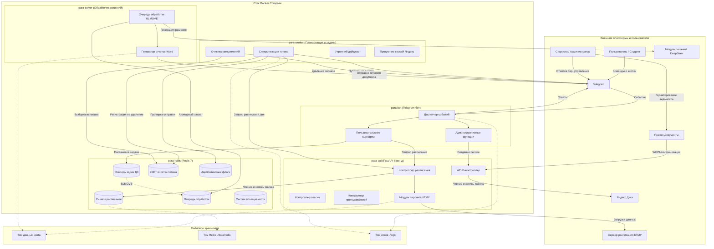
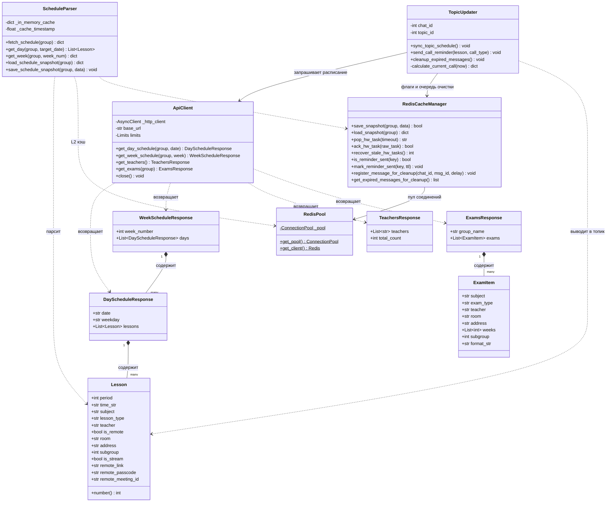
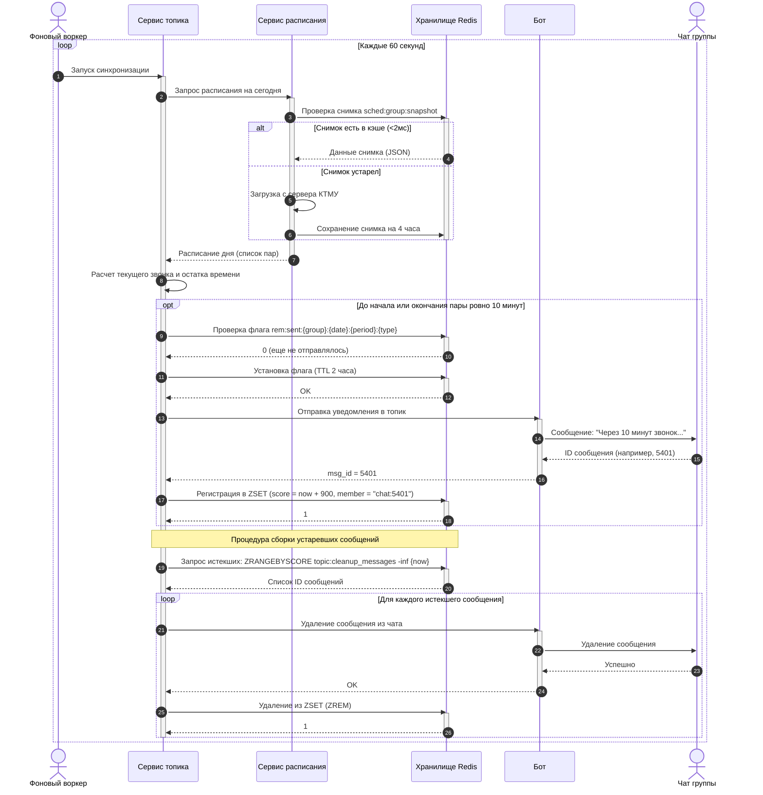
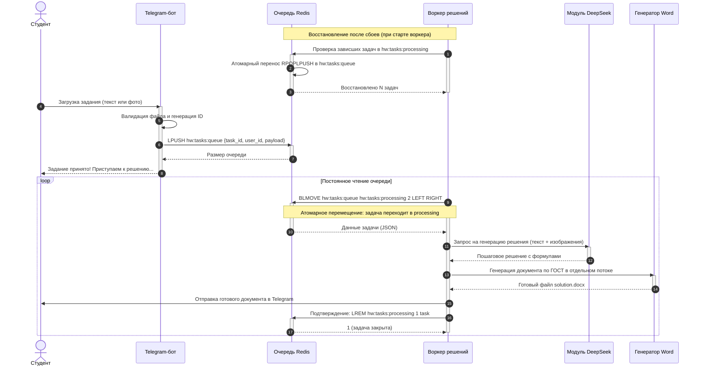
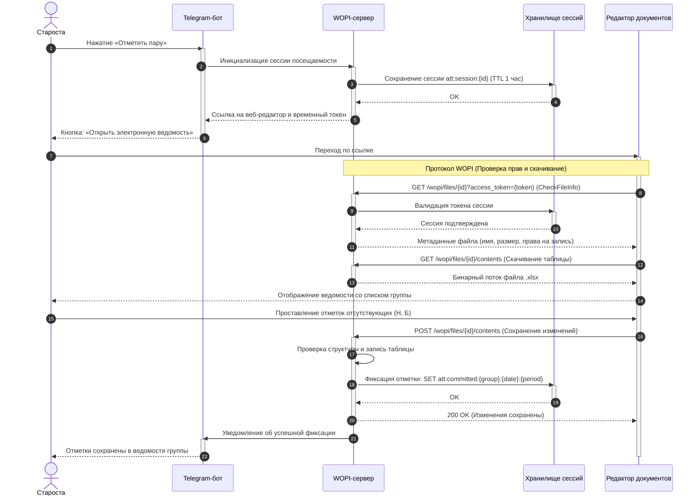
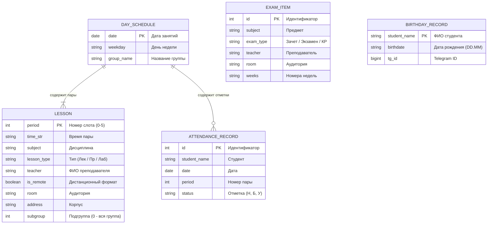

# 🏛️ Архитектура системы «para»

Техническое описание архитектуры, взаимосвязи микросервисов, моделей данных, распределенных очередей и сценариев работы Telegram-бота группы, внутреннего бэкенда расписания и фоновых воркеров.

---

## 📑 Содержание

1. [Компонентная структура и развертывание](#1-компонентная-структура-и-развертывание)
2. [Диаграмма классов и структур данных](#2-диаграмма-классов-и-структур-данных)
3. [Сценарий: Синхронизация топика и автоочистка уведомлений](#3-сценарий-синхронизация-топика-и-автоочистка-уведомлений)
4. [Сценарий: Надежная очередь решения задач](#4-сценарий-надежная-очередь-решения-задач)
5. [Сценарий: Фиксация посещаемости старостой](#5-сценарий-фиксация-посещаемости-старостой)
6. [Модели данных и структура хранилища Redis](#6-модели-данных-и-структура-хранилища-redis)
7. [Реестр ключей хранилища Redis](#реестр-ключей-хранилища-redis)

---

## 1. Компонентная структура и развертывание

Система развернута в изолированном окружении Docker Compose и взаимодействует через внутреннюю сеть `internal_bridge`.

### Сводная таблица контейнеров

| Контейнер | Базовый образ | Сетевой порт | Зона ответственности |
| :--- | :--- | :--- | :--- |
| `para-redis` | `redis:7-alpine` | `6379` (внутренний) | Быстрый кэш снимка расписания, надежная очередь задач с `BLMOVE`, хранилище сессий и ZSET-таймеры очистки |
| `para-api` | Python 3.12 (slim) | `8000` (внутренний) | Внутренний сервис: нормализация расписания, обработка данных КТМУ, поддержка протокола WOPI для работы с таблицами |
| `para-bot` | Python 3.12 (slim) | Выход через SOCKS5 | Пользовательский интерфейс: обработка команд, интерактивные клавиатуры, опросы старосты, FSM-состояния |
| `para-worker` | Python 3.12 (slim) | — | Фоновый планировщик: синхронизация топика каждую минуту, автоочистка временных сообщений, утренние дайджесты |
| `para-solver` | Python 3.12 (slim) | — | Воркер решения задач: непрерывное чтение очереди, формирование решения, оформление документов в формате Word |

---

## 2. Диаграмма классов и структур данных

---

## 3. Сценарий: Синхронизация топика и автоочистка уведомлений

Синхронизация выполняется каждую минуту воркером `para-worker`.

---

## 4. Сценарий: Надежная очередь решения задач

Очередь построена по принципу **Reliable Queue**: задача не теряется даже при падении или перезапуске воркера.

---

## 5. Сценарий: Фиксация посещаемости старостой

Интеграция со страницей редактирования Яндекс Документов по протоколу WOPI.

---

## 6. Модели данных и структура хранилища Redis

### Диаграмма сущностей (ERD)

---

### Реестр ключей хранилища Redis

Все ключи структурированы по префиксам и имеют четко определенное время жизни (TTL):

| Префикс / Шаблон ключа | Тип данных | Время жизни (TTL) | Назначение |
| :--- | :--- | :--- | :--- |
| `sched:group:snapshot` | String (JSON) | 4 часа | Снимок расписания группы на текущую неделю. Позволяет отдавать расписание за `<2мс` без повторного разбора 40-мегабайтных файлов КТМУ |
| `hw:tasks:queue` | List (FIFO) | Бессрочно | Очередь задач на решение. Пополняется ботом по мере поступления заданий от студентов |
| `hw:tasks:processing` | List | Бессрочно | Задачи в процессе обработки. Часть паттерна Reliable Queue: задача атомарно перемещается сюда через `BLMOVE` и удаляется только после отправки решения |
| `topic:cleanup_messages` | Sorted Set (ZSET) | Динамический | Очередь автоудаления временных сообщений. В качестве `score` используется unix timestamp времени удаления (`now + 900`), `member` — `"chat_id:message_id"` |
| `rem:sent:{group}:{date}:{period}:{type}` | String (флаг) | 2 часа | Защита от дублирования звонков и напоминаний в топике группы при сбоях или частых перезапусках |
| `att:session:{session_id}` | String (JSON) | 1 час | Данные временной авторизованной сессии старосты для доступа к редактированию ведомости через веб-редактор |
| `att:committed:{group}:{date}:{period}` | String (флаг) | 24 часа | Отметка о том, что посещаемость на конкретную пару зафиксирована старостой |
| `topic:schedule_msg_id:{group}` | String (int) | Бессрочно | ID главного закрепленного сообщения с расписанием в топике для его обновления на месте |

---

## 7. Файлы диаграмм

Резервные копии схем в векторном формате также сохранены в каталоге `docs/puml/`:
- [Диаграмма развертывания](puml/01_deployment_and_containers.svg)
- [Диаграмма классов](puml/02_class_diagram.svg)
- [Синхронизация топика](puml/03_sequence_topic_updater.svg)
- [Очередь решений](puml/04_sequence_hw_solver.svg)
- [Ведомость посещаемости](puml/05_sequence_wopi_attendance.svg)
- [Модели данных](puml/06_erd_data_models.svg)
