# Architecture Specification for «para»

Обновлено: 2026-11-01 — сброс ачивок с точкой отсчёта журнала (`achievement_baselines`, `services/achievement_reset.py`: журнальные ачивки и места считаются только по отметкам после сброса); ачивки переработаны: каталог из 80 с условием = описанием, журнальные и мета-правила (`services/achievement_rules.py`) выдаёт worker (`achievement_sync_loop`), событийные — хэндлеры и middleware (`services/achievement_triggers.py`, `services/achievement_events.py`, `bot/middlewares/achievements.py`), счётчики в `student_counters` (раздел 17.6); 2026-10-31 — публичный шлюз и туннели переехали с claude на vpn (185.230.67.217, сайт на :8443; раздел 9.5); 2026-10-30 — безопасность: образы ставят зависимости из lock с хешами, базовый образ по digest; туннели на VPS под пользователем `tunnel` с закреплённым ключом хоста (раздел 9.5); код в контейнерах `:ro`, сервисы получают только свои секреты (`compose.yml`); ключи API выдаются только в ЛС, сессии подписываются `SESSION_SECRET`, STT в ЛС только для группы и тестеров (`is_voice_request_allowed`), `/metrics` только админу с шаблонами маршрутов в лейблах, экранирование XML в docx (`to_xml_text`), `/miniapp/action` только для группы; автодеплой проверяет, что коммиты из `main` и подписаны ключом из `/etc/para/allowed_signers`; CI с `permissions: contents: read` и actions по SHA (раздел 9.6); аттестации: кабинет, дата и пара из сетки, пометка «предварительно» (`ExamItem.exam_date/pair_number/time_str/is_preliminary`, `ExamParser`); замены КТМУ (`services/schedule_substitutions.py`: сдвиг пары, отмены, переносы) применяются к расписанию (раздел 3.1); распознавание речи вынесено в сервис stt (раздел 8.16); автодеплой после зелёного CI (раздел 9.6); логи по сервисам (принцип 6); фоновое обновление расписания (`services/schedule_refresher.py`, раздел 3.1); основной API расписания переехал на `raspisanie-ktmu.ru`; одноразовые login-токены (`services/login_tokens.py`, `GET /miniapp/login`) вместо `?key=` и `/miniapp/dev-login`; `/gamification/leaderboard` и `/profile` закрыты `verify_api_or_tester`.

Technical specification of the distributed system architecture, end-to-end data flows, object models, and execution lifecycles for the Telegram group bot, timetable API service, and background workers.

---

## Table of Contents

1. [System Services Architecture & Core Contracts](#1-system-services-architecture--core-contracts)
2. [Domain Models & Service Contracts Diagram](#2-domain-models--service-contracts-diagram)
3. [End-to-End Flow: Schedule Query & L2 Caching](#3-end-to-end-flow-schedule-query--l2-caching)
4. [End-to-End Flow: Bell Notifications & Topic Auto-Cleanup](#4-end-to-end-flow-bell-notifications--topic-auto-cleanup)
5. [End-to-End Flow: Reliable AI Homework Solver Queue](#5-end-to-end-flow-reliable-ai-homework-solver-queue)
6. [End-to-End Flow: Electronic Attendance Registry (WOPI)](#6-end-to-end-flow-electronic-attendance-registry-wopi)
7. [Data Models & Redis Storage Structure](#7-data-models--redis-storage-structure)
8. [User Interaction Flows & Per-Button Architecture Diagrams](#8-user-interaction-flows--per-button-architecture-diagrams)
   - 8.1. [Command /start & Classmate Onboarding Flow](#81-command-start--classmate-onboarding-flow)
   - 8.2. [Button «📅 Сегодня» (sched:today) Ingress Flow](#82-button-сегодня-schedtoday-ingress-flow)
   - 8.3. [Button «📆 Завтра» (sched:tomorrow) Ingress Flow](#83-button-завтра-schedtomorrow-ingress-flow)
   - 8.4. [Buttons «⏭ Неделя (След.)» & «⏮ Неделя (Тек.)» Flow](#84-buttons-неделя-след--неделя-тек-schedweek--schedweek_next)
   - 8.5. [Button «🔄 Обновить» (sched:refresh) Force Sync Flow](#85-button-обновить-schedrefresh-force-sync-flow)
   - 8.6. [Button «🔔/🔕 Напоминания» (sched:toggle_notify) Subscription Flow](#86-button-bell-напоминания-schedtoggle_notify-subscription-flow)
   - 8.7. [Command /my_attendance & Button «🔄 Обновить мои данные» Flow](#87-command-my_attendance--button-обновить-мои-данные-attmy_refresh)
   - 8.8. [Headman Attendance Flow: Command /attendance & Mark Buttons](#88-headman-attendance-flow-command-attendance--mark-buttons)
   - 8.9. [Remote Lesson Direct Join Button «🔗 N-я пара» Flow](#89-remote-lesson-direct-join-button-n-я-пара-flow)
   - 8.10. [AI Homework Solver Workflow in Topic 405 (DeepSeek & GOST .docx)](#810-ai-homework-solver-workflow-in-topic-405-deepseek--gost-docx)
   - 8.11. [Headman & Admin Control Panel /admin Flow](#811-headman--admin-control-panel-admin-flow)
   - 8.12. [Unauthenticated Ingress & Fallback Flow (auth_fallback.py)](#812-unauthenticated-ingress--fallback-flow-auth_fallbackpy)
   - 8.13. [Global Exception Trapping & User-Facing Error Fallback (errors.py)](#813-global-exception-trapping--user-facing-error-fallback-errorspy)
   - 8.14. [Scoped Interactive Telegram Command Menus (commands.py)](#814-scoped-interactive-telegram-command-menus-commandspy)
   - 8.15. [Distributed Redis FSM Storage & Resilient Fallback (core/bot.py)](#815-distributed-redis-fsm-storage--resilient-fallback-corebotpy)
   - 8.16. [Voice & Video Note STT Transcription Flow (voice_transcribe.py)](#816-voice--video-note-stt-transcription-flow-voice_transcribepy)
9. [Dual-Protocol gRPC & Telegram Mini App Swagger UI Architecture](#9-dual-protocol-grpc--telegram-mini-app-swagger-ui-architecture)
   - 9.1. [gRPC Microservices Ingress & Protobuf Multiplexing Flow](#91-grpc-microservices-ingress--protobuf-multiplexing-flow)
   - 9.2. [Telegram Mini App Cryptographic Auth & Embedded Swagger UI Flow](#92-telegram-mini-app-cryptographic-auth--embedded-swagger-ui-flow)
   - 9.3. [Tester Whitelist Management Flow](#93-tester-whitelist-management-flow)
10. [Performance Hardening & Security Audit Architecture](#10-performance-hardening--security-audit-architecture)
   - 10.1. [API Security Boundary & Privilege Escalation Prevention](#101-api-security-boundary--privilege-escalation-prevention)
   - 10.2. [High-Performance Attendance Caching & Thread-Offloading Flow](#102-high-performance-attendance-caching--thread-offloading-flow)
   - 10.3. [Concurrent AI Solver Worker Pipeline with Semaphore Control](#103-concurrent-ai-solver-worker-pipeline-with-semaphore-control)
   - 10.4. [Multi-Tier High-Performance Architecture: L1 In-Memory, uvloop & gRPC Keepalive](#104-multi-tier-high-performance-architecture-l1-in-memory-uvloop--grpc-keepalive)
   - 10.5. [Enterprise Observability & Prometheus Metrics Architecture](#105-enterprise-observability--prometheus-metrics-architecture)
11. [Automated CI/CD Pipeline & Delivery Verification](#11-automated-cicd-pipeline--delivery-verification)
12. [Resilient Fallback Upstream & Clean Micro-Functions Architecture](#12-resilient-fallback-upstream--clean-micro-functions-architecture)
13. [Hardened Security Governance & Secrets Lifecycle Management](#13-hardened-security-governance--secrets-lifecycle-management)
14. [AI Resilience, Circuit Breaker & Prompt Sanitization Architecture](#14-ai-resilience-circuit-breaker--prompt-sanitization-architecture)
15. [Persistent Relational SQLite Architecture, Incident Alerting & Automated Backups](#15-persistent-relational-sqlite-architecture-incident-alerting--automated-backups)
16. [OpenTelemetry End-to-End Tracing & Locust 500+ RPS Stress Testing Architecture](#16-opentelemetry-end-to-end-tracing--locust-500-rps-stress-testing-architecture)
   - 16.1. [Distributed Tracing Span Topology (Telegram -> gRPC -> Redis -> SQLite)](#161-distributed-tracing-span-topology-telegram---grpc---redis---sqlite)
   - 16.2. [Locust Dual-Protocol Load Testing Architecture & Morning Peak Simulation](#162-locust-dual-protocol-load-testing-architecture--morning-peak-simulation)
   - 16.3. [Dual-Tab Mini App & Jaeger Reverse Proxy Architecture](#163-dual-tab-mini-app--jaeger-reverse-proxy-architecture)
17. [High-Performance Reliability, PII Protection & Gamification Showcase](#17-high-performance-reliability-pii-protection--gamification-showcase)
   - 17.1. [Telegram Bot Ingress & WOPI L2 Cache Sequence](#171-telegram-bot-ingress--wopi-l2-cache-sequence)
   - 17.2. [Classmate Role-Based Whitelist Gate Flowchart](#172-classmate-role-based-whitelist-gate-flowchart)
   - 17.3. [Gamification Progress Bar & Visual Status Architecture](#173-gamification-progress-bar--visual-status-architecture)
   - 17.4. [Decoupled Starosta Unranked, Lightweight Mini App & Path Traversal Security](#174-decoupled-starosta-unranked-lightweight-mini-app--path-traversal-security)
   - 17.5. [Instant Achievement Dispatcher & Telegram Push Notification Flow](#175-instant-achievement-dispatcher--telegram-push-notification-flow)
   - 17.6. [Achievement Rules, Event Sources & Worker Sync](#176-achievement-rules-event-sources--worker-sync)
---

## 1. System Services Architecture & Core Contracts

The architecture diagram outlines the interaction between distributed system components: ingress gateways, dispatchers, business logic microservices, in-memory state stores, and external upstream integrations.

```mermaid
classDiagram
    direction TB

    class TelegramGateway {
        +session AiohttpSession (pool_limit=50)
        +handle_schedule(chat_id, date) void
        +handle_hw_task(student_id, file) void
        +handle_attendance(admin_id) void
        +send_document(chat_id, docx) void
        +send_alert(chat_id, text) int
        +delete_msg(chat_id, msg_id) bool
    }

    class RetryAfterMiddleware {
        +__call__(handler, event, data) Any
        +retry_on_flood_control(attempt, delay) Any
    }

    class CallbackThrottleMiddleware {
        -_last_clicks dict
        +__call__(handler, event, data) Any
        -_determine_cooldown(cb_data) float
        -_handle_callback_throttle(event, now) bool
    }

    class DocxParserService {
        -_DOCX_LOCK Lock
        -_CACHE tuple
        +get_teacher_links(force_refresh) dict
        -_fetch_and_cache_teachers(now) dict
        -_is_cache_fresh(now, force) bool
        +parse_docx_xml(docx_bytes) dict
    }

    class ScheduleApiService {
        +get_day_schedule(group, date) DayScheduleResponse
        +get_week_schedule(group, week) WeekScheduleResponse
        +get_exams(group) ExamsResponse
        +refresh_schedule_in_background(force) void
    }

    class TopicWorkerService {
        +run_check_cycle() void
        +topic_sync_loop() void
        +sync_topic_main_message(force_refresh, target_date) bool
        +resolve_target_date(now_dt, ignore_restriction) date
        +get_next_working_day(target_date) date
        +is_too_early_to_publish(lessons, now_dt, today, ignore_restriction) bool
        +send_bell_reminder() void
        +cleanup_old_messages() void
    }

    class NotifierService {
        +schedule_lesson_reminder(today, lesson, now_dt) void
        +schedule_attendance_poll(today, lesson, now_dt) void
        +send_attendance_prompt(lesson) void
        +auto_close_attendance_session(lesson_num) void
        +send_daily_schedule_job() void
    }

    class HomeworkSolverService {
        +run_consumer_loop() void
        +recover_stale_tasks() int
        +solve_task(task_data) void
    }

    class WopiAttendanceService {
        +init_session(admin_id) str
        +check_file_info(file_id, token) dict
        +get_file(file_id, token) bytes
        +put_file(file_id, content, token) bool
        +check_session_ownership(session, user_id) bool
    }

    class BirthdayService {
        +check_and_send_birthday_congratulations(bot) void
        +is_morning_congrats_time(now_dt) bool
        +format_birthday_registry_text() str
    }

    class ClassmatesAuthService {
        +is_authorized_user(user) bool
        +find_classmate_by_tg_id(user_id) dict
        +find_unregistered_by_username(username) dict
        +update_classmate_tg_id(username, tg_id) dict
        +process_user_auth(user) tuple
    }

    class ExamParser {
        <<module services/exam_parser.py>>
        +get_group_exams() List~ExamItem~
        +parse_exam_from_load(load, maps, links) tuple
        +enrich_exam_from_instance(inst, data, maps, exams) void
        +apply_exam_slot(item, inst, asgn, data) void
        +resolve_exam_room(asgn, rms, is_remote) str
        +mark_preliminary(exams, published_weeks) void
    }

    class ExamTopicUpdater {
        +sync_exam_topic_message(force_refresh) bool
        +get_effective_semester_start() date
        +get_default_semester_start() date
        +format_exams_schedule_message(exams, sem_start) str
        +format_exam_card(exam, sem_start) str
    }

    class DeepSeekIntegrationModule {
        +solve_homework(image_bytes, prompt) str
        +build_deepseek_messages(prompt, b64_img) list
        +sanitize_prompt_input(text) str
        +get_deepseek_client() AsyncOpenAI
        +close_deepseek_client() void
    }

    class RedisStateManager {
        +get_snapshot(key) dict
        +set_snapshot(key, data, ttl) void
        +push_task(queue, item) void
        +pop_hw_task(timeout) dict
        +ack_hw_task(task_data) void
        +nack_hw_task(task_data, max_retries) bool
        +recover_stale_hw_tasks() int
        +redis_lock(key, ttl) AsyncGenerator
        +zadd_cleanup(set, score, item) void
        +zpop_expired(set, max_score) list
    }

    class KTMUProvider {
        +fetch_all_schedule() json
        +fetch_fallback_schedule() json
    }

    class DeepSeekProvider {
        +generate_solution(prompt) str
    }

    class YandexOfficeProvider {
        +open_web_editor(token) html
        +read_disk_xlsx(path) bytes
        +write_disk_xlsx(path, data) bool
    }

    class AudioTranscriberService {
        -_model WhisperModel
        -_cpu_model WhisperModel
        -_lock Lock
        -_gpu_semaphore Semaphore
        -_queue_count int
        +queue_size int
        +get_model() WhisperModel
        -_get_cpu_model() WhisperModel
        -_init_whisper_engine() WhisperModel
        -_sync_transcribe(model, path, lang) str
        -_clean_hallucinations(text) str
        -_infer_with_fallback(path, lang) str
        +transcribe_file(path, lang) str
        +warmup() void
    }

    class VoiceTranscribeHandler {
        +is_allowed_chat(chat_id, chat_type) bool
        +extract_audio_meta(message) AudioMeta
        +validate_audio_limits(duration, file_size, sender) str
        +acquire_user_slot(user_id) bool
        +release_user_slot(user_id) void
        +log_voice_request(meta) void
        +download_temp_audio(file_id) str
        +cleanup_temp_file(path) void
        +send_overflow_chunks(message, chunks) void
        +deliver_transcription(message, status_msg, sender, duration, text) void
        +process_audio_pipeline(file_id, sender, duration, message, status_msg, user_id) void
        +handle_voice_or_video_note(message) void
    }

    CallbackThrottleMiddleware --> TelegramGateway : debounces rapid inline-clicks & prevents handler flooding
    RetryAfterMiddleware --> TelegramGateway : wraps ingress updates & transparent 429 backoff
    TelegramGateway --> VoiceTranscribeHandler : routes voice & video_note updates
    VoiceTranscribeHandler --> AudioTranscriberService : offloads async speech recognition
    TelegramGateway --> ScheduleApiService : HTTP GET schedule
    TelegramGateway --> RedisStateManager : LPUSH HW queue
    TelegramGateway --> WopiAttendanceService : POST init session
    TopicWorkerService --> ScheduleApiService : query today schedule
    TopicWorkerService --> RedisStateManager : verify flags and ZSET
    TopicWorkerService --> TelegramGateway : publish bell reminders
    NotifierService --> TelegramGateway : send personal reminders and polls
    NotifierService --> ScheduleApiService : fetch daily schedule for broadcasts
    ScheduleApiService --> RedisStateManager : L2 snapshot cache
    ScheduleApiService --> DocxParserService : singleflight contact sync (30s cooldown)
    DocxParserService --> YandexOfficeProvider : public disk download
    ScheduleApiService ..> KTMUProvider : parse upstream on cache miss
    HomeworkSolverService --> RedisStateManager : BLMOVE HW queue
    HomeworkSolverService --> DeepSeekProvider : generate step solution
    HomeworkSolverService --> TelegramGateway : send docx to student
    WopiAttendanceService --> RedisStateManager : token validation
    WopiAttendanceService --> YandexOfficeProvider : spreadsheet sync
```

### Architectural Principles

1. **Decoupled Ingress & Asynchronous Queuing**: The Telegram Gateway never blocks on compute-heavy tasks or document rendering. Inbound student homework is atomically placed onto Redis queues (`LPUSH`) and acknowledged instantly. Attendance commit to Yandex Documents runs asynchronously via background worker tasks (`_async_commit_and_update`), immediately returning interactive feedback to group admins.
2. **Network Resilience & Connection Pooling**: Telegram API outbound calls operate over a persistent `AiohttpSession` pool (concurrency limit 50, keepalive), protected by `RetryAfterMiddleware` to transparently handle flood control (HTTP 429 / TelegramRetryAfter).
3. **Thundering Herd & Click Debounce Protection**: `CallbackThrottleMiddleware` intercepts rapid clicks on inline-buttons (cooldown 1.0–4.0s). `DocxParserService` applies `asyncio.Lock` singleflight synchronization and a 30s forced-refresh guard, completely eliminating parallel cache stampedes to Yandex Disk.
4. **Multi-Tier L2 Snapshot Caching**: The Schedule API isolates upstream college infrastructure by serving pre-computed, group-filtered timetable snapshots directly from Redis memory in `<2ms`.
5. **Autonomous Worker Daemons**: Background daemons (`Topic Worker` and `Homework Solver`) operate independently, relying on atomic primitives (`BLMOVE`, `ZRANGEBYSCORE`) to guarantee high availability and fault isolation.
6. **Per-Service Logging**: `core/logger.py` attaches one process-wide stdout handler and one `RotatingFileHandler` to every named logger. Each container writes its own file in the shared `./logs` mount (`api.log`, `bot.log`, `worker.log`, `solver.log`, resolved from `LOG_SERVICE` or the entrypoint name), so rotation is owned by a single process. Routine per-minute events (topic edits, gRPC reads, snapshot saves) are logged at `DEBUG`.

---

## 2. Domain Models & Service Contracts Diagram

This diagram specifies domain model typing, response payloads, service contracts, and inter-module dependencies across the application.

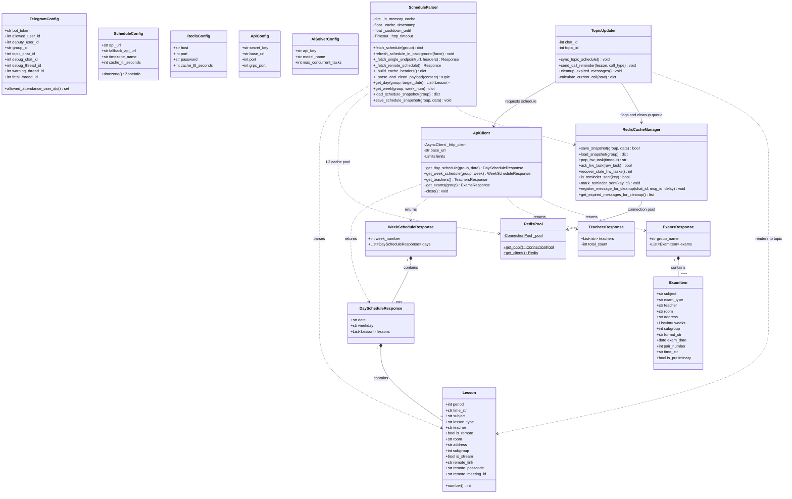

---

## 3. End-to-End Flow: Schedule Query & L2 Caching

Pipeline describing data movement when students or background services request group schedules, guaranteeing cold starts under `<2ms`.

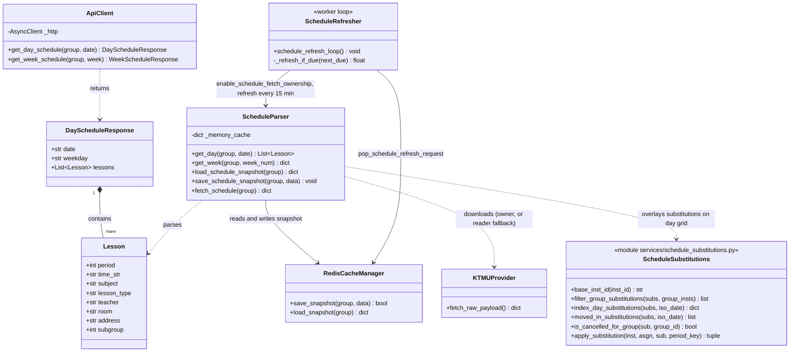

### 3.1. Background Refresh: Single Fetch Owner & Snapshot Readers

The KTMU API returns ~57 MB without gzip/ETag (~10 s per download), so only `para-worker` downloads it. `para-api` (and every gRPC/REST read) serves the Redis snapshot instantly and re-reads it only when `schedule:snapshot:meta.version` changes. `force_refresh` (bot «🔄 Обновить», admin sync) never blocks: it sets `schedule:refresh_requested`, which the worker picks up within 5 s.

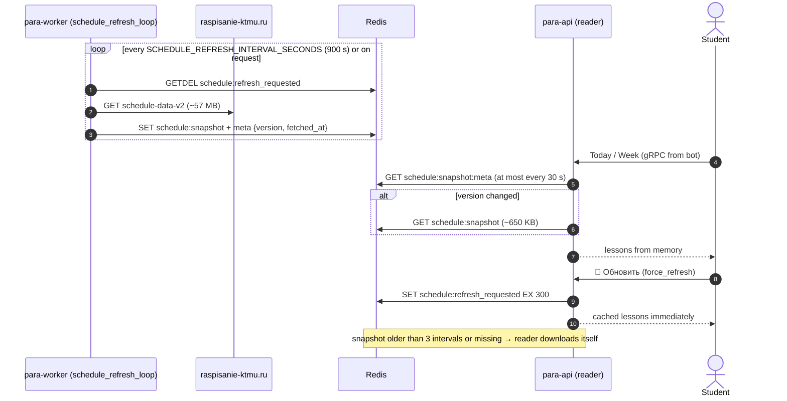

### Execution Flow & Data Lifecycle

1. **L2 Snapshot Verification**: When `get_day_schedule` is invoked, the parser immediately queries Redis key `sched:group:snapshot`. If the snapshot exists and is valid, structured timetable data is returned in `<2ms` without outbound networking.
2. **Cold Start & Upstream Ingestion**: On cache misses or stale intervals, the parser requests the raw ~50 MB timetable payload from KTMU servers with a 60-second read timeout. Deserialization and group filtering are offloaded to `asyncio.to_thread` to prevent freezing the FastAPI event loop.
3. **Resilience & Cooldown**: In case of network timeouts or upstream outages (including HTTP 5xx/4xx responses like 503), a 5-minute cooldown (`_COOLDOWN_UNTIL`) prevents hammering the upstream server, seamlessly falling back to cached Redis snapshots.
4. **Atomic Persistence & Multi-Level L1/L2 Caching**:
   - The normalized JSON payload is persisted to Redis L2 with a TTL of 14,400 seconds (4 hours).
   - Ingress Telegram bot layer maintains an **L1 Redis Day Cache** (`sched:day_pack:{date}`) for 180 seconds, serving "Today" and "Tomorrow" button transitions instantly (`<2ms`) without internal API HTTP overhead.
   - User authorization filter `ClassmateAuthFilter` utilizes an **In-Memory MTime Cache** of `birthdays.json`, eliminating synchronous disk reads from the event loop during update polling.
   - Outbound personal reminders in `services/notifier.py` execute concurrently via `asyncio.gather` bounded by a 10-slot semaphore.

---

## 4. End-to-End Flow: Bell Notifications & Topic Auto-Cleanup

Execution cycle governing bell reminders, deduplication guards, and message lifecycles inside Telegram forum topics.


### Notification & Auto-Cleanup Logic

1. **Idempotent Bell Alerts**: Every 60 seconds, the worker inspects lesson intervals for the current day. If exactly 10 minutes remain before lesson start/end, it checks `rem:sent:{group}:{date}:{period}:{type}`. If unset, it sets the flag with a 2-hour TTL and posts the alert to the chat.
2. **Expiration Scheduling**: Immediately after sending, the Telegram `message_id` is registered in Redis Sorted Set `topic:cleanup_messages` with a score equal to `timestamp + 900` (15 minutes).
3. **Automated Message Purging**: Each minute, the daemon calls `ZRANGEBYSCORE topic:cleanup_messages -inf {now}`, removes expired messages via Telegram `deleteMessage`, and deletes the entries via `ZREM`.

---

## 5. End-to-End Flow: Reliable AI Homework Solver Queue

Implementation of the **Reliable Queue** pattern guaranteeing **At-Least-Once** task execution via atomic list transitions.

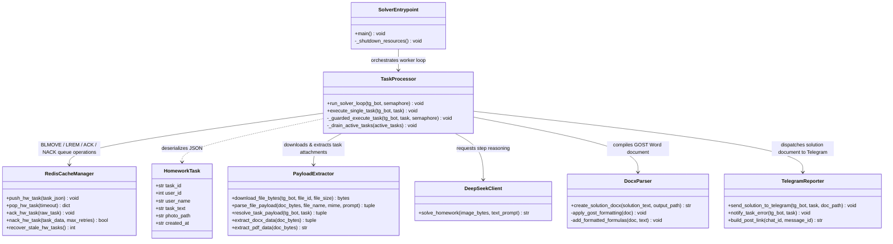

### Reliable Task Processing

1. **Atomic Ingestion (`BLMOVE`)**: The consumer extracts tasks from `hw:tasks:queue` and simultaneously moves them to `hw:tasks:processing`. If the container crashes mid-computation, the task remains preserved in `processing`.
2. **Daemon Crash Recovery**: On startup, `recover_stale_hw_tasks` safely relocates any orphaned tasks from `processing` back to `queue` via atomic `RPOPLPUSH`.
3. **Fault-Tolerant Retries & DLQ**: When a task encounters unrecoverable errors or parsing timeouts, `nack_hw_task` retries up to 3 times before shunting the poisoned task into Dead Letter Queue `hw:tasks:dlq`, alerting admins and keeping the main queue unblocked.
4. **GOST Academic Formatting**: Solved Markdown formulas are translated into Microsoft Word `.docx` documents adhering strictly to Russian academic GOST formatting (Times New Roman 14pt, 1.5 line spacing, 30-15-20-20 mm margins). The task is acknowledged via `LREM` only after document delivery.

---

## 6. End-to-End Flow: Electronic Attendance Registry (WOPI)

Data flow bridging the group administrator, Telegram Bot, FastAPI backend, and Yandex Documents cloud office via the WOPI standard.

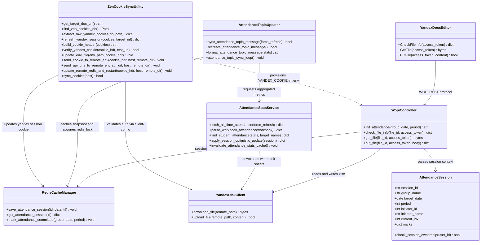


### WOPI Session Lifecycle & All-Time Registry

1. **Session Provisioning**: When the admin clicks "Mark Attendance", the bot issues a secure access token and creates a session in Redis `att:session:{id}` with a 1-hour TTL.
2. **Cloud Office Interaction**: Yandex Documents connects to the backend:
   - `CheckFileInfo`: verifies write permissions, user identity, and spreadsheet metadata;
   - `GetFile`: streams the binary `.xlsx` spreadsheet loaded from Yandex Disk;
   - `PutFile`: receives and updates the modified spreadsheet directly back to Yandex Disk storage.
3. **Instant Optimistic UI & Non-Blocking Commit**: Upon completing attendance input in the Telegram UI, `apply_session_optimistic_update` immediately adjusts student metrics in Redis and updates the Telegram Topic message within ~1s. An asynchronous task (`_async_commit_and_update`) persists records to the Yandex Table, followed by a delayed 15s settling pass.
4. **All-Time Multi-Month Tally**: `AttendanceStatsService` scans all historical monthly sheets (`СЕНТ`, `ОКТ`, `НОЯБ`, `ДЕК`...), aggregates cumulative counts (`П`, `О`, `У`, `Н`) for each student, and stores the structured result in Redis (`att:stats:all_time`) with a 1-hour TTL. Excused absences (`У`) are considered legitimate and do not lower the academic percentage.
5. **Academic Leagues Dashboard (Thread ID 7025)**: `AttendanceTopicUpdater` maintains an idempotent pinned message in the dedicated Telegram Topic containing the full group ranking divided into 3 Academic Leagues (Gold 90-100%, Silver 60-89%, Risk Zone <60%), clean single-line rows without line-wrapping, and progress bars. Late arrivals are formatted as `N оп` to eliminate optical confusion with the number 10. Background sync adapts between 3 min (daytime 08-19) and 15 min (night).
6. **Student Self-Service (`/my_attendance`)**: Students can check their private cumulative record and percentage of attendance in PM without group disclosure.
7. **Headman Concurrency Isolation**: `create_attendance_session` checks the active session in `att:active_session`. If an uncommitted survey is held by another administrator, creation is rejected (`PermissionError`). All interactive inline callbacks enforce `check_session_ownership(session, cb.from_user.id)` to prevent dual-headman split-brain marking.
8. **Morning Birthday Dispatch & Dynamic Semester Alignment**: Birthday congratulations are restricted to daylight hours (`is_morning_congrats_time`, >= 07:00 MSK). `ExamTopicUpdater` automatically resolves `semesterStart` from the live KTMU timetable payload, supporting dynamic academic calendars without hardcoded date limits.

---

## 7. Data Models & Redis Storage Structure

### Entity Relationship Diagram (ERD)

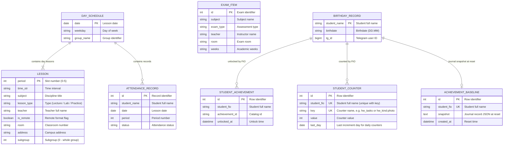

---

### Redis Key Registry & Storage Lifecycle

Comprehensive registry of all Redis keys, data structures, expiration policies, and lifecycle producers/consumers:

| Key / Key Pattern | Data Structure | TTL | Source / Producer | Consumer / Purpose |
| :--- | :--- | :--- | :--- | :--- |
| `sched:group:snapshot` | String (JSON) | 4 hours | KTMU Server (post-normalization) | Schedule API: serves group schedule in `<2ms` without raw file parsing |
| `hw:tasks:queue` | List (FIFO) | Indefinite | Telegram Bot (students) | Homework Solver: inbound queue of homework tasks |
| `hw:tasks:processing` | List | Indefinite | `hw:tasks:queue` (via `BLMOVE`) | Homework Solver: in-flight task isolation. Purged via `LREM` upon delivery |
| `topic:cleanup_messages` | Sorted Set (ZSET) | Dynamic | Topic Service on alert dispatch | Topic Service: scheduled message collector purged every 60s past 15 min |
| `rem:sent:{group}:{date}:{period}:{type}` | String (flag) | 2 hours | Topic Service before alert dispatch | Bell alert deduplication guard preventing repeats across worker restarts |
| `att:session:{session_id}` | String (JSON) | 1 hour | Backend on headman action | Yandex Documents: ephemeral token validation following WOPI standard |
| `att:committed:{group}:{date}:{period}` | String (flag) | 24 hours | WOPI controller on save | Bot & Worker: confirmation flag that attendance was marked for the lesson |
| `topic:schedule_msg_id:{group}` | String (int) | Indefinite | Bot on initial timetable post | Topic Service: pinned main schedule message ID updated in-place |
| `api:testers:whitelist` | Set (Strings) | Indefinite | Bot / Admin (`/add_tester`) | MiniApp Auth Router: O(1) membership check for authorized Swagger UI testers |

---

## 8. User Interaction Flows & Per-Button Architecture Diagrams

This section specifies the component architecture, data flow contracts, and execution mechanics for every Telegram user action (commands, inline button clicks, background queues, and administrative tools). All diagrams strictly follow the UML Class/Component structure established in Sections 1–3 (`direction TB`), detailing ingress controllers, middleware guards, Redis storage structures, domain DTOs, and upstream integrations. All interface text and technical descriptors are standardized in English, preserving exact Russian button labels (`Button Сегодня`, `Button Завтра`, etc.) for direct mapping to the Telegram user interface.

---

### 8.1 Command /start & Classmate Onboarding Flow

Architecture governing student onboarding, identity verification via group records, session registration, and initial timetable hydration.


#### Execution Flow & Under-the-Hood Lifecycle

1. **Authentication Guard**: Ingress updates for `/start` pass through `ClassmateAuthFilter`. The filter cross-checks `user_id` against `data/birthdays.json` using an in-memory mtime cache and validates against `ADMIN_IDS`. Unregistered users receive an immediate polite denial message (`⛔ Access Denied: 1-КПД-3 only`).
2. **Activity Registration**: Verified users are added to the Redis Set `bot:registered_users` via `UserCacheManager`, updating profile metadata without blocking disk writes.
3. **L1 Timetable Hydration**: `ScheduleApiService` queries Redis for `sched:day_pack:{today}`. If present, the payload is retrieved in `<2ms`. If absent, the normalized snapshot is parsed and cached with a 7200s TTL.
4. **Interactive UI Assembly**: `ScheduleKeyboardBuilder` constructs the default inline markup containing buttons `Сегодня`, `Завтра`, `Неделя (След.)`, `Обновить`, and `Напоминания`, delivering a frictionless greeting interface.

---

### 8.2 Button «📅 Сегодня» (sched:today) Ingress Flow

Component architecture handling user requests for the current day's timetable with anti-flood debouncing and in-place DOM updates.

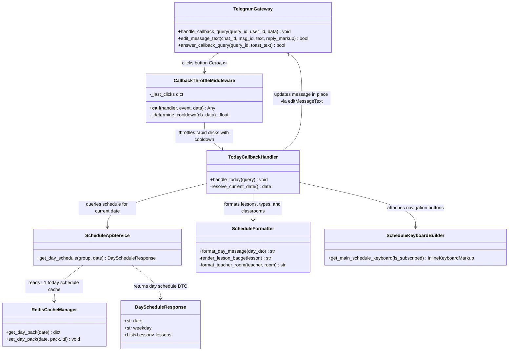

#### Execution Flow & Under-the-Hood Lifecycle

1. **Click Debounce & Throttling**: `CallbackThrottleMiddleware` intercepts rapid clicks on Button `📅 Сегодня`. Rapid successive taps (`<0.5s`) trigger an ephemeral alert toast (`⏳ Please wait a moment...`) to protect Telegram rate limits.
2. **Sub-millisecond L1 Retrieval**: `TodayCallbackHandler` reads the pre-computed JSON structure from Redis key `sched:day_pack:{today}`. No outbound HTTP or disk parsing occurs on cache hits.
3. **Visual Formatting**: `ScheduleFormatter` builds the Markdown representation, calculating period badges (e.g., lecture, practice, lab), instructor names, and room numbers.
4. **Zero-Flicker In-Place Edit**: Telegram `editMessageText` replaces the message text without sending a new chat notification, preserving message scroll position.

---

### 8.3 Button «📆 Завтра» (sched:tomorrow) Ingress Flow

Architecture for resolving next-day schedule queries, handling weekend shifts, and injecting remote video conference links.


#### Execution Flow & Under-the-Hood Lifecycle

1. **Timezone Normalization**: `AcademicDateResolver` computes tomorrow's date anchored to `Europe/Moscow`, regardless of host server timezone.
2. **Weekend & Holiday Detection**: If tomorrow is Sunday or a scheduled holiday, `format_weekend_placeholder` renders an aesthetic rest card without invoking college parsers.
3. **L1 Cache Retrieval**: Timetable data is resolved via `sched:day_pack:{tomorrow}` (TTL 2 hours).
4. **Dynamic VCS Linking**: If any lessons are flagged `is_remote=True`, `ScheduleKeyboardBuilder` dynamically includes direct conference join buttons.

---

### 8.4 Buttons «⏭ Неделя (След.)» & «⏮ Неделя (Тек.)» Flow

Architecture governing multi-day schedule compilation, academic week parity resolution, and bidirectional navigation toggling.

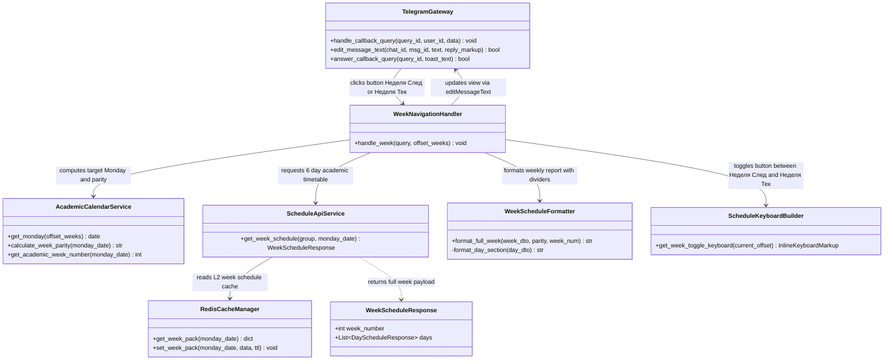

#### Execution Flow & Under-the-Hood Lifecycle

1. **Calendar Parity Calculation**: `AcademicCalendarService` calculates the Monday date for offset `+0` (current) or `+1` (next) and resolves academic week parity (Numerator/Denominator).
2. **L2 Snapshot Query**: `ScheduleApiService` checks Redis key `sched:week:{monday}` (TTL 14,400s). On hit, all 6 academic days are returned immediately.
3. **Aggregated Rendering**: `WeekScheduleFormatter` compiles all daily schedules into a compact, structured Markdown view separated by clean day headers.
4. **Smart Button Toggling**: The keyboard dynamically adjusts its callback action: when viewing the next week, the button switches to `⏮ Неделя (Тек.)` to allow seamless return.

---

### 8.5 Button «🔄 Обновить» (sched:refresh) Force Sync Flow

Architecture orchestrating cache eviction, upstream college synchronization, singleflight protection, and fallback resilience.

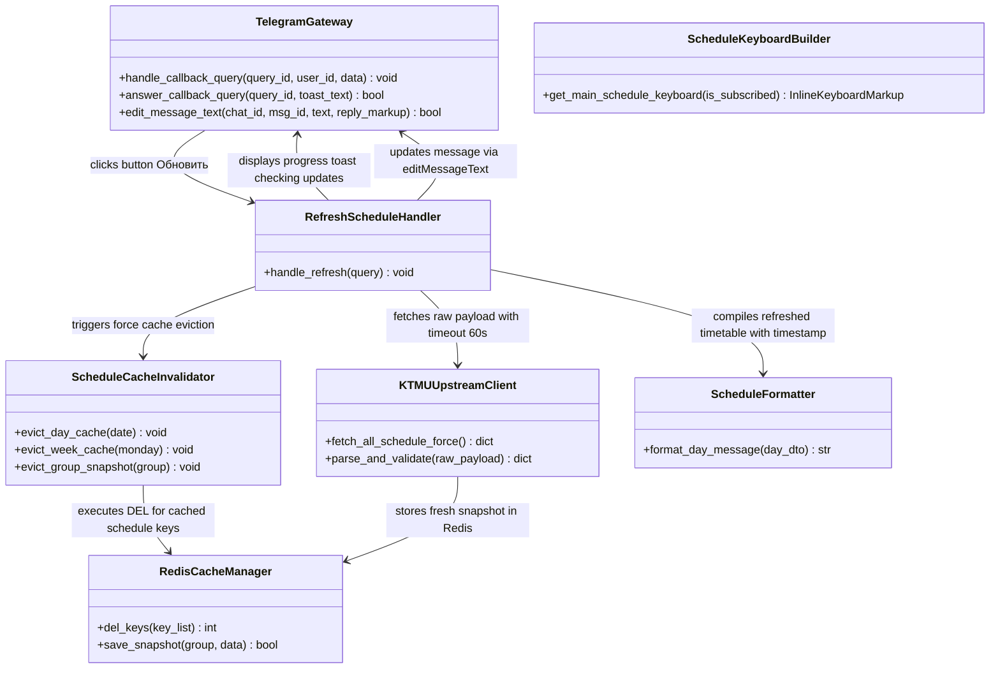

#### Execution Flow & Under-the-Hood Lifecycle

1. **User Toast Feedback**: An immediate Telegram `answerCallbackQuery` toast confirms that a live sync is underway (`🔄 Checking KTMU server updates...`).
2. **Targeted Cache Invalidation**: `ScheduleCacheInvalidator` evicts keys matching `sched:day_pack:*` and `sched:week:*` from Redis.
3. **Upstream Ingestion**: `KTMUUpstreamClient` issues an asynchronous HTTP request with a 60-second read timeout. Parsing is executed off-thread (`asyncio.to_thread`).
4. **Fallback Resilience**: If upstream is unreachable (HTTP 5xx/4xx), the handler falls back gracefully to the previous Redis snapshot and alerts the user with a non-blocking toast warning.

---

### 8.6 Button «🔔/🔕 Напоминания» (sched:toggle_notify) Subscription Flow

Architecture handling bell notification toggling with dual persistence across volatile Redis sets and durable disk storage.

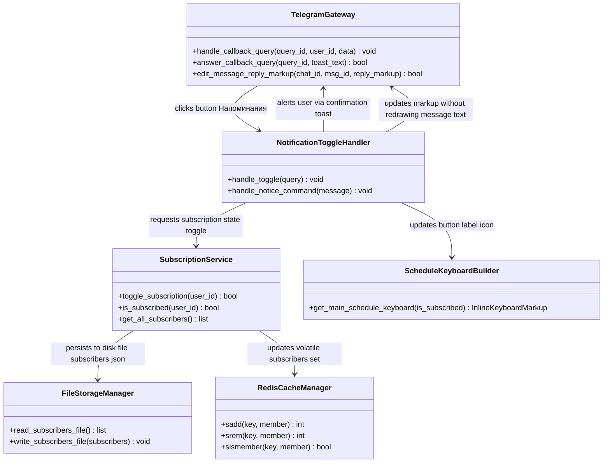

#### Execution Flow & Under-the-Hood Lifecycle

1. **Dual Persistence Model**: Subscriptions are toggled in `data/subscribers.json` (durable between container rebuilds) and mirrored to Redis Set `bot:subscribers` (for O(1) checks during automated alerts).
2. **Ephemeral Toast Response**: Telegram `answerCallbackQuery` confirms the new status (`🔔 Reminders enabled: alerts 15 min before class` or `🔕 Reminders disabled`).
3. **Isolated Markup Patching**: By invoking `editMessageReplyMarkup` instead of `editMessageText`, the button icon toggles seamlessly (`🔔` ↔ `🔕`) without message reflow.

---

### 8.7 Command /my_attendance & Button «🔄 Обновить мои данные» Flow

Architecture for student self-service attendance metrics, ensuring private messaging protection, multi-month data aggregation, and excused absence handling.

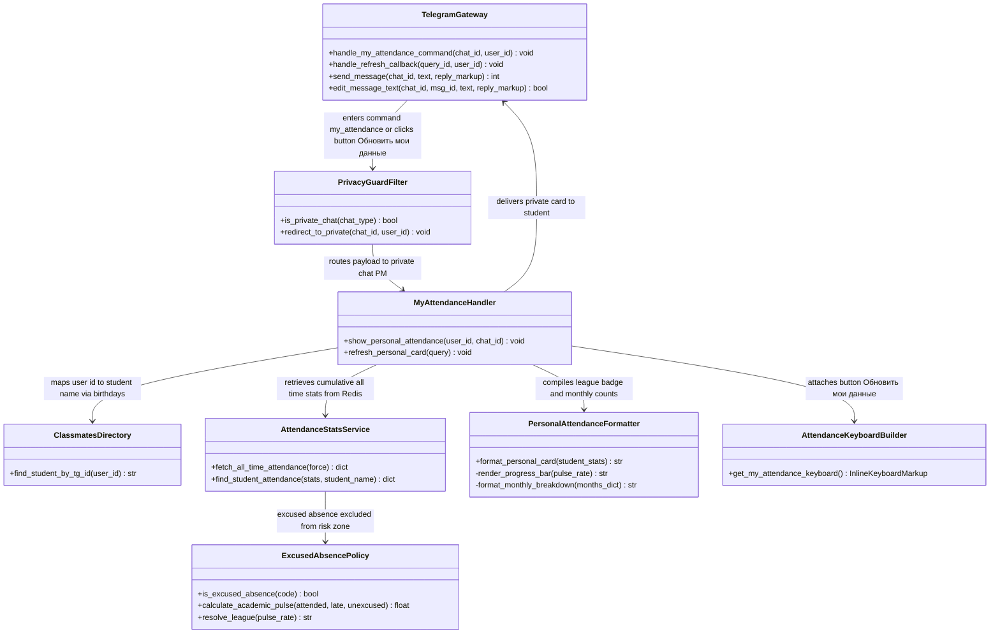

#### Execution Flow & Under-the-Hood Lifecycle

1. **Privacy Shield**: If triggered in the public group or topic, `PrivacyGuardFilter` sends a redirect alert in chat and dispatches the actual attendance statistics to the student's Private Messages (PM).
2. **Multi-Month Registry Aggregation**: `AttendanceStatsService` aggregates counts across all workbook sheets (`СЕНТ`, `ОКТ`, `НОЯБ`, `ДЕК`...) from Redis key `att:stats:all_time`.
3. **Excused Absences Business Rule**: Absences marked as `У` (Excused) are legitimate and do not lower the academic percentage or place the student into the Risk Zone.
4. **Personal Card Delivery**: The message renders the student's League (Gold, Silver, Risk), progress bar, total hours, and per-month breakdown, with a refresh button: `Button "🔄 Обновить мои данные"`.

---

### 8.8 Headman Attendance Flow: Command /attendance & Mark Buttons

Architecture governing the headman attendance marking survey, Redis session tracking, undo support, optimistic UI publishing, and cloud synchronization.

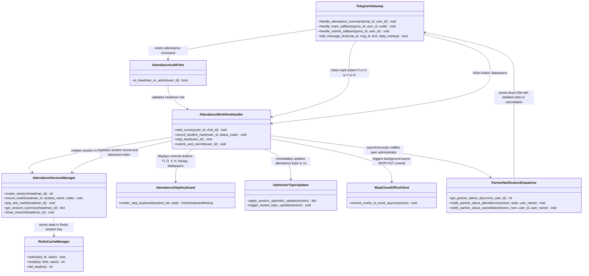

#### Execution Flow & Under-the-Hood Lifecycle

1. **Role Verification & Concurrency Control**: `AttendanceAuthFilter` validates headman status. Active survey sessions check `att:active_session` in Redis to prevent multiple headmen from conflicting.
2. **Interactive Survey State Machine**: Each student is presented sequentially with status buttons: `🟢 П` (Present), `🟡 О` (Late), `🔵 У` (Excused), `🔴 Н` (Unexcused), plus `⬅️ Назад` (Undo) and `💾 Завершить` (Submit).
3. **1-Second Optimistic Topic Update**: When the headman submits, `apply_session_optimistic_update` adjusts student statistics in Redis memory and refreshes the pinned Topic message within ~1 second.
4. **Asynchronous Cloud Commit**: `_async_commit_and_update` executes a background task to write records into the remote Excel workbook on Yandex Disk via WOPI without blocking the Telegram bot.
5. **Mutual Headman & Deputy Statistics Notification**: Upon completing the survey or cancelling a lesson, `notify_partner_about_attendance` asynchronously dispatches a comprehensive breakdown (present, late, excused, unexcused counts and names of absent students) directly to the peer administrator's direct messages.

---

### 8.9 Remote Lesson Direct Join Button «🔗 N-я пара» Flow

Component architecture for detecting online classes, mapping instructor credentials, and rendering direct conference launch buttons.

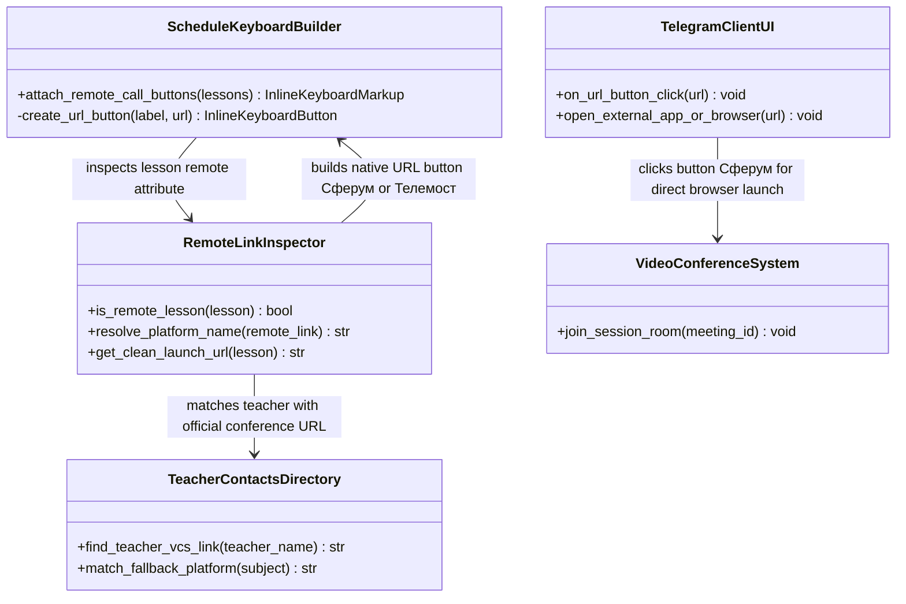

#### Execution Flow & Under-the-Hood Lifecycle

1. **Remote Attribute Parsing**: During timetable formatting, `RemoteLinkInspector` inspects `lesson.is_remote` and checks `lesson.remote_link`.
2. **Directory Matching**: If a link is missing from the raw timetable, `TeacherContactsDirectory` supplies the verified conference link (Sferum, VK Teams, Yandex Telemost, Kontur Talk).
3. **Native Inline URL Buttons**: Buttons are constructed as native Telegram `InlineKeyboardButton(text=..., url=...)`. Clicks execute directly on the student's device without incurring bot webhook latency.

---

### 8.10 AI Homework Solver Workflow in Topic 405 (DeepSeek & GOST .docx)

Component architecture for student homework submissions in dedicated Topic 405, reliable Redis queuing, multimodal reasoning, and academic formatting.

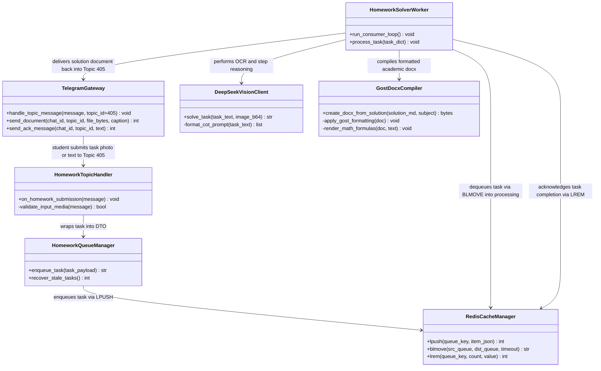

#### Execution Flow & Under-the-Hood Lifecycle

1. **Topic Ingress & Immediate ACK**: Tasks posted in Topic 405 are enqueued in Redis via `LPUSH hw:tasks:queue`. The bot immediately responds with an acknowledgement message.
2. **Atomic Ingestion (`BLMOVE`)**: The worker daemon safely transfers the task into `hw:tasks:processing`. If the container restarts mid-solve, orphaned tasks are automatically recovered.
3. **Multimodal LLM Reasoning**: `DeepSeekVisionClient` extracts handwritten and printed problem statements, generates step-by-step reasoning, and calculates final solutions.
4. **Academic Document Compilation**: `GostDocxCompiler` structures the solution into a Microsoft Word `.docx` file following Russian academic standards (Times New Roman 14pt, 1.5 line spacing, 30-15-20-20 mm margins). The file is sent directly to Topic 405, followed by queue acknowledgement via `LREM`.

---

### 8.11 Headman & Admin Control Panel /admin Flow

Architecture governing the administrative control center, role-based authorization, emergency broadcast tools, manual topic synchronization, and telemetry inspection.


#### Execution Flow & Under-the-Hood Lifecycle

1. **Role-Based Authorization (RBAC)**: `AdminAuthFilter` validates `user_id` against the immutable `ADMIN_IDS` configuration. Unauthorized access is blocked immediately.
2. **Control Dashboard Rendering**: The administrator is presented with 7 management controls: `📢 Экстренная рассылка`, `🔄 Форсировать обновление топика`, `📊 Системная статистика`, `📋 Экзамены`, `👥 База подписчиков`, and diagnostic tools.
3. **Emergency Schedule Push**: Clicking Button `📢 Экстренная рассылка` initiates an asynchronous broadcast of the day's timetable to all active subscribers via `services/notifier.py` with semaphore concurrency control.
4. **Forced Topic Rebuild**: Clicking Button `🔄 Форсировать обновление топика` triggers a full re-computation of the pinned Topic 7025 message directly from live sheets.
5. **System Telemetry**: Clicking Button `📊 Системная статистика` displays server metrics, active Redis connections, queue lengths, and memory footprint.

---

### 8.12 Unauthenticated Ingress & Fallback Flow (auth_fallback.py)

Architecture safeguarding the group assistant by isolating unauthorized direct messages, extracting caller identity safely, and displaying onboarding diagnostics.

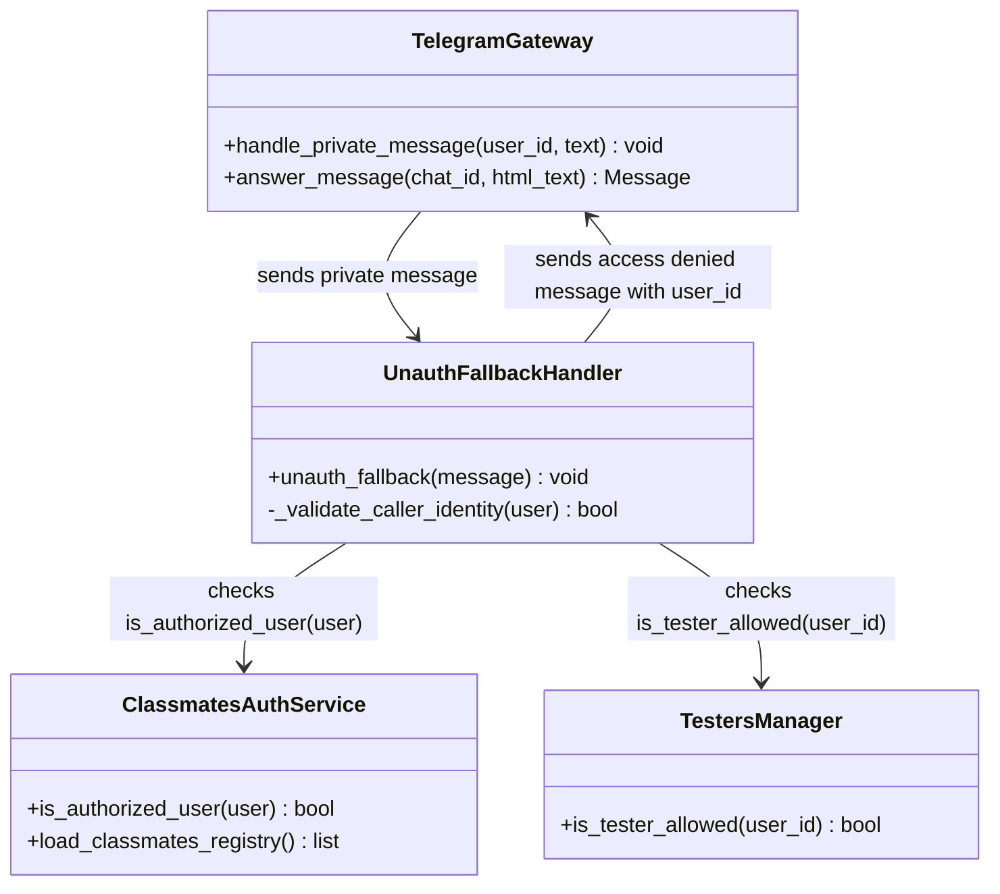

#### Execution Flow & Under-the-Hood Lifecycle

1. **Identity Extraction & Safe Guard**: The handler extracts `uid = user.id` before executing authorization filters and logging, preventing variable binding errors (`NameError`).
2. **Authorized User & Tester Bypass**: If the sender is an authorized classmate or an active API tester (`is_tester_allowed`), the handler silently passes without interruption.
3. **Diagnostic Access Denied Rendering**: For unauthorized strangers, the handler sends a structured HTML card containing the user's numeric `Telegram ID` (`<code>{uid}</code>`), instructing them to forward the ID to the headman for registry binding.

---

### 8.13 Global Exception Trapping & User-Facing Error Fallback (errors.py)

Architecture capturing unexpected exceptions across all router handlers, extinguishing perpetual spinner state on inline buttons, and delivering friendly diagnostics without revealing internal tracebacks.

```mermaid
classDiagram
    direction TB

    class TelegramDispatcher {
        +feed_update(update) void
        +handle_error(event) void
    }

    class GlobalErrorHandlerRouter {
        +global_error_handler(event) bool
        -_log_exception(error) void
        -_answer_stuck_callback(cb) void
        -_notify_user_message(msg) void
    }

    class ErrorEvent {
        +Update update
        +Exception exception
    }

    class TelegramCallbackQuery {
        +answer(text, show_alert) bool
    }

    class TelegramMessage {
        +answer(text) Message
    }

    TelegramDispatcher --> GlobalErrorHandlerRouter : captures unhandled exception
    GlobalErrorHandlerRouter ..> ErrorEvent : unwraps event and exception
    GlobalErrorHandlerRouter --> TelegramCallbackQuery : clears button spinner with show_alert modal
    GlobalErrorHandlerRouter --> TelegramMessage : replies with user-friendly transient error text
```

#### Execution Flow & Under-the-Hood Lifecycle

1. **Dispatcher Interception**: Whenever an unhandled exception bubbles up during handler execution, aiogram routes the context to `@router.error()`.
2. **Deterministic Logging**: The error is logged via `core.logger` (`error_handler`) with full diagnostic context without relying on blind traceback printing.
3. **Spinner Relief via Modal Alert**: If the failing update originated from an inline callback button, `cb.answer("⚠️ Временный сбой сервиса. Попробуйте снова.", show_alert=True)` is dispatched, immediately ending the UI loading freeze.
4. **Resilient Network Protection**: Fallback answers are wrapped in protected try/except blocks to guarantee zero unhandled cascade crashes even if Telegram API connection drops.

---

### 8.14 Scoped Interactive Telegram Command Menus (commands.py)

Architecture dynamically registering contextual command suggestions in Telegram client UI via `BotCommandScope`, distinguishing general student commands from privileged administrative operations.

```mermaid
classDiagram
    direction TB

    class BotCommandsRegistry {
        +get_default_user_commands() List~BotCommand~
        +get_admin_commands() List~BotCommand~
        +register_bot_commands(bot) void
    }

    class TelegramBotAPI {
        +set_my_commands(commands, scope) bool
    }

    class BotCommandScopeDefault {
        +String type = "default"
    }

    class BotCommandScopeChat {
        +String type = "chat"
        +int chat_id
    }

    class BotCommand {
        +String command
        +String description
    }

    BotCommandsRegistry --> TelegramBotAPI : registers scoped menu commands
    BotCommandsRegistry ..> BotCommandScopeDefault : applies start, today, notice, my_attendance, help
    BotCommandsRegistry ..> BotCommandScopeChat : applies admin, attendance, all, testers, swagger to headman
    BotCommandsRegistry ..> BotCommand : creates typed commands
```

#### Execution Flow & Under-the-Hood Lifecycle

1. **User Scope Segregation**: Standard students receive a minimalist, uncluttered menu (`/start`, `/today`, `/notice`, `/my_attendance`, `/help`) via `BotCommandScopeDefault`.
2. **Privileged Headman Scope**: Chat-scoped commands (`BotCommandScopeChat(chat_id=ALLOWED_USER_ID)`) expose admin workflows (`/admin`, `/attendance`, `/all`, `/testers`, `/swagger`).
3. **Graceful Startup Registration**: Invoked during `main()` bootstrap, non-blocking with error capture to prevent bot launch failure on Telegram rate-limits.

---

### 8.15 Distributed Redis FSM Storage & Resilient Fallback (core/bot.py)

Architecture replacing volatile memory storage with distributed Redis-backed Finite State Machine storage, enabling state preservation across process restarts, deployments, and multi-worker clusters.

```mermaid
classDiagram
    direction TB

    class CoreBotFactory {
        +create_bot_session() AiohttpSession
        +create_fsm_storage() BaseStorage
    }

    class RedisPoolManager {
        +get_redis_pool() ConnectionPool
    }

    class RedisStorage {
        +Redis redis
        +KeyBuilder key_builder
        +set_state(key, state) void
        +get_state(key) State
        +set_data(key, data) void
    }

    class MemoryStorage {
        +dict storage
    }

    class AiogramDispatcher {
        +BaseStorage storage
        +start_polling(bot) void
    }

    CoreBotFactory --> RedisPoolManager : acquires async redis connection pool
    CoreBotFactory --> RedisStorage : instantiates prefix='fsm' distributed storage
    CoreBotFactory ..> MemoryStorage : fallbacks on connection/import fault
    CoreBotFactory --> AiogramDispatcher : initializes dispatcher with resilient storage
```

#### Execution Flow & Under-the-Hood Lifecycle

1. **Connection Pooling**: Utilizes shared authenticated asynchronous connection pool `get_redis_pool()` (with mandatory `REDIS_PASSWORD`) to avoid connection exhaustion and enforce zero-trust access control.
2. **Namespaced Keys**: FSM keys are organized under prefix `fsm:` (`fsm:{chat_id}:{user_id}:state` / `data`), preventing key collision with timetable cache or attendance records.
3. **High-Availability Fallback**: If Redis service is unreachable or uninstalled during standalone test runs, `create_fsm_storage()` seamlessly falls back to `MemoryStorage`.
4. **Graceful Shutdown**: On process exit (`shutdown_bot`), `dp.storage.close()` is awaited to cleanly release active network descriptors and pool slots.

### 8.16 Voice & Video Note STT Transcription Flow (voice_transcribe.py)

Autonomous pipeline capturing voice notes (`voice`) and video round notes (`video_note`) across any forum topic in the target group chat or private DMs, executing high-precision speech-to-text recognition via GPU-accelerated `faster-whisper` (`large-v3-turbo`) with fallback to CPU.

```mermaid
sequenceDiagram
    autonumber
    actor User as Telegram User
    participant Bot as Aiogram Dispatcher
    participant Handler as voice_transcribe.py
    participant TG as Telegram Bot API
    participant Queue as Redis (stt:queue / stt:result:<job>)
    participant STT as para-stt (AudioTranscriber, faster-whisper)
    participant GPU as NVIDIA GTX 1660 Ti (CUDA)

    User->>Bot: Sends Voice / Video Note (in Topic or DM)
    Bot->>Handler: handle_voice_or_video_note(message)
    Handler->>Handler: is_allowed_chat(chat_id, type)
    Handler->>Handler: extract_audio_meta(message)
    Handler->>Handler: validate_audio_limits(duration<=300s, size<=20MB)
    Handler->>Handler: acquire_user_slot(user_id) [Flood control]
    Handler->>TG: message.reply("Расшифровываю...", message_thread_id)
    TG-->>User: Visual Status Indicator

    Handler->>Handler: process_audio_pipeline(...)
    Handler->>TG: bot.get_file(file_id) & bot.download_file(...) [timeout=25s]
    TG-->>Handler: Raw Audio (.ogg / .mp4) in shared tmpfs volume stt_audio

    Handler->>Queue: RPUSH stt:queue {job_id, path}
    STT->>Queue: BLPOP stt:queue (4 s loop)
    STT->>STT: acquire _gpu_semaphore, get_model() [warmed at stt startup]
    STT->>GPU: WhisperModel.transcribe(beam_size=1, no_speech_threshold=0.6, language="ru")
    GPU-->>STT: Segments: text, timestamps, language
    STT->>Queue: RPUSH stt:result:<job_id> {text | error} EX 600
    Handler->>Queue: BLPOP stt:result:<job_id> until TRANSCRIBE_TIMEOUT
    Queue-->>Handler: Normalized Full Text Transcript

    Handler->>Handler: split_text_to_chunks(text, max_chunk_len=4000)
    Handler->>TG: status_msg.edit_text(format_transcription_result(...)) [HTML safe]
    opt If text > 4000 characters
        Handler->>TG: message.reply(extra_chunk, message_thread_id) [HTML safe]
    end
    TG-->>User: Formatted HTML Quote with Duration & Speaker
    Handler->>Handler: cleanup_temp_file(temp_path) [tmpfs stt_audio]
    Handler->>Handler: release_user_slot(user_id)
```

#### Key Architecture & Resilience Principles
1. **Forum Thread Affinity**: Strictly preserves `message_thread_id=message.message_thread_id` across all responses, preventing transcription leakage into the General topic.
2. **GPU Concurrency Guard**: Bounded by `asyncio.Semaphore(1)` to serialize access to the NVIDIA GTX 1660 Ti, preventing CUDA VRAM OOM and CUDA execution contention.
3. **Anti-Hallucination Guardrails**: Utilizes `beam_size=1` (3x faster greedy decoding), `condition_on_previous_text=False`, `no_speech_threshold=0.6`, and explicit `language="ru"`, completely eliminating English hallucinations on screams, non-speech noise, or background music.
4. **Shared RAM-Disk Audio (`stt_audio` tmpfs volume)**: The bot downloads voice streams into a Docker tmpfs volume (`size=256m, uid=1000, mode=0700`) mounted into both `para-bot` and `para-stt`, eliminating SSD wear while keeping files invisible to other host users.
5. **Resilient Hardware Fallback**: Automatically degrades from `device="cuda"` (FP16) to a cached `_cpu_model` (INT8) if VRAM is temporarily exhausted or if execution fails at runtime.
6. **Zero Cold-Start Lag (Warmup)**: `para-stt` pre-loads `large-v3-turbo` into GPU memory at its own startup (`stt.py::_warmup_model`), so bot restarts and deploys never reload the model into VRAM.
7. **Isolated GPU Service**: `faster-whisper`, `nvidia-cublas-cu12` and `nvidia-cudnn-cu12` (`requirements-bot.txt`) live only in `stt.dockerfile`; the bot image dropped CUDA (~5.4 GB → ~0.5 GB), its GPU reservation and 4 GB memory limit. Bot and STT talk only through Redis (`services/stt_queue.py`).

---

## 9. Dual-Protocol gRPC & Telegram Mini App Swagger UI Architecture

The dual-protocol architecture combines a high-speed gRPC server (HTTP/2 binary Protobuf) for internal inter-service communication between `para-bot`, `para-worker`, `para-solver`, and `para-api`, alongside a FastAPI REST engine exposing interactive **Swagger UI** (`/docs`, `/openapi.json`) and a **Telegram Mini App** gateway with cryptographic HMAC-SHA256 verification and Redis whitelist access control.

```mermaid
classDiagram
    direction TB

    class GrpcServerManager {
        -_server aio_Server
        +create_grpc_server() aio_Server
        +start_grpc_server(server, host, port) void
        +stop_grpc_server(server, grace) void
    }

    class ScheduleServiceServicer {
        +GetDaySchedule(request, context) DayScheduleResponse
        +GetWeekSchedule(request, context) WeekScheduleResponse
        -_resolve_day(raw_date) date
        -_resolve_monday(raw_monday) date
    }

    class ExamsServiceServicer {
        +GetExams(request, context) ExamsResponse
    }

    class TeachersServiceServicer {
        +GetTeachers(request, context) TeachersResponse
    }

    class GrpcConverters {
        +lesson_to_proto(lesson) LessonProto
        +proto_to_lesson(proto) Lesson
        +week_days_to_proto(raw_days) list
        +exam_item_to_proto(exam) ExamItemProto
        +proto_to_exam_item(proto) ExamItem
        +teachers_dict_to_proto(raw) TeachersResponse
    }

    class ApiClientGrpc {
        -_CHANNEL aio_Channel
        -_CLIENT AsyncClient
        +_get_grpc_channel() aio_Channel
        +fetch_day_schedule(target_date, force_refresh) dict
        +fetch_week_schedule(monday, force_refresh) dict
        +fetch_exams(force_refresh) dict
        +fetch_teachers(force_refresh) dict
        +close_api_client() void
    }

    class MiniappRouter {
        +serve_miniapp_page() HTMLResponse
        +login_by_token(t, next_target) RedirectResponse
        +authenticate_miniapp(payload, response) MiniappAuthResponse
        +check_tester_status(session) MiniappCheckResponse
        +list_api_testers() TesterListResponse
        +api_add_tester(user_id) dict
        +api_remove_tester(user_id) dict
    }

    class MiniappAuthService {
        +validate_telegram_init_data(init_data) dict
        +generate_tester_session(user_id) str
        +verify_tester_session(token, max_age) int
        -_compute_init_data_hash(data_check_str) str
        -_is_auth_date_valid(auth_date_str) bool
    }

    class TestersManager {
        -_ADMIN_TESTERS set
        +add_tester(user_id) bool
        +remove_tester(user_id) bool
        +is_tester_allowed(user_id) bool
        +get_all_testers() list
    }

    class LoginTokensService {
        +LOGIN_REDIRECT_TARGETS dict
        +issue_login_token(user_id) str
        +consume_login_token(token) int
        +build_login_url(user_id, target) str
    }

    class AdminTestersHandler {
        +cmd_list_testers(message) void
        +cmd_add_tester(message) void
        +cmd_del_tester(message) void
        +cmd_open_swagger(message) void
        +cb_admin_testers(callback) void
        +process_tester_id_input(message, state) void
    }

    class ApiKeyAuthInterceptor {
        -_secret_key str
        +intercept_service(continuation, handler_call_details) Coroutine
    }

    GrpcServerManager --> ApiKeyAuthInterceptor : attaches interceptor
    GrpcServerManager --> ScheduleServiceServicer : registers servicer
    GrpcServerManager --> ExamsServiceServicer : registers servicer
    GrpcServerManager --> TeachersServiceServicer : registers servicer
    ApiKeyAuthInterceptor --> ScheduleServiceServicer : protects RPC endpoints
    ApiKeyAuthInterceptor --> ExamsServiceServicer : protects RPC endpoints
    ApiKeyAuthInterceptor --> TeachersServiceServicer : protects RPC endpoints
    ScheduleServiceServicer --> GrpcConverters : converts models
    ExamsServiceServicer --> GrpcConverters : converts models
    TeachersServiceServicer --> GrpcConverters : converts models
    ApiClientGrpc --> ApiKeyAuthInterceptor : sends metadata (x-api-key)
    ApiClientGrpc --> ScheduleServiceServicer : RPC HTTP/2 stream
    ApiClientGrpc --> ExamsServiceServicer : RPC HTTP/2 stream
    ApiClientGrpc --> TeachersServiceServicer : RPC HTTP/2 stream
    MiniappRouter --> MiniappAuthService : validates HMAC initData
    MiniappRouter --> TestersManager : checks tester whitelist in Redis
    AdminTestersHandler --> TestersManager : manages whitelist via Bot FSM
    AdminTestersHandler --> LoginTokensService : one-time Swagger links
    MiniappRouter --> LoginTokensService : GETDEL one-time token
```

---

### 9.1. gRPC Microservices Ingress & Protobuf Multiplexing Flow

Architecture governing high-performance binary RPC data exchange between microservices (`para-bot`, `para-worker`, `para-solver`) and `para-api` over HTTP/2 multiplexed streams with low-latency binary serialization and cryptographic API-key validation.

```mermaid
sequenceDiagram
    autonumber
    actor Caller as para-bot / para-worker
    participant Client as core/api_client.py
    participant Channel as grpc.aio.Channel (:50051)
    participant Auth as ApiKeyAuthInterceptor
    participant Servicer as ScheduleServiceServicer
    participant Parser as services/schedule_parser.py
    participant RedisStore as Redis L1/L2 Cache

    Caller->>Client: get_api_schedule_for_date(target_date)
    Client->>Channel: ScheduleServiceStub.GetDaySchedule(DayScheduleRequest, metadata=[(x-api-key, ...)])
    Channel->>Auth: intercept_service(continuation, handler_call_details)
    Auth->>Auth: secrets.compare_digest(request_key, API_SECRET_KEY)
    alt API Key Invalid / Missing
        Auth-->>Channel: grpc.StatusCode.UNAUTHENTICATED ("Invalid or missing API key")
        Channel-->>Client: grpc.RpcError (UNAUTHENTICATED)
        Client->>Client: Transparent REST fallback
    else Authenticated
        Auth->>Servicer: Ingest binary protobuf RPC frame
        Servicer->>Parser: get_schedule_for_date(day, force_refresh)
        Parser->>RedisStore: GET schedule:snapshot / L1 memory cache
        RedisStore-->>Parser: Return cached schedule / live parse
        Parser-->>Servicer: List[Lesson] domain models
        Servicer->>Servicer: lesson_to_proto() converter
        Servicer-->>Channel: DayScheduleResponse (binary frame)
        Channel-->>Client: Receive Protobuf response
        Client->>Client: proto_to_lesson() deserialization
        Client-->>Caller: List[Lesson] Pydantic models
    end
```

#### Execution Flow & Under-the-Hood Lifecycle

1. **Persistent Channel Multiplexing & Auth Metadata**: `ApiClientGrpc` maintains a persistent HTTP/2 connection channel (`grpc.aio.insecure_channel`) directed to `api:50051`. Each outbound RPC invocation includes secure `x-api-key` metadata retrieved from `config.py` (sourced from `.env`).
2. **Cryptographic Interceptor Validation**: `ApiKeyAuthInterceptor` extracts metadata headers and performs constant-time validation (`secrets.compare_digest`) against `API_SECRET_KEY`, rejecting unauthenticated cross-service traffic with `StatusCode.UNAUTHENTICATED`.
3. **Binary Frame Ingress**: Methods such as `get_api_schedule_for_date` construct typed `DayScheduleRequest` protobuf structures, achieving high compression and zero JSON parsing CPU overhead.
4. **Servicer Dispatch**: `ScheduleServiceServicer.GetDaySchedule` unpacks request parameters, delegates timetable resolution to `services/schedule_parser.py`, and inspects Redis L1/L2 snapshot caches.
5. **Data Mapping & Serialization**: Domain `Lesson` objects are mapped to Protobuf structures by `GrpcConverters.lesson_to_proto`, preserving subgroup partitioning, stream markers, and remote lecture identifiers.
6. **High Availability & HTTP Fallback**: If gRPC experiences communication disruption (`grpc.RpcError`), `ApiClientGrpc` intercepts the error and executes transparent fallback to legacy REST endpoints, ensuring zero downtime for end users.

---

### 9.2. Telegram Mini App Cryptographic Auth & Embedded Swagger UI Flow

Architecture governing cryptographic authentication via Telegram WebApp `initData`, session token minting, and embedding interactive OpenAPI Swagger UI within the Telegram client for authorized testers.

```mermaid
sequenceDiagram
    autonumber
    actor Tester as Tester (Telegram App)
    participant WebApp as Telegram Mini App (/miniapp)
    participant ApiRouter as api/router/miniapp.py
    participant AuthService as utils/miniapp_auth.py
    participant TestersMgr as services/testers_manager.py
    participant RedisStore as Redis (api:testers:whitelist)
    participant SwaggerUI as Swagger UI Bundle (/docs)
    participant ApiEndpoints as api/router/schedule.py

    Tester->>WebApp: Opens WebApp from Bot button
    WebApp->>WebApp: Reads window.Telegram.WebApp.initData
    WebApp->>ApiRouter: POST /miniapp/auth (init_data)
    ApiRouter->>AuthService: validate_telegram_init_data(init_data)
    AuthService->>AuthService: HMAC-SHA256(secret=WebAppData, BOT_TOKEN)
    AuthService->>AuthService: Verify hash equals computed_hash
    AuthService->>AuthService: Verify auth_date <= 86400s (Replay guard)
    AuthService-->>ApiRouter: Valid user data (id=12345, first_name=Alex)
    ApiRouter->>TestersMgr: is_tester_allowed(12345)
    TestersMgr->>RedisStore: SISMEMBER api:testers:whitelist 12345
    RedisStore-->>TestersMgr: 1 (Allowed)
    TestersMgr-->>ApiRouter: True (Authorized Tester)
    ApiRouter->>AuthService: generate_tester_session(12345)
    AuthService-->>ApiRouter: Signed token 12345:ts:hmac
    ApiRouter-->>WebApp: Set-Cookie para_session=token (HttpOnly, Secure)
    WebApp->>SwaggerUI: Mount Swagger UI with CleanSwaggerPlugin & relative gateway
    SwaggerUI->>ApiRouter: GET /openapi.json (para_session cookie authenticated)
    ApiRouter-->>SwaggerUI: 200 OK (OpenAPI 3.1 schema without server IP)
    SwaggerUI->>SwaggerUI: CleanSwaggerPlugin disables InfoUrl (no /openapi.json link)
    SwaggerUI-->>Tester: Render clean interactive API documentation (IP masked)
    Tester->>SwaggerUI: Click Try it out and Execute GET /schedule/day
    SwaggerUI->>SwaggerUI: requestInterceptor strips VPS host/IP -> relative URL
    SwaggerUI->>ApiEndpoints: GET /schedule/day (with para_session cookie)
    ApiEndpoints->>ApiRouter: verify_api_or_tester() validates cookie
    ApiEndpoints-->>SwaggerUI: 200 OK (lessons list)
    SwaggerUI-->>Tester: Display clean Curl & Request URL (no IP exposed)
```

#### Execution Flow & Under-the-Hood Lifecycle

1. **Telegram WebApp Initialization**: When a user clicks the Mini App button inside Telegram, the WebApp platform injects cryptographically signed `window.Telegram.WebApp.initData` containing user attributes, query timestamp, and signature hash.
2. **HMAC-SHA256 Cryptographic Verification**: The backend sorts parameters alphabetically to construct a deterministic `data_check_string`, computes `secret_key = HMAC-SHA256("WebAppData", BOT_TOKEN)`, and compares the derived digest against the provided `hash` using timing-attack safe comparison (`hmac.compare_digest`).
3. **Replay Attack Defense**: `MiniappAuthService` validates `auth_date` against `SESSION_MAX_AGE_SECONDS` (86400 seconds). Payloads older than 24 hours are rejected immediately with HTTP 401.
4. **RBAC Whitelist Enforcement**: `TestersManager.is_tester_allowed(user_id)` checks the Redis set `api:testers:whitelist` in O(1) time complexity. Unwhitelisted accounts are rejected with HTTP 403 Forbidden.
5. **Signed Session Token Minting**: `generate_tester_session(user_id)` constructs a tamper-proof session token format `<user_id>:<timestamp>:<signature>` and binds it to the browser via an HTTP-only secure cookie `para_session`.
6. **Embedded Swagger UI Execution & Host Sanitization**: The Mini App mounts Swagger UI Bundle pointing to `/openapi.json` with `CleanSwaggerPlugin` removing the `/openapi.json` header link, CSS hiding server selectors, and `requestInterceptor` stripping public VPS IP addresses and absolute hosts (`185-230-67-217.sslip.io`) to relative routes (`/schedule/day`). The `/openapi.json` endpoint itself is strictly guarded by `verify_api_or_tester()`, preventing unauthorized schema leakage.

---

### 9.3. Tester Whitelist Management & Personal API Key Flow

Administrative control flow for managing authorized testers in Redis, automatic personal API key generation (`para_test_<token_hex>`), and end-to-end request audit logging.

```mermaid
sequenceDiagram
    autonumber
    actor Admin as Headman / Admin
    participant Bot as para-bot
    participant Handler as bot/handlers/admin/testers.py
    participant TestersMgr as services/testers_manager.py
    participant RedisStore as Redis Cache
    actor Tester as External Tester (e.g. 8894263260)
    participant ApiServer as para-api (FastAPI)

    Admin->>Bot: /add_tester 8894263260
    Bot->>Handler: cmd_add_tester(message)
    Handler->>Handler: Validate numeric Telegram ID
    Handler->>TestersMgr: add_tester(8894263260)
    TestersMgr->>RedisStore: SADD api:testers:whitelist 8894263260
    TestersMgr->>TestersMgr: generate_or_get_tester_key(8894263260)
    TestersMgr->>RedisStore: SET api:uid_to_key:8894263260 para_test_xxx
    TestersMgr->>RedisStore: SET api:key_to_uid:para_test_xxx 8894263260
    TestersMgr-->>Handler: Return True & Generated Key
    Handler-->>Admin: Alert with tester ID & Personal API Key

    Tester->>Bot: /start or /swagger
    Bot->>Bot: Check is_tester_allowed(8894263260) == True
    Bot->>RedisStore: SET para:login_token:<t> 8894263260 EX 600
    Bot-->>Tester: Render Tester Cabinet with Key & one-time Swagger link

    Tester->>ApiServer: GET /miniapp/login?t=<t>&next=docs
    ApiServer->>RedisStore: GETDEL para:login_token:<t> -> 8894263260
    ApiServer-->>Tester: 303 -> /docs + Set-Cookie para_session

    Tester->>ApiServer: Request with Header X-API-Key or Bearer para_test_xxx
    ApiServer->>TestersMgr: get_tester_by_key(para_test_xxx)
    TestersMgr->>RedisStore: GET api:key_to_uid:para_test_xxx -> 8894263260
    ApiServer->>ApiServer: _log_audit_access("tester:8894263260", request)
    ApiServer-->>Tester: 200 OK Response
```

#### Execution Flow & Under-the-Hood Lifecycle

1. **Administrative Access Gate**: Only administrators present in `ADMIN_IDS` (headman and deputy) are permitted to manage API testing access. The headman control panel (`/testers` and `/swagger`) automatically displays the admin master key and generates 1-click links: `📱 Mini App` authenticates via Telegram `initData`, `🌐 Swagger UI` opens a one-time login link (`/miniapp/login?t=...`, TTL `LOGIN_TOKEN_TTL_SECONDS`, consumed atomically via `GETDEL`). API keys are never accepted from query parameters.
2. **Atomic Whitelist & Key Minting**: The `/add_tester <id>` command adds the user ID to `api:testers:whitelist` and generates an cryptographically secure 16-byte hex token prefixed with `API_TESTER_KEY_PREFIX`.
3. **Bidirectional O(1) Indexing**: Redis stores dual keys:
   - `{REDIS_TESTER_UID_TO_KEY_PREFIX}{uid}` -> `api_key`
   - `{REDIS_TESTER_KEY_TO_UID_PREFIX}{api_key}` -> `uid`
4. **Dual Authentication in MiniApp**: `POST /miniapp/auth` supports both Telegram `init_data` (HMAC-SHA256 signature) and `api_key` (Master Admin key or personal tester key). Successful validation issues a `para_session` cookie and activates `enableTesterUI()` with `⚡ Swagger` and `🔍 Jaeger` tabs.
5. **Security Audit Logging**: Every incoming request passing through `verify_api_or_tester()` resolves the caller to `tester:<uid>` or `master_admin` and writes an audit record to the structured log: `[AUDIT] {identity} -> {method} {path} (IP: {client_ip})`.
6. **Cabinet Access for Non-Students**: If an authorized tester is not a student in group 1-КПД-3, `cmd_start` does not reject them, but automatically displays their Tester Cabinet with Swagger UI and API key.

---

### 9.4. Full REST OpenAPI & Security Architecture (11 Subsystems & Schemas)

Comprehensive architecture diagram mapping the 11 integrated subsystem routers, typed Pydantic V2 request/response schemas, security dependencies, and data flow layers in `para-api`.

```mermaid
classDiagram
    direction TB

    class FastApiApplication {
        +title str = "para-api"
        +version str = "2.0.0"
        +openapi_schema dict
        +_register_routers(app) void
        +_custom_openapi_schema(app) dict
    }

    class ErrorDetail {
        +detail str
        +code Optional~str~
        +timestamp str
    }

    class ExceptionHandlers {
        +http_exception_handler(request, exc) JSONResponse
        +validation_exception_handler(request, exc) JSONResponse
        +unhandled_exception_handler(request, exc) JSONResponse
    }

    class SecurityDependencies {
        +verify_api_or_tester(key, bearer, cookie) str
        +verify_admin_access(auth_identity) str
        -_resolve_key_identity(key) str
        -_resolve_token_identity(token) str
        -_log_audit_access(identity, request) void
    }

    class ScheduleRouter {
        +GET /schedule/day
        +GET /schedule/today
        +GET /schedule/tomorrow
        +GET /schedule/week
        +GET /schedule/current
        +POST /schedule/refresh
    }

    class ExamsRouter {
        +GET /exams
        +GET /exams/upcoming
        +POST /exams/refresh
    }

    class TeachersRouter {
        +GET /teachers
        +GET /teachers/search
        +GET /teachers/:last_name
        +POST /teachers/custom
        +DELETE /teachers/custom/:last_name
        +POST /teachers/refresh
    }

    class AttendanceRouter {
        +GET /attendance/stats
        +GET /attendance/student/:fio
        +GET /attendance/session
        +POST /attendance/session/start
        +POST /attendance/session/mark
        +POST /attendance/session/batch_present
        +POST /attendance/session/commit
        +DELETE /attendance/session
    }

    class ClassmatesRouter {
        +GET /classmates
        +GET /classmates/:student_id
    }

    class BirthdaysRouter {
        +GET /birthdays
        +GET /birthdays/upcoming
        +GET /birthdays/today
    }

    class SolverRouter {
        +GET /solver/status
        +POST /solver/solve
        +GET /solver/task/:msg_id
        +POST /solver/queue/clear
    }

    class SubscribersRouter {
        +GET /subscribers
        +GET /subscribers/count
        +GET /subscribers/:chat_id
        +POST /subscribers/:chat_id
        +DELETE /subscribers/:chat_id
    }

    class SystemRouter {
        +GET /system/info
        +POST /system/cache/flush
    }

    class MiniappRouter {
        +GET /miniapp
        +GET /miniapp/login
        +POST /miniapp/auth
        +POST /miniapp/action
        +GET /miniapp/status
        +GET /miniapp/testers
        +POST /miniapp/testers/:uid
        +DELETE /miniapp/testers/:uid
    }

    class JaegerProxyRouter {
        +GET /jaeger
        +ANY /jaeger/{path}
    }

    class HealthRouter {
        +GET /health
    }

    class GamificationRouter {
        +GET /gamification/leaderboard auth
        +GET /gamification/profile auth
        +GET /gamification/achievements
        +GET /gamification/ranks
    }

    FastApiApplication --> SecurityDependencies : enforces OpenAPI SecuritySchemes
    FastApiApplication --> ScheduleRouter : mounts
    FastApiApplication --> ExamsRouter : mounts
    FastApiApplication --> TeachersRouter : mounts
    FastApiApplication --> AttendanceRouter : mounts
    FastApiApplication --> ClassmatesRouter : mounts
    FastApiApplication --> BirthdaysRouter : mounts
    FastApiApplication --> SolverRouter : mounts
    FastApiApplication --> SubscribersRouter : mounts
    FastApiApplication --> SystemRouter : mounts
    FastApiApplication --> MiniappRouter : mounts
    FastApiApplication --> JaegerProxyRouter : mounts
    FastApiApplication --> HealthRouter : mounts
    FastApiApplication --> GamificationRouter : mounts

    ScheduleRouter ..> SecurityDependencies : verify_api_or_tester
    ExamsRouter ..> SecurityDependencies : verify_api_or_tester
    TeachersRouter ..> SecurityDependencies : verify_api_or_tester
    AttendanceRouter ..> SecurityDependencies : verify_api_or_tester
    ClassmatesRouter ..> SecurityDependencies : verify_api_or_tester
    BirthdaysRouter ..> SecurityDependencies : verify_api_or_tester
    SolverRouter ..> SecurityDependencies : verify_api_or_tester
    SubscribersRouter ..> SecurityDependencies : verify_api_or_tester
    SystemRouter ..> SecurityDependencies : verify_api_or_tester
    MiniappRouter ..> SecurityDependencies : verify_api_or_tester
    JaegerProxyRouter ..> SecurityDependencies : verify_api_or_tester
    GamificationRouter ..> SecurityDependencies : verify_api_or_tester (leaderboard, profile)
    GamificationRouter ..> GamificationService : calculates XP, ranks & 80 achievements

```

---

### 9.6. Continuous Deployment: CI Gate & Server-Side Pull

GitHub never gets SSH access to the servers. After **all** CI jobs pass on `main`, the `deploy-gate` job moves branch `ci-passed` to that commit. The home server polls it and deploys itself; manual `scripts/deploy.sh` runs the same `deploy_remote.sh` under the same lock.

```mermaid
sequenceDiagram
    autonumber
    actor Dev as Developer
    participant GH as GitHub Actions (ci.yml)
    participant Timer as ut: para-autodeploy.timer (2 min)
    participant Deploy as scripts/deploy_remote.sh
    participant Compose as docker compose
    participant Bot as para-worker (deploy_notifier)

    Dev->>GH: git push main
    GH->>GH: 42 jobs (lint, types, security, tests, docker)
    GH->>GH: deploy-gate (only job with contents: write): git push HEAD:ci-passed
    Timer->>GH: git ls-remote refs/heads/ci-passed
    alt ci-passed not in HEAD
        Timer->>Deploy: DEPLOY_BRANCH=ci-passed (flock /run/lock/para-deploy.lock)
        Deploy->>Deploy: fetch ci-passed + main (timeouts)
        alt not in main, or any new commit unsigned by /etc/para/allowed_signers
            Deploy-->>Timer: fail (rev saved to /var/lib/para, no retries)
        end
        Deploy->>Deploy: ff-only merge
        Deploy->>Compose: rebuild if requirements/Dockerfile, up if compose.yml, else restart services whose mounts changed
        Deploy->>Compose: wait healthy, /health, restart counts, new ERROR lines
        Timer->>Bot: python -m services.deploy_notifier success|failure
        Bot-->>Dev: Telegram alert ✅ / 🚨
    end
```

### 9.5. Public HTTPS Edge Gateway & Reverse SSH Tunnel Architecture

Architecture diagram detailing the edge ingress topology: public mobile clients connect via HTTPS on port 8443 (443 is taken by Amnezia Xray) to the edge VPS gateway (ssh vpn) (`185-230-67-217.sslip.io:8443`), where Caddy terminates TLS via Let's Encrypt and forwards traffic over an encrypted reverse SSH tunnel directly into the local `para-api` backend container on `home`.

```mermaid
sequenceDiagram
    autonumber
    actor Client as Mobile Client (Telegram / Browser)
    participant Caddy as Caddy TLS Gateway (185.230.67.217:8443)
    participant VpsLocal as VPS Loopback (127.0.0.1:8080)
    participant SshTunnel as SSH Reverse Tunnel (para-vps-tunnel, user tunnel)
    participant HomeApi as para-api (home:8080)
    participant Redis as para-redis (home:6379)

    Client->>Caddy: HTTPS GET https://185-230-67-217.sslip.io:8443/miniapp
    Note over Caddy: TLS Termination (Let's Encrypt DV Cert, HTTP-01 on :80)<br/>Port 8443 (HTTP/2)
    Caddy->>VpsLocal: Proxy HTTP to 127.0.0.1:8080
    VpsLocal->>SshTunnel: Encrypted TCP channel
    SshTunnel->>HomeApi: Forward to 127.0.0.1:8080 (Docker bridge)
    HomeApi->>Redis: Session & Whitelist lookup
    Redis-->>HomeApi: Cache / State response
    HomeApi-->>SshTunnel: HTTP 200 OK
    SshTunnel-->>VpsLocal: Forward response
    VpsLocal-->>Caddy: Upstream response
    Caddy-->>Client: HTTPS 200 OK (Clean WebView render)
```


---

## 10. Performance Hardening & Security Audit Architecture

### 10.1. API Security Boundary & Privilege Escalation Prevention

Sequence diagram detailing the defense-in-depth protection added during the security audit:
1. `POST /teachers/custom` requires admin role verification (`verify_admin_access`), preventing testers from altering custom Zoom links.
2. `POST /solver/solve` enforces per-identity rate limiting (`_check_solver_rate_limit`) via Redis sliding window counters (5 req/min).
3. `POST /system/cache/flush` enforces strict prefix whitelisting (`_validate_flush_pattern`), rejecting broad flush attempts like `*` or critical namespaces.

```mermaid
sequenceDiagram
    autonumber
    actor Caller as Client (Tester / Admin / Attacker)
    participant ApiApp as FastAPI Ingress (para-api)
    participant AuthDep as Security Dependencies (deps.py)
    participant SecRule as Validation & Rate Limiter
    participant Redis as Redis Cache (para-redis)
    participant Handler as Business Logic Router

    alt Direct Solver API Rate Limiting
        Caller->>ApiApp: POST /solver/solve (DirectSolveRequest)
        ApiApp->>AuthDep: verify_api_or_tester()
        AuthDep-->>ApiApp: identity ("tester:12345" or "apikey")
        ApiApp->>SecRule: _check_solver_rate_limit(identity)
        SecRule->>Redis: INCR "ratelimit:solver:{identity}" & EXPIRE 60
        Redis-->>SecRule: current_count
        alt Count > 5 requests / min
            SecRule-->>ApiApp: raise HTTPException(429, Rate limit exceeded)
            ApiApp-->>Caller: HTTP 429 Too Many Requests
        else Allowed
            SecRule-->>ApiApp: OK
            ApiApp->>Handler: solve_direct_task()
            Handler-->>Caller: HTTP 200 TaskResult
        end
    else Custom Teacher Zoom Link Tampering Attempt
        Caller->>ApiApp: POST /teachers/custom (CustomTeacherRequest)
        ApiApp->>AuthDep: verify_admin_access()
        alt Caller is Tester (not Admin)
            AuthDep-->>ApiApp: raise HTTPException(403, Admin access required)
            ApiApp-->>Caller: HTTP 403 Forbidden
        else Caller is Root Admin
            AuthDep-->>ApiApp: OK
            ApiApp->>Handler: save_custom_teacher()
            Handler->>Redis: HSET "teachers:custom"
            Handler-->>Caller: HTTP 200 OK
        end
    else Cache Flush Pattern Boundary
        Caller->>ApiApp: POST /system/cache/flush?pattern=*
        ApiApp->>AuthDep: verify_api_key()
        AuthDep-->>ApiApp: OK
        ApiApp->>SecRule: _validate_flush_pattern("*")
        alt Pattern not in SAFE_FLUSH_PREFIXES
            SecRule-->>ApiApp: raise HTTPException(400, Flush pattern not allowed)
            ApiApp-->>Caller: HTTP 400 Bad Request
        else Pattern allowed (e.g. "sched:*")
            SecRule-->>ApiApp: OK
            ApiApp->>Handler: flush_cache(pattern)
            Handler->>Redis: SCAN & DEL matching keys
            Handler-->>Caller: HTTP 200 {"deleted": count}
        end
    end
```

---

### 10.2. High-Performance Attendance Caching & Thread-Offloading Flow

Architecture flow showing the mitigation of WOPI network latency and Excel parsing Event Loop blocking:
- Student roster is cached in Redis (`att:cached_students`) for 24 hours, reducing headman session startup from 3–7 seconds to 10–20 ms.
- Synchronous CPU-intensive 12-sheet Excel parsing (`parse_workbook_attendance`) is offloaded via `asyncio.to_thread`, keeping the async event loop responsive.

```mermaid
sequenceDiagram
    autonumber
    actor Headman as Headman / Admin User
    participant Bot as Telegram Bot (para-bot)
    participant AttMgr as AttendanceManager
    participant Redis as Redis Cache (para-redis)
    participant Wopi as WOPI Client (Yandex Docs)
    participant StatsMgr as AttendanceStats
    participant WorkerThread as asyncio.to_thread (Threadpool)

    Headman->>Bot: /attendance (Start Marking)
    Bot->>AttMgr: fetch_target_students()
    AttMgr->>Redis: GET "att:cached_students"
    alt Cache Hit (Warm Roster)
        Redis-->>AttMgr: JSON student list (29 items)
        Note over AttMgr: Zero network roundtrips (~15ms latency)
    else Cache Miss (Cold / Expired)
        Redis-->>AttMgr: null
        AttMgr->>Wopi: Download raw XLSX & extract students
        Wopi-->>AttMgr: Excel bytes
        AttMgr->>Redis: SETEX "att:cached_students" 86400 (24h)
    end
    AttMgr-->>Bot: List[str] students
    Bot-->>Headman: Inline Keyboard (Student 1/29)

    Headman->>Bot: /my_attendance (Fetch Stats)
    Bot->>StatsMgr: get_all_students_stats()
    StatsMgr->>Wopi: Download current XLSX
    Wopi-->>StatsMgr: Excel raw bytes
    Note over StatsMgr,WorkerThread: CPU-bound 12-month sheets traversal
    StatsMgr->>WorkerThread: asyncio.to_thread(parse_workbook_attendance, wb)
    WorkerThread-->>StatsMgr: Parsed Attendance Matrix
    Note over StatsMgr: Main event loop remains unblocked
    StatsMgr-->>Bot: Formatted Student Stats
    Bot-->>Headman: Telegram Message with Attendance Summary
```

---

### 10.3. Concurrent AI Solver Worker Pipeline with Semaphore Control

Sequence diagram illustrating concurrent AI task processing in `solver.py` with `asyncio.Semaphore(MAX_CONCURRENT_TASKS)`:

```mermaid
sequenceDiagram
    autonumber
    actor Student as Student in Topic 405
    participant Queue as Redis Reliable Queue (hw:queue)
    participant SolverLoop as Solver Loop (solver.py)
    participant Sem as asyncio.Semaphore(limit=3)
    participant AiTask as Worker Coroutine
    participant DeepSeek as DeepSeek AI Provider
    participant DocxGen as GOST Docx Generator
    participant Bot as Telegram Bot Notification

    Student->>Queue: Enqueue Task (task_id, prompt, files)
    loop Main Ingestion Loop
        SolverLoop->>Queue: BLPOP "hw:queue" (timeout=2)
        Queue-->>SolverLoop: Task Payload
        SolverLoop->>Sem: acquire()
        SolverLoop->>AiTask: asyncio.create_task(_process_with_semaphore())
        Note over SolverLoop: Loop immediately continues to fetch next task
    end

    par Concurrent Task Execution (up to 3 parallel)
        AiTask->>DeepSeek: generate_solution(prompt, attachments)
        DeepSeek-->>AiTask: Formatted solution text
        AiTask->>DocxGen: create_gost_document(solution)
        DocxGen-->>AiTask: output.docx bytes
        AiTask->>Bot: send_document(topic=405, docx)
        AiTask->>Queue: HSET "hw:tasks:{id}" status="done"
        AiTask->>Sem: release()
    end
```

---

### 10.4. Multi-Tier High-Performance Architecture: L1 In-Memory, uvloop & gRPC Keepalive

Architecture flow illustrating the multi-tier performance optimization:
1. **L1 In-Memory Cache**: `_RESOLVED_DAY_CACHE` serves pre-constructed `Lesson` models in 10 microseconds without touching Redis or running regex parsers.
2. **Network Acceleration**: Uvicorn runs with `uvloop` (libuv C-bindings) and `httptools` (Nginx C-parser) for high concurrency.
3. **gRPC HTTP/2 Warm Keepalive**: Channels maintain active ping intervals (`GRPC_KEEPALIVE_TIME_MS`), eliminating cold socket renegotiations.
4. **Bandwidth Optimization**: `GZipMiddleware` automatically compresses payloads >1 KB for mobile Mini App clients.

```mermaid
sequenceDiagram
    autonumber
    actor Client as Ingress Client (Bot / Worker / Mini App)
    participant Uvicorn as Uvicorn (uvloop + httptools)
    participant Gzip as GZip Middleware (>1KB)
    participant GrpcClient as gRPC Stub (Keepalive: 10s)
    participant GrpcServer as grpc.aio.Server
    participant L1Cache as L1 In-Memory Cache (_RESOLVED_DAY_CACHE)
    participant L2Redis as L2 Redis Snapshot (schedule:snapshot)

    alt gRPC High-Speed Path
        Client->>GrpcClient: GetDaySchedule(date=2026-10-12)
        Note over GrpcClient,GrpcServer: HTTP/2 Persistent TCP Stream (Pre-warmed Keepalive)
        GrpcClient->>GrpcServer: Binary Protobuf Request (32 bytes)
        GrpcServer->>L1Cache: Check _RESOLVED_DAY_CACHE[date]
        alt L1 Cache Hit (Warm Memory)
            L1Cache-->>GrpcServer: Ready list[Lesson] (10 microseconds)
        else L1 Cache Miss
            GrpcServer->>L2Redis: Load group snapshot
            L2Redis-->>GrpcServer: JSON Snapshot
            GrpcServer->>L1Cache: Save compiled models
        end
        GrpcServer-->>GrpcClient: Binary Protobuf Response (1.3 KB, ~0.3 ms)
    else REST / Mini App HTTP/2 Path
        Client->>Uvicorn: GET /schedule/day?target_date=2026-10-12
        Note over Uvicorn: Handled by uvloop + httptools C-engine
        Uvicorn->>L1Cache: Lookup resolved lessons
        L1Cache-->>Uvicorn: list[Lesson]
        Uvicorn->>Gzip: Serialize directly to JSON bytes
        Gzip-->>Client: HTTP 200 OK (Gzip Compressed, <1 ms)
    end
```

---

### 10.5. Enterprise Observability & Prometheus Metrics Architecture

Comprehensive observability pipeline unifying distributed request tracing, contextual logging, and standardized Prometheus metrics:

```mermaid
sequenceDiagram
    autonumber
    actor Client as External Client / Mini App
    participant Middleware as Observability Middleware
    participant Logger as Core Logger (trace_id context)
    participant Router as API Endpoint Router
    participant Metrics as Prometheus Registry
    actor Scraper as Prometheus / VictoriaMetrics

    Client->>Middleware: HTTP GET /api/storage/... (X-Request-ID: optional)
    activate Middleware
    Middleware->>Middleware: Generate / Extract trace_id (X-Request-ID)
    Middleware->>Logger: set_trace_id(trace_id)
    Logger-->>Logger: Auto-inject [trace_id=...] in all subsequent log entries
    Middleware->>Router: Forward request to route handler
    activate Router
    Router->>Logger: log.info("Processing business logic...")
    Router-->>Middleware: HTTP Response (Status 200)
    deactivate Router
    Middleware->>Metrics: record_http_request(method, endpoint, 200, duration)
    Middleware-->>Client: HTTP 200 OK (Header: X-Request-ID: {trace_id})
    deactivate Middleware

    Scraper->>Router: GET /metrics
    activate Router
    Router->>Metrics: generate_metrics_payload()
    Metrics-->>Router: Prometheus text/plain exposition payload
    Router-->>Scraper: HTTP 200 OK (text/plain; version=0.0.4)
    deactivate Router
```

---

## 11. Automated CI/CD Pipeline & Delivery Verification

The automated GitHub Actions workflow (`.github/workflows/ci.yml`) enforces multi-tier quality gates on every push and pull request before code reaches the production server.

```mermaid
flowchart TD
    GitPush(["Git Push / PR (main)"]) --> Trigger["GitHub Actions Runner (ubuntu-latest)"]

    subgraph Stage1["1. Static Analysis & Security (Python 3.12)"]
        Ruff["Ruff Linter\n(UP, B, SIM, E, F, I)"]
        Bandit["Bandit AST Scanner\n(pyproject.toml config)"]
        PipAudit["Pip-Audit Scanner\n(PyPA Advisory Database)"]
        DetectSecrets["Detect-Secrets Gate\n(.secrets.baseline)"]
    end

    subgraph Stage2["2. Isolated Test Matrix (Strict AsyncIO)"]
        Py311["Pytest Suite\n(Python 3.11 Runtime)"]
        Py312["Pytest Suite + Coverage\n(Python 3.12 + XML Artifact)"]
        EnvCI["Mock Env Loader\n(.env.ci -> .env)"]
    end

    subgraph Stage3["3. Container Delivery & Security Gate"]
        DockerBuild["Docker Compose Build Matrix\n(appuser UID 1000)"]
        SrvApi["para-api:latest\n(Non-Root appuser)"]
        SrvBot["para-bot:latest\n(Non-Root appuser)"]
        SrvWorker["para-worker:latest\n(Non-Root appuser)"]
        SrvSolver["para-solver:latest\n(Non-Root appuser)"]
        TrivyScan["Trivy Vulnerability Scanner\n(OS & Library CVE Audit)"]
    end

    Trigger --> Stage1
    Trigger --> Stage2
    Stage1 --> Stage3
    Stage2 --> Stage3

    EnvCI --> Py311
    EnvCI --> Py312

    DockerBuild --> SrvApi
    DockerBuild --> SrvBot
    DockerBuild --> SrvWorker
    DockerBuild --> SrvSolver
    SrvApi --> TrivyScan

    TrivyScan --> Success(["✅ Deployment Verified (Production Ready)"])
```

---

## 12. Resilient Fallback Upstream & Clean Micro-Functions Architecture

### 12.1. Dual-Endpoint Schedule Upstream Failover (TLS Alert Mitigation)

When the primary college schedule endpoint (`raspisanie-ktmu.ru`, formerly `timetable-ktmu.ru` until 2026-10-30) experiences TLS handshake failures (`[SSL: TLSV1_ALERT_INTERNAL_ERROR]`), the system dynamically switches to the configured `SCHEDULE_FALLBACK_API_URL` (`DEFAULT_FALLBACK_SCHEDULE_API_URL`), preserving cold-start capability and ensuring uninterrupted service.

```mermaid
sequenceDiagram
    autonumber
    actor Caller as Worker / API Client
    participant Engine as ScheduleParser Engine
    participant Redis as Redis L2 State Cache
    participant Primary as Primary Endpoint (raspisanie-ktmu.ru)
    participant Fallback as Fallback Endpoint (twc1.net)

    Caller->>Engine: fetch_schedule_data(force=True)
    activate Engine
    Engine->>Primary: GET /api/storage/schedule-data-v2
    alt Primary TLS Handshake Failure (internal_error 1016)
        Primary-->>Engine: [SSL: TLSV1_ALERT_INTERNAL_ERROR]
        Engine->>Engine: Log WARNING & record failure cooldown
        Engine->>Fallback: GET fallback schedule endpoint
        Fallback-->>Engine: HTTP 200 OK (Schedule JSON payload)
        Engine->>Redis: SET sched:raw_cache (TTL=1800s)
        Engine-->>Caller: Clean Parsed Group Schedule
    else Primary Success
        Primary-->>Engine: HTTP 200 OK (Schedule JSON payload)
        Engine->>Redis: SET sched:raw_cache (TTL=1800s)
        Engine-->>Caller: Clean Parsed Group Schedule
    end
    deactivate Engine
```

### 12.2. Decomposed Single-Responsibility Micro-Functions Architecture

All system functions and bot handlers are refactored into focused units of $\le 25$ lines, adhering to PEP 8 vertical spacing, structured guard clauses, and three-part docstrings:

```mermaid
classDiagram
    direction TB

    class BotHandlerIngress {
        <<Router Handler <= 25 Lines>>
        +handle_entrypoint(message, bot) None
        -_ensure_prerequisites(message) bool
        -_dispatch_processing(message, task_id) None
    }

    class GuardClauseSubsystem {
        <<Validation & Safety <= 25 Lines>>
        +validate_input_limits(meta) str
        +check_rate_limit(user_id) bool
        +acquire_user_slot(user_id) bool
        +release_user_slot(user_id) None
    }

    class ExecutionSubsystem {
        <<Core Business Logic <= 25 Lines>>
        +execute_atomic_operation(payload) Result
        +safe_edit_or_reply(event, markup) None
        +drain_active_tasks(task_set) None
    }

    BotHandlerIngress --> GuardClauseSubsystem: 1. Validate & Throttle
    BotHandlerIngress --> ExecutionSubsystem: 2. Isolated Atomic Work
```

### 12.3. Typed Fail-Fast System Configuration & Zero-Hardcode Architecture

All configuration variables, campus locations, upstream endpoints, and timeouts are loaded strictly through typed fail-fast validation accessors without unvalidated hardcoded strings:

```mermaid
classDiagram
    direction TB

    class ConfigValidator {
        +get_required_env(key) str
        +get_env(key, default) str
        +get_env_int(key, default) int
        +get_env_float(key, default) float
        +get_env_list(key, default) tuple
    }

    class EnvironmentStore {
        <<.env / Host OS Environment>>
        +DEFAULT_FALLBACK_SCHEDULE_API_URL str
        +SCHEDULE_FALLBACK_API_URL str
        +CAMPUS_ADDRESS_VOZNESENSKY str
        +CAMPUS_ADDRESS_TSVETOCHNAYA str
        +CAMPUS_ADDRESS_REMOTE str
    }

    class TypedConfigDomain {
        <<12 Clean Architectural Sections>>
        +1. Telegram Bot & Access
        +2. Forum Topics & Threads
        +3. Schedule & Upstream Failover
        +4. Campus Addresses & Locations
        +5. Redis Caching & State
        +6. Yandex & Attendance
        +7. Dual-Protocol API Gateway
        +8. DeepSeek AI Solver
        +9. Whisper Voice STT
        +10. Timers & Throttling
        +11. Data File Paths
        +12. Regexes & Dictionaries
    }

    EnvironmentStore --> ConfigValidator: 1. Raw Environment String Ingress
    ConfigValidator --> TypedConfigDomain: 2. Typed & Fail-Fast Validated Ingress
```

---

## 13. Hardened Security Governance & Secrets Lifecycle Management

To comply with enterprise security auditing, secret leakage prevention, and zero-trust policies, the system integrates pre-commit baseline auditing, dynamic secret rotation protocols, and strict token lifecycle management:

```mermaid
sequenceDiagram
    autonumber
    actor Dev as Developer / CI Pipeline
    participant PC as Pre-Commit Framework
    participant DS as Detect-Secrets Scanner
    participant PA as Pip-Audit PyPA Engine
    participant SecPol as SECURITY.md Governance
    participant Redis as Redis Auth & Session Store

    Dev->>PC: git commit (Trigger Pre-Commit Hooks)
    activate PC
    PC->>DS: Scan diff against .secrets.baseline
    alt Secret Detected (High Entropy / Keyword)
        DS-->>PC: Fail commit (Zero-Secrets Policy)
        PC-->>Dev: ❌ Commit Blocked: Secret Leak Prevented
    else No Secrets Found
        DS-->>PC: Pass hook
        PC->>PA: Verify requirements.txt against PyPA CVEs
        PA-->>PC: Zero known vulnerabilities confirmed
        PC-->>Dev: ✅ Pre-Commit Quality Gate Passed
    end
    deactivate PC

    Dev->>SecPol: Periodic Secret Rotation (Cookies / Tokens / API Keys)
    activate SecPol
    SecPol->>Redis: Invalidate revoked keys & update session tokens
    Redis-->>SecPol: Enforce dynamic TTL ceilings (86400s max)
    deactivate SecPol
```

---

## 14. AI Resilience, Circuit Breaker & Prompt Sanitization Architecture

To protect multimodal AI processing from prompt injection attacks, jailbreaks, and external API outages, the solver pipeline incorporates structured prompt sanitation, stateful Circuit Breaker protection, and exponential retry backoff:

```mermaid
flowchart TD
    TaskIngress(["📥 Student Homework Task\n(raw_text, media_paths)"]) --> ExtractPayload["services/solver/payload_extractor\n(resolve_task_payload)"]

    subgraph Sanitization["1. Prompt Hygiene & Context Isolation (services/solver/prompt_sanitizer)"]
        CleanChars["remove_invisible_control_chars\n(Strip null bytes & zero-width chars)"]
        DetectInjection["detect_injection_indicators\n(Regex audit for prompt injection & jailbreak)"]
        EscapeDelim["escape_context_delimiters\n(Escape XML tags & </учебное_задание>)"]
    end

    ExtractPayload --> CleanChars
    CleanChars --> DetectInjection
    DetectInjection --> EscapeDelim

    subgraph Resilience["2. AI Fault-Tolerance Subsystem (core/circuit_breaker)"]
        CBState{"Circuit State\n(CLOSED / OPEN / HALF_OPEN)"}
        RetryLoop["async_retry_with_backoff\n(Exponential Backoff + Jitter)"]
        DeepSeekAPI["DeepSeek Multimodal API\n(AsyncOpenAI Client)"]
        RecordSuccess["record_success()\n(Reset failure count)"]
        RecordFailure["record_failure()\n(Trip to OPEN after 3 failures)"]
    end

    EscapeDelim --> CBState
    CBState -->|CLOSED or HALF_OPEN| RetryLoop
    CBState -->|OPEN| FastFail["🛑 Fast-Fail: CircuitOpenError\n(Block request without network call)"]
    RetryLoop --> DeepSeekAPI
    DeepSeekAPI -->|200 OK| RecordSuccess
    DeepSeekAPI -->|5xx / 429 Error| RecordFailure

    subgraph Delivery["3. Solution Delivery & Reporting (services/solver)"]
        DocGen["utils/doc_generator\n(GOST 7.32-2017 .docx Builder)"]
        TgReport["services/solver/telegram_reporter\n(send_solution_to_telegram)"]
        AckTask["core/redis_cache\n(ack_hw_task via atomic LREM)"]
    end

    RecordSuccess --> DocGen
    DocGen --> TgReport
    TgReport --> AckTask
    AckTask --> TaskDone(["✅ Solution Delivered"])
```

---

## 15. Persistent Relational SQLite Architecture, Incident Alerting & Automated Backups

Introduced in v2.9.0, the platform incorporates an asynchronous relational persistence tier via **SQLite + SQLAlchemy 2.0 (`aiosqlite`)**, proactive **System Incident Alerting** dispatching to the admin Telegram channel, and an **Automated Disaster Recovery Backup Pipeline** with 7-day retention rotation and Telegram document delivery.

### 15.1. SQLite Persistence Class Diagram & Repository Contracts

```mermaid
classDiagram
    direction TB

    class DatabaseManager {
        -AsyncEngine _engine
        -async_sessionmaker _session_factory
        +init_db() void
        +get_async_session() AsyncSession
        -_set_sqlite_pragmas(dbapi_connection, connection_record) void
        -_migrate_subscribers_from_json() void
    }

    class Base {
        <<DeclarativeBase>>
    }

    class Subscriber {
        +int chat_id PK
        +string username
        +string full_name
        +boolean is_active
        +datetime subscribed_at
        +datetime updated_at
    }

    class AttendanceSnapshot {
        +int id PK
        +date snapshot_date
        +string student_name
        +int total_hours
        +int attended_hours
        +int late_hours
        +int excused_hours
        +int unexcused_hours
        +float percent
        +datetime created_at
    }

    class SystemIncident {
        +int id PK
        +string incident_type
        +IncidentSeverity severity
        +string title
        +string description
        +string trace_id
        +datetime created_at
    }

    class IncidentSeverity {
        <<enumeration>>
        INFO
        WARNING
        ERROR
        CRITICAL
    }

    class SubscriberRepository {
        +add_subscriber(chat_id, username, full_name) bool
        +remove_subscriber(chat_id) bool
        +get_active_chat_ids() list[int]
        +count_active() int
    }

    class IncidentRepository {
        +record_incident(incident_type, title, description, severity, trace_id) SystemIncident
        +get_recent_incidents(limit) list[SystemIncident]
    }

    class AttendanceRepository {
        +save_daily_snapshots(snapshot_date, records) int
        +get_snapshots_by_date(snapshot_date) list[AttendanceSnapshot]
    }

    class StudentAchievement {
        +int id PK
        +string student_fio
        +string achievement_id
        +datetime unlocked_at
    }

    class GamificationRepository {
        +get_all_unlocked_map() dict
        +unlock_achievement(student_fio, achievement_id) bool
    }

    Base <|-- Subscriber
    Base <|-- AttendanceSnapshot
    Base <|-- SystemIncident
    Base <|-- StudentAchievement
    SystemIncident --> IncidentSeverity : uses

    DatabaseManager --> Subscriber : manages
    DatabaseManager --> AttendanceSnapshot : manages
    DatabaseManager --> SystemIncident : manages
    DatabaseManager --> StudentAchievement : manages

    SubscriberRepository ..> Subscriber : queries/persists
    IncidentRepository ..> SystemIncident : queries/persists
    AttendanceRepository ..> AttendanceSnapshot : queries/persists
    GamificationRepository ..> StudentAchievement : queries/persists
```

### 15.2. System Incident Alerting Pipeline & Distributed Throttling

```mermaid
sequenceDiagram
    autonumber
    participant Trig as Incident Trigger (CB / Parser / Keepalive / ErrorHandler)
    participant Svc as services/alerting (send_admin_alert)
    participant Red as core/redis (Distributed Cooldown)
    participant Rep as db/sqlite/repositories (IncidentRepository)
    participant DB as SQLite DB (system_incidents)
    participant Bot as core/bot (Bot.send_message)
    participant Dbg as Debug Forum (-1004381975171)
    participant Adm as Admin Telegram (ALLOWED_USER_ID fallback)

    Trig->>Svc: send_admin_alert(incident_type, severity, title, desc, trace_id, cooldown_seconds)
    activate Svc
    Svc->>Rep: record_incident(...)
    Rep->>DB: INSERT INTO system_incidents VALUES (...)
    DB-->>Rep: Incident Record #ID
    Rep-->>Svc: SystemIncident
    Svc->>Red: SET alert:cooldown:{type} EX cooldown NX
    alt Redis Throttled or Local Cooldown Active
        Red-->>Svc: False (Key Exists - Cooldown Active)
        Svc-->>Trig: Suppress Telegram Alert (Deduplicated across containers)
    else Cooldown Expired / First Incident
        Red-->>Svc: True (Key Set - Cooldown Acquired)
        Svc->>Svc: _resolve_alert_destination(severity)
        alt DEBUG_CHAT_ID Configured
            Svc->>Bot: send_message(chat_id=DEBUG_CHAT_ID, thread_id=3/5/7, text=HTML)
            Bot->>Dbg: Topic [Fatal(7) / Warning(5) / Debug(3)] Alert Delivered
        else No Debug Group
            Svc->>Bot: send_message(chat_id=ALLOWED_USER_ID, text=HTML_ALERT)
            Bot->>Adm: Delivered directly to Admin PM
        end
        Bot-->>Svc: Success
        Svc-->>Trig: Alert Dispatched
    end
    deactivate Svc
```

### 15.3. Automated Backup Pipeline & Disaster Recovery Lifecycle

```mermaid
flowchart TD
    Cron(["⏰ Daily Scheduler (03:00 MSK)\nor POST /system/backup"]) --> BackupStart["services/backup_manager\n(run_backup_pipeline)"]

    subgraph Consistency["1. Online Hot Backup & Snapshotting"]
        SQLiteOnline["_backup_sqlite_online\n(sqlite3.backup API to staging/para.db)"]
        RedisSnapshot["_trigger_redis_bgsave\n(Redis BGSAVE & wait for lastsave)"]
    end

    BackupStart --> SQLiteOnline
    SQLiteOnline --> RedisSnapshot

    subgraph Archival["2. Tarball Compression & Local Storage"]
        TarArchive["_create_tar_archive\n(para_backup_YYYYMMDD_HHMMSS.tar.gz)"]
        RotateBackups["_rotate_old_backups\n(Purge archives older than 7 days)"]
    end

    RedisSnapshot --> TarArchive
    TarArchive --> RotateBackups

    subgraph Delivery["3. Disaster Recovery Telegram Distribution"]
        SendTg["_send_backup_to_telegram\n(FSInputFile -> bot.send_document to ALLOWED_USER_ID)"]
        AdminInbox(["📱 Admin Telegram\n(Encrypted offline copy)"])
    end

    RotateBackups --> SendTg
    SendTg --> AdminInbox
```

---

## 16. OpenTelemetry End-to-End Tracing & Locust 500+ RPS Stress Testing Architecture

### 16.1. Distributed Tracing Span Topology (Telegram -> gRPC -> Redis -> SQLite)

The distributed tracing lifecycle captures the complete span hierarchy across asynchronous boundaries, W3C TraceContext propagation over gRPC HTTP/2 metadata, L2 cache lookups, and SQLite WAL database operations. In production, an adaptive `ParentBased(TraceIdRatioBased(ratio=0.10))` sampler selects 10% of new root traces while ensuring 100% of downstream child spans (gRPC, Redis, SQLite) inherit the parent's sampling decision without orphan spans or serialization overhead.

```mermaid
sequenceDiagram
    autonumber
    actor User as 👤 Telegram Student
    participant BotMW as 🛡️ TracingMiddleware<br/>(bot/middlewares/tracing.py)
    participant BotHandler as 🤖 ScheduleHandler<br/>(bot/handlers/user/schedule.py)
    participant RPCClient as ⚡ gRPC Client<br/>(core/api_client.py)
    participant RPCServer as 🌐 GrpcTracingInterceptor<br/>(api/grpc/server.py)
    participant Servicer as ⚙️ ScheduleServicer<br/>(api/grpc/servicers.py)
    participant RedisL2 as 📦 Redis Cache<br/>(core/redis_cache.py)
    participant SQLiteDB as 🗄️ SQLite WAL<br/>(core/database.py)
    participant Jaeger as 🔭 Jaeger Collector<br/>(OTLP gRPC :4317)

    Note over User,BotMW: 1. Ingress Trigger & Adaptive Sampling
    User->>BotMW: Click Inline Button "📅 Сегодня" (sched:today)
    activate BotMW
    Note over BotMW: ParentBased Sampler (OTEL_SAMPLING_RATIO=0.10):<br/>Sample decision evaluated on Root Span<br/>[trace_id: 35a8c8...]

    BotMW->>BotHandler: Dispatch CallbackQuery
    activate BotHandler
    BotHandler->>RPCClient: fetch_day_schedule(target_date)
    activate RPCClient

    Note over RPCClient: Open Child Span:<br/>grpc.client.GetDaySchedule<br/>Inject W3C traceparent into gRPC metadata

    RPCClient->>RPCServer: gRPC Unary Call: GetDaySchedule(req, metadata)
    activate RPCServer

    Note over RPCServer: Open Child Span:<br/>grpc.server/ScheduleService/GetDaySchedule<br/>Extract W3C traceparent

    RPCServer->>Servicer: Invoke Servicer Implementation
    activate Servicer

    Servicer->>RedisL2: cache_get("sched:today:2026-10-19")
    activate RedisL2
    Note over RedisL2: Open Span: redis.cache_get
    RedisL2-->>Servicer: Cache Hit / Miss
    deactivate RedisL2

    opt Cache Miss / Fresh Sync
        Servicer->>SQLiteDB: get_async_session()
        activate SQLiteDB
        Note over SQLiteDB: Open Span: sqlite.session
        SQLiteDB-->>Servicer: Return Session & Query Records
        deactivate SQLiteDB
    end

    Servicer-->>RPCServer: Return DayScheduleResponseProto
    deactivate Servicer

    RPCServer-->>RPCClient: Return gRPC Binary Response
    deactivate RPCServer

    RPCClient-->>BotHandler: Return Lesson DTOs
    deactivate RPCClient

    BotHandler-->>BotMW: Render Reply Markup & Text
    deactivate BotHandler

    BotMW-->>User: Update Telegram UI via edit_message_text
    deactivate BotMW

    par Asynchronous Batch Export
        BotMW--)Jaeger: BatchSpanProcessor -> Export Spans
        RPCServer--)Jaeger: BatchSpanProcessor -> Export Spans
    end
```

### 16.2. Locust Dual-Protocol Load Testing Architecture & Morning Peak Simulation

The stress testing harness generates high-throughput concurrent load (500+ RPS) across dual protocols (HTTP REST and binary gRPC) with sub-10ms p99 latency guarantees.

```mermaid
flowchart TD
    subgraph LocustRunner["🚀 Locust 2.46+ Headless Engine"]
        Config["Configuration & Pacing\n(--users 100 --spawn-rate 25 -t 20s)"]
        UserSpawner{"User Spawner Pool"}

        HttpWorker["HttpScheduleUser (50% Load)\n- GET /schedule/day (pacing 1-4ms)\n- GET /schedule/week\n- GET /health & /metrics"]
        GrpcWorker["GrpcScheduleUser (50% Load)\n- ScheduleService.GetDaySchedule\n- ScheduleService.GetWeekSchedule\n(Persistent HTTP/2 Channel)"]

        Config --> UserSpawner
        UserSpawner --> HttpWorker
        UserSpawner --> GrpcWorker
    end

    subgraph TargetPlatform["🎓 Para Platform SUT (System Under Test)"]
        HttpListener["HTTP REST API (:8000)\nFastAPI + uvloop + GZip"]
        GrpcListener["Binary gRPC Server (:50051)\nHTTP/2 Multiplexing + Keepalive"]
        RedisPool["Redis 7 L2 In-Memory Cache\n(Sub-millisecond read hit rate)"]

        HttpWorker -->|500+ HTTP RPS| HttpListener
        GrpcWorker -->|500+ gRPC RPS| GrpcListener

        HttpListener --> RedisPool
        GrpcListener --> RedisPool
    end

    subgraph MetricsCollector["📊 Percentile Latency & Telemetry Analysis"]
        EventFire["events.request.fire()\n(request_type, response_time_ms)"]
        Aggregator["p50 / p95 / p99 Percentile Calculator"]
        HTMLReport["HTML Benchmark Report\n(docs/reports/load_test/benchmark.html)"]
        CSVExport["CSV Benchmark Timeseries\n(docs/reports/load_test/benchmark_stats.csv)"]

        HttpWorker -.-> EventFire
        GrpcWorker -.-> EventFire
        EventFire --> Aggregator
        Aggregator --> HTMLReport
        Aggregator --> CSVExport
    end
```

### 16.3. Dual-Tab Mini App & Jaeger Reverse Proxy Architecture

The unified developer and tester portal embeds both Swagger UI and Jaeger Tracing UI inside a single Telegram Mini App interface. Authorization is verified via Telegram HMAC-SHA256 signature and encrypted `para_session` cookie; requests to `/jaeger/*` are reverse-proxied over the internal Docker network with zero public port exposure.

```mermaid
sequenceDiagram
    autonumber
    actor Tester as 🧑‍💻 Authorized Tester
    participant WebApp as 📱 Telegram Mini App (/miniapp)
    participant Caddy as 🌐 Caddy Gateway (185.230.67.217:8443)
    participant ApiRouter as 🛡️ para-api (FastAPI :8000)
    participant AuthDep as 🔑 verify_api_or_tester (api/deps.py)
    participant JaegerProxy as 🔀 JaegerProxyRouter (api/router/jaeger.py)
    participant JaegerUI as 🔭 Jaeger all-in-one (:16686)

    Tester->>WebApp: Open Mini App via Telegram Button
    WebApp->>ApiRouter: POST /miniapp/auth (init_data)
    ApiRouter->>ApiRouter: Validate HMAC-SHA256 & Whitelist
    ApiRouter-->>WebApp: Set-Cookie: para_session=... (HttpOnly, Secure)

    Note over WebApp: Display 2-Tab Navigation Bar<br/>[⚡ Swagger UI] | [🔍 Jaeger Traces]

    alt Tab 1: Swagger UI Selected
        WebApp->>ApiRouter: GET /openapi.json (Cookie: para_session)
        ApiRouter->>AuthDep: Validate session
        AuthDep-->>ApiRouter: Authorized (tester:id)
        ApiRouter-->>WebApp: OpenAPI 3.1 Spec JSON
        Note over WebApp: Render Swagger UI in Native DOM
    else Tab 2: Jaeger Traces Selected
        WebApp->>JaegerProxy: GET /jaeger/ (Cookie: para_session in iframe)
        JaegerProxy->>AuthDep: Validate session
        AuthDep-->>JaegerProxy: Authorized (tester:id)
        JaegerProxy->>JaegerUI: HTTPX GET http://jaeger:16686/jaeger/
        JaegerUI-->>JaegerProxy: HTTP 200 (HTML + base href="/jaeger/")
        JaegerProxy-->>WebApp: Stream Response to <iframe>

---

## 17. High-Performance Reliability, PII Protection & Gamification Showcase

### 17.1. Zero-Latency Event Loop & Resilient Long-Polling Architecture

To eliminate socket drops and event loop blocking, the long-polling timeout is configured to 20 seconds, well within the 45-second client session timeout over SOCKS5 proxy. Expensive operations (WOPI Excel downloads and parsing) are cached in Redis (`gamification:leaderboard:v1`, TTL=300s) with seamless failover to local SQLite snapshots.

```mermaid
sequenceDiagram
    autonumber
    actor User as 👤 Student / Group Member
    participant Bot as 🤖 Telegram Bot (aiogram :start_polling)
    participant Redis as ⚡ Redis 7 Cache
    participant SQLite as 🗄️ SQLite WAL Snapshot
    participant Worker as ⚙️ para-worker (Background)
    participant Yandex as ☁️ Yandex Docs (WOPI)

    Note over Bot: Polling loop: timeout=20s < client_timeout=45s (Zero drops)
    User->>Bot: /leaderboard or /profile
    activate Bot
    Bot->>Redis: cache_get("gamification:leaderboard:v1")
    activate Redis
    alt Cache Hit (Sub-millisecond)
        Redis-->>Bot: JSON payload with 26 calculated profiles
    else Cache Miss
        Redis-->>Bot: None
        deactivate Redis
        Bot->>SQLite: AttendanceRepository.get_latest_snapshots()
        activate SQLite
        SQLite-->>Bot: Return local daily attendance snapshot
        deactivate SQLite
        Note over Bot: Instant response with fallback snapshot (No blocking)
    end

    Bot-->>User: Render Leaderboard / Profile Card & Progress Bar
    deactivate Bot

    Note over Worker: Background async loop maintains fresh cache
    Worker->>Yandex: WOPI Download & Parse Workbook (1MB)
    activate Worker
    Yandex-->>Worker: Updated attendance workbook
    Worker->>SQLite: AttendanceRepository.save_daily_snapshots()
    Worker->>Redis: cache_set("att:stats:all_time", ...)
    Worker->>Redis: cache_set("gamification:leaderboard:v1", ...)
    deactivate Worker
```

### 17.2. Strict PII Protection & Classmate Auth Boundary

The bot and API implement a zero-trust policy for student personal identifiable information (full names and academic attendance records). Non-classmates are intercepted at the router level by `ClassmateAuthFilter` and served a generic access-denied screen with their Telegram ID.

```mermaid
flowchart TD
    User([Telegram User Ingress]) --> FilterCheck{ClassmateAuthFilter\nis_authorized_user?}

    FilterCheck -- "Yes (Classmate / Admin)" --> AllowAccess["Allow Execution\n- /leaderboard (Full podium & names)\n- /profile (Personal stats & XP)\n- /my_attendance (Card with records)\n- Mini App Open Button"]
    FilterCheck -- "No (Stranger / Outside User)" --> DenyAccess["Intercept via auth_fallback\n- Output: ⛔ Доступ ограничен\n- Display: Telegram ID\n- ZERO student names or stats exposed"]

    AllowAccess --> TelegramView([Render Group Schedule & Stats])
    DenyAccess --> TelegramDeny([Send Access Restricted Notice])
```

### 17.3. Gamification Progress Bar & Visual Status Architecture

The Mini App and Telegram bot provide clear visual feedback distinguishing unlocked achievements from locked/in-progress ones, complete with status filtering and interactive progress bars.

```mermaid
classDiagram
    class StudentProfile {
        +str fio
        +str short_fio
        +float attendance_pct
        +int total_classes
        +int present_count
        +int late_count
        +int excused_count
        +int unexcused_count
        +str rank_name
        +str rank_icon
        +int xp
        +list~str~ unlocked_achievements
    }

    class AchievementVisualCard {
        +str id
        +str title
        +str description
        +str icon
        +str rarity
        +int xp_reward
        +bool is_unlocked
        +render_card()
    }

    class MiniAppShowcaseView {
        +int total_achievements : 80
        +int unlocked_count
        +float progress_pct
        +filter_status(st) : all | unlocked | locked
        +filter_category(cat)
        +update_progress_bar()
    }

    StudentProfile "1" --> "*" AchievementVisualCard : owns
    MiniAppShowcaseView "1" --> "*" AchievementVisualCard : displays
```

### 17.4. Decoupled Starosta Unranked, Lightweight Mini App & Path Traversal Security

Architecture diagram of the unranked headman design, security sanitization gates for reverse proxy endpoints, and decoupled high-performance Mini App execution without blocking devtools bundles:

```mermaid
classDiagram
    direction TB

    class LeaderboardResponse {
        +int total_students
        +float group_pulse
        +list~StudentProfile~ leaderboard
        +StudentProfile starosta
    }

    class GamificationDecomposition {
        +_check_attendance_rules(stat, rules)
        +_check_punctuality_rules(stat, rules)
        +_check_bot_rules(stat, rules)
        +_check_ai_rules(stat, rules)
        +_check_student_life_rules(stat, rules)
        +_check_social_rules(stat, rules)
        +_check_easter_egg_rules(stat, rules)
        +_check_mastery_rules(stat, rules)
    }

    class JaegerPathSanitizer {
        +_sanitize_proxy_path(path: str) str
        +detect_traversal_attempts(path: str) bool
    }

    class SecureSyncExecution {
        +send_cookie_to_remote_env(cookie) void
        +send_api_urls_to_remote_env(urls) void
        -run_via_ssh_stdin_pipe(script_bytes) void
    }

    class LightweightMiniAppView {
        +Promise_allSettled_Ingress()
        +Set_O1_Status_Filtering()
        +Isolated_Swagger_Docs_Route()
    }

    LeaderboardResponse "1" *-- "many" StudentProfile : competing_students
    LeaderboardResponse "1" *-- "0..1" StudentProfile : starosta_unranked
    GamificationDecomposition ..> LeaderboardResponse : builds_ranked_profiles
    JaegerPathSanitizer --> FastApiApplication : guards /jaeger/{path}
    LightweightMiniAppView ..> LeaderboardResponse : consumes_concurrently
```

### 17.5. Instant Achievement Dispatcher & Telegram Push Notification Flow

Architecture of real-time gamification awards triggered by user bot commands, audio notes, button clicks, and Mini App ingress. Newly unlocked achievements are atomically committed to SQLite, immediately invalidate the Redis leaderboard cache, and dispatch celebratory Telegram notifications directly to the student.

```mermaid
sequenceDiagram
    autonumber
    actor Student as 👤 Student (e.g. Скачков Никита)
    participant BotHandler as 🤖 Bot Handler / Ingress
    participant AchService as 🏅 AchievementService (services/achievement_service.py)
    participant Classmates as 👥 ClassmatesAuth (services/classmates_auth.py)
    participant SQLite as 🗄️ SQLite GamificationRepository
    participant Redis as ⚡ Redis Cache (redis_cache.py)
    participant Telegram as 💬 Telegram Bot API

    Student->>BotHandler: /start, /help, /my_attendance or Voice/Button
    activate BotHandler
    BotHandler->>AchService: award_achievement(user_id, ach_id, bot=bot)
    activate AchService

    AchService->>Classmates: resolve_student_fio(user_id)
    Classmates-->>AchService: Full name (e.g. "Скачков Никита")

    AchService->>SQLite: GamificationRepository.unlock_achievement(fio, ach_id)
    activate SQLite
    SQLite-->>AchService: bool (True if newly unlocked, False if already had)
    deactivate SQLite

    alt Newly Unlocked
        AchService->>Redis: cache_delete("gamification:leaderboard:v1")
        activate Redis
        Redis-->>AchService: Cache Invalidation OK (Immediate sync for MiniApp)
        deactivate Redis

        AchService->>Telegram: bot.send_message(user_id, "🏆 НОВОЕ ДОСТИЖЕНИЕ РАЗБЛОКИРОВАНО!...")
        Telegram-->>Student: Push Notification with icon, title, description & XP
    else Already Unlocked
        Note over AchService: No duplicate notification or cache churn
    end

    AchService-->>BotHandler: True / False
    deactivate AchService
    BotHandler-->>Student: Render standard command / button response
    deactivate BotHandler
```

```mermaid
classDiagram
    direction TB

    class AchievementService {
        +resolve_student_fio(user_id: int, fallback_name: str) str
        +format_achievement_notification(ach: AchievementDefinition) str
        +format_achievements_digest(achs: list~AchievementDefinition~) str
        +send_achievement_message(bot, user_id: int, text: str) None
        +invalidate_leaderboard_cache() None
        +unlock_for_fio(fio: str, ach_id: str) AchievementDefinition
        +award_achievement(user_id: int, ach_id: str, bot, fallback_name) bool
    }

    class GamificationRepository {
        +unlock_achievement(fio: str, ach_id: str) bool
        +get_student_achievements(fio: str) list~str~
    }

    class RedisCacheClient {
        +cache_delete(key: str) bool
        +cache_flush(pattern: str) int
        +cache_get(key: str) str
        +cache_set(key: str, value: str, ttl: int) None
    }

    AchievementService ..> GamificationRepository : persists_unlock
    AchievementService ..> RedisCacheClient : invalidates_leaderboard
```

### 17.6. Achievement Rules, Event Sources & Worker Sync

Описание каждой ачивки — её условие. Журнальные и мета-ачивки (посещаемость, XP, места в рейтинге)
выдаёт worker раз в 10 минут и шлёт одну сводку в ЛС; событийные выдают хэндлеры бота, middleware
и Mini App в момент действия. Выданные ачивки не отзываются.

```mermaid
flowchart LR
    journal[(Журнал Яндекс → Redis/SQLite)] --> sync[achievement_sync_loop · worker]
    sync --> rules[achievement_rules · STAT_RULES / evaluate_meta_rules]
    baseline[(achievement_baselines · точка отсчёта)] --> sync
    reset[achievement_reset --confirm] --> baseline
    handlers[bot.handlers.user · schedule / attendance / hw_solver / profile] --> events[achievement_events]
    mw[AchievementActivityMiddleware · outer] --> events
    miniapp[POST /miniapp/action] --> events
    events --> triggers[achievement_triggers · время, кнопки, ДЗ]
    events --> counters[(student_counters)]
    events --> windows[(Redis: ach:refresh:*, ach:ping_all)]
    sync --> service[achievement_service]
    events --> service
    service --> unlocked[(student_achievements)]
```

```mermaid
classDiagram
    direction TB
    class StudentStat {
        +MonthStat overall
        +list~MonthStat~ months
        +bool in_birthdays
        +visited() int
    }
    class MetaContext {
        +int place
        +float pct
        +int total_marks
        +float group_pulse
    }
    class AchievementRules {
        <<module services/achievement_rules.py>>
        +build_student_stat(raw, in_birthdays, baseline) StudentStat
        +evaluate_stat_rules(s: StudentStat) set~str~
        +evaluate_meta_rules(unlocked, ctx: MetaContext) set~str~
    }
    class AchievementTriggers {
        <<module services/achievement_triggers.py>>
        +schedule_view_achievements(view: ScheduleView, now, lessons) set~str~
        +lesson_moment_achievements(now, lessons) set~str~
        +homework_achievements(task: HomeworkTask, now) set~str~
    }
    class AchievementEvents {
        <<module services/achievement_events.py>>
        +bump_counter(uid, key, bot, name) int
        +on_interaction(user, bot) None
        +on_schedule_view(user, bot, view, lessons) None
        +on_refresh_click(user, bot) None
        +on_attendance_view(user, bot) None
        +on_homework_task(uid, name, bot, task) None
        +on_group_message(message, bot) None
        +on_profile_view(uid, viewed_fio) bool
        +mark_ping_all() None
    }
    class AchievementSync {
        <<module services/achievement_sync.py>>
        +compute_new_achievements(profile, raw, places, pulse) set~str~
        +sync_stat_achievements(bot) int
        +achievement_sync_loop(bot) None
    }
    class CounterRepository {
        +increment(fio, key, today) int
        +count_keys(fio, prefix) int
    }
    class AchievementResetRepository {
        +reset_with_baseline(stats) tuple~int,int~
        +get_baselines() dict
    }
    AchievementSync ..> AchievementResetRepository
    AchievementRules ..> StudentStat
    AchievementRules ..> MetaContext
    AchievementSync ..> AchievementRules
    AchievementEvents ..> AchievementTriggers
    AchievementEvents ..> CounterRepository
    AchievementSync ..> AchievementService
    AchievementEvents ..> AchievementService
```
