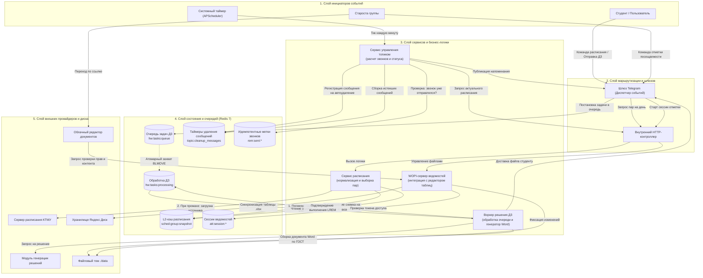
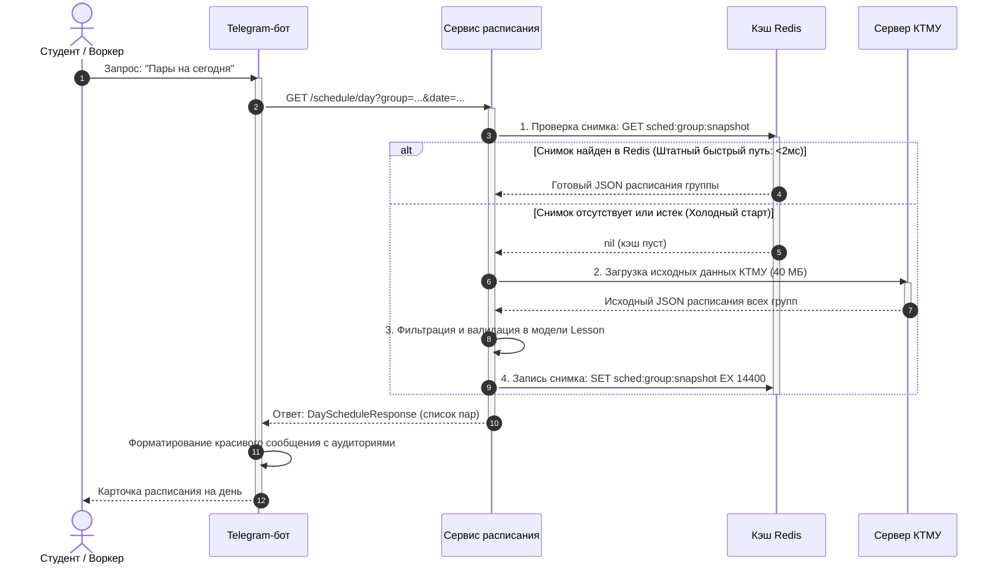
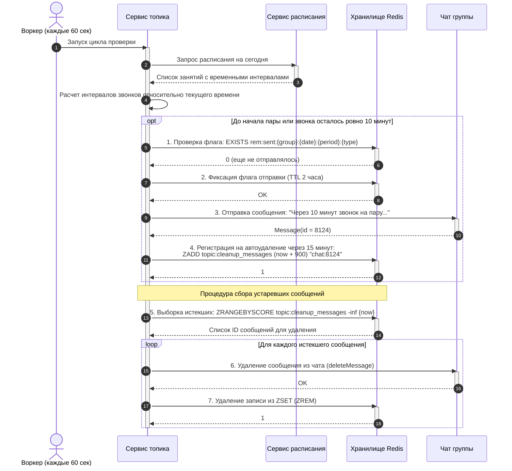
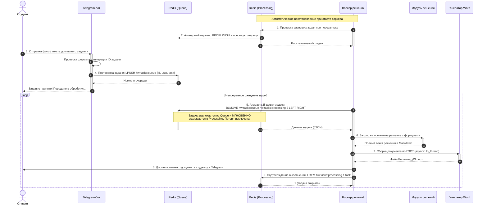
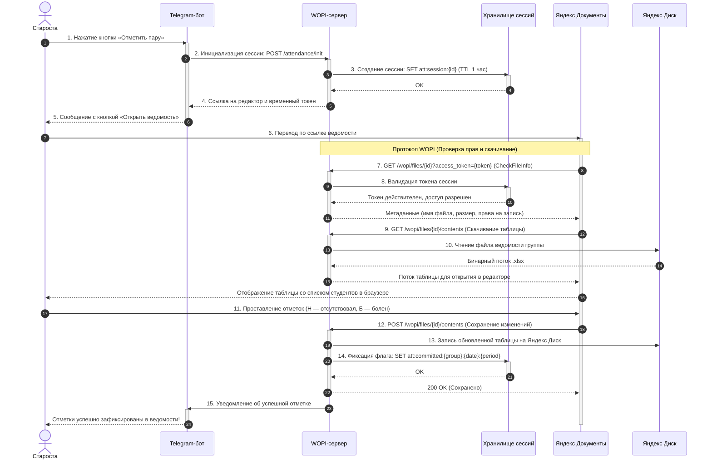
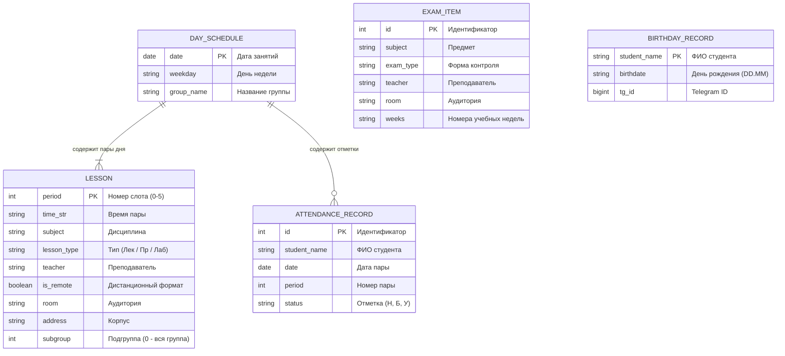

# 🏛️ Архитектура системы «para»

Техническая спецификация архитектуры, сквозных потоков данных (End-to-End Data Flow), объектных моделей и жизненного цикла распределенных процессов Telegram-бота группы, сервиса расписания и фоновых воркеров.

---

## 📑 Содержание

1. [Сквозная архитектура потоков данных (End-to-End Data Flow)](#1-сквозная-архитектура-потоков-данных)
2. [Диаграмма классов, моделей и сервисных контрактов](#2-диаграмма-классов-моделей-и-сервисных-контрактов)
3. [Сквозной процесс: Запрос и кэширование расписания](#3-сквозной-процесс-запрос-и-кэширование-расписания)
4. [Сквозной процесс: Уведомления о парах и очистка топика](#4-сквозной-процесс-уведомления-о-парах-и-очистка-топика)
5. [Сквозной процесс: Надежная очередь решения домашних заданий](#5-сквозной-процесс-надежная-очередь-решения-домашних-заданий)
6. [Сквозной процесс: Электронная ведомость посещаемости (WOPI)](#6-сквозной-процесс-электронная-ведомость-посещаемости-wopi)
7. [Модели сущностей и структура хранилища Redis](#7-модели-сущностей-и-структура-хранилища-redis)

---

## 1. Сквозная архитектура потоков данных

Архитектура построена по многоуровневой схеме (Layered Pipeline). Запросы и события проходят строго сверху вниз: от инициаторов через шлюзы и слой бизнес-логики в кэш и внешние системы.

---

## 2. Диаграмма классов, моделей и сервисных контрактов

Диаграмма описывает типизацию предметной области, структуру передаваемых ответов и контракты сервисов.

---

## 3. Сквозной процесс: Запрос и кэширование расписания

Цепочка движения данных при запросе расписания пользователем или фоновым воркером. Процесс гарантирует холодный старт за `<2мс` за счет снимка в Redis.

---

## 4. Сквозной процесс: Уведомления о парах и очистка топика

Цепочка ежеминутного контроля времени звонков, предотвращения повторов и автоудаления временных сообщений.

---

## 5. Сквозной процесс: Надежная очередь решения домашних заданий

Паттерн **Reliable Queue**: исключает потерю задания студента при аварийном завершении воркера благодаря атомарному разделению очередей `queue` и `processing`.

---

## 6. Сквозной процесс: Электронная ведомость посещаемости (WOPI)

Сквозная цепочка взаимодействия старосты, Telegram-бота, бэкенда и облачного редактора Яндекс Документов по стандарту WOPI.

---

## 7. Модели сущностей и структура хранилища Redis

### Диаграмма сущностей предметной области (ERD)

---

### Реестр ключей хранилища Redis

Таблица описывает все ключи, используемые в системе, их тип данных, время жизни и происхождение данных:

| Ключ / Шаблон ключа | Тип структуры | Время жизни (TTL) | Откуда поступает | Куда передается / Назначение |
| :--- | :--- | :--- | :--- | :--- |
| `sched:group:snapshot` | String (JSON) | 4 часа | Сервер КТМУ (после нормализации) | Сервис расписания: отдает готовые данные за `<2мс` без повторного разбора файлов |
| `hw:tasks:queue` | List (FIFO) | Бессрочно | Telegram-бот от студентов | Воркер решений: очередь входящих заданий на решение |
| `hw:tasks:processing` | List | Бессрочно | Очередь `hw:tasks:queue` (через `BLMOVE`) | Воркер решений: изоляция задачи на время генерации. Удаляется после успешной отправки |
| `topic:cleanup_messages` | Sorted Set (ZSET) | Динамический | Сервис топика при отправке напоминания | Сервис топика: сборщик устаревших сообщений каждые 60с по истечении 15 минут |
| `rem:sent:{group}:{date}:{period}:{type}` | String (флаг) | 2 часа | Сервис топика перед отправкой звонка | Предотвращение дублирования сообщений при частых перезапусках сервисов |
| `att:session:{session_id}` | String (JSON) | 1 час | Бэкенд при нажатии старостой кнопки | Редактор Яндекс Документов: валидация временного доступа по стандарту WOPI |
| `att:committed:{group}:{date}:{period}` | String (флаг) | 24 часа | WOPI-контроллер после сохранения таблицы | Бот и сервисы: статус того, что староста зафиксировал посещаемость на пару |
| `topic:schedule_msg_id:{group}` | String (int) | Бессрочно | Бот при первой публикации расписания | Сервис топика: ID главного закрепленного сообщения для обновления на месте |
