# Architecture Specification for «para»

Technical specification of the distributed system architecture, end-to-end data flows, object models, and execution lifecycles for the Telegram group bot, timetable API service, and background workers.

---

## Table of Contents

1. [System Services Architecture & Core Contracts](#1-system-services-architecture--core-contracts)
2. [Domain Models & Service Contracts Diagram](#2-domain-models--service-contracts-diagram)
3. [End-to-End Flow: Schedule Query & L2 Caching](#3-end-to-end-flow-schedule-query--l2-caching)
4. [End-to-End Flow: Bell Notifications & Topic Auto-Cleanup](#4-end-to-end-flow-bell-notifications--topic-auto-cleanup)
5. [End-to-End Flow: Reliable AI Homework Solver Queue](#5-end-to-end-flow-reliable-ai-homework-solver-queue)
6. [End-to-End Flow: Electronic Attendance Registry (WOPI)](#6-end-to-end-flow-electronic-attendance-registry-wopi)
7. [Data Models & Redis Storage Structure](#7-data-models--redis-storage-structure)
8. [User Interaction Flows & Per-Button Sequence Diagrams](#8-user-interaction-flows--per-button-sequence-diagrams)
   - 8.1. [Команда /start и Авторизация одногруппника](#81-команда-start-и-авторизация-одногруппника)
   - 8.2. [Кнопка 📅 Сегодня (sched:today)](#82-кнопка--сегодня-schedtoday)
   - 8.3. [Кнопка 📆 Завтра (sched:tomorrow)](#83-кнопка--завтра-schedtomorrow)
   - 8.4. [Кнопки ⏭ Неделя (След.) и ⏮ Неделя (Тек.)](#84-кнопки--неделя-след-и--неделя-тек-schedweek--schedweek_next)
   - 8.5. [Кнопка 🔄 Обновить (sched:refresh)](#85-кнопка--обновить-schedrefresh)
   - 8.6. [Кнопка 🔔/🔕 Напоминания и меню /notice](#86-кнопка-bell-напоминания-вклвыкл-schedtoggle_notify-и-меню-notice)
   - 8.7. [Команда /my_attendance и кнопка 🔄 Обновить мои данные](#87-команда-my_attendance-и-кнопка--обновить-мои-данные-attmy_refresh)
   - 8.8. [Команда /attendance старосты и пошаговый опрос (Сквозной WOPI)](#88-команда-attendance-старосты-и-пошаговый-опрос-сквозной-wopi)
   - 8.9. [Кнопка дистанционной пары 🔗 N-я пара](#89-кнопка-дистанционной-пары--n-я-пара)
   - 8.10. [Автоматический AI-Решебник Домашних Заданий (DeepSeek)](#810-автоматический-ai-решебник-домашних-заданий-deepseek)
   - 8.11. [Панель управления старосты и администратора /admin](#811-панель-управления-старосты-и-администратора-admin)
---

## 1. System Services Architecture & Core Contracts

The architecture diagram outlines the interaction between distributed system components: ingress gateways, dispatchers, business logic microservices, in-memory state stores, and external upstream integrations.

```mermaid
classDiagram
    direction TB

    class TelegramGateway {
        +session AiohttpSession (pool_limit=50)
        +handle_schedule(chat_id, date) void
        +handle_hw_task(student_id, file) void
        +handle_attendance(admin_id) void
        +send_document(chat_id, docx) void
        +send_alert(chat_id, text) int
        +delete_msg(chat_id, msg_id) bool
    }

    class RetryAfterMiddleware {
        +__call__(handler, event, data) Any
        +retry_on_flood_control(attempt, delay) Any
    }

    class CallbackThrottleMiddleware {
        -_last_clicks dict
        +__call__(handler, event, data) Any
        -_determine_cooldown(cb_data) float
        -_handle_callback_throttle(event, now) bool
    }

    class DocxParserService {
        -_DOCX_LOCK Lock
        -_CACHE tuple
        +get_teacher_links(force_refresh) dict
        -_fetch_and_cache_teachers(now) dict
        -_is_cache_fresh(now, force) bool
        +parse_docx_xml(docx_bytes) dict
    }

    class ScheduleApiService {
        +get_day_schedule(group, date) DayScheduleResponse
        +get_week_schedule(group, week) WeekScheduleResponse
        +get_exams(group) ExamsResponse
        +refresh_schedule_in_background(force) void
    }

    class TopicWorkerService {
        +run_check_cycle() void
        +send_bell_reminder() void
        +cleanup_old_messages() void
    }

    class HomeworkSolverService {
        +run_consumer_loop() void
        +recover_stale_tasks() int
        +solve_task(task_data) void
    }

    class WopiAttendanceService {
        +init_session(admin_id) str
        +check_file_info(file_id, token) dict
        +get_file(file_id, token) bytes
        +put_file(file_id, content, token) bool
        +check_session_ownership(session, user_id) bool
    }

    class BirthdayService {
        +check_and_send_birthday_congratulations(bot) void
        +is_morning_congrats_time(now_dt) bool
        +format_birthday_registry_text() str
    }

    class ClassmatesAuthService {
        +is_authorized_user(user) bool
        +find_classmate_by_tg_id(user_id) dict
        +find_unregistered_by_username(username) dict
        +update_classmate_tg_id(username, tg_id) dict
        +process_user_auth(user) tuple
    }

    class ExamTopicUpdater {
        +sync_exam_topic_message(force_refresh) bool
        +get_effective_semester_start() date
        +get_default_semester_start() date
        +format_exams_schedule_message(exams, sem_start) str
    }

    class DeepSeekIntegrationModule {
        +solve_homework(image_bytes, prompt) str
        +build_deepseek_messages(prompt, b64_img) list
        +sanitize_prompt_input(text) str
        +get_deepseek_client() AsyncOpenAI
        +close_deepseek_client() void
    }

    class RedisStateManager {
        +get_snapshot(key) dict
        +set_snapshot(key, data, ttl) void
        +push_task(queue, item) void
        +pop_hw_task(timeout) dict
        +ack_hw_task(task_data) void
        +nack_hw_task(task_data, max_retries) bool
        +recover_stale_hw_tasks() int
        +redis_lock(key, ttl) AsyncGenerator
        +zadd_cleanup(set, score, item) void
        +zpop_expired(set, max_score) list
    }

    class KTMUProvider {
        +fetch_all_schedule() json
    }

    class DeepSeekProvider {
        +generate_solution(prompt) str
    }

    class YandexOfficeProvider {
        +open_web_editor(token) html
        +read_disk_xlsx(path) bytes
        +write_disk_xlsx(path, data) bool
    }

    CallbackThrottleMiddleware --> TelegramGateway : debounces rapid inline-clicks & prevents handler flooding
    RetryAfterMiddleware --> TelegramGateway : wraps ingress updates & transparent 429 backoff
    TelegramGateway --> ScheduleApiService : HTTP GET schedule
    TelegramGateway --> RedisStateManager : LPUSH HW queue
    TelegramGateway --> WopiAttendanceService : POST init session
    TopicWorkerService --> ScheduleApiService : query today schedule
    TopicWorkerService --> RedisStateManager : verify flags and ZSET
    TopicWorkerService --> TelegramGateway : publish bell reminders
    ScheduleApiService --> RedisStateManager : L2 snapshot cache
    ScheduleApiService --> DocxParserService : singleflight contact sync (30s cooldown)
    DocxParserService --> YandexOfficeProvider : public disk download
    ScheduleApiService ..> KTMUProvider : parse upstream on cache miss
    HomeworkSolverService --> RedisStateManager : BLMOVE HW queue
    HomeworkSolverService --> DeepSeekProvider : generate step solution
    HomeworkSolverService --> TelegramGateway : send docx to student
    WopiAttendanceService --> RedisStateManager : token validation
    WopiAttendanceService --> YandexOfficeProvider : spreadsheet sync
```

### Architectural Principles

1. **Decoupled Ingress & Asynchronous Queuing**: The Telegram Gateway never blocks on compute-heavy tasks or document rendering. Inbound student homework is atomically placed onto Redis queues (`LPUSH`) and acknowledged instantly. Attendance commit to Yandex Documents runs asynchronously via background worker tasks (`_async_commit_and_update`), immediately returning interactive feedback to group admins.
2. **Network Resilience & Connection Pooling**: Telegram API outbound calls operate over a persistent `AiohttpSession` pool (concurrency limit 50, keepalive), protected by `RetryAfterMiddleware` to transparently handle flood control (HTTP 429 / TelegramRetryAfter).
3. **Thundering Herd & Click Debounce Protection**: `CallbackThrottleMiddleware` intercepts rapid clicks on inline-buttons (cooldown 1.0–4.0s). `DocxParserService` applies `asyncio.Lock` singleflight synchronization and a 30s forced-refresh guard, completely eliminating parallel cache stampedes to Yandex Disk.
4. **Multi-Tier L2 Snapshot Caching**: The Schedule API isolates upstream college infrastructure by serving pre-computed, group-filtered timetable snapshots directly from Redis memory in `<2ms`.
5. **Autonomous Worker Daemons**: Background daemons (`Topic Worker` and `Homework Solver`) operate independently, relying on atomic primitives (`BLMOVE`, `ZRANGEBYSCORE`) to guarantee high availability and fault isolation.

---

## 2. Domain Models & Service Contracts Diagram

This diagram specifies domain model typing, response payloads, service contracts, and inter-module dependencies across the application.

---

## 3. End-to-End Flow: Schedule Query & L2 Caching

Pipeline describing data movement when students or background services request group schedules, guaranteeing cold starts under `<2ms`.

### Execution Flow & Data Lifecycle

1. **L2 Snapshot Verification**: When `get_day_schedule` is invoked, the parser immediately queries Redis key `sched:group:snapshot`. If the snapshot exists and is valid, structured timetable data is returned in `<2ms` without outbound networking.
2. **Cold Start & Upstream Ingestion**: On cache misses or stale intervals, the parser requests the raw ~50 MB timetable payload from KTMU servers with a 60-second read timeout. Deserialization and group filtering are offloaded to `asyncio.to_thread` to prevent freezing the FastAPI event loop.
3. **Resilience & Cooldown**: In case of network timeouts or upstream outages (including HTTP 5xx/4xx responses like 503), a 5-minute cooldown (`_COOLDOWN_UNTIL`) prevents hammering the upstream server, seamlessly falling back to cached Redis snapshots.
4. **Atomic Persistence & Multi-Level L1/L2 Caching**:
   - The normalized JSON payload is persisted to Redis L2 with a TTL of 14,400 seconds (4 hours).
   - Ingress Telegram bot layer maintains an **L1 Redis Day Cache** (`sched:day_pack:{date}`) for 180 seconds, serving "Today" and "Tomorrow" button transitions instantly (`<2ms`) without internal API HTTP overhead.
   - User authorization filter `ClassmateAuthFilter` utilizes an **In-Memory MTime Cache** of `birthdays.json`, eliminating synchronous disk reads from the event loop during update polling.
   - Outbound personal reminders in `services/notifier.py` execute concurrently via `asyncio.gather` bounded by a 10-slot semaphore.

---

## 4. End-to-End Flow: Bell Notifications & Topic Auto-Cleanup

Execution cycle governing bell reminders, deduplication guards, and message lifecycles inside Telegram forum topics.

### Notification & Auto-Cleanup Logic

1. **Idempotent Bell Alerts**: Every 60 seconds, the worker inspects lesson intervals for the current day. If exactly 10 minutes remain before lesson start/end, it checks `rem:sent:{group}:{date}:{period}:{type}`. If unset, it sets the flag with a 2-hour TTL and posts the alert to the chat.
2. **Expiration Scheduling**: Immediately after sending, the Telegram `message_id` is registered in Redis Sorted Set `topic:cleanup_messages` with a score equal to `timestamp + 900` (15 minutes).
3. **Automated Message Purging**: Each minute, the daemon calls `ZRANGEBYSCORE topic:cleanup_messages -inf {now}`, removes expired messages via Telegram `deleteMessage`, and deletes the entries via `ZREM`.

---

## 5. End-to-End Flow: Reliable AI Homework Solver Queue

Implementation of the **Reliable Queue** pattern guaranteeing **At-Least-Once** task execution via atomic list transitions.

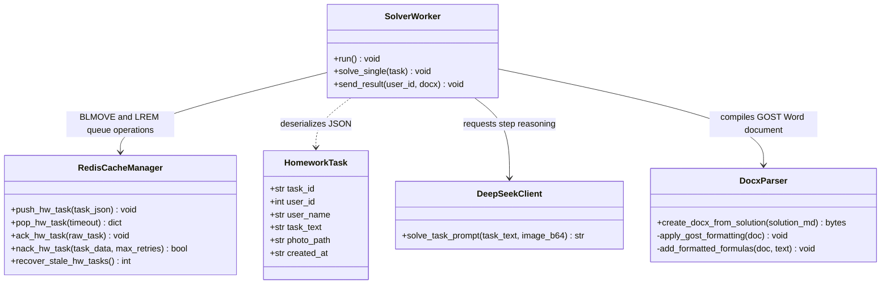

### Reliable Task Processing

1. **Atomic Ingestion (`BLMOVE`)**: The consumer extracts tasks from `hw:tasks:queue` and simultaneously moves them to `hw:tasks:processing`. If the container crashes mid-computation, the task remains preserved in `processing`.
2. **Daemon Crash Recovery**: On startup, `recover_stale_hw_tasks` safely relocates any orphaned tasks from `processing` back to `queue` via atomic `RPOPLPUSH`.
3. **Fault-Tolerant Retries & DLQ**: When a task encounters unrecoverable errors or parsing timeouts, `nack_hw_task` retries up to 3 times before shunting the poisoned task into Dead Letter Queue `hw:tasks:dlq`, alerting admins and keeping the main queue unblocked.
4. **GOST Academic Formatting**: Solved Markdown formulas are translated into Microsoft Word `.docx` documents adhering strictly to Russian academic GOST formatting (Times New Roman 14pt, 1.5 line spacing, 30-15-20-20 mm margins). The task is acknowledged via `LREM` only after document delivery.

---

## 6. End-to-End Flow: Electronic Attendance Registry (WOPI)

Data flow bridging the group administrator, Telegram Bot, FastAPI backend, and Yandex Documents cloud office via the WOPI standard.

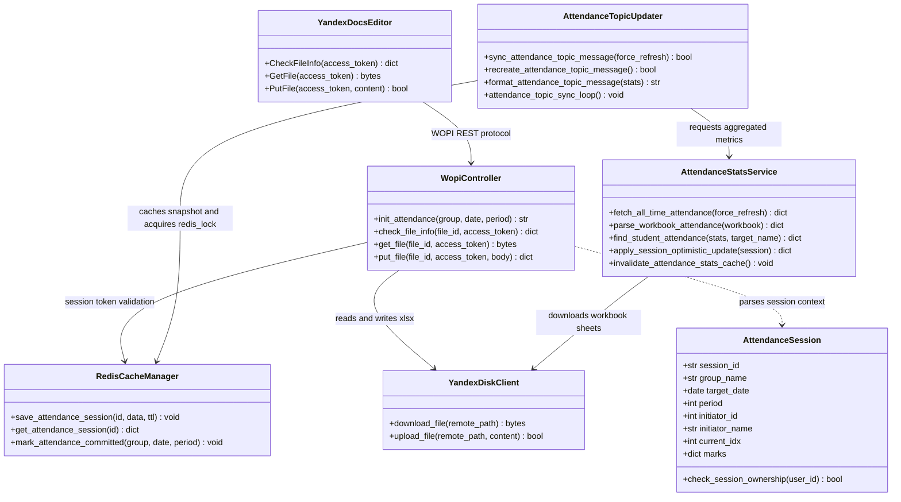

### WOPI Session Lifecycle & All-Time Registry

1. **Session Provisioning**: When the admin clicks "Mark Attendance", the bot issues a secure access token and creates a session in Redis `att:session:{id}` with a 1-hour TTL.
2. **Cloud Office Interaction**: Yandex Documents connects to the backend:
   - `CheckFileInfo`: verifies write permissions, user identity, and spreadsheet metadata;
   - `GetFile`: streams the binary `.xlsx` spreadsheet loaded from Yandex Disk;
   - `PutFile`: receives and updates the modified spreadsheet directly back to Yandex Disk storage.
3. **Instant Optimistic UI & Non-Blocking Commit**: Upon completing attendance input in the Telegram UI, `apply_session_optimistic_update` immediately adjusts student metrics in Redis and updates the Telegram Topic message within ~1s. An asynchronous task (`_async_commit_and_update`) persists records to the Yandex Table, followed by a delayed 15s settling pass.
4. **All-Time Multi-Month Tally**: `AttendanceStatsService` scans all historical monthly sheets (`СЕНТ`, `ОКТ`, `НОЯБ`, `ДЕК`...), aggregates cumulative counts (`П`, `О`, `У`, `Н`) for each student, and stores the structured result in Redis (`att:stats:all_time`) with a 1-hour TTL. Excused absences (`У`) are considered legitimate and do not lower the academic percentage.
5. **Academic Leagues Dashboard (Thread ID 7025)**: `AttendanceTopicUpdater` maintains an idempotent pinned message in the dedicated Telegram Topic containing the full group ranking divided into 3 Academic Leagues (Gold 90-100%, Silver 60-89%, Risk Zone <60%), clean single-line rows without line-wrapping, and progress bars. Late arrivals are formatted as `N оп` to eliminate optical confusion with the number 10. Background sync adapts between 3 min (daytime 08-19) and 15 min (night).
6. **Student Self-Service (`/my_attendance`)**: Students can check their private cumulative record and percentage of attendance in PM without group disclosure.
7. **Headman Concurrency Isolation**: `create_attendance_session` checks the active session in `att:active_session`. If an uncommitted survey is held by another administrator, creation is rejected (`PermissionError`). All interactive inline callbacks enforce `check_session_ownership(session, cb.from_user.id)` to prevent dual-headman split-brain marking.
8. **Morning Birthday Dispatch & Dynamic Semester Alignment**: Birthday congratulations are restricted to daylight hours (`is_morning_congrats_time`, >= 07:00 MSK). `ExamTopicUpdater` automatically resolves `semesterStart` from the live KTMU timetable payload, supporting dynamic academic calendars without hardcoded date limits.

---

## 7. Data Models & Redis Storage Structure

### Entity Relationship Diagram (ERD)

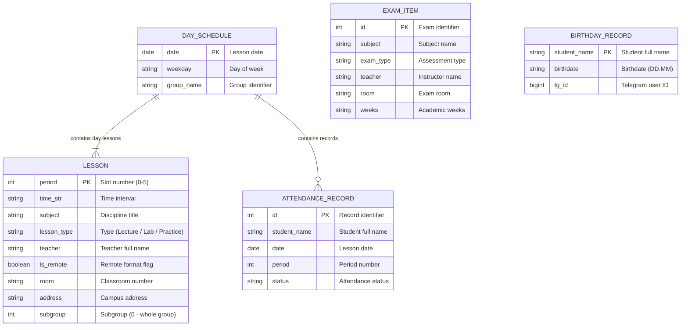

---

### Redis Key Registry & Storage Lifecycle

Comprehensive registry of all Redis keys, data structures, expiration policies, and lifecycle producers/consumers:

| Key / Key Pattern | Data Structure | TTL | Source / Producer | Consumer / Purpose |
| :--- | :--- | :--- | :--- | :--- |
| `sched:group:snapshot` | String (JSON) | 4 hours | KTMU Server (post-normalization) | Schedule API: serves group schedule in `<2ms` without raw file parsing |
| `hw:tasks:queue` | List (FIFO) | Indefinite | Telegram Bot (students) | Homework Solver: inbound queue of homework tasks |
| `hw:tasks:processing` | List | Indefinite | `hw:tasks:queue` (via `BLMOVE`) | Homework Solver: in-flight task isolation. Purged via `LREM` upon delivery |
| `topic:cleanup_messages` | Sorted Set (ZSET) | Dynamic | Topic Service on alert dispatch | Topic Service: scheduled message collector purged every 60s past 15 min |
| `rem:sent:{group}:{date}:{period}:{type}` | String (flag) | 2 hours | Topic Service before alert dispatch | Bell alert deduplication guard preventing repeats across worker restarts |
| `att:session:{session_id}` | String (JSON) | 1 hour | Backend on headman action | Yandex Documents: ephemeral token validation following WOPI standard |
| `att:committed:{group}:{date}:{period}` | String (flag) | 24 hours | WOPI controller on save | Bot & Worker: confirmation flag that attendance was marked for the lesson |
| `topic:schedule_msg_id:{group}` | String (int) | Indefinite | Bot on initial timetable post | Topic Service: pinned main schedule message ID updated in-place |

---

## 8. User Interaction Flows & Per-Button Sequence Diagrams

В данном разделе подробно визуализированы и описаны все сценарии взаимодействия пользователя (студента или старосты/администратора) с Telegram-ботом. Каждая кнопка, команда и фоновый процесс сопровождается отдельной UML Sequence-диаграммой стандарта Mermaid, раскрывающей внутреннюю архитектуру: контроллеры, фильтры авторизации, уровни кэширования L1/L2 Redis, взаимодействие с файловой системой, внешними API КТМУ, Яндекс Документами и очередями задач.

---

### 8.1 /start Command & Classmate Authentication

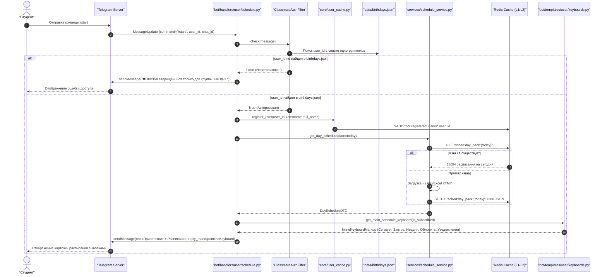

#### Что происходит «под капотом»:
1. **Фильтрация и Auth Guard**: `ClassmateAuthFilter` инспектирует `message.from_user.id`. Доступ предоставляется только студентам группы из `data/birthdays.json` или доверенным администраторам из `ADMIN_IDS`.
2. **Регистрация активности**: Пользователь сохраняется в оперативном сете Redis `bot:registered_users` для рассылок и актуализации профиля.
3. **Кэширование L1**: Расписание на текущий день извлекается за `<1.5ms` из ключа `sched:day_pack:{date}`.
4. **Рендеринг интерфейса**: Собирается интерактивная клавиатура с кнопками управления днями, неделями, ссылками на онлайн-пары и тумблером уведомлений.

---

### 8.2 Button «📅 Сегодня» (sched:today)

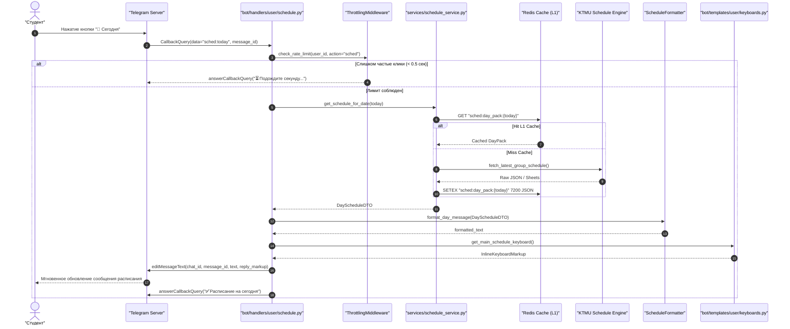

#### Что происходит «под капотом»:
1. **Rate Limiting**: Защита от спам-кликов предотвращает исчерпание лимитов Telegram Bot API.
2. **In-place Edit**: Бот не спамит новыми сообщениями, а вызывает `editMessageText` того же сообщения, оптимизируя UI.
3. **Форматирование статусов**: Определяются и подсвечиваются типы занятий (лекция, практика, лабораторная), номер кабинета и ФИО преподавателя.

---

### 8.3 Button «📆 Завтра» (sched:tomorrow)

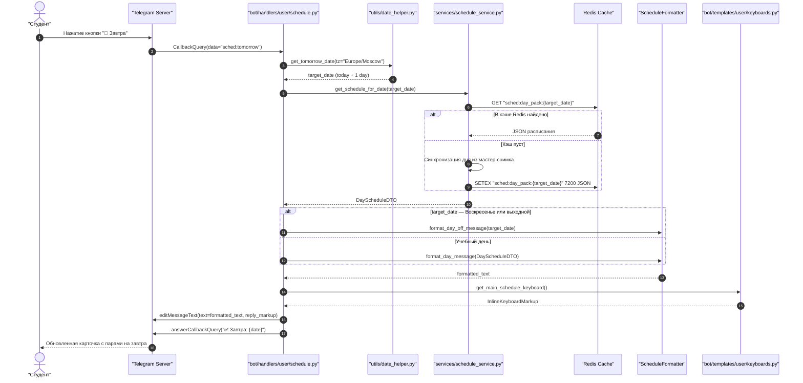

#### Что происходит «под капотом»:
1. **Временные зоны**: Расчет даты `target_date` ведется строго по московскому часовому поясу (`Europe/Moscow`).
2. **Детекция выходных**: Если день выходной, рендерится легкая заглушка об отдыхе без обращения к тяжелым парсерам.
3. **Обновление ссылок**: Для дистанционных занятий завтрашнего дня динамически подготавливаются URL-кнопки видеоконференций.

---

### 8.4 Buttons «⏭ Неделя (След.)» & «⏮ Неделя (Тек.)» (sched:week / sched:week_next)

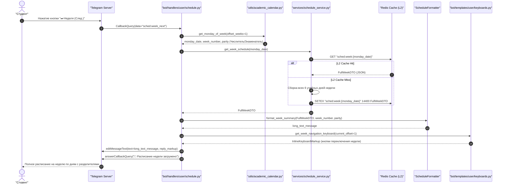

#### Что происходит «под капотом»:
1. **Четность недели**: Рассчитывается статус числитель/знаменатель согласно академическому календарю колледжа.
2. **L2 Кэширование**: Недельный дамп кэшируется целиком под ключом `sched:week:{monday}` с TTL 4 часа.
3. **Интеллектуальная клавиатура**: Кнопка переключения недели динамически меняет свой текст и callback_data на «⏮ Текущая неделя», позволяя студенту бесшовно переключаться туда и обратно.

---

### 8.5 Button «🔄 Обновить» (sched:refresh)

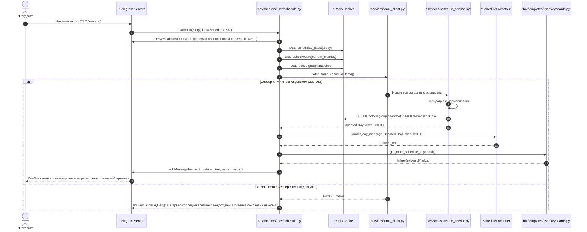

#### Что происходит «под капотом»:
1. **Принудительный Cache Invalidation**: Удаляются устаревшие ключи из Redis (`DEL`), предотвращая показ закэшированных замен.
2. **Сетевая синхронизация**: Выполняется асинхронный HTTP-запрос к API/порталу КТМУ.
3. **Resilience & Fallback**: При недоступности серверов колледжа бот не падает, а возвращает пользователю уведомление с последней валидной копией данных.

---

### 8.6 Button «🔔/🔕 Напоминания» (sched:toggle_notify)

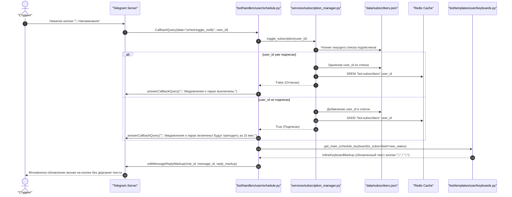

#### Что происходит «под капотом»:
1. **Двойная персистентность**: Подписка моментально обновляется в Redis Set (`bot:subscribers`) для быстрых проверок воркерами и дублируется в `data/subscribers.json` для сохранения между перезапусками контейнеров.
2. **Мгновенный отклик UI**: Вызывается метод `editMessageReplyMarkup`, обновляющий только кнопки клавиатуры без перерисовки текста сообщения.

---

### 8.7 Command /my_attendance & Button «🔄 Обновить мои данные» (att:my_refresh)

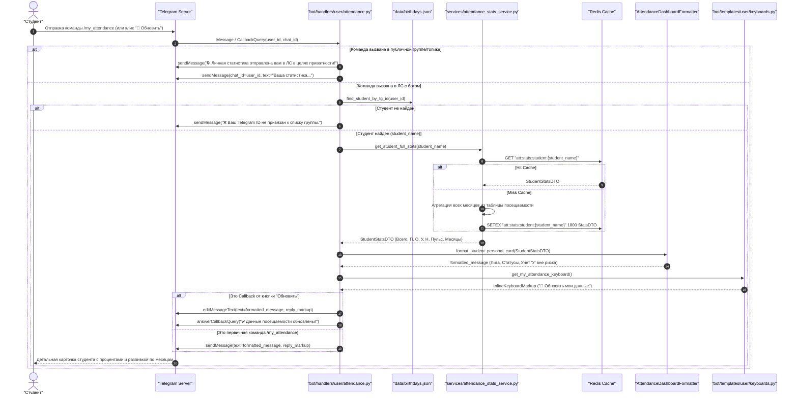

#### Что происходит «под капотом»:
1. **Конфиденциальность (Privacy Guard)**: Если студент запрашивает `/my_attendance` в общей беседе группы, бот защищает персональные данные и перенаправляет карточку в личные сообщения.
2. **Бизнес-правило уважительных причин ('У')**: Пропуски с уважительной причиной не влияют на штрафные баллы и не переводят студента в красную «Зону риска».
3. **Помесячный срез**: Подсчитываются часы присутствия и пропусков за каждый учебный месяц (сентябрь, октябрь, ноябрь и т.д.).

---

### 8.8 Headman Attendance Flow (/attendance & Interactive Buttons)

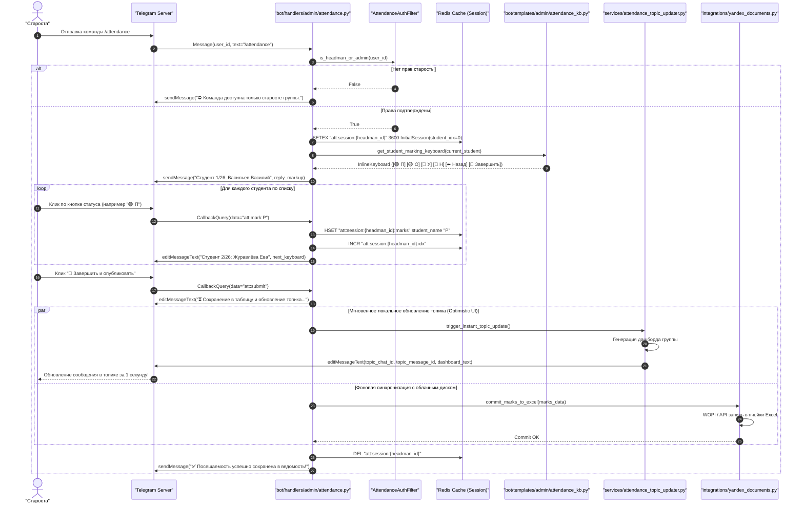

#### Что происходит «под капотом»:
1. **FSM в Redis**: Сессия опроса хранится в Redis с возможностью отката шага назад (`⬅️ Назад`) без потери введенных данных.
2. **Параллельный Optimistic UI**: Обновление витрины посещаемости в топике группы происходит моментально (< 1 сек), не блокируя интерфейс долгими операциями сетевого ввода/вывода.
3. **WOPI / Cloud Persistence**: Фоновый воркер производит запись в официальную ведомость группы на Яндекс Диске.

---

### 8.9 Remote Lesson Direct Join Button («🔗 N-я пара»)

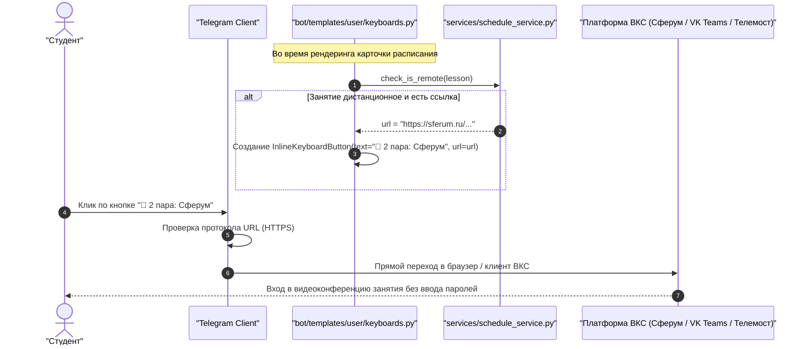

#### Что происходит «под капотом»:
1. **Native Inline URL**: Кнопка не генерирует callback на сервер бота, экономя сетевые запросы и сетевую задержку.
2. **Динамический маппинг**: Ссылки на кабинеты преподавателей автоматически сопоставляются с базой ссылок кафедры.

---

### 8.10 AI Homework Solver Workflow (Topic 405)

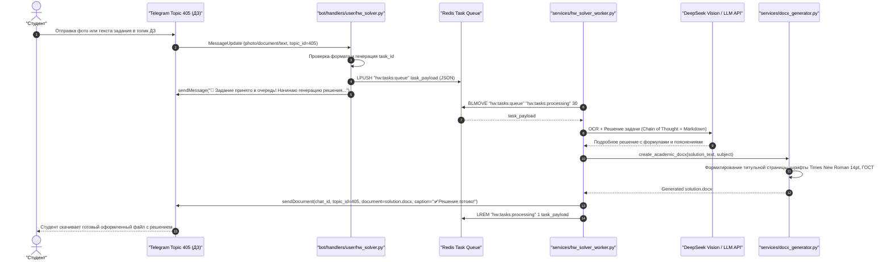

#### Что происходит «под капотом»:
1. **Атомарная очередь `BLMOVE`**: Гарантирует надежность обработки (At-least-once delivery). Если воркер аварийно упадет в процессе работы, задача останется в списке `hw:tasks:processing` и будет восстановлена.
2. **DeepSeek Multi-modal**: Распознавание рукописных конспектов, графиков и формул на фотографиях заданий.
3. **ГОСТ-оформление**: Генерация готового документа Microsoft Word (`.docx`) с соблюдением академических отступов, колонтитулов и стилей.

---

### 8.11 Admin Control Panel (/admin & Action Buttons)

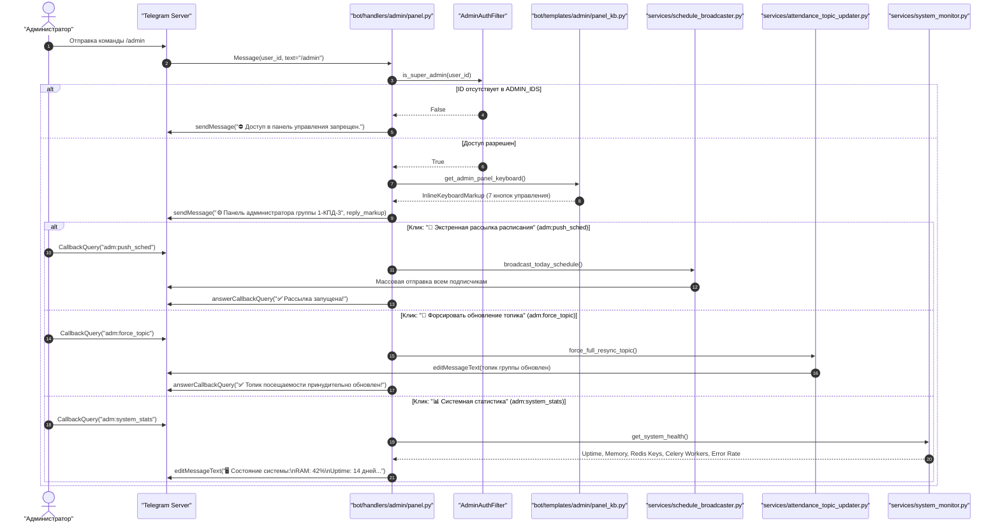

#### Что происходит «под капотом»:
1. **Строгий RBAC**: Проверка ID в неизменяемом кортеже `ADMIN_IDS` из защищенных переменных окружения.
2. **Административные триггеры**: Ручное управление жизненным циклом фоновых демонов, принудительная синхронизация топиков и запуск аварийных рассылок при смене пар.
3. **Мониторинг здоровья системы**: Сбор ключевых телеметрических показателей (состояние памяти, размер очередей Redis, доступность внешних API).

