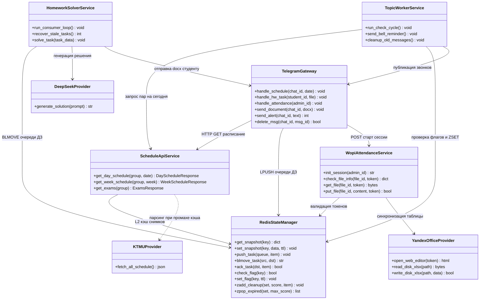
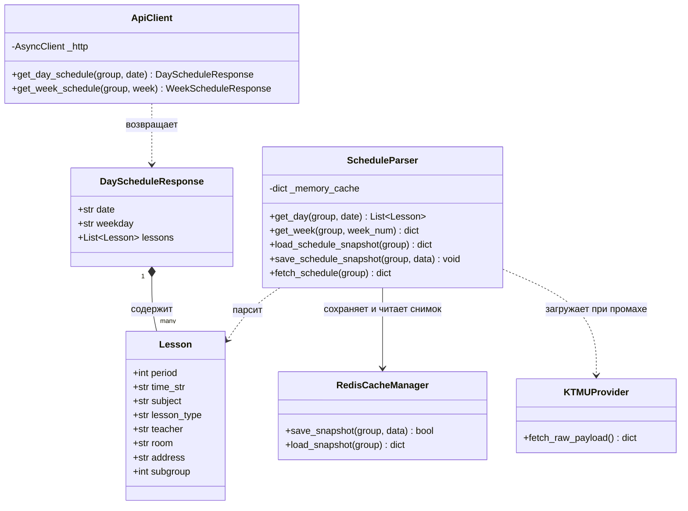
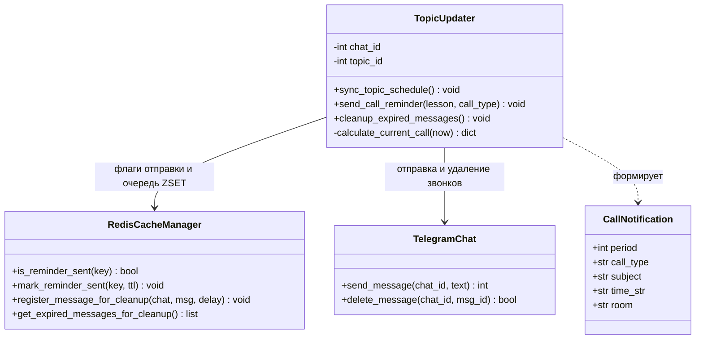
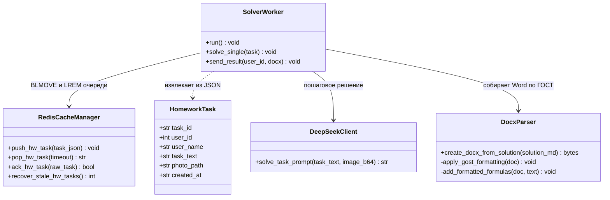
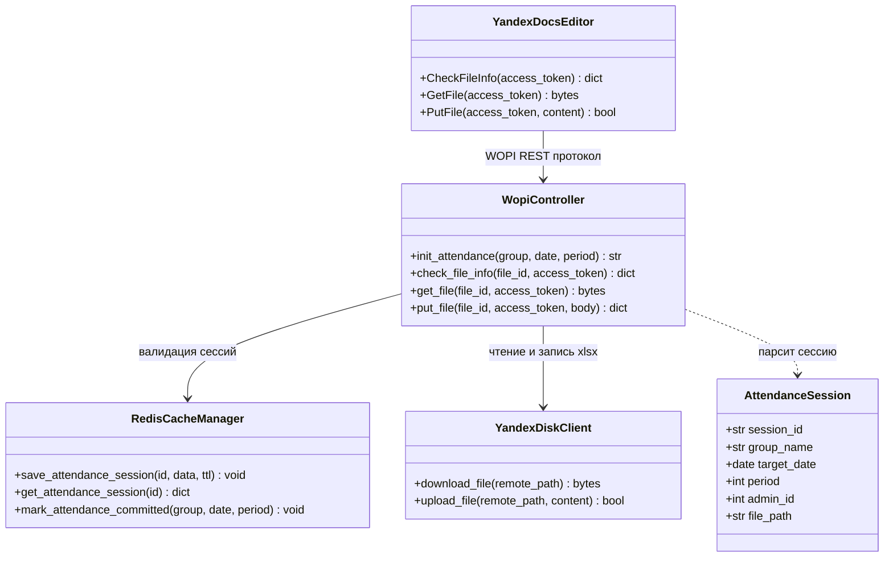
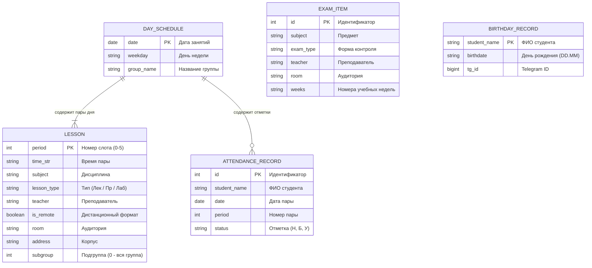

# 🏛️ Архитектура системы «para»

Техническая спецификация архитектуры, сквозных потоков данных (End-to-End Data Flow), объектных моделей и жизненного цикла распределенных процессов Telegram-бота группы, сервиса расписания и фоновых воркеров.

---

## 📑 Содержание

1. [Сквозная архитектура сервисов и системных контрактов](#1-сквозная-архитектура-сервисов-и-системных-контрактов)
2. [Диаграмма классов, моделей и сервисных контрактов](#2-диаграмма-классов-моделей-и-сервисных-контрактов)
3. [Сквозной процесс: Запрос и кэширование расписания](#3-сквозной-процесс-запрос-и-кэширование-расписания)
4. [Сквозной процесс: Уведомления о парах и очистка топика](#4-сквозной-процесс-уведомления-о-парах-и-очистка-топика)
5. [Сквозной процесс: Надежная очередь решения домашних заданий](#5-сквозной-процесс-надежная-очередь-решения-домашних-заданий)
6. [Сквозной процесс: Электронная ведомость посещаемости (WOPI)](#6-сквозной-процесс-электронная-ведомость-посещаемости-wopi)
7. [Модели сущностей и структура хранилища Redis](#7-модели-сущностей-и-структура-хранилища-redis)

---

## 1. Сквозная архитектура сервисов и системных контрактов

Архитектурная схема описывает взаимодействие распределенных компонентов системы: точки входа запросов, диспетчеры, сервисы бизнес-логики, узлы оперативной памяти и внешние интеграции.

### Принципы межсервисного взаимодействия

1. **Изоляция очередей и диспетчеризации**: Шлюз Telegram не производит тяжелых вычислений и не ждет генерации файлов, а атомарно регистрирует задачу в очереди Redis (`LPUSH`).
2. **L2-кэширование**: Сервис расписания изолирует сервер КТМУ, отдавая готовые структуры занятий из снимка Redis за `<2мс`.
3. **Автономность воркеров**: Воркер топика и воркер решений ДЗ функционируют как независимые демоны, взаимодействуя с ботом через контракты очереди и вызовы сообщений.

---

## 2. Диаграмма классов, моделей и сервисных контрактов

Диаграмма описывает типизацию предметной области, структуру передаваемых ответов и контракты сервисов.

---

## 3. Сквозной процесс: Запрос и кэширование расписания

Цепочка движения данных при запросе расписания пользователем или фоновым воркером. Процесс гарантирует холодный старт за `<2мс` за счет снимка в Redis.

### Логика движения данных в модуле расписания

1. **Проверка L2-кэша**: При входящем вызове `get_day_schedule` парсер сначала проверяет ключ `sched:group:snapshot` в Redis. Если снимок существует и не просрочен, данные десериализуются за `<2мс` без сетевых вызовов.
2. **Холодный старт**: При отсутствии ключа парсер обращается к серверу КТМУ, скачивает общий JSON-файл расписания (размером 40 МБ), производит фильтрацию по группе и валидацию полей в типизированные объекты `Lesson`.
3. **Фиксация снимка**: Нормализованный JSON сохраняется в Redis с TTL 14400 секунд (4 часа), гарантируя мгновенные ответы для всех последующих обращений.

---

## 4. Сквозной процесс: Уведомления о парах и очистка топика

Цепочка ежеминутного контроля времени звонков, предотвращения повторов и автоудаления временных сообщений.

### Логика мониторинга звонков и топика

1. **Идемпотентность отправки**: Каждую минуту воркер рассчитывает время до ближайшей пары. Если до звонка осталось ровно 10 минут, проверяется флаг `rem:sent:{group}:{date}:{period}:{type}`. При значении 0 выставляется ключ с TTL 2 часа, исключая повторные отправки при рестартах воркера.
2. **Регистрация на автоудаление**: После успешной отправки уведомления ID сообщения помещается в Redis Sorted Set `topic:cleanup_messages` со score, равным `timestamp + 900` (15 минут).
3. **Сборщик устаревших записей**: Раз в минуту выполняется `ZRANGEBYSCORE topic:cleanup_messages -inf {now}`, сообщения удаляются из чата через `deleteMessage`, а записи очищаются через `ZREM`.

---

## 5. Сквозной процесс: Надежная очередь решения домашних заданий

Паттерн **Reliable Queue**: исключает потерю задания студента при аварийном завершении воркера благодаря атомарному разделению очередей `queue` и `processing`.

### Надежная обработка задач генерации решений

1. **Атомарный захват (`BLMOVE`)**: Воркер извлекает задачу из `hw:tasks:queue` и одновременно помещает в `hw:tasks:processing`. Если контейнер воркера перезапустится в момент генерации, задача не будет потеряна.
2. **Восстановление при старте**: Функция `recover_stale_hw_tasks` при инициализации сервиса возвращает зависшие задачи из `processing` обратно в `queue` через `RPOPLPUSH`.
3. **Генерация по ГОСТ**: Модуль генерации оформляет текст и формулы в `.docx` с соблюдением стандартов (шрифт Times New Roman 14, поля 30-15-20-20 мм, нумерация страниц). После отправки документа в Telegram воркер подтверждает выполнение вызовом `LREM`.

---

## 6. Сквозной процесс: Электронная ведомость посещаемости (WOPI)

Сквозная цепочка взаимодействия старосты, Telegram-бота, бэкенда и облачного редактора Яндекс Документов по стандарту WOPI.

### Жизненный цикл сессии ведомости

1. **Инициализация сессии**: При нажатии старостой кнопки бот создает токен доступа и сохраняет сессию в Redis `att:session:{id}` с TTL 3600с.
2. **Интеграция с редактором**: Яндекс Документы обращаются к эндпоинтам контроллера:
   - `CheckFileInfo`: подтверждение прав доступа и структуры файла;
   - `GetFile`: загрузка исходной таблицы `.xlsx` с Яндекс Диска;
   - `PutFile`: сохранение измененного бинарного файла обратно в хранилище.
3. **Фиксация отметки**: После успешного закрытия файла выставляется флаг `att:committed:{group}:{date}:{period}`, подтверждающий учет посещаемости за пару.

---

## 7. Модели сущностей и структура хранилища Redis

### Диаграмма сущностей предметной области (ERD)

---

### Реестр ключей хранилища Redis

Таблица описывает все ключи, используемые в системе, их тип данных, время жизни и происхождение данных:

| Ключ / Шаблон ключа | Тип структуры | Время жизни (TTL) | Откуда поступает | Куда передается / Назначение |
| :--- | :--- | :--- | :--- | :--- |
| `sched:group:snapshot` | String (JSON) | 4 часа | Сервер КТМУ (после нормализации) | Сервис расписания: отдает готовые данные за `<2мс` без повторного разбора файлов |
| `hw:tasks:queue` | List (FIFO) | Бессрочно | Telegram-бот от студентов | Воркер решений: очередь входящих заданий на решение |
| `hw:tasks:processing` | List | Бессрочно | Очередь `hw:tasks:queue` (через `BLMOVE`) | Воркер решений: изоляция задачи на время генерации. Удаляется после успешной отправки |
| `topic:cleanup_messages` | Sorted Set (ZSET) | Динамический | Сервис топика при отправке напоминания | Сервис топика: сборщик устаревших сообщений каждые 60с по истечении 15 минут |
| `rem:sent:{group}:{date}:{period}:{type}` | String (флаг) | 2 часа | Сервис топика перед отправкой звонка | Предотвращение дублирования сообщений при частых перезапусках сервисов |
| `att:session:{session_id}` | String (JSON) | 1 час | Бэкенд при нажатии старостой кнопки | Редактор Яндекс Документов: валидация временного доступа по стандарту WOPI |
| `att:committed:{group}:{date}:{period}` | String (флаг) | 24 часа | WOPI-контроллер после сохранения таблицы | Бот и сервисы: статус того, что староста зафиксировал посещаемость на пару |
| `topic:schedule_msg_id:{group}` | String (int) | Бессрочно | Бот при первой публикации расписания | Сервис топика: ID главного закрепленного сообщения для обновления на месте |
