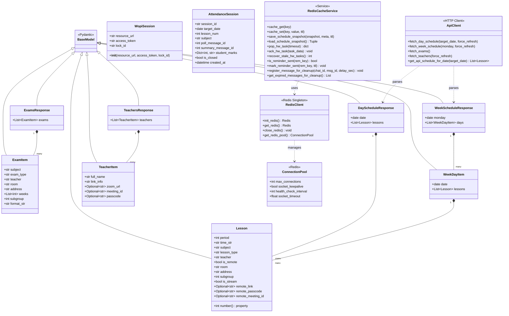
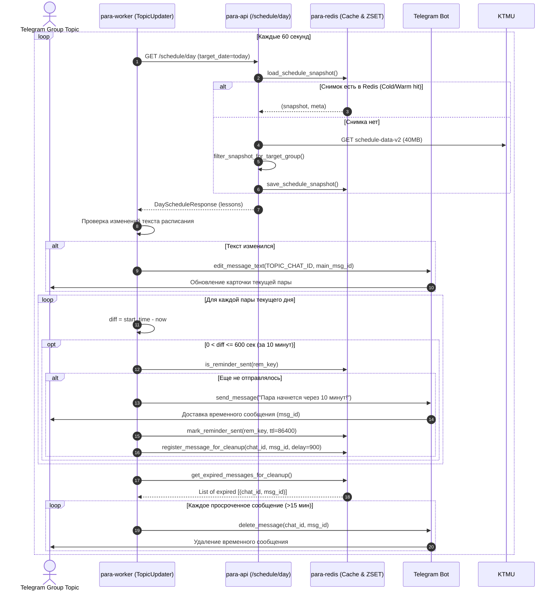
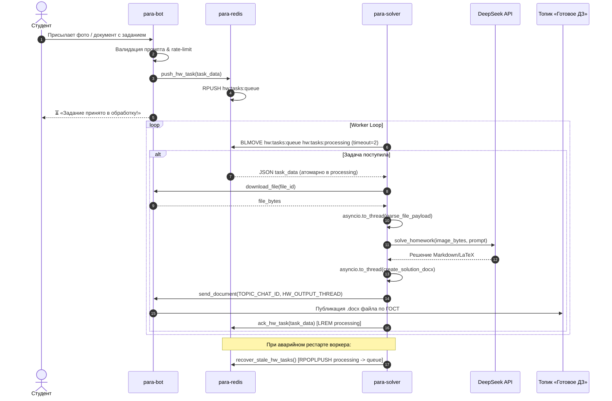
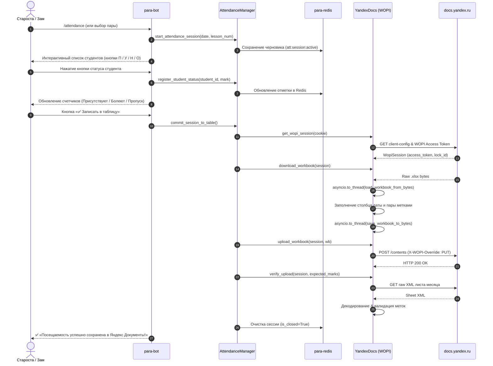
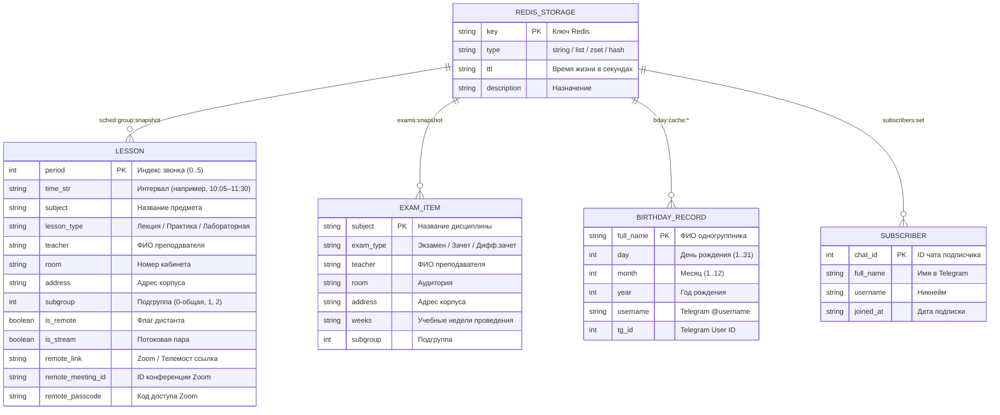

# 🏛️ Архитектурная UML-документация проекта «para»

Полная спецификация архитектуры, взаимодействия модулей, структур данных и жизненного цикла процессов Telegram-бота расписания КТМУ, внутреннего REST API и фоновых микросервисов.

---

## 1. 🏗️ Компонентная архитектура (Component & Container Diagram)

Диаграмма контейнеров Docker Compose, сетевого взаимодействия, постоянных томов и интеграций с внешними API.

```mermaid
flowchart TD
    subgraph External_World["🌐 Внешние сервисы и пользователи"]
        User["👤 Пользователь / Студент"]
        Admin["👑 Староста / Администратор"]
        TG_API["✈️ Telegram Bot API"]
        KTMU_API["🏫 API КТМУ (timetable-ktmu.ru)"]
        YD_DISK["📂 Яндекс Диск (Public REST API)"]
        YD_DOCS["📊 Яндекс Документы (WOPI Host)"]
        DEEPSEEK["🧠 DeepSeek API (AI Vision & Text)"]
    end

    subgraph Docker_Compose["🐳 Стек Docker Compose (Сеть: internal_bridge)"]
        subgraph S_Redis["⚡ para-redis (Redis 7 Alpine)"]
            RCache[("Кэш снимка расписания\n(sched:group:snapshot)")]
            RQueue[("Очередь задач ДЗ\n(hw:tasks:queue)")]
            RProc[("Очередь обработки ДЗ\n(hw:tasks:processing)")]
            RClean[("ZSET очистки топика\n(topic:cleanup_messages)")]
            RSess[("Сессии посещаемости\n(att:session:*)")]
            RState[("Идемпотентные флаги\n(rem:sent:*, topic:*)")]
        end

        subgraph S_API["🚀 para-api (FastAPI + Uvicorn)"]
            Router_Sched["/schedule (Day & Week)"]
            Router_Exams["/exams"]
            Router_Teachers["/teachers"]
            Router_Health["/health"]
            SchedParser["Schedule Parser\n(clean 40MB -> target group)"]
            DocxParser["Docx Parser\n(Zip/XML Teacher Links)"]
        end

        subgraph S_Bot["🤖 para-bot (aiogram 3)"]
            Dispatch["Dispatcher & Filters"]
            Handlers_User["User Handlers\n(Schedule, HW Solver)"]
            Handlers_Admin["Admin Handlers\n(Attendance, Panel, Mute, Ping)"]
            Keyboards["Inline & Reply Keyboards"]
        end

        subgraph S_Worker["⚙️ para-worker (Background Worker)"]
            TopicUpdater["Topic Updater Loop\n(60s sync + 10m reminder)"]
            ExamUpdater["Exam Updater Loop\n(10m sync)"]
            BirthdayMgr["Birthday Manager\n(07:00 Wishes & Registry)"]
            YKeepalive["Yandex Keep-Alive Loop\n(6h refresh)"]
            Scheduler["APScheduler\n(06:00 Digest & Attendance Poll)"]
        end

        subgraph S_Solver["📐 para-solver (DeepSeek Worker)"]
            SolverLoop["Solver Queue Loop\n(BLMOVE -> Processing)"]
            DocxGen["Docx Generator\n(GOST Solution Formatter)"]
            FileExtractor["File Extractor\n(Image / Docx / PDF / Text)"]
        end
    end

    subgraph Volumes["💾 Постоянные тома (Data Volumes)"]
        Vol_Redis[("./data/redis (AOF)")]
        Vol_Data[("./data (JSON States)")]
        Vol_Logs[("./logs (Rotating Files)")]
    end

    User -->|Команды / Кнопки| TG_API
    Admin -->|/attendance, /all, /mute| TG_API
    TG_API <-->|Long Polling / Webhook| Dispatch

    Dispatch --> Handlers_User
    Dispatch --> Handlers_Admin

    Handlers_User -->|HTTP GET (X-API-Key)| Router_Sched
    Handlers_User -->|RPUSH hw:tasks:queue| RQueue
    Handlers_Admin -->|Управление сессией| RSess

    TopicUpdater -->|HTTP GET /schedule/day| Router_Sched
    TopicUpdater -->|Проверка/Отметка отправки| RState
    TopicUpdater -->|ZADD / ZRANGEBYSCORE| RClean
    TopicUpdater -->|send_message / delete_message| TG_API

    ExamUpdater -->|HTTP GET /exams| Router_Exams
    ExamUpdater -->|edit_message_text| TG_API

    BirthdayMgr -->|Чтение/Запись| Vol_Data
    BirthdayMgr -->|Поздравления в топик| TG_API

    YKeepalive -->|WOPI Token Refresh| YD_DOCS
    Scheduler -->|Оповещения и опросы| TG_API

    Router_Sched --> SchedParser
    Router_Teachers --> DocxParser
    SchedParser -->|HTTP GET ETag| KTMU_API
    SchedParser <-->|Снимок группы| RCache
    DocxParser -->|HTTP GET .docx| YD_DISK

    SolverLoop -->|BLMOVE| RProc
    SolverLoop -->|Download File| TG_API
    SolverLoop --> FileExtractor
    SolverLoop -->|Prompt + Image| DEEPSEEK
    SolverLoop --> DocxGen
    SolverLoop -->|Send .docx| TG_API
    SolverLoop -->|LREM (ACK)| RProc

    S_Redis --- Vol_Redis
    S_API --- Vol_Logs
    S_Bot --- Vol_Logs
    S_Worker --- Vol_Data
    S_Solver --- Vol_Logs
```

---

## 2. 🧩 Диаграмма классов и структур данных (Class Diagram)

Иерархия Pydantic-моделей, сервисных классов, пулов соединений и контрактов API.



---

## 3. 🔄 Диаграммы последовательности (Sequence Diagrams)

### 3.1. Синхронизация расписания топика и 10-минутные напоминания (Topic Sync & Ephemeral Reminders)



---

### 3.2. Отказоустойчивое решение домашних заданий (Reliable AI Homework Queue)



---

### 3.3. Фиксация посещаемости в Яндекс Документы через WOPI (Attendance Workflow)



---

## 4. 🗄️ Схема данных и хранилищ (Entity-Relationship & Key Schema)

Структура данных постоянных JSON-файлов и ключей Redis.



### Реестр ключей Redis

| Ключ Redis | Тип | TTL | Описание |
| :--- | :--- | :--- | :--- |
| `sched:group:snapshot` | String (JSON) | 86400 сек (24ч) | Очищенный срез расписания для группы 1-КПД-3 (cold-start <2мс) |
| `sched:group:meta` | String (JSON) | 86400 сек (24ч) | Заголовки `ETag`, `Last-Modified`, `published_at` из API КТМУ |
| `hw:tasks:queue` | List (FIFO) | Бессрочно | Основная очередь входящих заданий на решение |
| `hw:tasks:processing` | List | Бессрочно | Задачи, находящиеся в процессе генерации AI (Reliable Queue) |
| `hw_processed:<msg_id>` | String ("1") | 30 дней | Защита от повторного решения одного и того же сообщения |
| `hw_hash:<sha256>` | String ("1") | 24 часа | Дедупликация идентичных запросов ДЗ |
| `rem:sent:<date>:<period>:<subgroup>` | String ("1") | 86400 сек | Идемпотентный флаг отправки 10-минутного напоминания в топик |
| `topic:main_msg_id` | String (int) | Бессрочно | ID главного зафиксированного сообщения топика расписания |
| `topic:cleanup_messages` | ZSET | До удаления | Очередь удаления временных сообщений (score = UNIX-таймштамп) |
| `att:session:active` | String (JSON) | 86400 сек | Активная сессия заполнения посещаемости пары старостой |
| `yandex:cookie:effective` | String | 604800 сек (7д) | Актуальные сессионные Cookie редактора Яндекс Документов |

---

## 5. 🛡️ Архитектурные правила и гарантии (Quality Attributes)

1. **Производительность (Latency & Throughput)**:
   - Кэширование расписания в Redis с поддержкой ETag/304 Not Modified.
   - Пул соединений `ConnectionPool` в Redis (`max_connections=20`) и `httpx.Limits` в HTTP-клиентах предотвращают постоянные рукопожатия TCP.
   - CPU-bound задачи (парсинг `openpyxl`, `docx`, `pdf`) изолированы в `asyncio.to_thread`, не блокируя Event Loop.
2. **Отказоустойчивость (Fault Tolerance)**:
   - Паттерн Reliable Queue (`BLMOVE` + `ACK` + `recover_stale_hw_tasks`) гарантирует доставку ДЗ даже при падении контейнера.
   - Изоляция состояния топика в Redis исключает дублирование сообщений при перезапуске воркера.
   - Docker Healthchecks и политика запуска `depends_on: condition: service_healthy` обеспечивают детерминированный порядок старта сервисов.
3. **Чистота кода (Code Standards)**:
   - Строгое ограничение: **все функции и методы <= 25 строк**.
   - Принцип единственной ответственности (SRP).
   - 100% покрытие unit-тестами критических путей (445 тестов).
