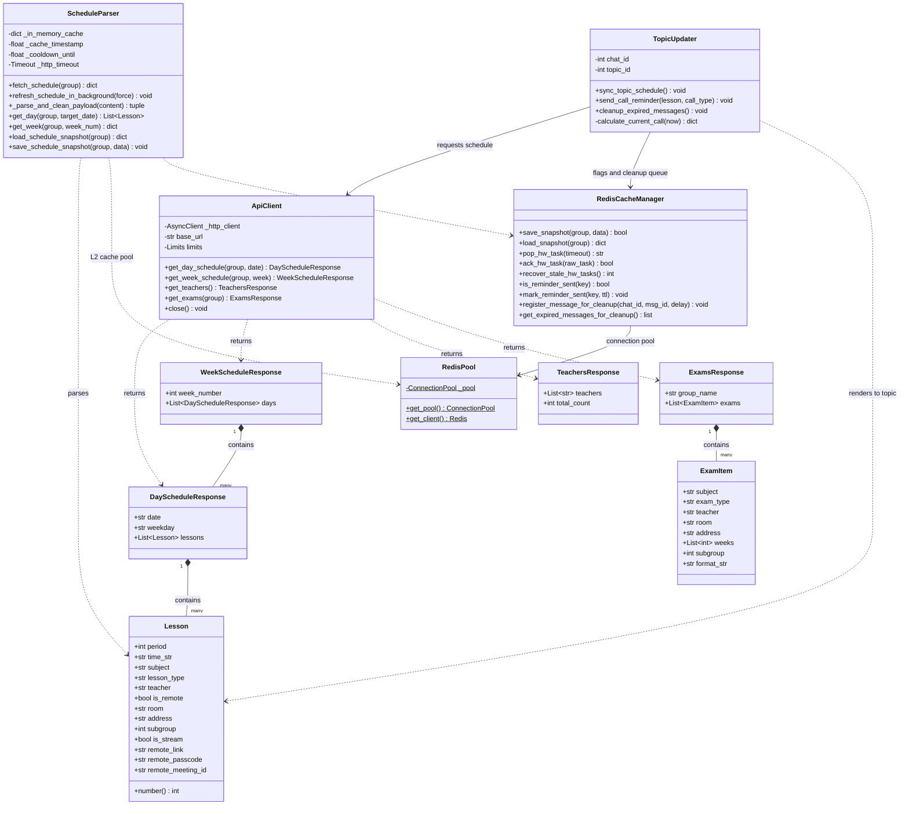
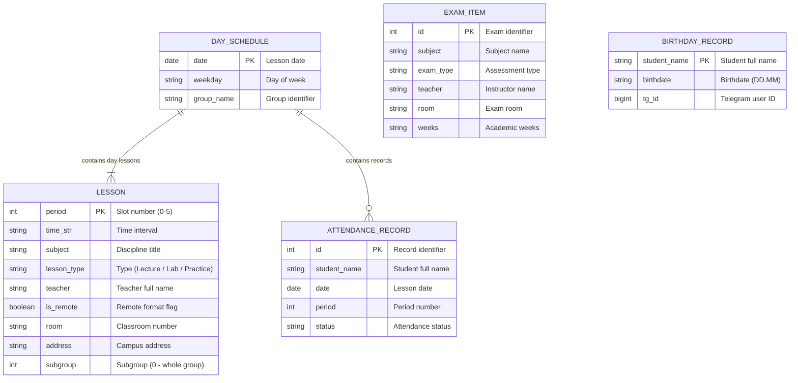
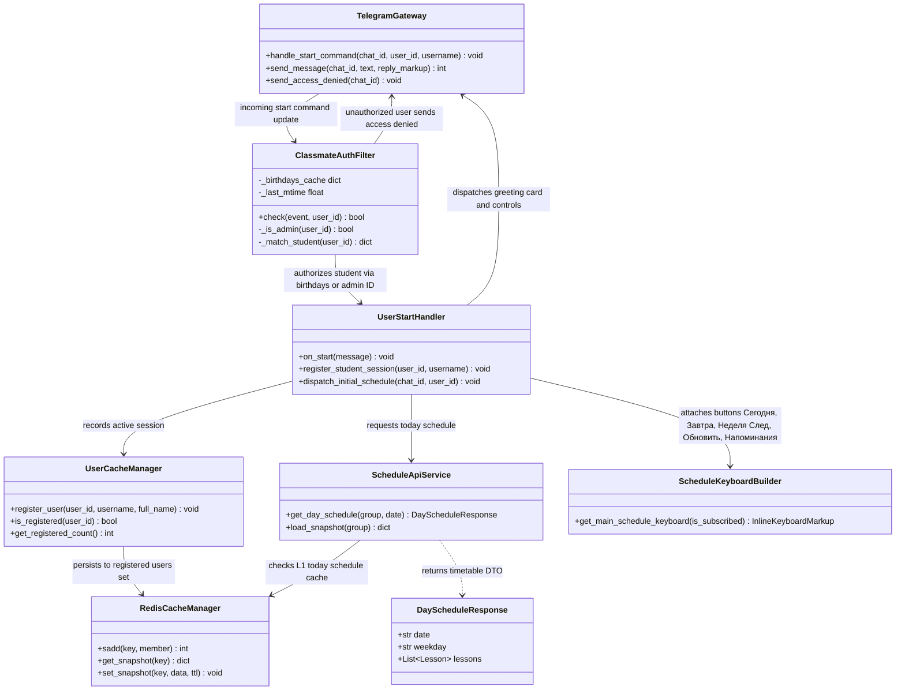
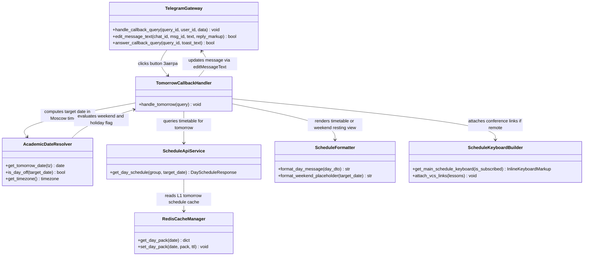
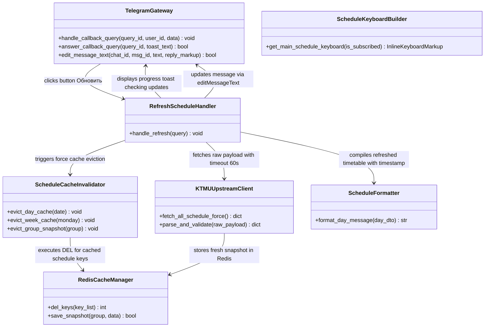
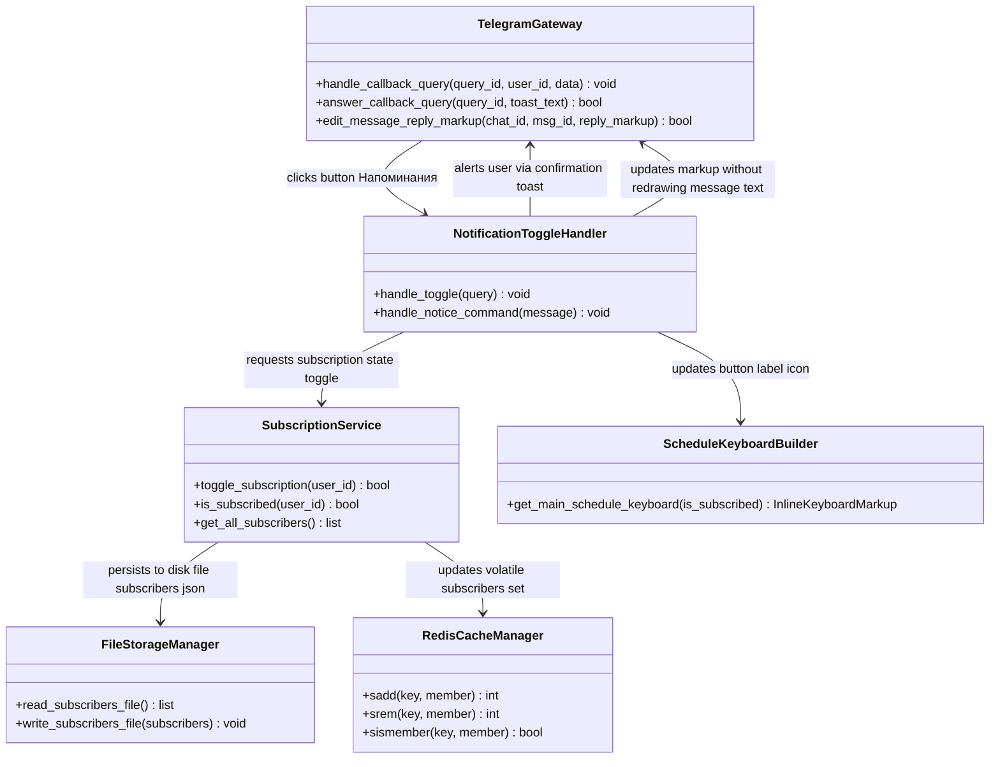
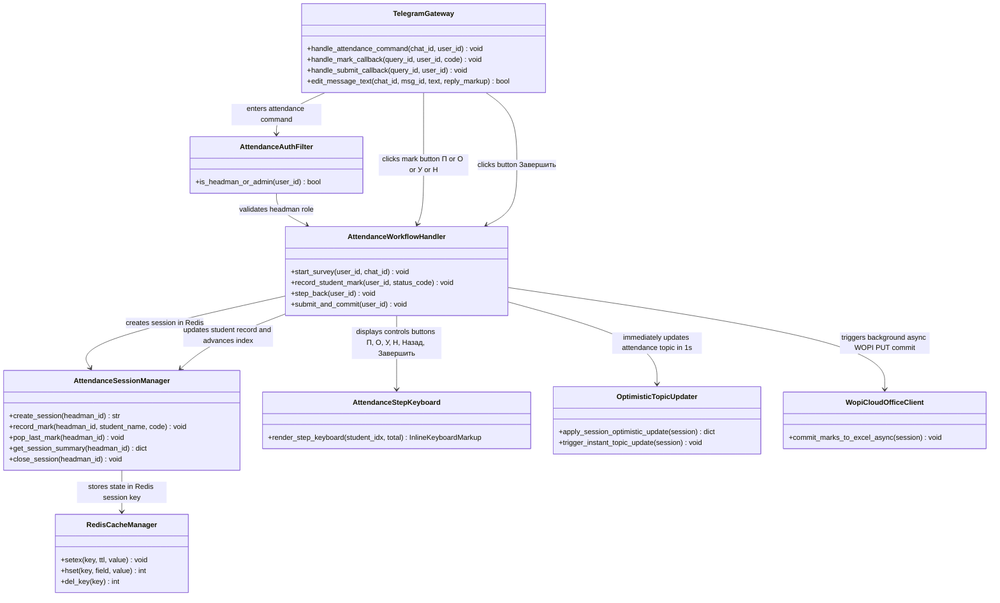
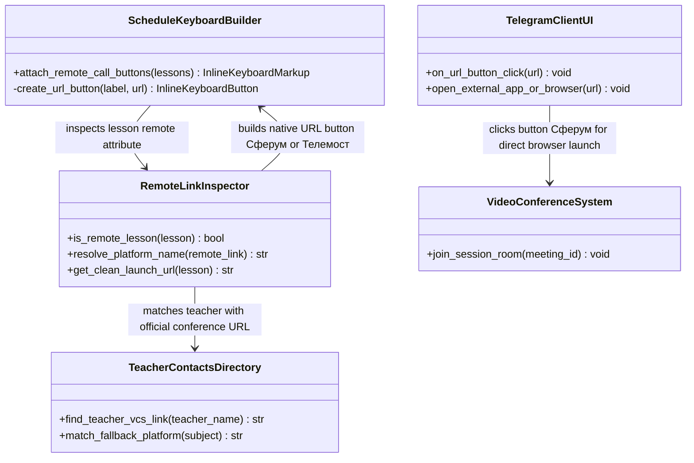
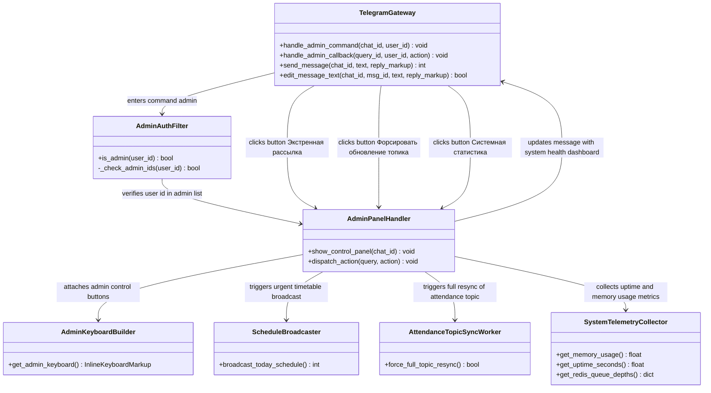

# Architecture Specification for «para»

Technical specification of the distributed system architecture, end-to-end data flows, object models, and execution lifecycles for the Telegram group bot, timetable API service, and background workers.

---

## Table of Contents

1. [System Services Architecture & Core Contracts](#1-system-services-architecture--core-contracts)
2. [Domain Models & Service Contracts Diagram](#2-domain-models--service-contracts-diagram)
3. [End-to-End Flow: Schedule Query & L2 Caching](#3-end-to-end-flow-schedule-query--l2-caching)
4. [End-to-End Flow: Bell Notifications & Topic Auto-Cleanup](#4-end-to-end-flow-bell-notifications--topic-auto-cleanup)
5. [End-to-End Flow: Reliable AI Homework Solver Queue](#5-end-to-end-flow-reliable-ai-homework-solver-queue)
6. [End-to-End Flow: Electronic Attendance Registry (WOPI)](#6-end-to-end-flow-electronic-attendance-registry-wopi)
7. [Data Models & Redis Storage Structure](#7-data-models--redis-storage-structure)
8. [User Interaction Flows & Per-Button Architecture Diagrams](#8-user-interaction-flows--per-button-architecture-diagrams)
   - 8.1. [Command /start & Classmate Onboarding Flow](#81-command-start--classmate-onboarding-flow)
   - 8.2. [Button «📅 Сегодня» (sched:today) Ingress Flow](#82-button-сегодня-schedtoday-ingress-flow)
   - 8.3. [Button «📆 Завтра» (sched:tomorrow) Ingress Flow](#83-button-завтра-schedtomorrow-ingress-flow)
   - 8.4. [Buttons «⏭ Неделя (След.)» & «⏮ Неделя (Тек.)» Flow](#84-buttons-неделя-след--неделя-тек-schedweek--schedweek_next)
   - 8.5. [Button «🔄 Обновить» (sched:refresh) Force Sync Flow](#85-button-обновить-schedrefresh-force-sync-flow)
   - 8.6. [Button «🔔/🔕 Напоминания» (sched:toggle_notify) Subscription Flow](#86-button-bell-напоминания-schedtoggle_notify-subscription-flow)
   - 8.7. [Command /my_attendance & Button «🔄 Обновить мои данные» Flow](#87-command-my_attendance--button-обновить-мои-данные-attmy_refresh)
   - 8.8. [Headman Attendance Flow: Command /attendance & Mark Buttons](#88-headman-attendance-flow-command-attendance--mark-buttons)
   - 8.9. [Remote Lesson Direct Join Button «🔗 N-я пара» Flow](#89-remote-lesson-direct-join-button-n-я-пара-flow)
   - 8.10. [AI Homework Solver Workflow in Topic 405 (DeepSeek & GOST .docx)](#810-ai-homework-solver-workflow-in-topic-405-deepseek--gost-docx)
   - 8.11. [Headman & Admin Control Panel /admin Flow](#811-headman--admin-control-panel-admin-flow)
---

## 1. System Services Architecture & Core Contracts

The architecture diagram outlines the interaction between distributed system components: ingress gateways, dispatchers, business logic microservices, in-memory state stores, and external upstream integrations.

```mermaid
classDiagram
    direction TB

    class TelegramGateway {
        +session AiohttpSession (pool_limit=50)
        +handle_schedule(chat_id, date) void
        +handle_hw_task(student_id, file) void
        +handle_attendance(admin_id) void
        +send_document(chat_id, docx) void
        +send_alert(chat_id, text) int
        +delete_msg(chat_id, msg_id) bool
    }

    class RetryAfterMiddleware {
        +__call__(handler, event, data) Any
        +retry_on_flood_control(attempt, delay) Any
    }

    class CallbackThrottleMiddleware {
        -_last_clicks dict
        +__call__(handler, event, data) Any
        -_determine_cooldown(cb_data) float
        -_handle_callback_throttle(event, now) bool
    }

    class DocxParserService {
        -_DOCX_LOCK Lock
        -_CACHE tuple
        +get_teacher_links(force_refresh) dict
        -_fetch_and_cache_teachers(now) dict
        -_is_cache_fresh(now, force) bool
        +parse_docx_xml(docx_bytes) dict
    }

    class ScheduleApiService {
        +get_day_schedule(group, date) DayScheduleResponse
        +get_week_schedule(group, week) WeekScheduleResponse
        +get_exams(group) ExamsResponse
        +refresh_schedule_in_background(force) void
    }

    class TopicWorkerService {
        +run_check_cycle() void
        +send_bell_reminder() void
        +cleanup_old_messages() void
    }

    class HomeworkSolverService {
        +run_consumer_loop() void
        +recover_stale_tasks() int
        +solve_task(task_data) void
    }

    class WopiAttendanceService {
        +init_session(admin_id) str
        +check_file_info(file_id, token) dict
        +get_file(file_id, token) bytes
        +put_file(file_id, content, token) bool
        +check_session_ownership(session, user_id) bool
    }

    class BirthdayService {
        +check_and_send_birthday_congratulations(bot) void
        +is_morning_congrats_time(now_dt) bool
        +format_birthday_registry_text() str
    }

    class ClassmatesAuthService {
        +is_authorized_user(user) bool
        +find_classmate_by_tg_id(user_id) dict
        +find_unregistered_by_username(username) dict
        +update_classmate_tg_id(username, tg_id) dict
        +process_user_auth(user) tuple
    }

    class ExamTopicUpdater {
        +sync_exam_topic_message(force_refresh) bool
        +get_effective_semester_start() date
        +get_default_semester_start() date
        +format_exams_schedule_message(exams, sem_start) str
    }

    class DeepSeekIntegrationModule {
        +solve_homework(image_bytes, prompt) str
        +build_deepseek_messages(prompt, b64_img) list
        +sanitize_prompt_input(text) str
        +get_deepseek_client() AsyncOpenAI
        +close_deepseek_client() void
    }

    class RedisStateManager {
        +get_snapshot(key) dict
        +set_snapshot(key, data, ttl) void
        +push_task(queue, item) void
        +pop_hw_task(timeout) dict
        +ack_hw_task(task_data) void
        +nack_hw_task(task_data, max_retries) bool
        +recover_stale_hw_tasks() int
        +redis_lock(key, ttl) AsyncGenerator
        +zadd_cleanup(set, score, item) void
        +zpop_expired(set, max_score) list
    }

    class KTMUProvider {
        +fetch_all_schedule() json
    }

    class DeepSeekProvider {
        +generate_solution(prompt) str
    }

    class YandexOfficeProvider {
        +open_web_editor(token) html
        +read_disk_xlsx(path) bytes
        +write_disk_xlsx(path, data) bool
    }

    CallbackThrottleMiddleware --> TelegramGateway : debounces rapid inline-clicks & prevents handler flooding
    RetryAfterMiddleware --> TelegramGateway : wraps ingress updates & transparent 429 backoff
    TelegramGateway --> ScheduleApiService : HTTP GET schedule
    TelegramGateway --> RedisStateManager : LPUSH HW queue
    TelegramGateway --> WopiAttendanceService : POST init session
    TopicWorkerService --> ScheduleApiService : query today schedule
    TopicWorkerService --> RedisStateManager : verify flags and ZSET
    TopicWorkerService --> TelegramGateway : publish bell reminders
    ScheduleApiService --> RedisStateManager : L2 snapshot cache
    ScheduleApiService --> DocxParserService : singleflight contact sync (30s cooldown)
    DocxParserService --> YandexOfficeProvider : public disk download
    ScheduleApiService ..> KTMUProvider : parse upstream on cache miss
    HomeworkSolverService --> RedisStateManager : BLMOVE HW queue
    HomeworkSolverService --> DeepSeekProvider : generate step solution
    HomeworkSolverService --> TelegramGateway : send docx to student
    WopiAttendanceService --> RedisStateManager : token validation
    WopiAttendanceService --> YandexOfficeProvider : spreadsheet sync
```

### Architectural Principles

1. **Decoupled Ingress & Asynchronous Queuing**: The Telegram Gateway never blocks on compute-heavy tasks or document rendering. Inbound student homework is atomically placed onto Redis queues (`LPUSH`) and acknowledged instantly. Attendance commit to Yandex Documents runs asynchronously via background worker tasks (`_async_commit_and_update`), immediately returning interactive feedback to group admins.
2. **Network Resilience & Connection Pooling**: Telegram API outbound calls operate over a persistent `AiohttpSession` pool (concurrency limit 50, keepalive), protected by `RetryAfterMiddleware` to transparently handle flood control (HTTP 429 / TelegramRetryAfter).
3. **Thundering Herd & Click Debounce Protection**: `CallbackThrottleMiddleware` intercepts rapid clicks on inline-buttons (cooldown 1.0–4.0s). `DocxParserService` applies `asyncio.Lock` singleflight synchronization and a 30s forced-refresh guard, completely eliminating parallel cache stampedes to Yandex Disk.
4. **Multi-Tier L2 Snapshot Caching**: The Schedule API isolates upstream college infrastructure by serving pre-computed, group-filtered timetable snapshots directly from Redis memory in `<2ms`.
5. **Autonomous Worker Daemons**: Background daemons (`Topic Worker` and `Homework Solver`) operate independently, relying on atomic primitives (`BLMOVE`, `ZRANGEBYSCORE`) to guarantee high availability and fault isolation.

---

## 2. Domain Models & Service Contracts Diagram

This diagram specifies domain model typing, response payloads, service contracts, and inter-module dependencies across the application.

---

## 3. End-to-End Flow: Schedule Query & L2 Caching

Pipeline describing data movement when students or background services request group schedules, guaranteeing cold starts under `<2ms`.

### Execution Flow & Data Lifecycle

1. **L2 Snapshot Verification**: When `get_day_schedule` is invoked, the parser immediately queries Redis key `sched:group:snapshot`. If the snapshot exists and is valid, structured timetable data is returned in `<2ms` without outbound networking.
2. **Cold Start & Upstream Ingestion**: On cache misses or stale intervals, the parser requests the raw ~50 MB timetable payload from KTMU servers with a 60-second read timeout. Deserialization and group filtering are offloaded to `asyncio.to_thread` to prevent freezing the FastAPI event loop.
3. **Resilience & Cooldown**: In case of network timeouts or upstream outages (including HTTP 5xx/4xx responses like 503), a 5-minute cooldown (`_COOLDOWN_UNTIL`) prevents hammering the upstream server, seamlessly falling back to cached Redis snapshots.
4. **Atomic Persistence & Multi-Level L1/L2 Caching**:
   - The normalized JSON payload is persisted to Redis L2 with a TTL of 14,400 seconds (4 hours).
   - Ingress Telegram bot layer maintains an **L1 Redis Day Cache** (`sched:day_pack:{date}`) for 180 seconds, serving "Today" and "Tomorrow" button transitions instantly (`<2ms`) without internal API HTTP overhead.
   - User authorization filter `ClassmateAuthFilter` utilizes an **In-Memory MTime Cache** of `birthdays.json`, eliminating synchronous disk reads from the event loop during update polling.
   - Outbound personal reminders in `services/notifier.py` execute concurrently via `asyncio.gather` bounded by a 10-slot semaphore.

---

## 4. End-to-End Flow: Bell Notifications & Topic Auto-Cleanup

Execution cycle governing bell reminders, deduplication guards, and message lifecycles inside Telegram forum topics.

### Notification & Auto-Cleanup Logic

1. **Idempotent Bell Alerts**: Every 60 seconds, the worker inspects lesson intervals for the current day. If exactly 10 minutes remain before lesson start/end, it checks `rem:sent:{group}:{date}:{period}:{type}`. If unset, it sets the flag with a 2-hour TTL and posts the alert to the chat.
2. **Expiration Scheduling**: Immediately after sending, the Telegram `message_id` is registered in Redis Sorted Set `topic:cleanup_messages` with a score equal to `timestamp + 900` (15 minutes).
3. **Automated Message Purging**: Each minute, the daemon calls `ZRANGEBYSCORE topic:cleanup_messages -inf {now}`, removes expired messages via Telegram `deleteMessage`, and deletes the entries via `ZREM`.

---

## 5. End-to-End Flow: Reliable AI Homework Solver Queue

Implementation of the **Reliable Queue** pattern guaranteeing **At-Least-Once** task execution via atomic list transitions.

### Reliable Task Processing

1. **Atomic Ingestion (`BLMOVE`)**: The consumer extracts tasks from `hw:tasks:queue` and simultaneously moves them to `hw:tasks:processing`. If the container crashes mid-computation, the task remains preserved in `processing`.
2. **Daemon Crash Recovery**: On startup, `recover_stale_hw_tasks` safely relocates any orphaned tasks from `processing` back to `queue` via atomic `RPOPLPUSH`.
3. **Fault-Tolerant Retries & DLQ**: When a task encounters unrecoverable errors or parsing timeouts, `nack_hw_task` retries up to 3 times before shunting the poisoned task into Dead Letter Queue `hw:tasks:dlq`, alerting admins and keeping the main queue unblocked.
4. **GOST Academic Formatting**: Solved Markdown formulas are translated into Microsoft Word `.docx` documents adhering strictly to Russian academic GOST formatting (Times New Roman 14pt, 1.5 line spacing, 30-15-20-20 mm margins). The task is acknowledged via `LREM` only after document delivery.

---

## 6. End-to-End Flow: Electronic Attendance Registry (WOPI)

Data flow bridging the group administrator, Telegram Bot, FastAPI backend, and Yandex Documents cloud office via the WOPI standard.

### WOPI Session Lifecycle & All-Time Registry

1. **Session Provisioning**: When the admin clicks "Mark Attendance", the bot issues a secure access token and creates a session in Redis `att:session:{id}` with a 1-hour TTL.
2. **Cloud Office Interaction**: Yandex Documents connects to the backend:
   - `CheckFileInfo`: verifies write permissions, user identity, and spreadsheet metadata;
   - `GetFile`: streams the binary `.xlsx` spreadsheet loaded from Yandex Disk;
   - `PutFile`: receives and updates the modified spreadsheet directly back to Yandex Disk storage.
3. **Instant Optimistic UI & Non-Blocking Commit**: Upon completing attendance input in the Telegram UI, `apply_session_optimistic_update` immediately adjusts student metrics in Redis and updates the Telegram Topic message within ~1s. An asynchronous task (`_async_commit_and_update`) persists records to the Yandex Table, followed by a delayed 15s settling pass.
4. **All-Time Multi-Month Tally**: `AttendanceStatsService` scans all historical monthly sheets (`СЕНТ`, `ОКТ`, `НОЯБ`, `ДЕК`...), aggregates cumulative counts (`П`, `О`, `У`, `Н`) for each student, and stores the structured result in Redis (`att:stats:all_time`) with a 1-hour TTL. Excused absences (`У`) are considered legitimate and do not lower the academic percentage.
5. **Academic Leagues Dashboard (Thread ID 7025)**: `AttendanceTopicUpdater` maintains an idempotent pinned message in the dedicated Telegram Topic containing the full group ranking divided into 3 Academic Leagues (Gold 90-100%, Silver 60-89%, Risk Zone <60%), clean single-line rows without line-wrapping, and progress bars. Late arrivals are formatted as `N оп` to eliminate optical confusion with the number 10. Background sync adapts between 3 min (daytime 08-19) and 15 min (night).
6. **Student Self-Service (`/my_attendance`)**: Students can check their private cumulative record and percentage of attendance in PM without group disclosure.
7. **Headman Concurrency Isolation**: `create_attendance_session` checks the active session in `att:active_session`. If an uncommitted survey is held by another administrator, creation is rejected (`PermissionError`). All interactive inline callbacks enforce `check_session_ownership(session, cb.from_user.id)` to prevent dual-headman split-brain marking.
8. **Morning Birthday Dispatch & Dynamic Semester Alignment**: Birthday congratulations are restricted to daylight hours (`is_morning_congrats_time`, >= 07:00 MSK). `ExamTopicUpdater` automatically resolves `semesterStart` from the live KTMU timetable payload, supporting dynamic academic calendars without hardcoded date limits.

---

## 7. Data Models & Redis Storage Structure

### Entity Relationship Diagram (ERD)

---

### Redis Key Registry & Storage Lifecycle

Comprehensive registry of all Redis keys, data structures, expiration policies, and lifecycle producers/consumers:

| Key / Key Pattern | Data Structure | TTL | Source / Producer | Consumer / Purpose |
| :--- | :--- | :--- | :--- | :--- |
| `sched:group:snapshot` | String (JSON) | 4 hours | KTMU Server (post-normalization) | Schedule API: serves group schedule in `<2ms` without raw file parsing |
| `hw:tasks:queue` | List (FIFO) | Indefinite | Telegram Bot (students) | Homework Solver: inbound queue of homework tasks |
| `hw:tasks:processing` | List | Indefinite | `hw:tasks:queue` (via `BLMOVE`) | Homework Solver: in-flight task isolation. Purged via `LREM` upon delivery |
| `topic:cleanup_messages` | Sorted Set (ZSET) | Dynamic | Topic Service on alert dispatch | Topic Service: scheduled message collector purged every 60s past 15 min |
| `rem:sent:{group}:{date}:{period}:{type}` | String (flag) | 2 hours | Topic Service before alert dispatch | Bell alert deduplication guard preventing repeats across worker restarts |
| `att:session:{session_id}` | String (JSON) | 1 hour | Backend on headman action | Yandex Documents: ephemeral token validation following WOPI standard |
| `att:committed:{group}:{date}:{period}` | String (flag) | 24 hours | WOPI controller on save | Bot & Worker: confirmation flag that attendance was marked for the lesson |
| `topic:schedule_msg_id:{group}` | String (int) | Indefinite | Bot on initial timetable post | Topic Service: pinned main schedule message ID updated in-place |

---

## 8. User Interaction Flows & Per-Button Architecture Diagrams

This section specifies the component architecture, data flow contracts, and execution mechanics for every Telegram user action (commands, inline button clicks, background queues, and administrative tools). All diagrams strictly follow the UML Class/Component structure established in Sections 1–3 (`direction TB`), detailing ingress controllers, middleware guards, Redis storage structures, domain DTOs, and upstream integrations. All interface text and technical descriptors are standardized in English, preserving exact Russian button labels (`Button Сегодня`, `Button Завтра`, etc.) for direct mapping to the Telegram user interface.

---

### 8.1 Command /start & Classmate Onboarding Flow

Architecture governing student onboarding, identity verification via group records, session registration, and initial timetable hydration.

#### Execution Flow & Under-the-Hood Lifecycle

1. **Authentication Guard**: Ingress updates for `/start` pass through `ClassmateAuthFilter`. The filter cross-checks `user_id` against `data/birthdays.json` using an in-memory mtime cache and validates against `ADMIN_IDS`. Unregistered users receive an immediate polite denial message (`⛔ Access Denied: 1-КПД-3 only`).
2. **Activity Registration**: Verified users are added to the Redis Set `bot:registered_users` via `UserCacheManager`, updating profile metadata without blocking disk writes.
3. **L1 Timetable Hydration**: `ScheduleApiService` queries Redis for `sched:day_pack:{today}`. If present, the payload is retrieved in `<2ms`. If absent, the normalized snapshot is parsed and cached with a 7200s TTL.
4. **Interactive UI Assembly**: `ScheduleKeyboardBuilder` constructs the default inline markup containing buttons `Сегодня`, `Завтра`, `Неделя (След.)`, `Обновить`, and `Напоминания`, delivering a frictionless greeting interface.

---

### 8.2 Button «📅 Сегодня» (sched:today) Ingress Flow

Component architecture handling user requests for the current day's timetable with anti-flood debouncing and in-place DOM updates.

#### Execution Flow & Under-the-Hood Lifecycle

1. **Click Debounce & Throttling**: `CallbackThrottleMiddleware` intercepts rapid clicks on Button `📅 Сегодня`. Rapid successive taps (`<0.5s`) trigger an ephemeral alert toast (`⏳ Please wait a moment...`) to protect Telegram rate limits.
2. **Sub-millisecond L1 Retrieval**: `TodayCallbackHandler` reads the pre-computed JSON structure from Redis key `sched:day_pack:{today}`. No outbound HTTP or disk parsing occurs on cache hits.
3. **Visual Formatting**: `ScheduleFormatter` builds the Markdown representation, calculating period badges (e.g., lecture, practice, lab), instructor names, and room numbers.
4. **Zero-Flicker In-Place Edit**: Telegram `editMessageText` replaces the message text without sending a new chat notification, preserving message scroll position.

---

### 8.3 Button «📆 Завтра» (sched:tomorrow) Ingress Flow

Architecture for resolving next-day schedule queries, handling weekend shifts, and injecting remote video conference links.

#### Execution Flow & Under-the-Hood Lifecycle

1. **Timezone Normalization**: `AcademicDateResolver` computes tomorrow's date anchored to `Europe/Moscow`, regardless of host server timezone.
2. **Weekend & Holiday Detection**: If tomorrow is Sunday or a scheduled holiday, `format_weekend_placeholder` renders an aesthetic rest card without invoking college parsers.
3. **L1 Cache Retrieval**: Timetable data is resolved via `sched:day_pack:{tomorrow}` (TTL 2 hours).
4. **Dynamic VCS Linking**: If any lessons are flagged `is_remote=True`, `ScheduleKeyboardBuilder` dynamically includes direct conference join buttons.

---

### 8.4 Buttons «⏭ Неделя (След.)» & «⏮ Неделя (Тек.)» Flow

Architecture governing multi-day schedule compilation, academic week parity resolution, and bidirectional navigation toggling.

#### Execution Flow & Under-the-Hood Lifecycle

1. **Calendar Parity Calculation**: `AcademicCalendarService` calculates the Monday date for offset `+0` (current) or `+1` (next) and resolves academic week parity (Numerator/Denominator).
2. **L2 Snapshot Query**: `ScheduleApiService` checks Redis key `sched:week:{monday}` (TTL 14,400s). On hit, all 6 academic days are returned immediately.
3. **Aggregated Rendering**: `WeekScheduleFormatter` compiles all daily schedules into a compact, structured Markdown view separated by clean day headers.
4. **Smart Button Toggling**: The keyboard dynamically adjusts its callback action: when viewing the next week, the button switches to `⏮ Неделя (Тек.)` to allow seamless return.

---

### 8.5 Button «🔄 Обновить» (sched:refresh) Force Sync Flow

Architecture orchestrating cache eviction, upstream college synchronization, singleflight protection, and fallback resilience.

#### Execution Flow & Under-the-Hood Lifecycle

1. **User Toast Feedback**: An immediate Telegram `answerCallbackQuery` toast confirms that a live sync is underway (`🔄 Checking KTMU server updates...`).
2. **Targeted Cache Invalidation**: `ScheduleCacheInvalidator` evicts keys matching `sched:day_pack:*` and `sched:week:*` from Redis.
3. **Upstream Ingestion**: `KTMUUpstreamClient` issues an asynchronous HTTP request with a 60-second read timeout. Parsing is executed off-thread (`asyncio.to_thread`).
4. **Fallback Resilience**: If upstream is unreachable (HTTP 5xx/4xx), the handler falls back gracefully to the previous Redis snapshot and alerts the user with a non-blocking toast warning.

---

### 8.6 Button «🔔/🔕 Напоминания» (sched:toggle_notify) Subscription Flow

Architecture handling bell notification toggling with dual persistence across volatile Redis sets and durable disk storage.

#### Execution Flow & Under-the-Hood Lifecycle

1. **Dual Persistence Model**: Subscriptions are toggled in `data/subscribers.json` (durable between container rebuilds) and mirrored to Redis Set `bot:subscribers` (for O(1) checks during automated alerts).
2. **Ephemeral Toast Response**: Telegram `answerCallbackQuery` confirms the new status (`🔔 Reminders enabled: alerts 15 min before class` or `🔕 Reminders disabled`).
3. **Isolated Markup Patching**: By invoking `editMessageReplyMarkup` instead of `editMessageText`, the button icon toggles seamlessly (`🔔` ↔ `🔕`) without message reflow.

---

### 8.7 Command /my_attendance & Button «🔄 Обновить мои данные» Flow

Architecture for student self-service attendance metrics, ensuring private messaging protection, multi-month data aggregation, and excused absence handling.

#### Execution Flow & Under-the-Hood Lifecycle

1. **Privacy Shield**: If triggered in the public group or topic, `PrivacyGuardFilter` sends a redirect alert in chat and dispatches the actual attendance statistics to the student's Private Messages (PM).
2. **Multi-Month Registry Aggregation**: `AttendanceStatsService` aggregates counts across all workbook sheets (`СЕНТ`, `ОКТ`, `НОЯБ`, `ДЕК`...) from Redis key `att:stats:all_time`.
3. **Excused Absences Business Rule**: Absences marked as `У` (Excused) are legitimate and do not lower the academic percentage or place the student into the Risk Zone.
4. **Personal Card Delivery**: The message renders the student's League (Gold, Silver, Risk), progress bar, total hours, and per-month breakdown, with a refresh button: `Button "🔄 Обновить мои данные"`.

---

### 8.8 Headman Attendance Flow: Command /attendance & Mark Buttons

Architecture governing the headman attendance marking survey, Redis session tracking, undo support, optimistic UI publishing, and cloud synchronization.

#### Execution Flow & Under-the-Hood Lifecycle

1. **Role Verification & Concurrency Control**: `AttendanceAuthFilter` validates headman status. Active survey sessions check `att:active_session` in Redis to prevent multiple headmen from conflicting.
2. **Interactive Survey State Machine**: Each student is presented sequentially with status buttons: `🟢 П` (Present), `🟡 О` (Late), `🔵 У` (Excused), `🔴 Н` (Unexcused), plus `⬅️ Назад` (Undo) and `💾 Завершить` (Submit).
3. **1-Second Optimistic Topic Update**: When the headman submits, `apply_session_optimistic_update` adjusts student statistics in Redis memory and refreshes the pinned Topic message within ~1 second.
4. **Asynchronous Cloud Commit**: `_async_commit_and_update` executes a background task to write records into the remote Excel workbook on Yandex Disk via WOPI without blocking the Telegram bot.

---

### 8.9 Remote Lesson Direct Join Button «🔗 N-я пара» Flow

Component architecture for detecting online classes, mapping instructor credentials, and rendering direct conference launch buttons.

#### Execution Flow & Under-the-Hood Lifecycle

1. **Remote Attribute Parsing**: During timetable formatting, `RemoteLinkInspector` inspects `lesson.is_remote` and checks `lesson.remote_link`.
2. **Directory Matching**: If a link is missing from the raw timetable, `TeacherContactsDirectory` supplies the verified conference link (Sferum, VK Teams, Yandex Telemost, Kontur Talk).
3. **Native Inline URL Buttons**: Buttons are constructed as native Telegram `InlineKeyboardButton(text=..., url=...)`. Clicks execute directly on the student's device without incurring bot webhook latency.

---

### 8.10 AI Homework Solver Workflow in Topic 405 (DeepSeek & GOST .docx)

Component architecture for student homework submissions in dedicated Topic 405, reliable Redis queuing, multimodal reasoning, and academic formatting.

#### Execution Flow & Under-the-Hood Lifecycle

1. **Topic Ingress & Immediate ACK**: Tasks posted in Topic 405 are enqueued in Redis via `LPUSH hw:tasks:queue`. The bot immediately responds with an acknowledgement message.
2. **Atomic Ingestion (`BLMOVE`)**: The worker daemon safely transfers the task into `hw:tasks:processing`. If the container restarts mid-solve, orphaned tasks are automatically recovered.
3. **Multimodal LLM Reasoning**: `DeepSeekVisionClient` extracts handwritten and printed problem statements, generates step-by-step reasoning, and calculates final solutions.
4. **Academic Document Compilation**: `GostDocxCompiler` structures the solution into a Microsoft Word `.docx` file following Russian academic standards (Times New Roman 14pt, 1.5 line spacing, 30-15-20-20 mm margins). The file is sent directly to Topic 405, followed by queue acknowledgement via `LREM`.

---

### 8.11 Headman & Admin Control Panel /admin Flow

Architecture governing the administrative control center, role-based authorization, emergency broadcast tools, manual topic synchronization, and telemetry inspection.

#### Execution Flow & Under-the-Hood Lifecycle

1. **Role-Based Authorization (RBAC)**: `AdminAuthFilter` validates `user_id` against the immutable `ADMIN_IDS` configuration. Unauthorized access is blocked immediately.
2. **Control Dashboard Rendering**: The administrator is presented with 7 management controls: `📢 Экстренная рассылка`, `🔄 Форсировать обновление топика`, `📊 Системная статистика`, `📋 Экзамены`, `👥 База подписчиков`, and diagnostic tools.
3. **Emergency Schedule Push**: Clicking Button `📢 Экстренная рассылка` initiates an asynchronous broadcast of the day's timetable to all active subscribers via `services/notifier.py` with semaphore concurrency control.
4. **Forced Topic Rebuild**: Clicking Button `🔄 Форсировать обновление топика` triggers a full re-computation of the pinned Topic 7025 message directly from live sheets.
5. **System Telemetry**: Clicking Button `📊 Системная статистика` displays server metrics, active Redis connections, queue lengths, and memory footprint.

