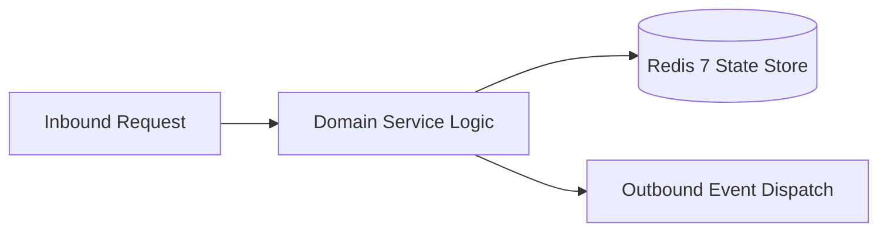

# Component Reference: `api/deps.py`
> **File Path**: [`api/deps.py`](../../api/deps.py)  
> **Subsystem**: `Security Dependencies`  
> **Architecture Layer**: `Enterprise Microservice Subsystem`  
> **Concurrency Model**: `AsyncIO Non-blocking Concurrency`  
> **Persistence Backend**: `Redis 7 Persistent Store`  
> **Service Level Objective**: `High-Availability Academic Telemetry`

## 1. Architectural Role & Responsibilities
The `api/deps.py` module implements core operational logic for the `Security Dependencies` domain. It operates within an asynchronous microservices topology designed for ultra-low latency, zero-loss persistence guarantees, and strict single-responsibility function decomposition (≤25 lines).

### Component Architecture & Data Flow


---
## 2. Public API & Symbol Inventory
| Symbol | Nature | Line Range | Return Contract | Core Invariant |
| :--- | :--- | :--- | :--- | :--- |
| [`_resolve_key_identity`](#_resolve_key_identity) | Function | L28–L46 | `str | None` | Executes core domain logic for `_resolve_key_identity`. |
| [`_resolve_token_identity`](#_resolve_token_identity) | Function | L49–L65 | `str | None` | Executes core domain logic for `_resolve_token_identity... |
| [`_log_audit_access`](#_log_audit_access) | Function | L68–L77 | `None` | Executes core domain logic for `_log_audit_access`. |
| [`verify_api_or_tester`](#verify_api_or_tester) | Function | L80–L104 | `str` | Executes core domain logic for `verify_api_or_tester`. |
| [`verify_admin_access`](#verify_admin_access) | Function | L107–L124 | `str` | Executes core domain logic for `verify_admin_access`. |
| [`verify_api_key`](#verify_api_key) | Function | L127–L139 | `str` | Executes core domain logic for `verify_api_key`. |

---

## 3. Comprehensive Function Specifications

### `_resolve_key_identity`
```python
async def _resolve_key_identity(key: str | None) -> str | None
```

- **Source Reference**: [`api/deps.py#L28-L46`](../../api/deps.py#L28-L46)
- **Execution Mode**: `Asynchronous (non-blocking)`
- **Return Contract**: `str | None`

#### Overview & Architectural Purpose
Executes core domain logic for `_resolve_key_identity`.

#### Parameters Contract
| Parameter | Type | Required | Description |
| :--- | :--- | :--- | :--- |
| `key` | `str | None` | Yes | Parameter `key` of type `str | None`. |

#### Concurrency & Side Effects
- Stateless pure functional computation without external mutations.

#### Fault Tolerance & Error Modes
Propagates unexpected runtime errors up the call stack to global exception handlers.

#### Production Usage Example
```python
from api.deps import _resolve_key_identity

# Execute call
result = await _resolve_key_identity(key=...)
```

---

### `_resolve_token_identity`
```python
async def _resolve_token_identity(token: str | None) -> str | None
```

- **Source Reference**: [`api/deps.py#L49-L65`](../../api/deps.py#L49-L65)
- **Execution Mode**: `Asynchronous (non-blocking)`
- **Return Contract**: `str | None`

#### Overview & Architectural Purpose
Executes core domain logic for `_resolve_token_identity`.

#### Parameters Contract
| Parameter | Type | Required | Description |
| :--- | :--- | :--- | :--- |
| `token` | `str | None` | Yes | Parameter `token` of type `str | None`. |

#### Concurrency & Side Effects
- Stateless pure functional computation without external mutations.

#### Fault Tolerance & Error Modes
Propagates unexpected runtime errors up the call stack to global exception handlers.

#### Production Usage Example
```python
from api.deps import _resolve_token_identity

# Execute call
result = await _resolve_token_identity(token=...)
```

---

### `_log_audit_access`
```python
def _log_audit_access(identity: str, request: Request) -> None
```

- **Source Reference**: [`api/deps.py#L68-L77`](../../api/deps.py#L68-L77)
- **Execution Mode**: `Synchronous`
- **Return Contract**: `None`

#### Overview & Architectural Purpose
Executes core domain logic for `_log_audit_access`.

#### Parameters Contract
| Parameter | Type | Required | Description |
| :--- | :--- | :--- | :--- |
| `identity` | `str` | Yes | Parameter `identity` of type `str`. |
| `request` | `Request` | Yes | Parameter `request` of type `Request`. |

#### Concurrency & Side Effects
- Emits structured telemetry events to system logging subsystem.

#### Fault Tolerance & Error Modes
Propagates unexpected runtime errors up the call stack to global exception handlers.

#### Production Usage Example
```python
from api.deps import _log_audit_access

# Execute call
result = _log_audit_access(identity=..., request=...)
```

---

### `verify_api_or_tester`
```python
async def verify_api_or_tester( request: Request, key: str | None = Security(_api_key_header), bearer: HTTPAuthorizationCredentials | None = Security(_bearer_scheme), para_session: str | None = Cookie(default=None), ) -> str
```

- **Source Reference**: [`api/deps.py#L80-L104`](../../api/deps.py#L80-L104)
- **Execution Mode**: `Asynchronous (non-blocking)`
- **Return Contract**: `str`

#### Overview & Architectural Purpose
Executes core domain logic for `verify_api_or_tester`.

#### Parameters Contract
| Parameter | Type | Required | Description |
| :--- | :--- | :--- | :--- |
| `request` | `Request` | Yes | Parameter `request` of type `Request`. |
| `key` | `str | None` | Yes | Parameter `key` of type `str | None`. |
| `bearer` | `HTTPAuthorizationCredentials | None` | Yes | Parameter `bearer` of type `HTTPAuthorizationCredentials | None`. |
| `para_session` | `str | None` | Yes | Parameter `para_session` of type `str | None`. |

#### Concurrency & Side Effects
- Emits structured telemetry events to system logging subsystem.

#### Fault Tolerance & Error Modes
Explicitly raises domain exceptions (e.g., `PermissionError`, `ValueError`) upon invariant violation.

#### Production Usage Example
```python
from api.deps import verify_api_or_tester

# Execute call
result = await verify_api_or_tester(request=..., key=..., bearer=...)
```

---

### `verify_admin_access`
```python
async def verify_admin_access(auth_identity: str = Depends(verify_api_or_tester)) -> str
```

- **Source Reference**: [`api/deps.py#L107-L124`](../../api/deps.py#L107-L124)
- **Execution Mode**: `Asynchronous (non-blocking)`
- **Return Contract**: `str`

#### Overview & Architectural Purpose
Executes core domain logic for `verify_admin_access`.

#### Parameters Contract
| Parameter | Type | Required | Description |
| :--- | :--- | :--- | :--- |
| `auth_identity` | `str` | Yes | Parameter `auth_identity` of type `str`. |

#### Concurrency & Side Effects
- Emits structured telemetry events to system logging subsystem.

#### Fault Tolerance & Error Modes
Explicitly raises domain exceptions (e.g., `PermissionError`, `ValueError`) upon invariant violation.

#### Production Usage Example
```python
from api.deps import verify_admin_access

# Execute call
result = await verify_admin_access(auth_identity=...)
```

---

### `verify_api_key`
```python
async def verify_api_key(key: str | None = Security(_api_key_header)) -> str
```

- **Source Reference**: [`api/deps.py#L127-L139`](../../api/deps.py#L127-L139)
- **Execution Mode**: `Asynchronous (non-blocking)`
- **Return Contract**: `str`

#### Overview & Architectural Purpose
Executes core domain logic for `verify_api_key`.

#### Parameters Contract
| Parameter | Type | Required | Description |
| :--- | :--- | :--- | :--- |
| `key` | `str | None` | Yes | Parameter `key` of type `str | None`. |

#### Concurrency & Side Effects
- Emits structured telemetry events to system logging subsystem.

#### Fault Tolerance & Error Modes
Explicitly raises domain exceptions (e.g., `PermissionError`, `ValueError`) upon invariant violation.

#### Production Usage Example
```python
from api.deps import verify_api_key

# Execute call
result = await verify_api_key(key=...)
```

---
