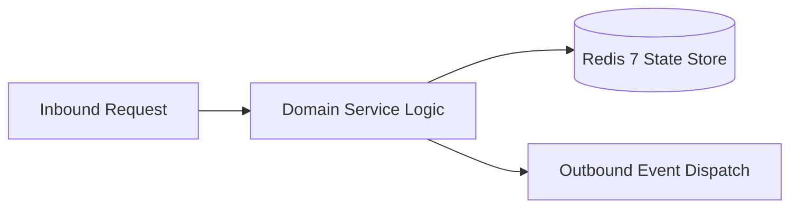

# Component Reference: `api/grpc/converters.py`
> **File Path**: [`api/grpc/converters.py`](../../api/grpc/converters.py)  
> **Subsystem**: `Protobuf Converters`  
> **Architecture Layer**: `Enterprise Microservice Subsystem`  
> **Concurrency Model**: `AsyncIO Non-blocking Concurrency`  
> **Persistence Backend**: `Redis 7 Persistent Store`  
> **Service Level Objective**: `High-Availability Academic Telemetry`

## 1. Architectural Role & Responsibilities
The `api/grpc/converters.py` module implements core operational logic for the `Protobuf Converters` domain. It operates within an asynchronous microservices topology designed for ultra-low latency, zero-loss persistence guarantees, and strict single-responsibility function decomposition (≤25 lines).

### Component Architecture & Data Flow


---
## 2. Public API & Symbol Inventory
| Symbol | Nature | Line Range | Return Contract | Core Invariant |
| :--- | :--- | :--- | :--- | :--- |
| [`lesson_to_proto`](#lesson_to_proto) | Function | L16–L32 | `LessonProto` | Executes core domain logic for `lesson_to_proto`. |
| [`proto_to_lesson`](#proto_to_lesson) | Function | L35–L51 | `Lesson` | Executes core domain logic for `proto_to_lesson`. |
| [`week_days_to_proto`](#week_days_to_proto) | Function | L54–L60 | `list[WeekDayProto]` | Executes core domain logic for `week_days_to_proto`. |
| [`exam_item_to_proto`](#exam_item_to_proto) | Function | L63–L74 | `ExamItemProto` | Executes core domain logic for `exam_item_to_proto`. |
| [`proto_to_exam_item`](#proto_to_exam_item) | Function | L77–L88 | `ExamItem` | Executes core domain logic for `proto_to_exam_item`. |
| [`teachers_dict_to_proto`](#teachers_dict_to_proto) | Function | L91–L99 | `TeachersResponse` | Executes core domain logic for `teachers_dict_to_proto`... |

---

## 3. Comprehensive Function Specifications

### `lesson_to_proto`
```python
def lesson_to_proto(lesson: Lesson) -> LessonProto
```

- **Source Reference**: [`api/grpc/converters.py#L16-L32`](../../api/grpc/converters.py#L16-L32)
- **Execution Mode**: `Synchronous`
- **Return Contract**: `LessonProto`

#### Overview & Architectural Purpose
Executes core domain logic for `lesson_to_proto`.

#### Parameters Contract
| Parameter | Type | Required | Description |
| :--- | :--- | :--- | :--- |
| `lesson` | `Lesson` | Yes | Parameter `lesson` of type `Lesson`. |

#### Concurrency & Side Effects
- Stateless pure functional computation without external mutations.

#### Fault Tolerance & Error Modes
Propagates unexpected runtime errors up the call stack to global exception handlers.

#### Production Usage Example
```python
from api.grpc.converters import lesson_to_proto

# Execute call
result = lesson_to_proto(lesson=...)
```

---

### `proto_to_lesson`
```python
def proto_to_lesson(proto: LessonProto) -> Lesson
```

- **Source Reference**: [`api/grpc/converters.py#L35-L51`](../../api/grpc/converters.py#L35-L51)
- **Execution Mode**: `Synchronous`
- **Return Contract**: `Lesson`

#### Overview & Architectural Purpose
Executes core domain logic for `proto_to_lesson`.

#### Parameters Contract
| Parameter | Type | Required | Description |
| :--- | :--- | :--- | :--- |
| `proto` | `LessonProto` | Yes | Parameter `proto` of type `LessonProto`. |

#### Concurrency & Side Effects
- Stateless pure functional computation without external mutations.

#### Fault Tolerance & Error Modes
Propagates unexpected runtime errors up the call stack to global exception handlers.

#### Production Usage Example
```python
from api.grpc.converters import proto_to_lesson

# Execute call
result = proto_to_lesson(proto=...)
```

---

### `week_days_to_proto`
```python
def week_days_to_proto(raw_days: list[tuple[date, list[Lesson]]]) -> list[WeekDayProto]
```

- **Source Reference**: [`api/grpc/converters.py#L54-L60`](../../api/grpc/converters.py#L54-L60)
- **Execution Mode**: `Synchronous`
- **Return Contract**: `list[WeekDayProto]`

#### Overview & Architectural Purpose
Executes core domain logic for `week_days_to_proto`.

#### Parameters Contract
| Parameter | Type | Required | Description |
| :--- | :--- | :--- | :--- |
| `raw_days` | `list[tuple[date, list[Lesson]]]` | Yes | Parameter `raw_days` of type `list[tuple[date, list[Lesson]]]`. |

#### Concurrency & Side Effects
- Stateless pure functional computation without external mutations.

#### Fault Tolerance & Error Modes
Propagates unexpected runtime errors up the call stack to global exception handlers.

#### Production Usage Example
```python
from api.grpc.converters import week_days_to_proto

# Execute call
result = week_days_to_proto(raw_days=...)
```

---

### `exam_item_to_proto`
```python
def exam_item_to_proto(exam: ExamItem) -> ExamItemProto
```

- **Source Reference**: [`api/grpc/converters.py#L63-L74`](../../api/grpc/converters.py#L63-L74)
- **Execution Mode**: `Synchronous`
- **Return Contract**: `ExamItemProto`

#### Overview & Architectural Purpose
Executes core domain logic for `exam_item_to_proto`.

#### Parameters Contract
| Parameter | Type | Required | Description |
| :--- | :--- | :--- | :--- |
| `exam` | `ExamItem` | Yes | Parameter `exam` of type `ExamItem`. |

#### Concurrency & Side Effects
- Stateless pure functional computation without external mutations.

#### Fault Tolerance & Error Modes
Propagates unexpected runtime errors up the call stack to global exception handlers.

#### Production Usage Example
```python
from api.grpc.converters import exam_item_to_proto

# Execute call
result = exam_item_to_proto(exam=...)
```

---

### `proto_to_exam_item`
```python
def proto_to_exam_item(proto: ExamItemProto) -> ExamItem
```

- **Source Reference**: [`api/grpc/converters.py#L77-L88`](../../api/grpc/converters.py#L77-L88)
- **Execution Mode**: `Synchronous`
- **Return Contract**: `ExamItem`

#### Overview & Architectural Purpose
Executes core domain logic for `proto_to_exam_item`.

#### Parameters Contract
| Parameter | Type | Required | Description |
| :--- | :--- | :--- | :--- |
| `proto` | `ExamItemProto` | Yes | Parameter `proto` of type `ExamItemProto`. |

#### Concurrency & Side Effects
- Stateless pure functional computation without external mutations.

#### Fault Tolerance & Error Modes
Propagates unexpected runtime errors up the call stack to global exception handlers.

#### Production Usage Example
```python
from api.grpc.converters import proto_to_exam_item

# Execute call
result = proto_to_exam_item(proto=...)
```

---

### `teachers_dict_to_proto`
```python
def teachers_dict_to_proto(raw: dict[str, dict]) -> TeachersResponse
```

- **Source Reference**: [`api/grpc/converters.py#L91-L99`](../../api/grpc/converters.py#L91-L99)
- **Execution Mode**: `Synchronous`
- **Return Contract**: `TeachersResponse`

#### Overview & Architectural Purpose
Executes core domain logic for `teachers_dict_to_proto`.

#### Parameters Contract
| Parameter | Type | Required | Description |
| :--- | :--- | :--- | :--- |
| `raw` | `dict[str, dict]` | Yes | Parameter `raw` of type `dict[str, dict]`. |

#### Concurrency & Side Effects
- Stateless pure functional computation without external mutations.

#### Fault Tolerance & Error Modes
Propagates unexpected runtime errors up the call stack to global exception handlers.

#### Production Usage Example
```python
from api.grpc.converters import teachers_dict_to_proto

# Execute call
result = teachers_dict_to_proto(raw=...)
```

---
