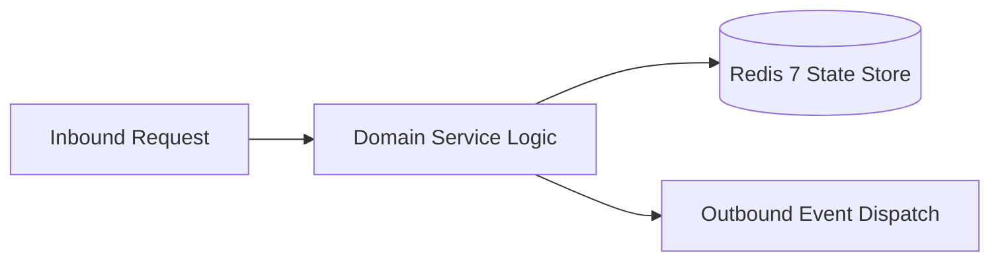

# Component Reference: `api/grpc/server.py`
> **File Path**: [`api/grpc/server.py`](../../api/grpc/server.py)  
> **Subsystem**: `gRPC HTTP/2 Server`  
> **Architecture Layer**: `Enterprise Microservice Subsystem`  
> **Concurrency Model**: `AsyncIO Non-blocking Concurrency`  
> **Persistence Backend**: `Redis 7 Persistent Store`  
> **Service Level Objective**: `High-Availability Academic Telemetry`

## 1. Architectural Role & Responsibilities
The `api/grpc/server.py` module implements core operational logic for the `gRPC HTTP/2 Server` domain. It operates within an asynchronous microservices topology designed for ultra-low latency, zero-loss persistence guarantees, and strict single-responsibility function decomposition (≤25 lines).

### Component Architecture & Data Flow


---
## 2. Public API & Symbol Inventory
| Symbol | Nature | Line Range | Return Contract | Core Invariant |
| :--- | :--- | :--- | :--- | :--- |
| [`ApiKeyAuthInterceptor._abort_unauthenticated`](#apikeyauthinterceptor_abort_unauthenticated) | Method | L35–L36 | `Any` | Executes core domain logic for `_abort_unauthenticated`... |
| [`ApiKeyAuthInterceptor.intercept_service`](#apikeyauthinterceptorintercept_service) | Method | L38–L47 | `grpc.RpcMethodHandler` | Executes core domain logic for `intercept_service`. |
| [`_register_servicers`](#_register_servicers) | Function | L50–L54 | `None` | Executes core domain logic for `_register_servicers`. |
| [`create_grpc_server`](#create_grpc_server) | Function | L57–L70 | `grpc.aio.Server` | Initializes and constructs a new instance of `create_gr... |
| [`start_grpc_server`](#start_grpc_server) | Function | L73–L78 | `None` | Executes core domain logic for `start_grpc_server`. |
| [`stop_grpc_server`](#stop_grpc_server) | Function | L81–L86 | `None` | Executes core domain logic for `stop_grpc_server`. |

---

## 3. Comprehensive Function Specifications

## Class Model: `ApiKeyAuthInterceptor`

Encapsulates domain entities and data transfer logic for `ApiKeyAuthInterceptor`.

### `ApiKeyAuthInterceptor._abort_unauthenticated`
```python
async def _abort_unauthenticated(_req: Any, context: grpc.aio.ServicerContext) -> Any
```

- **Source Reference**: [`api/grpc/server.py#L35-L36`](../../api/grpc/server.py#L35-L36)
- **Execution Mode**: `Asynchronous (non-blocking)`
- **Return Contract**: `Any`

#### Overview & Architectural Purpose
Executes core domain logic for `_abort_unauthenticated`.

#### Parameters Contract
| Parameter | Type | Required | Description |
| :--- | :--- | :--- | :--- |
| `_req` | `Any` | Yes | Parameter `_req` of type `Any`. |
| `context` | `grpc.aio.ServicerContext` | Yes | Parameter `context` of type `grpc.aio.ServicerContext`. |

#### Concurrency & Side Effects
- Stateless pure functional computation without external mutations.

#### Fault Tolerance & Error Modes
Propagates unexpected runtime errors up the call stack to global exception handlers.

#### Production Usage Example
```python
from api.grpc.server import _abort_unauthenticated

# Execute call
result = await _abort_unauthenticated(_req=..., context=...)
```

---

### `ApiKeyAuthInterceptor.intercept_service`
```python
async def intercept_service( self, continuation: Callable[[grpc.HandlerCallDetails], Awaitable[grpc.RpcMethodHandler]], handler_call_details: grpc.HandlerCallDetails, ) -> grpc.RpcMethodHandler
```

- **Source Reference**: [`api/grpc/server.py#L38-L47`](../../api/grpc/server.py#L38-L47)
- **Execution Mode**: `Asynchronous (non-blocking)`
- **Return Contract**: `grpc.RpcMethodHandler`

#### Overview & Architectural Purpose
Executes core domain logic for `intercept_service`.

#### Parameters Contract
| Parameter | Type | Required | Description |
| :--- | :--- | :--- | :--- |
| `continuation` | `Callable[[grpc.HandlerCallDetails], Awaitable[grpc.RpcMethodHandler]]` | Yes | Parameter `continuation` of type `Callable[[grpc.HandlerCallDetails], Awaitable[grpc.RpcMethodHandler]]`. |
| `handler_call_details` | `grpc.HandlerCallDetails` | Yes | Parameter `handler_call_details` of type `grpc.HandlerCallDetails`. |

#### Concurrency & Side Effects
- Stateless pure functional computation without external mutations.

#### Fault Tolerance & Error Modes
Propagates unexpected runtime errors up the call stack to global exception handlers.

#### Production Usage Example
```python
from api.grpc.server import intercept_service

# Execute call
result = await intercept_service(continuation=..., handler_call_details=...)
```

---

### `_register_servicers`
```python
def _register_servicers(server: grpc.aio.Server) -> None
```

- **Source Reference**: [`api/grpc/server.py#L50-L54`](../../api/grpc/server.py#L50-L54)
- **Execution Mode**: `Synchronous`
- **Return Contract**: `None`

#### Overview & Architectural Purpose
Executes core domain logic for `_register_servicers`.

#### Parameters Contract
| Parameter | Type | Required | Description |
| :--- | :--- | :--- | :--- |
| `server` | `grpc.aio.Server` | Yes | Parameter `server` of type `grpc.aio.Server`. |

#### Concurrency & Side Effects
- Stateless pure functional computation without external mutations.

#### Fault Tolerance & Error Modes
Propagates unexpected runtime errors up the call stack to global exception handlers.

#### Production Usage Example
```python
from api.grpc.server import _register_servicers

# Execute call
result = _register_servicers(server=...)
```

---

### `create_grpc_server`
```python
def create_grpc_server() -> grpc.aio.Server
```

- **Source Reference**: [`api/grpc/server.py#L57-L70`](../../api/grpc/server.py#L57-L70)
- **Execution Mode**: `Synchronous`
- **Return Contract**: `grpc.aio.Server`

#### Overview & Architectural Purpose
Initializes and constructs a new instance of `create_grpc_server`.

#### Parameters Contract
*This method takes no input parameters.*

#### Concurrency & Side Effects
- Stateless pure functional computation without external mutations.

#### Fault Tolerance & Error Modes
Propagates unexpected runtime errors up the call stack to global exception handlers.

#### Production Usage Example
```python
from api.grpc.server import create_grpc_server

# Execute call
result = create_grpc_server()
```

---

### `start_grpc_server`
```python
async def start_grpc_server(server: grpc.aio.Server, host: str, port: int) -> None
```

- **Source Reference**: [`api/grpc/server.py#L73-L78`](../../api/grpc/server.py#L73-L78)
- **Execution Mode**: `Asynchronous (non-blocking)`
- **Return Contract**: `None`

#### Overview & Architectural Purpose
Executes core domain logic for `start_grpc_server`.

#### Parameters Contract
| Parameter | Type | Required | Description |
| :--- | :--- | :--- | :--- |
| `server` | `grpc.aio.Server` | Yes | Parameter `server` of type `grpc.aio.Server`. |
| `host` | `str` | Yes | Parameter `host` of type `str`. |
| `port` | `int` | Yes | Parameter `port` of type `int`. |

#### Concurrency & Side Effects
- Emits structured telemetry events to system logging subsystem.

#### Fault Tolerance & Error Modes
Propagates unexpected runtime errors up the call stack to global exception handlers.

#### Production Usage Example
```python
from api.grpc.server import start_grpc_server

# Execute call
result = await start_grpc_server(server=..., host=..., port=...)
```

---

### `stop_grpc_server`
```python
async def stop_grpc_server(server: grpc.aio.Server | None, grace: float = 5.0) -> None
```

- **Source Reference**: [`api/grpc/server.py#L81-L86`](../../api/grpc/server.py#L81-L86)
- **Execution Mode**: `Asynchronous (non-blocking)`
- **Return Contract**: `None`

#### Overview & Architectural Purpose
Executes core domain logic for `stop_grpc_server`.

#### Parameters Contract
| Parameter | Type | Required | Description |
| :--- | :--- | :--- | :--- |
| `server` | `grpc.aio.Server | None` | Yes | Parameter `server` of type `grpc.aio.Server | None`. |
| `grace` | `float` | Yes | Parameter `grace` of type `float`. |

#### Concurrency & Side Effects
- Emits structured telemetry events to system logging subsystem.

#### Fault Tolerance & Error Modes
Propagates unexpected runtime errors up the call stack to global exception handlers.

#### Production Usage Example
```python
from api.grpc.server import stop_grpc_server

# Execute call
result = await stop_grpc_server(server=..., grace=...)
```

---
