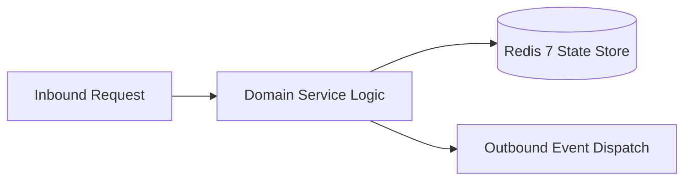

# Component Reference: `api/grpc/servicers.py`
> **File Path**: [`api/grpc/servicers.py`](../../api/grpc/servicers.py)
> **Subsystem**: `gRPC RPC Servicers`
> **Architecture Layer**: `Enterprise Microservice Subsystem`
> **Concurrency Model**: `AsyncIO Non-blocking Concurrency`
> **Persistence Backend**: `Redis 7 Persistent Store`
> **Service Level Objective**: `High-Availability Academic Telemetry`

## 1. Architectural Role & Responsibilities
The `api/grpc/servicers.py` module implements core operational logic for the `gRPC RPC Servicers` domain. It operates within an asynchronous microservices topology designed for ultra-low latency, zero-loss persistence guarantees, and strict single-responsibility function decomposition (≤25 lines).

### Component Architecture & Data Flow


---
## 2. Public API & Symbol Inventory
| Symbol | Nature | Line Range | Return Contract | Core Invariant |
| :--- | :--- | :--- | :--- | :--- |
| [`_resolve_day`](#_resolve_day) | Function | L35–L46 | `date` | Executes core domain logic for `_resolve_day`. |
| [`_resolve_monday`](#_resolve_monday) | Function | L49–L61 | `date` | Executes core domain logic for `_resolve_monday`. |
| [`ScheduleServicer.GetDaySchedule`](#scheduleservicergetdayschedule) | Method | L67–L85 | `schedule_pb2.DayScheduleResponse` | Executes core domain logic for `GetDaySchedule`. |
| [`ScheduleServicer.GetWeekSchedule`](#scheduleservicergetweekschedule) | Method | L87–L105 | `schedule_pb2.WeekScheduleResponse` | Executes core domain logic for `GetWeekSchedule`. |
| [`ExamsServicer.GetExams`](#examsservicergetexams) | Method | L111–L128 | `exams_pb2.ExamsResponse` | Executes core domain logic for `GetExams`. |
| [`TeachersServicer.GetTeachers`](#teachersservicergetteachers) | Method | L134–L149 | `teachers_pb2.TeachersResponse` | Executes core domain logic for `GetTeachers`. |

---

## 3. Comprehensive Function Specifications

### `_resolve_day`
```python
def _resolve_day(raw_date: str) -> date
```

- **Source Reference**: [`api/grpc/servicers.py#L35-L46`](../../api/grpc/servicers.py#L35-L46)
- **Execution Mode**: `Synchronous`
- **Return Contract**: `date`

#### Overview & Architectural Purpose
Executes core domain logic for `_resolve_day`.

#### Parameters Contract
| Parameter | Type | Required | Description |
| :--- | :--- | :--- | :--- |
| `raw_date` | `str` | Yes | Parameter `raw_date` of type `str`. |

#### Concurrency & Side Effects
- Stateless pure functional computation without external mutations.

#### Fault Tolerance & Error Modes
Propagates unexpected runtime errors up the call stack to global exception handlers.

#### Production Usage Example
```python
from api.grpc.servicers import _resolve_day

# Execute call
result = _resolve_day(raw_date=...)
```

---

### `_resolve_monday`
```python
def _resolve_monday(raw_monday: str) -> date
```

- **Source Reference**: [`api/grpc/servicers.py#L49-L61`](../../api/grpc/servicers.py#L49-L61)
- **Execution Mode**: `Synchronous`
- **Return Contract**: `date`

#### Overview & Architectural Purpose
Executes core domain logic for `_resolve_monday`.

#### Parameters Contract
| Parameter | Type | Required | Description |
| :--- | :--- | :--- | :--- |
| `raw_monday` | `str` | Yes | Parameter `raw_monday` of type `str`. |

#### Concurrency & Side Effects
- Stateless pure functional computation without external mutations.

#### Fault Tolerance & Error Modes
Propagates unexpected runtime errors up the call stack to global exception handlers.

#### Production Usage Example
```python
from api.grpc.servicers import _resolve_monday

# Execute call
result = _resolve_monday(raw_monday=...)
```

---

## Class Model: `ScheduleServicer`

Encapsulates domain entities and data transfer logic for `ScheduleServicer`.

### `ScheduleServicer.GetDaySchedule`
```python
async def GetDaySchedule( self, request: schedule_pb2.DayScheduleRequest, context: grpc.aio.ServicerContext, ) -> schedule_pb2.DayScheduleResponse
```

- **Source Reference**: [`api/grpc/servicers.py#L67-L85`](../../api/grpc/servicers.py#L67-L85)
- **Execution Mode**: `Asynchronous (non-blocking)`
- **Return Contract**: `schedule_pb2.DayScheduleResponse`

#### Overview & Architectural Purpose
Executes core domain logic for `GetDaySchedule`.

#### Parameters Contract
| Parameter | Type | Required | Description |
| :--- | :--- | :--- | :--- |
| `request` | `schedule_pb2.DayScheduleRequest` | Yes | Parameter `request` of type `schedule_pb2.DayScheduleRequest`. |
| `context` | `grpc.aio.ServicerContext` | Yes | Parameter `context` of type `grpc.aio.ServicerContext`. |

#### Concurrency & Side Effects
- Emits structured telemetry events to system logging subsystem.

#### Fault Tolerance & Error Modes
Propagates unexpected runtime errors up the call stack to global exception handlers.

#### Production Usage Example
```python
from api.grpc.servicers import GetDaySchedule

# Execute call
result = await GetDaySchedule(request=..., context=...)
```

---

### `ScheduleServicer.GetWeekSchedule`
```python
async def GetWeekSchedule( self, request: schedule_pb2.WeekScheduleRequest, context: grpc.aio.ServicerContext, ) -> schedule_pb2.WeekScheduleResponse
```

- **Source Reference**: [`api/grpc/servicers.py#L87-L105`](../../api/grpc/servicers.py#L87-L105)
- **Execution Mode**: `Asynchronous (non-blocking)`
- **Return Contract**: `schedule_pb2.WeekScheduleResponse`

#### Overview & Architectural Purpose
Executes core domain logic for `GetWeekSchedule`.

#### Parameters Contract
| Parameter | Type | Required | Description |
| :--- | :--- | :--- | :--- |
| `request` | `schedule_pb2.WeekScheduleRequest` | Yes | Parameter `request` of type `schedule_pb2.WeekScheduleRequest`. |
| `context` | `grpc.aio.ServicerContext` | Yes | Parameter `context` of type `grpc.aio.ServicerContext`. |

#### Concurrency & Side Effects
- Emits structured telemetry events to system logging subsystem.

#### Fault Tolerance & Error Modes
Propagates unexpected runtime errors up the call stack to global exception handlers.

#### Production Usage Example
```python
from api.grpc.servicers import GetWeekSchedule

# Execute call
result = await GetWeekSchedule(request=..., context=...)
```

---

## Class Model: `ExamsServicer`

Encapsulates domain entities and data transfer logic for `ExamsServicer`.

### `ExamsServicer.GetExams`
```python
async def GetExams( self, request: exams_pb2.ExamsRequest, context: grpc.aio.ServicerContext, ) -> exams_pb2.ExamsResponse
```

- **Source Reference**: [`api/grpc/servicers.py#L111-L128`](../../api/grpc/servicers.py#L111-L128)
- **Execution Mode**: `Asynchronous (non-blocking)`
- **Return Contract**: `exams_pb2.ExamsResponse`

#### Overview & Architectural Purpose
Executes core domain logic for `GetExams`.

#### Parameters Contract
| Parameter | Type | Required | Description |
| :--- | :--- | :--- | :--- |
| `request` | `exams_pb2.ExamsRequest` | Yes | Parameter `request` of type `exams_pb2.ExamsRequest`. |
| `context` | `grpc.aio.ServicerContext` | Yes | Parameter `context` of type `grpc.aio.ServicerContext`. |

#### Concurrency & Side Effects
- Emits structured telemetry events to system logging subsystem.

#### Fault Tolerance & Error Modes
Propagates unexpected runtime errors up the call stack to global exception handlers.

#### Production Usage Example
```python
from api.grpc.servicers import GetExams

# Execute call
result = await GetExams(request=..., context=...)
```

---

## Class Model: `TeachersServicer`

Encapsulates domain entities and data transfer logic for `TeachersServicer`.

### `TeachersServicer.GetTeachers`
```python
async def GetTeachers( self, request: teachers_pb2.TeachersRequest, context: grpc.aio.ServicerContext, ) -> teachers_pb2.TeachersResponse
```

- **Source Reference**: [`api/grpc/servicers.py#L134-L149`](../../api/grpc/servicers.py#L134-L149)
- **Execution Mode**: `Asynchronous (non-blocking)`
- **Return Contract**: `teachers_pb2.TeachersResponse`

#### Overview & Architectural Purpose
Executes core domain logic for `GetTeachers`.

#### Parameters Contract
| Parameter | Type | Required | Description |
| :--- | :--- | :--- | :--- |
| `request` | `teachers_pb2.TeachersRequest` | Yes | Parameter `request` of type `teachers_pb2.TeachersRequest`. |
| `context` | `grpc.aio.ServicerContext` | Yes | Parameter `context` of type `grpc.aio.ServicerContext`. |

#### Concurrency & Side Effects
- Emits structured telemetry events to system logging subsystem.

#### Fault Tolerance & Error Modes
Propagates unexpected runtime errors up the call stack to global exception handlers.

#### Production Usage Example
```python
from api.grpc.servicers import GetTeachers

# Execute call
result = await GetTeachers(request=..., context=...)
```

---
