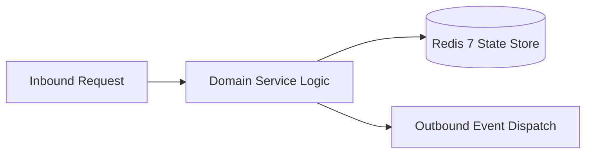

# Component Reference: `api/handlers.py`
> **File Path**: [`api/handlers.py`](../../api/handlers.py)
> **Subsystem**: `REST Request Handlers`
> **Architecture Layer**: `Enterprise Microservice Subsystem`
> **Concurrency Model**: `AsyncIO Non-blocking Concurrency`
> **Persistence Backend**: `Redis 7 Persistent Store`
> **Service Level Objective**: `High-Availability Academic Telemetry`

## 1. Architectural Role & Responsibilities
The `api/handlers.py` module implements core operational logic for the `REST Request Handlers` domain. It operates within an asynchronous microservices topology designed for ultra-low latency, zero-loss persistence guarantees, and strict single-responsibility function decomposition (≤25 lines).

### Component Architecture & Data Flow


---
## 2. Public API & Symbol Inventory
| Symbol | Nature | Line Range | Return Contract | Core Invariant |
| :--- | :--- | :--- | :--- | :--- |
| [`http_exception_handler`](#http_exception_handler) | Function | L19–L29 | `JSONResponse` | Executes core domain logic for `http_exception_handler`... |
| [`validation_exception_handler`](#validation_exception_handler) | Function | L32–L46 | `JSONResponse` | Executes core domain logic for `validation_exception_ha... |
| [`unhandled_exception_handler`](#unhandled_exception_handler) | Function | L49–L60 | `JSONResponse` | Executes core domain logic for `unhandled_exception_han... |
| [`register_exception_handlers`](#register_exception_handlers) | Function | L63–L73 | `None` | Executes core domain logic for `register_exception_hand... |

---

## 3. Comprehensive Function Specifications

### `http_exception_handler`
```python
async def http_exception_handler(request: Request, exc: HTTPException) -> JSONResponse
```

- **Source Reference**: [`api/handlers.py#L19-L29`](../../api/handlers.py#L19-L29)
- **Execution Mode**: `Asynchronous (non-blocking)`
- **Return Contract**: `JSONResponse`

#### Overview & Architectural Purpose
Executes core domain logic for `http_exception_handler`.

#### Parameters Contract
| Parameter | Type | Required | Description |
| :--- | :--- | :--- | :--- |
| `request` | `Request` | Yes | Parameter `request` of type `Request`. |
| `exc` | `HTTPException` | Yes | Parameter `exc` of type `HTTPException`. |

#### Concurrency & Side Effects
- Stateless pure functional computation without external mutations.

#### Fault Tolerance & Error Modes
Propagates unexpected runtime errors up the call stack to global exception handlers.

#### Production Usage Example
```python
from api.handlers import http_exception_handler

# Execute call
result = await http_exception_handler(request=..., exc=...)
```

---

### `validation_exception_handler`
```python
async def validation_exception_handler(request: Request, exc: RequestValidationError) -> JSONResponse
```

- **Source Reference**: [`api/handlers.py#L32-L46`](../../api/handlers.py#L32-L46)
- **Execution Mode**: `Asynchronous (non-blocking)`
- **Return Contract**: `JSONResponse`

#### Overview & Architectural Purpose
Executes core domain logic for `validation_exception_handler`.

#### Parameters Contract
| Parameter | Type | Required | Description |
| :--- | :--- | :--- | :--- |
| `request` | `Request` | Yes | Parameter `request` of type `Request`. |
| `exc` | `RequestValidationError` | Yes | Parameter `exc` of type `RequestValidationError`. |

#### Concurrency & Side Effects
- Emits structured telemetry events to system logging subsystem.

#### Fault Tolerance & Error Modes
Propagates unexpected runtime errors up the call stack to global exception handlers.

#### Production Usage Example
```python
from api.handlers import validation_exception_handler

# Execute call
result = await validation_exception_handler(request=..., exc=...)
```

---

### `unhandled_exception_handler`
```python
async def unhandled_exception_handler(request: Request, exc: Exception) -> JSONResponse
```

- **Source Reference**: [`api/handlers.py#L49-L60`](../../api/handlers.py#L49-L60)
- **Execution Mode**: `Asynchronous (non-blocking)`
- **Return Contract**: `JSONResponse`

#### Overview & Architectural Purpose
Executes core domain logic for `unhandled_exception_handler`.

#### Parameters Contract
| Parameter | Type | Required | Description |
| :--- | :--- | :--- | :--- |
| `request` | `Request` | Yes | Parameter `request` of type `Request`. |
| `exc` | `Exception` | Yes | Parameter `exc` of type `Exception`. |

#### Concurrency & Side Effects
- Emits structured telemetry events to system logging subsystem.

#### Fault Tolerance & Error Modes
Propagates unexpected runtime errors up the call stack to global exception handlers.

#### Production Usage Example
```python
from api.handlers import unhandled_exception_handler

# Execute call
result = await unhandled_exception_handler(request=..., exc=...)
```

---

### `register_exception_handlers`
```python
def register_exception_handlers(app: FastAPI) -> None
```

- **Source Reference**: [`api/handlers.py#L63-L73`](../../api/handlers.py#L63-L73)
- **Execution Mode**: `Synchronous`
- **Return Contract**: `None`

#### Overview & Architectural Purpose
Executes core domain logic for `register_exception_handlers`.

#### Parameters Contract
| Parameter | Type | Required | Description |
| :--- | :--- | :--- | :--- |
| `app` | `FastAPI` | Yes | Parameter `app` of type `FastAPI`. |

#### Concurrency & Side Effects
- Stateless pure functional computation without external mutations.

#### Fault Tolerance & Error Modes
Propagates unexpected runtime errors up the call stack to global exception handlers.

#### Production Usage Example
```python
from api.handlers import register_exception_handlers

# Execute call
result = register_exception_handlers(app=...)
```

---
