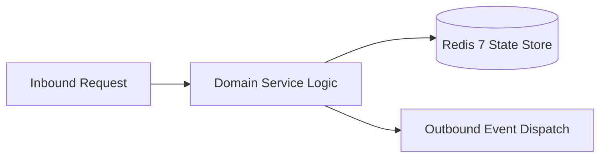

# Component Reference: `api/router/attendance.py`
> **File Path**: [`api/router/attendance.py`](../../api/router/attendance.py)  
> **Subsystem**: `Attendance API`  
> **Architecture Layer**: `Enterprise Microservice Subsystem`  
> **Concurrency Model**: `AsyncIO Non-blocking Concurrency`  
> **Persistence Backend**: `Redis 7 Persistent Store`  
> **Service Level Objective**: `High-Availability Academic Telemetry`

## 1. Architectural Role & Responsibilities
The `api/router/attendance.py` module implements core operational logic for the `Attendance API` domain. It operates within an asynchronous microservices topology designed for ultra-low latency, zero-loss persistence guarantees, and strict single-responsibility function decomposition (≤25 lines).

### Component Architecture & Data Flow


---
## 2. Public API & Symbol Inventory
| Symbol | Nature | Line Range | Return Contract | Core Invariant |
| :--- | :--- | :--- | :--- | :--- |
| [`get_attendance_stats`](#get_attendance_stats) | Function | L38–L42 | `AttendanceStatsResponse` | Retrieves and resolves domain data for `get_attendance_... |
| [`get_student_attendance`](#get_student_attendance) | Function | L46–L56 | `StudentPersonalStatsResponse` | Retrieves and resolves domain data for `get_student_att... |
| [`_build_session_response`](#_build_session_response) | Function | L59–L73 | `ActiveSessionResponse` | Executes core domain logic for `_build_session_response... |
| [`get_current_session`](#get_current_session) | Function | L77–L80 | `ActiveSessionResponse` | Retrieves and resolves domain data for `get_current_ses... |
| [`start_session`](#start_session) | Function | L84–L90 | `ActiveSessionResponse` | Executes core domain logic for `start_session`. |
| [`mark_student`](#mark_student) | Function | L94–L99 | `ActiveSessionResponse` | Executes core domain logic for `mark_student`. |
| [`batch_present`](#batch_present) | Function | L103–L108 | `ActiveSessionResponse` | Executes core domain logic for `batch_present`. |
| [`commit_session`](#commit_session) | Function | L112–L121 | `CommitAttendanceResponse` | Commits transactional modifications to external store f... |
| [`cancel_session`](#cancel_session) | Function | L125–L128 | `dict` | Executes core domain logic for `cancel_session`. |

---

## 3. Comprehensive Function Specifications

### `get_attendance_stats`
```python
async def get_attendance_stats(force_refresh: bool = Query(default=False)) -> AttendanceStatsResponse
```

- **Source Reference**: [`api/router/attendance.py#L38-L42`](../../api/router/attendance.py#L38-L42)
- **Execution Mode**: `Asynchronous (non-blocking)`
- **Return Contract**: `AttendanceStatsResponse`

#### Overview & Architectural Purpose
Retrieves and resolves domain data for `get_attendance_stats`.

#### Parameters Contract
| Parameter | Type | Required | Description |
| :--- | :--- | :--- | :--- |
| `force_refresh` | `bool` | Yes | Parameter `force_refresh` of type `bool`. |

#### Concurrency & Side Effects
- Stateless pure functional computation without external mutations.

#### Fault Tolerance & Error Modes
Propagates unexpected runtime errors up the call stack to global exception handlers.

#### Production Usage Example
```python
from api.router.attendance import get_attendance_stats

# Execute call
result = await get_attendance_stats(force_refresh=...)
```

---

### `get_student_attendance`
```python
async def get_student_attendance(fio: str) -> StudentPersonalStatsResponse
```

- **Source Reference**: [`api/router/attendance.py#L46-L56`](../../api/router/attendance.py#L46-L56)
- **Execution Mode**: `Asynchronous (non-blocking)`
- **Return Contract**: `StudentPersonalStatsResponse`

#### Overview & Architectural Purpose
Retrieves and resolves domain data for `get_student_attendance`.

#### Parameters Contract
| Parameter | Type | Required | Description |
| :--- | :--- | :--- | :--- |
| `fio` | `str` | Yes | Full canonical name of the student in Cyrillic nominative format. |

#### Concurrency & Side Effects
- Stateless pure functional computation without external mutations.

#### Fault Tolerance & Error Modes
Explicitly raises domain exceptions (e.g., `PermissionError`, `ValueError`) upon invariant violation.

#### Production Usage Example
```python
from api.router.attendance import get_student_attendance

# Execute call
result = await get_student_attendance(fio=...)
```

---

### `_build_session_response`
```python
def _build_session_response(s) -> ActiveSessionResponse
```

- **Source Reference**: [`api/router/attendance.py#L59-L73`](../../api/router/attendance.py#L59-L73)
- **Execution Mode**: `Synchronous`
- **Return Contract**: `ActiveSessionResponse`

#### Overview & Architectural Purpose
Executes core domain logic for `_build_session_response`.

#### Parameters Contract
| Parameter | Type | Required | Description |
| :--- | :--- | :--- | :--- |
| `s` | `Any` | Yes | Parameter `s` of type `Any`. |

#### Concurrency & Side Effects
- Stateless pure functional computation without external mutations.

#### Fault Tolerance & Error Modes
Propagates unexpected runtime errors up the call stack to global exception handlers.

#### Production Usage Example
```python
from api.router.attendance import _build_session_response

# Execute call
result = _build_session_response(s=...)
```

---

### `get_current_session`
```python
async def get_current_session() -> ActiveSessionResponse
```

- **Source Reference**: [`api/router/attendance.py#L77-L80`](../../api/router/attendance.py#L77-L80)
- **Execution Mode**: `Asynchronous (non-blocking)`
- **Return Contract**: `ActiveSessionResponse`

#### Overview & Architectural Purpose
Retrieves and resolves domain data for `get_current_session`.

#### Parameters Contract
*This method takes no input parameters.*

#### Concurrency & Side Effects
- Stateless pure functional computation without external mutations.

#### Fault Tolerance & Error Modes
Propagates unexpected runtime errors up the call stack to global exception handlers.

#### Production Usage Example
```python
from api.router.attendance import get_current_session

# Execute call
result = await get_current_session()
```

---

### `start_session`
```python
async def start_session(payload: StartSessionRequest) -> ActiveSessionResponse
```

- **Source Reference**: [`api/router/attendance.py#L84-L90`](../../api/router/attendance.py#L84-L90)
- **Execution Mode**: `Asynchronous (non-blocking)`
- **Return Contract**: `ActiveSessionResponse`

#### Overview & Architectural Purpose
Executes core domain logic for `start_session`.

#### Parameters Contract
| Parameter | Type | Required | Description |
| :--- | :--- | :--- | :--- |
| `payload` | `StartSessionRequest` | Yes | Parameter `payload` of type `StartSessionRequest`. |

#### Concurrency & Side Effects
- Stateless pure functional computation without external mutations.

#### Fault Tolerance & Error Modes
Explicitly raises domain exceptions (e.g., `PermissionError`, `ValueError`) upon invariant violation.

#### Production Usage Example
```python
from api.router.attendance import start_session

# Execute call
result = await start_session(payload=...)
```

---

### `mark_student`
```python
async def mark_student(payload: MarkStudentRequest) -> ActiveSessionResponse
```

- **Source Reference**: [`api/router/attendance.py#L94-L99`](../../api/router/attendance.py#L94-L99)
- **Execution Mode**: `Asynchronous (non-blocking)`
- **Return Contract**: `ActiveSessionResponse`

#### Overview & Architectural Purpose
Executes core domain logic for `mark_student`.

#### Parameters Contract
| Parameter | Type | Required | Description |
| :--- | :--- | :--- | :--- |
| `payload` | `MarkStudentRequest` | Yes | Parameter `payload` of type `MarkStudentRequest`. |

#### Concurrency & Side Effects
- Stateless pure functional computation without external mutations.

#### Fault Tolerance & Error Modes
Explicitly raises domain exceptions (e.g., `PermissionError`, `ValueError`) upon invariant violation.

#### Production Usage Example
```python
from api.router.attendance import mark_student

# Execute call
result = await mark_student(payload=...)
```

---

### `batch_present`
```python
async def batch_present() -> ActiveSessionResponse
```

- **Source Reference**: [`api/router/attendance.py#L103-L108`](../../api/router/attendance.py#L103-L108)
- **Execution Mode**: `Asynchronous (non-blocking)`
- **Return Contract**: `ActiveSessionResponse`

#### Overview & Architectural Purpose
Executes core domain logic for `batch_present`.

#### Parameters Contract
*This method takes no input parameters.*

#### Concurrency & Side Effects
- Stateless pure functional computation without external mutations.

#### Fault Tolerance & Error Modes
Explicitly raises domain exceptions (e.g., `PermissionError`, `ValueError`) upon invariant violation.

#### Production Usage Example
```python
from api.router.attendance import batch_present

# Execute call
result = await batch_present()
```

---

### `commit_session`
```python
async def commit_session() -> CommitAttendanceResponse
```

- **Source Reference**: [`api/router/attendance.py#L112-L121`](../../api/router/attendance.py#L112-L121)
- **Execution Mode**: `Asynchronous (non-blocking)`
- **Return Contract**: `CommitAttendanceResponse`

#### Overview & Architectural Purpose
Commits transactional modifications to external store for `commit_session`.

#### Parameters Contract
*This method takes no input parameters.*

#### Concurrency & Side Effects
- Stateless pure functional computation without external mutations.

#### Fault Tolerance & Error Modes
Explicitly raises domain exceptions (e.g., `PermissionError`, `ValueError`) upon invariant violation.

#### Production Usage Example
```python
from api.router.attendance import commit_session

# Execute call
result = await commit_session()
```

---

### `cancel_session`
```python
async def cancel_session() -> dict
```

- **Source Reference**: [`api/router/attendance.py#L125-L128`](../../api/router/attendance.py#L125-L128)
- **Execution Mode**: `Asynchronous (non-blocking)`
- **Return Contract**: `dict`

#### Overview & Architectural Purpose
Executes core domain logic for `cancel_session`.

#### Parameters Contract
*This method takes no input parameters.*

#### Concurrency & Side Effects
- Stateless pure functional computation without external mutations.

#### Fault Tolerance & Error Modes
Propagates unexpected runtime errors up the call stack to global exception handlers.

#### Production Usage Example
```python
from api.router.attendance import cancel_session

# Execute call
result = await cancel_session()
```

---
