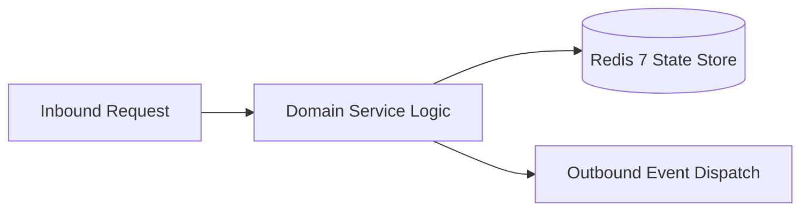

# Component Reference: `api/router/birthdays.py`
> **File Path**: [`api/router/birthdays.py`](../../api/router/birthdays.py)  
> **Subsystem**: `Birthdays API`  
> **Architecture Layer**: `Enterprise Microservice Subsystem`  
> **Concurrency Model**: `AsyncIO Non-blocking Concurrency`  
> **Persistence Backend**: `Redis 7 Persistent Store`  
> **Service Level Objective**: `High-Availability Academic Telemetry`

## 1. Architectural Role & Responsibilities
The `api/router/birthdays.py` module implements core operational logic for the `Birthdays API` domain. It operates within an asynchronous microservices topology designed for ultra-low latency, zero-loss persistence guarantees, and strict single-responsibility function decomposition (≤25 lines).

### Component Architecture & Data Flow


---
## 2. Public API & Symbol Inventory
| Symbol | Nature | Line Range | Return Contract | Core Invariant |
| :--- | :--- | :--- | :--- | :--- |
| [`_map_calculated_to_dto`](#_map_calculated_to_dto) | Function | L25–L44 | `BirthdayItem` | Executes core domain logic for `_map_calculated_to_dto`... |
| [`get_birthdays_calendar`](#get_birthdays_calendar) | Function | L48–L64 | `BirthdaysCalendarResponse` | Retrieves and resolves domain data for `get_birthdays_c... |
| [`get_upcoming_birthdays`](#get_upcoming_birthdays) | Function | L68–L87 | `UpcomingBirthdaysResponse` | Retrieves and resolves domain data for `get_upcoming_bi... |
| [`get_today_birthdays`](#get_today_birthdays) | Function | L91–L107 | `TodayBirthdaysResponse` | Retrieves and resolves domain data for `get_today_birth... |

---

## 3. Comprehensive Function Specifications

### `_map_calculated_to_dto`
```python
def _map_calculated_to_dto(c: dict) -> BirthdayItem
```

- **Source Reference**: [`api/router/birthdays.py#L25-L44`](../../api/router/birthdays.py#L25-L44)
- **Execution Mode**: `Synchronous`
- **Return Contract**: `BirthdayItem`

#### Overview & Architectural Purpose
Executes core domain logic for `_map_calculated_to_dto`.

#### Parameters Contract
| Parameter | Type | Required | Description |
| :--- | :--- | :--- | :--- |
| `c` | `dict` | Yes | Parameter `c` of type `dict`. |

#### Concurrency & Side Effects
- Stateless pure functional computation without external mutations.

#### Fault Tolerance & Error Modes
Propagates unexpected runtime errors up the call stack to global exception handlers.

#### Production Usage Example
```python
from api.router.birthdays import _map_calculated_to_dto

# Execute call
result = _map_calculated_to_dto(c=...)
```

---

### `get_birthdays_calendar`
```python
async def get_birthdays_calendar() -> BirthdaysCalendarResponse
```

- **Source Reference**: [`api/router/birthdays.py#L48-L64`](../../api/router/birthdays.py#L48-L64)
- **Execution Mode**: `Asynchronous (non-blocking)`
- **Return Contract**: `BirthdaysCalendarResponse`

#### Overview & Architectural Purpose
Retrieves and resolves domain data for `get_birthdays_calendar`.

#### Parameters Contract
*This method takes no input parameters.*

#### Concurrency & Side Effects
- Stateless pure functional computation without external mutations.

#### Fault Tolerance & Error Modes
Propagates unexpected runtime errors up the call stack to global exception handlers.

#### Production Usage Example
```python
from api.router.birthdays import get_birthdays_calendar

# Execute call
result = await get_birthdays_calendar()
```

---

### `get_upcoming_birthdays`
```python
async def get_upcoming_birthdays( days: int = Query(default=30, ge=1, le=365, description="Search horizon (days)"), ) -> UpcomingBirthdaysResponse
```

- **Source Reference**: [`api/router/birthdays.py#L68-L87`](../../api/router/birthdays.py#L68-L87)
- **Execution Mode**: `Asynchronous (non-blocking)`
- **Return Contract**: `UpcomingBirthdaysResponse`

#### Overview & Architectural Purpose
Retrieves and resolves domain data for `get_upcoming_birthdays`.

#### Parameters Contract
| Parameter | Type | Required | Description |
| :--- | :--- | :--- | :--- |
| `days` | `int` | Yes | Parameter `days` of type `int`. |

#### Concurrency & Side Effects
- Stateless pure functional computation without external mutations.

#### Fault Tolerance & Error Modes
Propagates unexpected runtime errors up the call stack to global exception handlers.

#### Production Usage Example
```python
from api.router.birthdays import get_upcoming_birthdays

# Execute call
result = await get_upcoming_birthdays(days=...)
```

---

### `get_today_birthdays`
```python
async def get_today_birthdays() -> TodayBirthdaysResponse
```

- **Source Reference**: [`api/router/birthdays.py#L91-L107`](../../api/router/birthdays.py#L91-L107)
- **Execution Mode**: `Asynchronous (non-blocking)`
- **Return Contract**: `TodayBirthdaysResponse`

#### Overview & Architectural Purpose
Retrieves and resolves domain data for `get_today_birthdays`.

#### Parameters Contract
*This method takes no input parameters.*

#### Concurrency & Side Effects
- Stateless pure functional computation without external mutations.

#### Fault Tolerance & Error Modes
Propagates unexpected runtime errors up the call stack to global exception handlers.

#### Production Usage Example
```python
from api.router.birthdays import get_today_birthdays

# Execute call
result = await get_today_birthdays()
```

---
