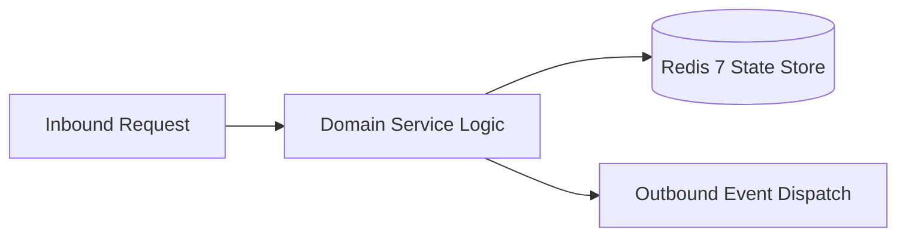

# Component Reference: `api/router/classmates.py`
> **File Path**: [`api/router/classmates.py`](../../api/router/classmates.py)
> **Subsystem**: `Classmates API`
> **Architecture Layer**: `Enterprise Microservice Subsystem`
> **Concurrency Model**: `AsyncIO Non-blocking Concurrency`
> **Persistence Backend**: `Redis 7 Persistent Store`
> **Service Level Objective**: `High-Availability Academic Telemetry`

## 1. Architectural Role & Responsibilities
The `api/router/classmates.py` module implements core operational logic for the `Classmates API` domain. It operates within an asynchronous microservices topology designed for ultra-low latency, zero-loss persistence guarantees, and strict single-responsibility function decomposition (≤25 lines).

### Component Architecture & Data Flow


---
## 2. Public API & Symbol Inventory
| Symbol | Nature | Line Range | Return Contract | Core Invariant |
| :--- | :--- | :--- | :--- | :--- |
| [`_to_classmate_item`](#_to_classmate_item) | Function | L22–L40 | `ClassmateItem` | Executes core domain logic for `_to_classmate_item`. |
| [`list_classmates`](#list_classmates) | Function | L44–L57 | `ClassmatesListResponse` | Executes core domain logic for `list_classmates`. |
| [`_find_student_in_registry`](#_find_student_in_registry) | Function | L60–L74 | `dict | None` | Executes core domain logic for `_find_student_in_regist... |
| [`get_classmate_detail`](#get_classmate_detail) | Function | L78–L102 | `ClassmateDetailResponse` | Retrieves and resolves domain data for `get_classmate_d... |

---

## 3. Comprehensive Function Specifications

### `_to_classmate_item`
```python
def _to_classmate_item(raw: dict) -> ClassmateItem
```

- **Source Reference**: [`api/router/classmates.py#L22-L40`](../../api/router/classmates.py#L22-L40)
- **Execution Mode**: `Synchronous`
- **Return Contract**: `ClassmateItem`

#### Overview & Architectural Purpose
Executes core domain logic for `_to_classmate_item`.

#### Parameters Contract
| Parameter | Type | Required | Description |
| :--- | :--- | :--- | :--- |
| `raw` | `dict` | Yes | Parameter `raw` of type `dict`. |

#### Concurrency & Side Effects
- Stateless pure functional computation without external mutations.

#### Fault Tolerance & Error Modes
Propagates unexpected runtime errors up the call stack to global exception handlers.

#### Production Usage Example
```python
from api.router.classmates import _to_classmate_item

# Execute call
result = _to_classmate_item(raw=...)
```

---

### `list_classmates`
```python
async def list_classmates() -> ClassmatesListResponse
```

- **Source Reference**: [`api/router/classmates.py#L44-L57`](../../api/router/classmates.py#L44-L57)
- **Execution Mode**: `Asynchronous (non-blocking)`
- **Return Contract**: `ClassmatesListResponse`

#### Overview & Architectural Purpose
Executes core domain logic for `list_classmates`.

#### Parameters Contract
*This method takes no input parameters.*

#### Concurrency & Side Effects
- Stateless pure functional computation without external mutations.

#### Fault Tolerance & Error Modes
Propagates unexpected runtime errors up the call stack to global exception handlers.

#### Production Usage Example
```python
from api.router.classmates import list_classmates

# Execute call
result = await list_classmates()
```

---

### `_find_student_in_registry`
```python
def _find_student_in_registry(registry: list[dict], identifier: int) -> dict | None
```

- **Source Reference**: [`api/router/classmates.py#L60-L74`](../../api/router/classmates.py#L60-L74)
- **Execution Mode**: `Synchronous`
- **Return Contract**: `dict | None`

#### Overview & Architectural Purpose
Executes core domain logic for `_find_student_in_registry`.

#### Parameters Contract
| Parameter | Type | Required | Description |
| :--- | :--- | :--- | :--- |
| `registry` | `list[dict]` | Yes | Parameter `registry` of type `list[dict]`. |
| `identifier` | `int` | Yes | Parameter `identifier` of type `int`. |

#### Concurrency & Side Effects
- Stateless pure functional computation without external mutations.

#### Fault Tolerance & Error Modes
Propagates unexpected runtime errors up the call stack to global exception handlers.

#### Production Usage Example
```python
from api.router.classmates import _find_student_in_registry

# Execute call
result = _find_student_in_registry(registry=..., identifier=...)
```

---

### `get_classmate_detail`
```python
async def get_classmate_detail(student_id: int) -> ClassmateDetailResponse
```

- **Source Reference**: [`api/router/classmates.py#L78-L102`](../../api/router/classmates.py#L78-L102)
- **Execution Mode**: `Asynchronous (non-blocking)`
- **Return Contract**: `ClassmateDetailResponse`

#### Overview & Architectural Purpose
Retrieves and resolves domain data for `get_classmate_detail`.

#### Parameters Contract
| Parameter | Type | Required | Description |
| :--- | :--- | :--- | :--- |
| `student_id` | `int` | Yes | Parameter `student_id` of type `int`. |

#### Concurrency & Side Effects
- Stateless pure functional computation without external mutations.

#### Fault Tolerance & Error Modes
Explicitly raises domain exceptions (e.g., `PermissionError`, `ValueError`) upon invariant violation.

#### Production Usage Example
```python
from api.router.classmates import get_classmate_detail

# Execute call
result = await get_classmate_detail(student_id=...)
```

---
