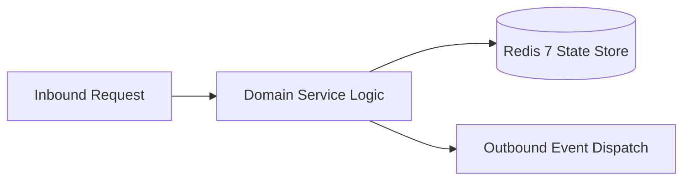

# Component Reference: `api/router/exams.py`
> **File Path**: [`api/router/exams.py`](../../api/router/exams.py)  
> **Subsystem**: `Exams API`  
> **Architecture Layer**: `Enterprise Microservice Subsystem`  
> **Concurrency Model**: `AsyncIO Non-blocking Concurrency`  
> **Persistence Backend**: `Redis 7 Persistent Store`  
> **Service Level Objective**: `High-Availability Academic Telemetry`

## 1. Architectural Role & Responsibilities
The `api/router/exams.py` module implements core operational logic for the `Exams API` domain. It operates within an asynchronous microservices topology designed for ultra-low latency, zero-loss persistence guarantees, and strict single-responsibility function decomposition (≤25 lines).

### Component Architecture & Data Flow


---
## 2. Public API & Symbol Inventory
| Symbol | Nature | Line Range | Return Contract | Core Invariant |
| :--- | :--- | :--- | :--- | :--- |
| [`list_exams`](#list_exams) | Function | L23–L35 | `ExamsResponse` | Executes core domain logic for `list_exams`. |
| [`_resolve_current_week`](#_resolve_current_week) | Function | L38–L52 | `int` | Executes core domain logic for `_resolve_current_week`. |
| [`upcoming_exams`](#upcoming_exams) | Function | L56–L74 | `UpcomingExamsResponse` | Executes core domain logic for `upcoming_exams`. |
| [`refresh_exams`](#refresh_exams) | Function | L78–L91 | `ExamsRefreshResponse` | Executes core domain logic for `refresh_exams`. |

---

## 3. Comprehensive Function Specifications

### `list_exams`
```python
async def list_exams() -> ExamsResponse
```

- **Source Reference**: [`api/router/exams.py#L23-L35`](../../api/router/exams.py#L23-L35)
- **Execution Mode**: `Asynchronous (non-blocking)`
- **Return Contract**: `ExamsResponse`

#### Overview & Architectural Purpose
Executes core domain logic for `list_exams`.

#### Parameters Contract
*This method takes no input parameters.*

#### Concurrency & Side Effects
- Stateless pure functional computation without external mutations.

#### Fault Tolerance & Error Modes
Propagates unexpected runtime errors up the call stack to global exception handlers.

#### Production Usage Example
```python
from api.router.exams import list_exams

# Execute call
result = await list_exams()
```

---

### `_resolve_current_week`
```python
async def _resolve_current_week() -> int
```

- **Source Reference**: [`api/router/exams.py#L38-L52`](../../api/router/exams.py#L38-L52)
- **Execution Mode**: `Asynchronous (non-blocking)`
- **Return Contract**: `int`

#### Overview & Architectural Purpose
Executes core domain logic for `_resolve_current_week`.

#### Parameters Contract
*This method takes no input parameters.*

#### Concurrency & Side Effects
- Stateless pure functional computation without external mutations.

#### Fault Tolerance & Error Modes
Propagates unexpected runtime errors up the call stack to global exception handlers.

#### Production Usage Example
```python
from api.router.exams import _resolve_current_week

# Execute call
result = await _resolve_current_week()
```

---

### `upcoming_exams`
```python
async def upcoming_exams( weeks_ahead: int = Query(default=4, ge=1, le=20, description="Planning horizon (weeks)"), ) -> UpcomingExamsResponse
```

- **Source Reference**: [`api/router/exams.py#L56-L74`](../../api/router/exams.py#L56-L74)
- **Execution Mode**: `Asynchronous (non-blocking)`
- **Return Contract**: `UpcomingExamsResponse`

#### Overview & Architectural Purpose
Executes core domain logic for `upcoming_exams`.

#### Parameters Contract
| Parameter | Type | Required | Description |
| :--- | :--- | :--- | :--- |
| `weeks_ahead` | `int` | Yes | Parameter `weeks_ahead` of type `int`. |

#### Concurrency & Side Effects
- Stateless pure functional computation without external mutations.

#### Fault Tolerance & Error Modes
Propagates unexpected runtime errors up the call stack to global exception handlers.

#### Production Usage Example
```python
from api.router.exams import upcoming_exams

# Execute call
result = await upcoming_exams(weeks_ahead=...)
```

---

### `refresh_exams`
```python
async def refresh_exams() -> ExamsRefreshResponse
```

- **Source Reference**: [`api/router/exams.py#L78-L91`](../../api/router/exams.py#L78-L91)
- **Execution Mode**: `Asynchronous (non-blocking)`
- **Return Contract**: `ExamsRefreshResponse`

#### Overview & Architectural Purpose
Executes core domain logic for `refresh_exams`.

#### Parameters Contract
*This method takes no input parameters.*

#### Concurrency & Side Effects
- Stateless pure functional computation without external mutations.

#### Fault Tolerance & Error Modes
Propagates unexpected runtime errors up the call stack to global exception handlers.

#### Production Usage Example
```python
from api.router.exams import refresh_exams

# Execute call
result = await refresh_exams()
```

---
