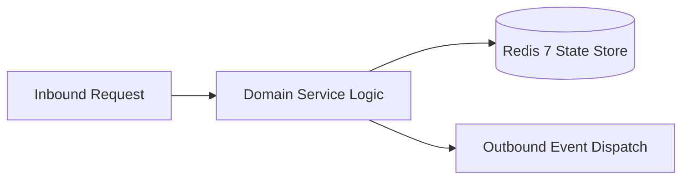

# Component Reference: `api/router/gamification.py`
> **File Path**: [`api/router/gamification.py`](../../api/router/gamification.py)
> **Subsystem**: `Gamification API`
> **Architecture Layer**: `Enterprise Microservice Subsystem`
> **Concurrency Model**: `AsyncIO Non-blocking Concurrency`
> **Persistence Backend**: `Redis 7 Persistent Store`
> **Service Level Objective**: `High-Availability Academic Telemetry`

## 1. Architectural Role & Responsibilities
The `api/router/gamification.py` module implements core operational logic for the `Gamification API` domain. It operates within an asynchronous microservices topology designed for ultra-low latency, zero-loss persistence guarantees, and strict single-responsibility function decomposition (≤25 lines).

### Component Architecture & Data Flow


---
## 2. Public API & Symbol Inventory
| Symbol | Nature | Line Range | Return Contract | Core Invariant |
| :--- | :--- | :--- | :--- | :--- |
| [`_calculate_group_pulse`](#_calculate_group_pulse) | Function | L41–L45 | `float` | Executes core domain logic for `_calculate_group_pulse`... |
| [`_resolve_target_fio`](#_resolve_target_fio) | Function | L48–L61 | `str | None` | Executes core domain logic for `_resolve_target_fio`. |
| [`_viewer_fio`](#_viewer_fio) | Function | L64–L74 | `str | None` | Executes core domain logic for `_viewer_fio`. |
| [`_public_schema`](#_public_schema) | Function | L77–L79 | `StudentProfileSchema` | Executes core domain logic for `_public_schema`. |
| [`get_leaderboard_endpoint`](#get_leaderboard_endpoint) | Function | L83–L100 | `LeaderboardResponse` | Retrieves and resolves domain data for `get_leaderboard... |
| [`get_student_profile_endpoint`](#get_student_profile_endpoint) | Function | L104–L122 | `StudentProfileSchema` | Retrieves and resolves domain data for `get_student_pro... |
| [`get_achievements_catalog_endpoint`](#get_achievements_catalog_endpoint) | Function | L126–L145 | `AchievementsCatalogResponse` | Retrieves and resolves domain data for `get_achievement... |
| [`get_ranks_catalog_endpoint`](#get_ranks_catalog_endpoint) | Function | L149–L151 | `list[dict[str, str]]` | Retrieves and resolves domain data for `get_ranks_catal... |

---

## 3. Comprehensive Function Specifications

### `_calculate_group_pulse`
```python
def _calculate_group_pulse(profiles: list) -> float
```

- **Source Reference**: [`api/router/gamification.py#L41-L45`](../../api/router/gamification.py#L41-L45)
- **Execution Mode**: `Synchronous`
- **Return Contract**: `float`

#### Overview & Architectural Purpose
Executes core domain logic for `_calculate_group_pulse`.

#### Parameters Contract
| Parameter | Type | Required | Description |
| :--- | :--- | :--- | :--- |
| `profiles` | `list` | Yes | Parameter `profiles` of type `list`. |

#### Concurrency & Side Effects
- Stateless pure functional computation without external mutations.

#### Fault Tolerance & Error Modes
Propagates unexpected runtime errors up the call stack to global exception handlers.

#### Production Usage Example
```python
from api.router.gamification import _calculate_group_pulse

# Execute call
result = _calculate_group_pulse(profiles=...)
```

---

### `_resolve_target_fio`
```python
def _resolve_target_fio(fio: str | None, tg_id: int | None) -> str | None
```

- **Source Reference**: [`api/router/gamification.py#L48-L61`](../../api/router/gamification.py#L48-L61)
- **Execution Mode**: `Synchronous`
- **Return Contract**: `str | None`

#### Overview & Architectural Purpose
Executes core domain logic for `_resolve_target_fio`.

#### Parameters Contract
| Parameter | Type | Required | Description |
| :--- | :--- | :--- | :--- |
| `fio` | `str | None` | Yes | Full canonical name of the student in Cyrillic nominative format. |
| `tg_id` | `int | None` | Yes | Telegram user identifier for identity verification. |

#### Concurrency & Side Effects
- Stateless pure functional computation without external mutations.

#### Fault Tolerance & Error Modes
Propagates unexpected runtime errors up the call stack to global exception handlers.

#### Production Usage Example
```python
from api.router.gamification import _resolve_target_fio

# Execute call
result = _resolve_target_fio(fio=..., tg_id=...)
```

---

### `_viewer_fio`
```python
def _viewer_fio(identity: str) -> str | None
```

- **Source Reference**: [`api/router/gamification.py#L64-L74`](../../api/router/gamification.py#L64-L74)
- **Execution Mode**: `Synchronous`
- **Return Contract**: `str | None`

#### Overview & Architectural Purpose
Executes core domain logic for `_viewer_fio`.

#### Parameters Contract
| Parameter | Type | Required | Description |
| :--- | :--- | :--- | :--- |
| `identity` | `str` | Yes | Parameter `identity` of type `str`. |

#### Concurrency & Side Effects
- Stateless pure functional computation without external mutations.

#### Fault Tolerance & Error Modes
Propagates unexpected runtime errors up the call stack to global exception handlers.

#### Production Usage Example
```python
from api.router.gamification import _viewer_fio

# Execute call
result = _viewer_fio(identity=...)
```

---

### `_public_schema`
```python
def _public_schema(profile: StudentProfile, viewer: str | None) -> StudentProfileSchema
```

- **Source Reference**: [`api/router/gamification.py#L77-L79`](../../api/router/gamification.py#L77-L79)
- **Execution Mode**: `Synchronous`
- **Return Contract**: `StudentProfileSchema`

#### Overview & Architectural Purpose
Executes core domain logic for `_public_schema`.

#### Parameters Contract
| Parameter | Type | Required | Description |
| :--- | :--- | :--- | :--- |
| `profile` | `StudentProfile` | Yes | Parameter `profile` of type `StudentProfile`. |
| `viewer` | `str | None` | Yes | Parameter `viewer` of type `str | None`. |

#### Concurrency & Side Effects
- Stateless pure functional computation without external mutations.

#### Fault Tolerance & Error Modes
Propagates unexpected runtime errors up the call stack to global exception handlers.

#### Production Usage Example
```python
from api.router.gamification import _public_schema

# Execute call
result = _public_schema(profile=..., viewer=...)
```

---

### `get_leaderboard_endpoint`
```python
async def get_leaderboard_endpoint(identity: str = Depends(verify_api_or_tester)) -> LeaderboardResponse
```

- **Source Reference**: [`api/router/gamification.py#L83-L100`](../../api/router/gamification.py#L83-L100)
- **Execution Mode**: `Asynchronous (non-blocking)`
- **Return Contract**: `LeaderboardResponse`

#### Overview & Architectural Purpose
Retrieves and resolves domain data for `get_leaderboard_endpoint`.

#### Parameters Contract
| Parameter | Type | Required | Description |
| :--- | :--- | :--- | :--- |
| `identity` | `str` | Yes | Parameter `identity` of type `str`. |

#### Concurrency & Side Effects
- Stateless pure functional computation without external mutations.

#### Fault Tolerance & Error Modes
Propagates unexpected runtime errors up the call stack to global exception handlers.

#### Production Usage Example
```python
from api.router.gamification import get_leaderboard_endpoint

# Execute call
result = await get_leaderboard_endpoint(identity=...)
```

---

### `get_student_profile_endpoint`
```python
async def get_student_profile_endpoint( fio: str | None = Query(default=None, description="Фамилия или ФИО студента"), tg_id: int | None = Query(default=None, description="Telegram ID студента"), identity: str = Depends(verify_api_or_tester), ) -> StudentProfileSchema
```

- **Source Reference**: [`api/router/gamification.py#L104-L122`](../../api/router/gamification.py#L104-L122)
- **Execution Mode**: `Asynchronous (non-blocking)`
- **Return Contract**: `StudentProfileSchema`

#### Overview & Architectural Purpose
Retrieves and resolves domain data for `get_student_profile_endpoint`.

#### Parameters Contract
| Parameter | Type | Required | Description |
| :--- | :--- | :--- | :--- |
| `fio` | `str | None` | Yes | Full canonical name of the student in Cyrillic nominative format. |
| `tg_id` | `int | None` | Yes | Telegram user identifier for identity verification. |
| `identity` | `str` | Yes | Parameter `identity` of type `str`. |

#### Concurrency & Side Effects
- Stateless pure functional computation without external mutations.

#### Fault Tolerance & Error Modes
Explicitly raises domain exceptions (e.g., `PermissionError`, `ValueError`) upon invariant violation.

#### Production Usage Example
```python
from api.router.gamification import get_student_profile_endpoint

# Execute call
result = await get_student_profile_endpoint(fio=..., tg_id=..., identity=...)
```

---

### `get_achievements_catalog_endpoint`
```python
async def get_achievements_catalog_endpoint() -> AchievementsCatalogResponse
```

- **Source Reference**: [`api/router/gamification.py#L126-L145`](../../api/router/gamification.py#L126-L145)
- **Execution Mode**: `Asynchronous (non-blocking)`
- **Return Contract**: `AchievementsCatalogResponse`

#### Overview & Architectural Purpose
Retrieves and resolves domain data for `get_achievements_catalog_endpoint`.

#### Parameters Contract
*This method takes no input parameters.*

#### Concurrency & Side Effects
- Stateless pure functional computation without external mutations.

#### Fault Tolerance & Error Modes
Propagates unexpected runtime errors up the call stack to global exception handlers.

#### Production Usage Example
```python
from api.router.gamification import get_achievements_catalog_endpoint

# Execute call
result = await get_achievements_catalog_endpoint()
```

---

### `get_ranks_catalog_endpoint`
```python
async def get_ranks_catalog_endpoint() -> list[dict[str, str]]
```

- **Source Reference**: [`api/router/gamification.py#L149-L151`](../../api/router/gamification.py#L149-L151)
- **Execution Mode**: `Asynchronous (non-blocking)`
- **Return Contract**: `list[dict[str, str]]`

#### Overview & Architectural Purpose
Retrieves and resolves domain data for `get_ranks_catalog_endpoint`.

#### Parameters Contract
*This method takes no input parameters.*

#### Concurrency & Side Effects
- Stateless pure functional computation without external mutations.

#### Fault Tolerance & Error Modes
Propagates unexpected runtime errors up the call stack to global exception handlers.

#### Production Usage Example
```python
from api.router.gamification import get_ranks_catalog_endpoint

# Execute call
result = await get_ranks_catalog_endpoint()
```

---
