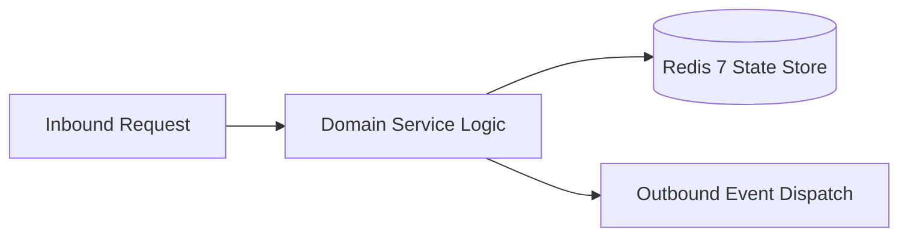

# Component Reference: `api/router/health.py`
> **File Path**: [`api/router/health.py`](../../api/router/health.py)
> **Subsystem**: `Healthcheck API`
> **Architecture Layer**: `Enterprise Microservice Subsystem`
> **Concurrency Model**: `AsyncIO Non-blocking Concurrency`
> **Persistence Backend**: `Redis 7 Persistent Store`
> **Service Level Objective**: `High-Availability Academic Telemetry`

## 1. Architectural Role & Responsibilities
The `api/router/health.py` module implements core operational logic for the `Healthcheck API` domain. It operates within an asynchronous microservices topology designed for ultra-low latency, zero-loss persistence guarantees, and strict single-responsibility function decomposition (≤25 lines).

### Component Architecture & Data Flow


---
## 2. Public API & Symbol Inventory
| Symbol | Nature | Line Range | Return Contract | Core Invariant |
| :--- | :--- | :--- | :--- | :--- |
| [`healthcheck`](#healthcheck) | Function | L21–L31 | `HealthResponse` | Executes core domain logic for `healthcheck`. |

---

## 3. Comprehensive Function Specifications

## Class Model: `HealthResponse`

Encapsulates domain entities and data transfer logic for `HealthResponse`.

### `healthcheck`
```python
async def healthcheck() -> HealthResponse
```

- **Source Reference**: [`api/router/health.py#L21-L31`](../../api/router/health.py#L21-L31)
- **Execution Mode**: `Asynchronous (non-blocking)`
- **Return Contract**: `HealthResponse`

#### Overview & Architectural Purpose
Executes core domain logic for `healthcheck`.

#### Parameters Contract
*This method takes no input parameters.*

#### Concurrency & Side Effects
- Stateless pure functional computation without external mutations.

#### Fault Tolerance & Error Modes
Propagates unexpected runtime errors up the call stack to global exception handlers.

#### Production Usage Example
```python
from api.router.health import healthcheck

# Execute call
result = await healthcheck()
```

---
