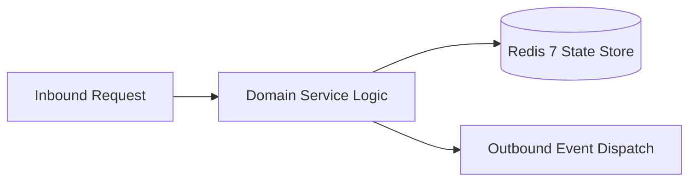

# Component Reference: `api/router/jaeger.py`
> **File Path**: [`api/router/jaeger.py`](../../api/router/jaeger.py)
> **Subsystem**: `Jaeger Tracing Proxy API`
> **Architecture Layer**: `Enterprise Microservice Subsystem`
> **Concurrency Model**: `AsyncIO Non-blocking Concurrency`
> **Persistence Backend**: `Redis 7 Persistent Store`
> **Service Level Objective**: `High-Availability Academic Telemetry`

## 1. Architectural Role & Responsibilities
The `api/router/jaeger.py` module implements core operational logic for the `Jaeger Tracing Proxy API` domain. It operates within an asynchronous microservices topology designed for ultra-low latency, zero-loss persistence guarantees, and strict single-responsibility function decomposition (≤25 lines).

### Component Architecture & Data Flow


---
## 2. Public API & Symbol Inventory
| Symbol | Nature | Line Range | Return Contract | Core Invariant |
| :--- | :--- | :--- | :--- | :--- |
| [`_filter_headers`](#_filter_headers) | Function | L43–L51 | `dict[str, str]` | Executes core domain logic for `_filter_headers`. |
| [`_build_target_url`](#_build_target_url) | Function | L54–L65 | `str` | Executes core domain logic for `_build_target_url`. |
| [`_forward_request`](#_forward_request) | Function | L68–L91 | `Response` | Executes core domain logic for `_forward_request`. |
| [`redirect_jaeger_root`](#redirect_jaeger_root) | Function | L95–L103 | `RedirectResponse` | Executes core domain logic for `redirect_jaeger_root`. |
| [`proxy_jaeger`](#proxy_jaeger) | Function | L107–L118 | `Response` | Executes core domain logic for `proxy_jaeger`. |

---

## 3. Comprehensive Function Specifications

### `_filter_headers`
```python
def _filter_headers(headers: Any) -> dict[str, str]
```

- **Source Reference**: [`api/router/jaeger.py#L43-L51`](../../api/router/jaeger.py#L43-L51)
- **Execution Mode**: `Synchronous`
- **Return Contract**: `dict[str, str]`

#### Overview & Architectural Purpose
Executes core domain logic for `_filter_headers`.

#### Parameters Contract
| Parameter | Type | Required | Description |
| :--- | :--- | :--- | :--- |
| `headers` | `Any` | Yes | Parameter `headers` of type `Any`. |

#### Concurrency & Side Effects
- Stateless pure functional computation without external mutations.

#### Fault Tolerance & Error Modes
Propagates unexpected runtime errors up the call stack to global exception handlers.

#### Production Usage Example
```python
from api.router.jaeger import _filter_headers

# Execute call
result = _filter_headers(headers=...)
```

---

### `_build_target_url`
```python
def _build_target_url(path: str, query: str) -> str
```

- **Source Reference**: [`api/router/jaeger.py#L54-L65`](../../api/router/jaeger.py#L54-L65)
- **Execution Mode**: `Synchronous`
- **Return Contract**: `str`

#### Overview & Architectural Purpose
Executes core domain logic for `_build_target_url`.

#### Parameters Contract
| Parameter | Type | Required | Description |
| :--- | :--- | :--- | :--- |
| `path` | `str` | Yes | Parameter `path` of type `str`. |
| `query` | `str` | Yes | Parameter `query` of type `str`. |

#### Concurrency & Side Effects
- Stateless pure functional computation without external mutations.

#### Fault Tolerance & Error Modes
Propagates unexpected runtime errors up the call stack to global exception handlers.

#### Production Usage Example
```python
from api.router.jaeger import _build_target_url

# Execute call
result = _build_target_url(path=..., query=...)
```

---

### `_forward_request`
```python
async def _forward_request(method: str, url: str, headers: dict[str, str], body: bytes | None) -> Response
```

- **Source Reference**: [`api/router/jaeger.py#L68-L91`](../../api/router/jaeger.py#L68-L91)
- **Execution Mode**: `Asynchronous (non-blocking)`
- **Return Contract**: `Response`

#### Overview & Architectural Purpose
Executes core domain logic for `_forward_request`.

#### Parameters Contract
| Parameter | Type | Required | Description |
| :--- | :--- | :--- | :--- |
| `method` | `str` | Yes | Parameter `method` of type `str`. |
| `url` | `str` | Yes | Parameter `url` of type `str`. |
| `headers` | `dict[str, str]` | Yes | Parameter `headers` of type `dict[str, str]`. |
| `body` | `bytes | None` | Yes | Parameter `body` of type `bytes | None`. |

#### Concurrency & Side Effects
- Emits structured telemetry events to system logging subsystem.
- Performs non-blocking network I/O over HTTP or gRPC.

#### Fault Tolerance & Error Modes
Encapsulates faults within `try/except` blocks, logging errors and returning safe fallback defaults.

#### Production Usage Example
```python
from api.router.jaeger import _forward_request

# Execute call
result = await _forward_request(method=..., url=..., headers=...)
```

---

### `redirect_jaeger_root`
```python
async def redirect_jaeger_root() -> RedirectResponse
```

- **Source Reference**: [`api/router/jaeger.py#L95-L103`](../../api/router/jaeger.py#L95-L103)
- **Execution Mode**: `Asynchronous (non-blocking)`
- **Return Contract**: `RedirectResponse`

#### Overview & Architectural Purpose
Executes core domain logic for `redirect_jaeger_root`.

#### Parameters Contract
*This method takes no input parameters.*

#### Concurrency & Side Effects
- Stateless pure functional computation without external mutations.

#### Fault Tolerance & Error Modes
Propagates unexpected runtime errors up the call stack to global exception handlers.

#### Production Usage Example
```python
from api.router.jaeger import redirect_jaeger_root

# Execute call
result = await redirect_jaeger_root()
```

---

### `proxy_jaeger`
```python
async def proxy_jaeger(request: Request, path: str = "") -> Response
```

- **Source Reference**: [`api/router/jaeger.py#L107-L118`](../../api/router/jaeger.py#L107-L118)
- **Execution Mode**: `Asynchronous (non-blocking)`
- **Return Contract**: `Response`

#### Overview & Architectural Purpose
Executes core domain logic for `proxy_jaeger`.

#### Parameters Contract
| Parameter | Type | Required | Description |
| :--- | :--- | :--- | :--- |
| `request` | `Request` | Yes | Parameter `request` of type `Request`. |
| `path` | `str` | Yes | Parameter `path` of type `str`. |

#### Concurrency & Side Effects
- Stateless pure functional computation without external mutations.

#### Fault Tolerance & Error Modes
Propagates unexpected runtime errors up the call stack to global exception handlers.

#### Production Usage Example
```python
from api.router.jaeger import proxy_jaeger

# Execute call
result = await proxy_jaeger(request=..., path=...)
```

---
