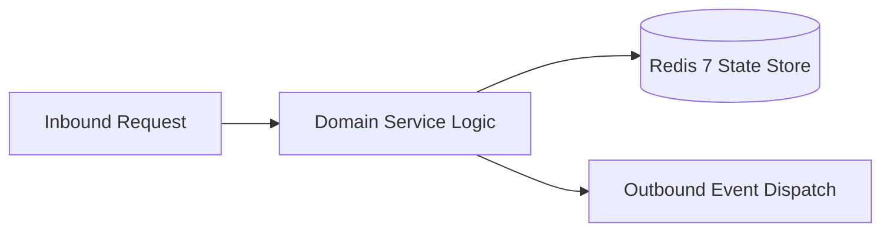

# Component Reference: `api/router/metrics.py`
> **File Path**: [`api/router/metrics.py`](../../api/router/metrics.py)
> **Subsystem**: `Prometheus Metrics API`
> **Architecture Layer**: `Enterprise Microservice Subsystem`
> **Concurrency Model**: `AsyncIO Non-blocking Concurrency`
> **Persistence Backend**: `Redis 7 Persistent Store`
> **Service Level Objective**: `High-Availability Academic Telemetry`

## 1. Architectural Role & Responsibilities
The `api/router/metrics.py` module implements core operational logic for the `Prometheus Metrics API` domain. It operates within an asynchronous microservices topology designed for ultra-low latency, zero-loss persistence guarantees, and strict single-responsibility function decomposition (≤25 lines).

### Component Architecture & Data Flow


---
## 2. Public API & Symbol Inventory
| Symbol | Nature | Line Range | Return Contract | Core Invariant |
| :--- | :--- | :--- | :--- | :--- |
| [`get_prometheus_metrics`](#get_prometheus_metrics) | Function | L18–L28 | `Response` | Retrieves and resolves domain data for `get_prometheus_... |

---

## 3. Comprehensive Function Specifications

### `get_prometheus_metrics`
```python
async def get_prometheus_metrics() -> Response
```

- **Source Reference**: [`api/router/metrics.py#L18-L28`](../../api/router/metrics.py#L18-L28)
- **Execution Mode**: `Asynchronous (non-blocking)`
- **Return Contract**: `Response`

#### Overview & Architectural Purpose
Retrieves and resolves domain data for `get_prometheus_metrics`.

#### Parameters Contract
*This method takes no input parameters.*

#### Concurrency & Side Effects
- Stateless pure functional computation without external mutations.

#### Fault Tolerance & Error Modes
Propagates unexpected runtime errors up the call stack to global exception handlers.

#### Production Usage Example
```python
from api.router.metrics import get_prometheus_metrics

# Execute call
result = await get_prometheus_metrics()
```

---
