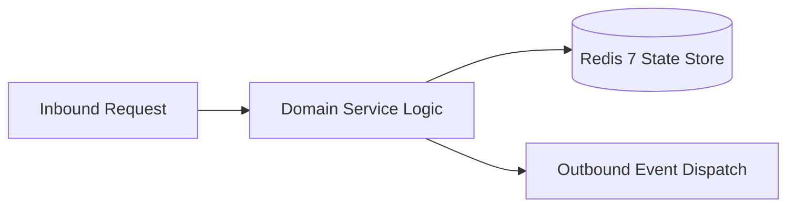

# Component Reference: `api/router/miniapp.py`
> **File Path**: [`api/router/miniapp.py`](../../api/router/miniapp.py)
> **Subsystem**: `MiniApp API`
> **Architecture Layer**: `Enterprise Microservice Subsystem`
> **Concurrency Model**: `AsyncIO Non-blocking Concurrency`
> **Persistence Backend**: `Redis 7 Persistent Store`
> **Service Level Objective**: `High-Availability Academic Telemetry`

## 1. Architectural Role & Responsibilities
The `api/router/miniapp.py` module implements core operational logic for the `MiniApp API` domain. It operates within an asynchronous microservices topology designed for ultra-low latency, zero-loss persistence guarantees, and strict single-responsibility function decomposition (≤25 lines).

### Component Architecture & Data Flow


---
## 2. Public API & Symbol Inventory
| Symbol | Nature | Line Range | Return Contract | Core Invariant |
| :--- | :--- | :--- | :--- | :--- |
| [`_set_tester_cookie`](#_set_tester_cookie) | Function | L53–L71 | `None` | Executes core domain logic for `_set_tester_cookie`. |
| [`serve_miniapp_page`](#serve_miniapp_page) | Function | L75–L88 | `HTMLResponse` | Executes core domain logic for `serve_miniapp_page`. |
| [`_resolve_api_key_user`](#_resolve_api_key_user) | Function | L91–L101 | `tuple[int, str, str] | None` | Executes core domain logic for `_resolve_api_key_user`. |
| [`dev_login`](#dev_login) | Function | L105–L114 | `Response` | Executes core domain logic for `dev_login`. |
| [`_auth_by_key`](#_auth_by_key) | Function | L117–L125 | `MiniappAuthResponse` | Executes core domain logic for `_auth_by_key`. |
| [`_auth_telegram_init`](#_auth_telegram_init) | Function | L128–L145 | `MiniappAuthResponse` | Executes core domain logic for `_auth_telegram_init`. |
| [`authenticate_miniapp`](#authenticate_miniapp) | Function | L149–L155 | `MiniappAuthResponse` | Executes core domain logic for `authenticate_miniapp`. |
| [`check_tester_status`](#check_tester_status) | Function | L159–L177 | `MiniappCheckResponse` | Executes core domain logic for `check_tester_status`. |
| [`_resolve_action_uid`](#_resolve_action_uid) | Function | L180–L190 | `int | None` | Executes core domain logic for `_resolve_action_uid`. |
| [`trigger_miniapp_action`](#trigger_miniapp_action) | Function | L194–L217 | `MiniappActionResult` | Executes core domain logic for `trigger_miniapp_action`... |
| [`list_api_testers`](#list_api_testers) | Function | L221–L234 | `TesterListResponse` | Executes core domain logic for `list_api_testers`. |
| [`api_add_tester`](#api_add_tester) | Function | L238–L252 | `dict` | Executes core domain logic for `api_add_tester`. |
| [`api_remove_tester`](#api_remove_tester) | Function | L256–L270 | `dict` | Executes core domain logic for `api_remove_tester`. |

---

## 3. Comprehensive Function Specifications

### `_set_tester_cookie`
```python
def _set_tester_cookie(response: Response, user_id: int) -> None
```

- **Source Reference**: [`api/router/miniapp.py#L53-L71`](../../api/router/miniapp.py#L53-L71)
- **Execution Mode**: `Synchronous`
- **Return Contract**: `None`

#### Overview & Architectural Purpose
Executes core domain logic for `_set_tester_cookie`.

#### Parameters Contract
| Parameter | Type | Required | Description |
| :--- | :--- | :--- | :--- |
| `response` | `Response` | Yes | Parameter `response` of type `Response`. |
| `user_id` | `int` | Yes | Unique 64-bit Telegram user identifier. |

#### Concurrency & Side Effects
- Stateless pure functional computation without external mutations.

#### Fault Tolerance & Error Modes
Propagates unexpected runtime errors up the call stack to global exception handlers.

#### Production Usage Example
```python
from api.router.miniapp import _set_tester_cookie

# Execute call
result = _set_tester_cookie(response=..., user_id=...)
```

---

### `serve_miniapp_page`
```python
async def serve_miniapp_page() -> HTMLResponse
```

- **Source Reference**: [`api/router/miniapp.py#L75-L88`](../../api/router/miniapp.py#L75-L88)
- **Execution Mode**: `Asynchronous (non-blocking)`
- **Return Contract**: `HTMLResponse`

#### Overview & Architectural Purpose
Executes core domain logic for `serve_miniapp_page`.

#### Parameters Contract
*This method takes no input parameters.*

#### Concurrency & Side Effects
- Stateless pure functional computation without external mutations.

#### Fault Tolerance & Error Modes
Propagates unexpected runtime errors up the call stack to global exception handlers.

#### Production Usage Example
```python
from api.router.miniapp import serve_miniapp_page

# Execute call
result = await serve_miniapp_page()
```

---

### `_resolve_api_key_user`
```python
async def _resolve_api_key_user(key: str) -> tuple[int, str, str] | None
```

- **Source Reference**: [`api/router/miniapp.py#L91-L101`](../../api/router/miniapp.py#L91-L101)
- **Execution Mode**: `Asynchronous (non-blocking)`
- **Return Contract**: `tuple[int, str, str] | None`

#### Overview & Architectural Purpose
Executes core domain logic for `_resolve_api_key_user`.

#### Parameters Contract
| Parameter | Type | Required | Description |
| :--- | :--- | :--- | :--- |
| `key` | `str` | Yes | Parameter `key` of type `str`. |

#### Concurrency & Side Effects
- Stateless pure functional computation without external mutations.

#### Fault Tolerance & Error Modes
Propagates unexpected runtime errors up the call stack to global exception handlers.

#### Production Usage Example
```python
from api.router.miniapp import _resolve_api_key_user

# Execute call
result = await _resolve_api_key_user(key=...)
```

---

### `dev_login`
```python
async def dev_login(key: str = Query(..., description="API Secret Key")) -> Response
```

- **Source Reference**: [`api/router/miniapp.py#L105-L114`](../../api/router/miniapp.py#L105-L114)
- **Execution Mode**: `Asynchronous (non-blocking)`
- **Return Contract**: `Response`

#### Overview & Architectural Purpose
Executes core domain logic for `dev_login`.

#### Parameters Contract
| Parameter | Type | Required | Description |
| :--- | :--- | :--- | :--- |
| `key` | `str` | Yes | Parameter `key` of type `str`. |

#### Concurrency & Side Effects
- Emits structured telemetry events to system logging subsystem.

#### Fault Tolerance & Error Modes
Explicitly raises domain exceptions (e.g., `PermissionError`, `ValueError`) upon invariant violation.

#### Production Usage Example
```python
from api.router.miniapp import dev_login

# Execute call
result = await dev_login(key=...)
```

---

### `_auth_by_key`
```python
async def _auth_by_key(api_key: str, response: Response) -> MiniappAuthResponse
```

- **Source Reference**: [`api/router/miniapp.py#L117-L125`](../../api/router/miniapp.py#L117-L125)
- **Execution Mode**: `Asynchronous (non-blocking)`
- **Return Contract**: `MiniappAuthResponse`

#### Overview & Architectural Purpose
Executes core domain logic for `_auth_by_key`.

#### Parameters Contract
| Parameter | Type | Required | Description |
| :--- | :--- | :--- | :--- |
| `api_key` | `str` | Yes | Parameter `api_key` of type `str`. |
| `response` | `Response` | Yes | Parameter `response` of type `Response`. |

#### Concurrency & Side Effects
- Emits structured telemetry events to system logging subsystem.

#### Fault Tolerance & Error Modes
Explicitly raises domain exceptions (e.g., `PermissionError`, `ValueError`) upon invariant violation.

#### Production Usage Example
```python
from api.router.miniapp import _auth_by_key

# Execute call
result = await _auth_by_key(api_key=..., response=...)
```

---

### `_auth_telegram_init`
```python
async def _auth_telegram_init(init_data: str, response: Response) -> MiniappAuthResponse
```

- **Source Reference**: [`api/router/miniapp.py#L128-L145`](../../api/router/miniapp.py#L128-L145)
- **Execution Mode**: `Asynchronous (non-blocking)`
- **Return Contract**: `MiniappAuthResponse`

#### Overview & Architectural Purpose
Executes core domain logic for `_auth_telegram_init`.

#### Parameters Contract
| Parameter | Type | Required | Description |
| :--- | :--- | :--- | :--- |
| `init_data` | `str` | Yes | Parameter `init_data` of type `str`. |
| `response` | `Response` | Yes | Parameter `response` of type `Response`. |

#### Concurrency & Side Effects
- Emits structured telemetry events to system logging subsystem.

#### Fault Tolerance & Error Modes
Explicitly raises domain exceptions (e.g., `PermissionError`, `ValueError`) upon invariant violation.

#### Production Usage Example
```python
from api.router.miniapp import _auth_telegram_init

# Execute call
result = await _auth_telegram_init(init_data=..., response=...)
```

---

### `authenticate_miniapp`
```python
async def authenticate_miniapp(payload: MiniappAuthRequest, response: Response) -> MiniappAuthResponse
```

- **Source Reference**: [`api/router/miniapp.py#L149-L155`](../../api/router/miniapp.py#L149-L155)
- **Execution Mode**: `Asynchronous (non-blocking)`
- **Return Contract**: `MiniappAuthResponse`

#### Overview & Architectural Purpose
Executes core domain logic for `authenticate_miniapp`.

#### Parameters Contract
| Parameter | Type | Required | Description |
| :--- | :--- | :--- | :--- |
| `payload` | `MiniappAuthRequest` | Yes | Parameter `payload` of type `MiniappAuthRequest`. |
| `response` | `Response` | Yes | Parameter `response` of type `Response`. |

#### Concurrency & Side Effects
- Stateless pure functional computation without external mutations.

#### Fault Tolerance & Error Modes
Explicitly raises domain exceptions (e.g., `PermissionError`, `ValueError`) upon invariant violation.

#### Production Usage Example
```python
from api.router.miniapp import authenticate_miniapp

# Execute call
result = await authenticate_miniapp(payload=..., response=...)
```

---

### `check_tester_status`
```python
async def check_tester_status(para_session: str = Cookie(default=None)) -> MiniappCheckResponse
```

- **Source Reference**: [`api/router/miniapp.py#L159-L177`](../../api/router/miniapp.py#L159-L177)
- **Execution Mode**: `Asynchronous (non-blocking)`
- **Return Contract**: `MiniappCheckResponse`

#### Overview & Architectural Purpose
Executes core domain logic for `check_tester_status`.

#### Parameters Contract
| Parameter | Type | Required | Description |
| :--- | :--- | :--- | :--- |
| `para_session` | `str` | Yes | Parameter `para_session` of type `str`. |

#### Concurrency & Side Effects
- Stateless pure functional computation without external mutations.

#### Fault Tolerance & Error Modes
Propagates unexpected runtime errors up the call stack to global exception handlers.

#### Production Usage Example
```python
from api.router.miniapp import check_tester_status

# Execute call
result = await check_tester_status(para_session=...)
```

---

### `_resolve_action_uid`
```python
def _resolve_action_uid(payload: MiniappActionRequest, session: str | None) -> int | None
```

- **Source Reference**: [`api/router/miniapp.py#L180-L190`](../../api/router/miniapp.py#L180-L190)
- **Execution Mode**: `Synchronous`
- **Return Contract**: `int | None`

#### Overview & Architectural Purpose
Executes core domain logic for `_resolve_action_uid`.

#### Parameters Contract
| Parameter | Type | Required | Description |
| :--- | :--- | :--- | :--- |
| `payload` | `MiniappActionRequest` | Yes | Parameter `payload` of type `MiniappActionRequest`. |
| `session` | `str | None` | Yes | Active domain session instance containing current student index and marks. |

#### Concurrency & Side Effects
- Stateless pure functional computation without external mutations.

#### Fault Tolerance & Error Modes
Propagates unexpected runtime errors up the call stack to global exception handlers.

#### Production Usage Example
```python
from api.router.miniapp import _resolve_action_uid

# Execute call
result = _resolve_action_uid(payload=..., session=...)
```

---

### `trigger_miniapp_action`
```python
async def trigger_miniapp_action( payload: MiniappActionRequest, para_session: str | None = Cookie(default=None) ) -> MiniappActionResult
```

- **Source Reference**: [`api/router/miniapp.py#L194-L217`](../../api/router/miniapp.py#L194-L217)
- **Execution Mode**: `Asynchronous (non-blocking)`
- **Return Contract**: `MiniappActionResult`

#### Overview & Architectural Purpose
Executes core domain logic for `trigger_miniapp_action`.

#### Parameters Contract
| Parameter | Type | Required | Description |
| :--- | :--- | :--- | :--- |
| `payload` | `MiniappActionRequest` | Yes | Parameter `payload` of type `MiniappActionRequest`. |
| `para_session` | `str | None` | Yes | Parameter `para_session` of type `str | None`. |

#### Concurrency & Side Effects
- Stateless pure functional computation without external mutations.

#### Fault Tolerance & Error Modes
Explicitly raises domain exceptions (e.g., `PermissionError`, `ValueError`) upon invariant violation.

#### Production Usage Example
```python
from api.router.miniapp import trigger_miniapp_action

# Execute call
result = await trigger_miniapp_action(payload=..., para_session=...)
```

---

### `list_api_testers`
```python
async def list_api_testers() -> TesterListResponse
```

- **Source Reference**: [`api/router/miniapp.py#L221-L234`](../../api/router/miniapp.py#L221-L234)
- **Execution Mode**: `Asynchronous (non-blocking)`
- **Return Contract**: `TesterListResponse`

#### Overview & Architectural Purpose
Executes core domain logic for `list_api_testers`.

#### Parameters Contract
*This method takes no input parameters.*

#### Concurrency & Side Effects
- Stateless pure functional computation without external mutations.

#### Fault Tolerance & Error Modes
Propagates unexpected runtime errors up the call stack to global exception handlers.

#### Production Usage Example
```python
from api.router.miniapp import list_api_testers

# Execute call
result = await list_api_testers()
```

---

### `api_add_tester`
```python
async def api_add_tester(user_id: int) -> dict
```

- **Source Reference**: [`api/router/miniapp.py#L238-L252`](../../api/router/miniapp.py#L238-L252)
- **Execution Mode**: `Asynchronous (non-blocking)`
- **Return Contract**: `dict`

#### Overview & Architectural Purpose
Executes core domain logic for `api_add_tester`.

#### Parameters Contract
| Parameter | Type | Required | Description |
| :--- | :--- | :--- | :--- |
| `user_id` | `int` | Yes | Unique 64-bit Telegram user identifier. |

#### Concurrency & Side Effects
- Stateless pure functional computation without external mutations.

#### Fault Tolerance & Error Modes
Explicitly raises domain exceptions (e.g., `PermissionError`, `ValueError`) upon invariant violation.

#### Production Usage Example
```python
from api.router.miniapp import api_add_tester

# Execute call
result = await api_add_tester(user_id=...)
```

---

### `api_remove_tester`
```python
async def api_remove_tester(user_id: int) -> dict
```

- **Source Reference**: [`api/router/miniapp.py#L256-L270`](../../api/router/miniapp.py#L256-L270)
- **Execution Mode**: `Asynchronous (non-blocking)`
- **Return Contract**: `dict`

#### Overview & Architectural Purpose
Executes core domain logic for `api_remove_tester`.

#### Parameters Contract
| Parameter | Type | Required | Description |
| :--- | :--- | :--- | :--- |
| `user_id` | `int` | Yes | Unique 64-bit Telegram user identifier. |

#### Concurrency & Side Effects
- Stateless pure functional computation without external mutations.

#### Fault Tolerance & Error Modes
Explicitly raises domain exceptions (e.g., `PermissionError`, `ValueError`) upon invariant violation.

#### Production Usage Example
```python
from api.router.miniapp import api_remove_tester

# Execute call
result = await api_remove_tester(user_id=...)
```

---
