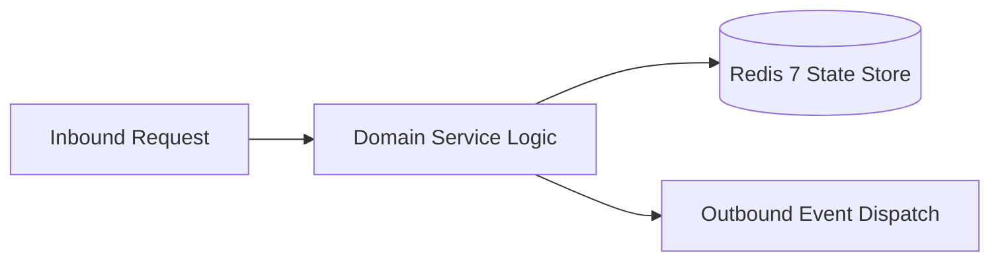

# Component Reference: `api/router/miniapp.py`
> **File Path**: [`api/router/miniapp.py`](../../api/router/miniapp.py)  
> **Subsystem**: `MiniApp API`  
> **Architecture Layer**: `Enterprise Microservice Subsystem`  
> **Concurrency Model**: `AsyncIO Non-blocking Concurrency`  
> **Persistence Backend**: `Redis 7 Persistent Store`  
> **Service Level Objective**: `High-Availability Academic Telemetry`

## 1. Architectural Role & Responsibilities
The `api/router/miniapp.py` module implements core operational logic for the `MiniApp API` domain. It operates within an asynchronous microservices topology designed for ultra-low latency, zero-loss persistence guarantees, and strict single-responsibility function decomposition (≤25 lines).

### Component Architecture & Data Flow


---
## 2. Public API & Symbol Inventory
| Symbol | Nature | Line Range | Return Contract | Core Invariant |
| :--- | :--- | :--- | :--- | :--- |
| [`_set_tester_cookie`](#_set_tester_cookie) | Function | L47–L57 | `None` | Executes core domain logic for `_set_tester_cookie`. |
| [`serve_miniapp_page`](#serve_miniapp_page) | Function | L61–L65 | `HTMLResponse` | Executes core domain logic for `serve_miniapp_page`. |
| [`authenticate_miniapp`](#authenticate_miniapp) | Function | L69–L79 | `MiniappAuthResponse` | Executes core domain logic for `authenticate_miniapp`. |
| [`check_tester_status`](#check_tester_status) | Function | L83–L91 | `MiniappCheckResponse` | Executes core domain logic for `check_tester_status`. |
| [`list_api_testers`](#list_api_testers) | Function | L95–L99 | `TesterListResponse` | Executes core domain logic for `list_api_testers`. |
| [`api_add_tester`](#api_add_tester) | Function | L103–L108 | `dict` | Executes core domain logic for `api_add_tester`. |
| [`api_remove_tester`](#api_remove_tester) | Function | L112–L117 | `dict` | Executes core domain logic for `api_remove_tester`. |

---

## 3. Comprehensive Function Specifications

### `_set_tester_cookie`
```python
def _set_tester_cookie(response: Response, user_id: int) -> None
```

- **Source Reference**: [`api/router/miniapp.py#L47-L57`](../../api/router/miniapp.py#L47-L57)
- **Execution Mode**: `Synchronous`
- **Return Contract**: `None`

#### Overview & Architectural Purpose
Executes core domain logic for `_set_tester_cookie`.

#### Parameters Contract
| Parameter | Type | Required | Description |
| :--- | :--- | :--- | :--- |
| `response` | `Response` | Yes | Parameter `response` of type `Response`. |
| `user_id` | `int` | Yes | Unique 64-bit Telegram user identifier. |

#### Concurrency & Side Effects
- Stateless pure functional computation without external mutations.

#### Fault Tolerance & Error Modes
Propagates unexpected runtime errors up the call stack to global exception handlers.

#### Production Usage Example
```python
from api.router.miniapp import _set_tester_cookie

# Execute call
result = _set_tester_cookie(response=..., user_id=...)
```

---

### `serve_miniapp_page`
```python
async def serve_miniapp_page() -> HTMLResponse
```

- **Source Reference**: [`api/router/miniapp.py#L61-L65`](../../api/router/miniapp.py#L61-L65)
- **Execution Mode**: `Asynchronous (non-blocking)`
- **Return Contract**: `HTMLResponse`

#### Overview & Architectural Purpose
Executes core domain logic for `serve_miniapp_page`.

#### Parameters Contract
*This method takes no input parameters.*

#### Concurrency & Side Effects
- Stateless pure functional computation without external mutations.

#### Fault Tolerance & Error Modes
Propagates unexpected runtime errors up the call stack to global exception handlers.

#### Production Usage Example
```python
from api.router.miniapp import serve_miniapp_page

# Execute call
result = await serve_miniapp_page()
```

---

### `authenticate_miniapp`
```python
async def authenticate_miniapp(payload: MiniappAuthRequest, response: Response) -> MiniappAuthResponse
```

- **Source Reference**: [`api/router/miniapp.py#L69-L79`](../../api/router/miniapp.py#L69-L79)
- **Execution Mode**: `Asynchronous (non-blocking)`
- **Return Contract**: `MiniappAuthResponse`

#### Overview & Architectural Purpose
Executes core domain logic for `authenticate_miniapp`.

#### Parameters Contract
| Parameter | Type | Required | Description |
| :--- | :--- | :--- | :--- |
| `payload` | `MiniappAuthRequest` | Yes | Parameter `payload` of type `MiniappAuthRequest`. |
| `response` | `Response` | Yes | Parameter `response` of type `Response`. |

#### Concurrency & Side Effects
- Emits structured telemetry events to system logging subsystem.

#### Fault Tolerance & Error Modes
Explicitly raises domain exceptions (e.g., `PermissionError`, `ValueError`) upon invariant violation.

#### Production Usage Example
```python
from api.router.miniapp import authenticate_miniapp

# Execute call
result = await authenticate_miniapp(payload=..., response=...)
```

---

### `check_tester_status`
```python
async def check_tester_status(para_session: str = Cookie(default=None)) -> MiniappCheckResponse
```

- **Source Reference**: [`api/router/miniapp.py#L83-L91`](../../api/router/miniapp.py#L83-L91)
- **Execution Mode**: `Asynchronous (non-blocking)`
- **Return Contract**: `MiniappCheckResponse`

#### Overview & Architectural Purpose
Executes core domain logic for `check_tester_status`.

#### Parameters Contract
| Parameter | Type | Required | Description |
| :--- | :--- | :--- | :--- |
| `para_session` | `str` | Yes | Parameter `para_session` of type `str`. |

#### Concurrency & Side Effects
- Stateless pure functional computation without external mutations.

#### Fault Tolerance & Error Modes
Propagates unexpected runtime errors up the call stack to global exception handlers.

#### Production Usage Example
```python
from api.router.miniapp import check_tester_status

# Execute call
result = await check_tester_status(para_session=...)
```

---

### `list_api_testers`
```python
async def list_api_testers() -> TesterListResponse
```

- **Source Reference**: [`api/router/miniapp.py#L95-L99`](../../api/router/miniapp.py#L95-L99)
- **Execution Mode**: `Asynchronous (non-blocking)`
- **Return Contract**: `TesterListResponse`

#### Overview & Architectural Purpose
Executes core domain logic for `list_api_testers`.

#### Parameters Contract
*This method takes no input parameters.*

#### Concurrency & Side Effects
- Stateless pure functional computation without external mutations.

#### Fault Tolerance & Error Modes
Propagates unexpected runtime errors up the call stack to global exception handlers.

#### Production Usage Example
```python
from api.router.miniapp import list_api_testers

# Execute call
result = await list_api_testers()
```

---

### `api_add_tester`
```python
async def api_add_tester(user_id: int) -> dict
```

- **Source Reference**: [`api/router/miniapp.py#L103-L108`](../../api/router/miniapp.py#L103-L108)
- **Execution Mode**: `Asynchronous (non-blocking)`
- **Return Contract**: `dict`

#### Overview & Architectural Purpose
Executes core domain logic for `api_add_tester`.

#### Parameters Contract
| Parameter | Type | Required | Description |
| :--- | :--- | :--- | :--- |
| `user_id` | `int` | Yes | Unique 64-bit Telegram user identifier. |

#### Concurrency & Side Effects
- Stateless pure functional computation without external mutations.

#### Fault Tolerance & Error Modes
Explicitly raises domain exceptions (e.g., `PermissionError`, `ValueError`) upon invariant violation.

#### Production Usage Example
```python
from api.router.miniapp import api_add_tester

# Execute call
result = await api_add_tester(user_id=...)
```

---

### `api_remove_tester`
```python
async def api_remove_tester(user_id: int) -> dict
```

- **Source Reference**: [`api/router/miniapp.py#L112-L117`](../../api/router/miniapp.py#L112-L117)
- **Execution Mode**: `Asynchronous (non-blocking)`
- **Return Contract**: `dict`

#### Overview & Architectural Purpose
Executes core domain logic for `api_remove_tester`.

#### Parameters Contract
| Parameter | Type | Required | Description |
| :--- | :--- | :--- | :--- |
| `user_id` | `int` | Yes | Unique 64-bit Telegram user identifier. |

#### Concurrency & Side Effects
- Stateless pure functional computation without external mutations.

#### Fault Tolerance & Error Modes
Explicitly raises domain exceptions (e.g., `PermissionError`, `ValueError`) upon invariant violation.

#### Production Usage Example
```python
from api.router.miniapp import api_remove_tester

# Execute call
result = await api_remove_tester(user_id=...)
```

---
