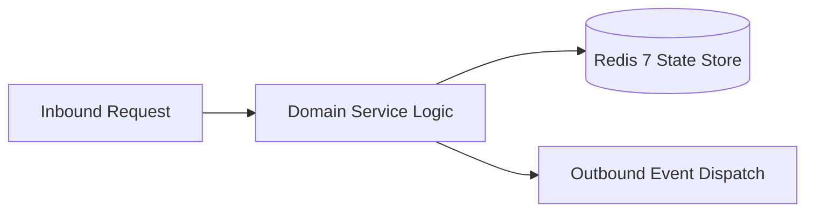

# Component Reference: `api/router/schedule.py`
> **File Path**: [`api/router/schedule.py`](../../api/router/schedule.py)
> **Subsystem**: `Schedule API`
> **Architecture Layer**: `Enterprise Microservice Subsystem`
> **Concurrency Model**: `AsyncIO Non-blocking Concurrency`
> **Persistence Backend**: `Redis 7 Persistent Store`
> **Service Level Objective**: `High-Availability Academic Telemetry`

## 1. Architectural Role & Responsibilities
The `api/router/schedule.py` module implements core operational logic for the `Schedule API` domain. It operates within an asynchronous microservices topology designed for ultra-low latency, zero-loss persistence guarantees, and strict single-responsibility function decomposition (≤25 lines).

### Component Architecture & Data Flow


---
## 2. Public API & Symbol Inventory
| Symbol | Nature | Line Range | Return Contract | Core Invariant |
| :--- | :--- | :--- | :--- | :--- |
| [`_current_monday`](#_current_monday) | Function | L28–L40 | `date` | Executes core domain logic for `_current_monday`. |
| [`schedule_day`](#schedule_day) | Function | L44–L60 | `DayScheduleResponse` | Executes core domain logic for `schedule_day`. |
| [`schedule_today`](#schedule_today) | Function | L64–L77 | `DayScheduleResponse` | Executes core domain logic for `schedule_today`. |
| [`schedule_tomorrow`](#schedule_tomorrow) | Function | L81–L94 | `DayScheduleResponse` | Executes core domain logic for `schedule_tomorrow`. |
| [`schedule_week`](#schedule_week) | Function | L98–L115 | `WeekScheduleResponse` | Executes core domain logic for `schedule_week`. |
| [`_match_lesson_interval`](#_match_lesson_interval) | Function | L118–L134 | `tuple[bool, bool]` | Executes core domain logic for `_match_lesson_interval`... |
| [`_find_current_and_next`](#_find_current_and_next) | Function | L137–L155 | `tuple[Lesson | None, Lesson | None]` | Executes core domain logic for `_find_current_and_next`... |
| [`schedule_current`](#schedule_current) | Function | L159–L177 | `CurrentLessonResponse` | Executes core domain logic for `schedule_current`. |
| [`schedule_refresh`](#schedule_refresh) | Function | L181–L194 | `ScheduleRefreshResponse` | Executes core domain logic for `schedule_refresh`. |

---

## 3. Comprehensive Function Specifications

### `_current_monday`
```python
def _current_monday() -> date
```

- **Source Reference**: [`api/router/schedule.py#L28-L40`](../../api/router/schedule.py#L28-L40)
- **Execution Mode**: `Synchronous`
- **Return Contract**: `date`

#### Overview & Architectural Purpose
Executes core domain logic for `_current_monday`.

#### Parameters Contract
*This method takes no input parameters.*

#### Concurrency & Side Effects
- Stateless pure functional computation without external mutations.

#### Fault Tolerance & Error Modes
Propagates unexpected runtime errors up the call stack to global exception handlers.

#### Production Usage Example
```python
from api.router.schedule import _current_monday

# Execute call
result = _current_monday()
```

---

### `schedule_day`
```python
async def schedule_day( target_date: date | None = Query(default=None, description="Target date (YYYY-MM-DD)"), force_refresh: bool = Query(default=False), ) -> DayScheduleResponse
```

- **Source Reference**: [`api/router/schedule.py#L44-L60`](../../api/router/schedule.py#L44-L60)
- **Execution Mode**: `Asynchronous (non-blocking)`
- **Return Contract**: `DayScheduleResponse`

#### Overview & Architectural Purpose
Executes core domain logic for `schedule_day`.

#### Parameters Contract
| Parameter | Type | Required | Description |
| :--- | :--- | :--- | :--- |
| `target_date` | `date | None` | Yes | Target calendar date for schedule or attendance resolution (ISO-8601). |
| `force_refresh` | `bool` | Yes | Parameter `force_refresh` of type `bool`. |

#### Concurrency & Side Effects
- Stateless pure functional computation without external mutations.

#### Fault Tolerance & Error Modes
Propagates unexpected runtime errors up the call stack to global exception handlers.

#### Production Usage Example
```python
from api.router.schedule import schedule_day

# Execute call
result = await schedule_day(target_date=..., force_refresh=...)
```

---

### `schedule_today`
```python
async def schedule_today(force_refresh: bool = Query(default=False)) -> DayScheduleResponse
```

- **Source Reference**: [`api/router/schedule.py#L64-L77`](../../api/router/schedule.py#L64-L77)
- **Execution Mode**: `Asynchronous (non-blocking)`
- **Return Contract**: `DayScheduleResponse`

#### Overview & Architectural Purpose
Executes core domain logic for `schedule_today`.

#### Parameters Contract
| Parameter | Type | Required | Description |
| :--- | :--- | :--- | :--- |
| `force_refresh` | `bool` | Yes | Parameter `force_refresh` of type `bool`. |

#### Concurrency & Side Effects
- Stateless pure functional computation without external mutations.

#### Fault Tolerance & Error Modes
Propagates unexpected runtime errors up the call stack to global exception handlers.

#### Production Usage Example
```python
from api.router.schedule import schedule_today

# Execute call
result = await schedule_today(force_refresh=...)
```

---

### `schedule_tomorrow`
```python
async def schedule_tomorrow(force_refresh: bool = Query(default=False)) -> DayScheduleResponse
```

- **Source Reference**: [`api/router/schedule.py#L81-L94`](../../api/router/schedule.py#L81-L94)
- **Execution Mode**: `Asynchronous (non-blocking)`
- **Return Contract**: `DayScheduleResponse`

#### Overview & Architectural Purpose
Executes core domain logic for `schedule_tomorrow`.

#### Parameters Contract
| Parameter | Type | Required | Description |
| :--- | :--- | :--- | :--- |
| `force_refresh` | `bool` | Yes | Parameter `force_refresh` of type `bool`. |

#### Concurrency & Side Effects
- Stateless pure functional computation without external mutations.

#### Fault Tolerance & Error Modes
Propagates unexpected runtime errors up the call stack to global exception handlers.

#### Production Usage Example
```python
from api.router.schedule import schedule_tomorrow

# Execute call
result = await schedule_tomorrow(force_refresh=...)
```

---

### `schedule_week`
```python
async def schedule_week( monday: date | None = Query(default=None, description="Monday of the week (YYYY-MM-DD)"), force_refresh: bool = Query(default=False), ) -> WeekScheduleResponse
```

- **Source Reference**: [`api/router/schedule.py#L98-L115`](../../api/router/schedule.py#L98-L115)
- **Execution Mode**: `Asynchronous (non-blocking)`
- **Return Contract**: `WeekScheduleResponse`

#### Overview & Architectural Purpose
Executes core domain logic for `schedule_week`.

#### Parameters Contract
| Parameter | Type | Required | Description |
| :--- | :--- | :--- | :--- |
| `monday` | `date | None` | Yes | Parameter `monday` of type `date | None`. |
| `force_refresh` | `bool` | Yes | Parameter `force_refresh` of type `bool`. |

#### Concurrency & Side Effects
- Stateless pure functional computation without external mutations.

#### Fault Tolerance & Error Modes
Propagates unexpected runtime errors up the call stack to global exception handlers.

#### Production Usage Example
```python
from api.router.schedule import schedule_week

# Execute call
result = await schedule_week(monday=..., force_refresh=...)
```

---

### `_match_lesson_interval`
```python
def _match_lesson_interval(lesson: Lesson, now_time: str) -> tuple[bool, bool]
```

- **Source Reference**: [`api/router/schedule.py#L118-L134`](../../api/router/schedule.py#L118-L134)
- **Execution Mode**: `Synchronous`
- **Return Contract**: `tuple[bool, bool]`

#### Overview & Architectural Purpose
Executes core domain logic for `_match_lesson_interval`.

#### Parameters Contract
| Parameter | Type | Required | Description |
| :--- | :--- | :--- | :--- |
| `lesson` | `Lesson` | Yes | Parameter `lesson` of type `Lesson`. |
| `now_time` | `str` | Yes | Parameter `now_time` of type `str`. |

#### Concurrency & Side Effects
- Stateless pure functional computation without external mutations.

#### Fault Tolerance & Error Modes
Propagates unexpected runtime errors up the call stack to global exception handlers.

#### Production Usage Example
```python
from api.router.schedule import _match_lesson_interval

# Execute call
result = _match_lesson_interval(lesson=..., now_time=...)
```

---

### `_find_current_and_next`
```python
def _find_current_and_next(lessons: list[Lesson], now_time: str) -> tuple[Lesson | None, Lesson | None]
```

- **Source Reference**: [`api/router/schedule.py#L137-L155`](../../api/router/schedule.py#L137-L155)
- **Execution Mode**: `Synchronous`
- **Return Contract**: `tuple[Lesson | None, Lesson | None]`

#### Overview & Architectural Purpose
Executes core domain logic for `_find_current_and_next`.

#### Parameters Contract
| Parameter | Type | Required | Description |
| :--- | :--- | :--- | :--- |
| `lessons` | `list[Lesson]` | Yes | Parameter `lessons` of type `list[Lesson]`. |
| `now_time` | `str` | Yes | Parameter `now_time` of type `str`. |

#### Concurrency & Side Effects
- Stateless pure functional computation without external mutations.

#### Fault Tolerance & Error Modes
Propagates unexpected runtime errors up the call stack to global exception handlers.

#### Production Usage Example
```python
from api.router.schedule import _find_current_and_next

# Execute call
result = _find_current_and_next(lessons=..., now_time=...)
```

---

### `schedule_current`
```python
async def schedule_current() -> CurrentLessonResponse
```

- **Source Reference**: [`api/router/schedule.py#L159-L177`](../../api/router/schedule.py#L159-L177)
- **Execution Mode**: `Asynchronous (non-blocking)`
- **Return Contract**: `CurrentLessonResponse`

#### Overview & Architectural Purpose
Executes core domain logic for `schedule_current`.

#### Parameters Contract
*This method takes no input parameters.*

#### Concurrency & Side Effects
- Stateless pure functional computation without external mutations.

#### Fault Tolerance & Error Modes
Propagates unexpected runtime errors up the call stack to global exception handlers.

#### Production Usage Example
```python
from api.router.schedule import schedule_current

# Execute call
result = await schedule_current()
```

---

### `schedule_refresh`
```python
async def schedule_refresh() -> ScheduleRefreshResponse
```

- **Source Reference**: [`api/router/schedule.py#L181-L194`](../../api/router/schedule.py#L181-L194)
- **Execution Mode**: `Asynchronous (non-blocking)`
- **Return Contract**: `ScheduleRefreshResponse`

#### Overview & Architectural Purpose
Executes core domain logic for `schedule_refresh`.

#### Parameters Contract
*This method takes no input parameters.*

#### Concurrency & Side Effects
- Stateless pure functional computation without external mutations.

#### Fault Tolerance & Error Modes
Propagates unexpected runtime errors up the call stack to global exception handlers.

#### Production Usage Example
```python
from api.router.schedule import schedule_refresh

# Execute call
result = await schedule_refresh()
```

---
