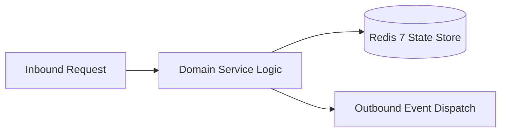

# Component Reference: `api/router/solver.py`
> **File Path**: [`api/router/solver.py`](../../api/router/solver.py)  
> **Subsystem**: `HW Solver API`  
> **Architecture Layer**: `Enterprise Microservice Subsystem`  
> **Concurrency Model**: `AsyncIO Non-blocking Concurrency`  
> **Persistence Backend**: `Redis 7 Persistent Store`  
> **Service Level Objective**: `High-Availability Academic Telemetry`

## 1. Architectural Role & Responsibilities
The `api/router/solver.py` module implements core operational logic for the `HW Solver API` domain. It operates within an asynchronous microservices topology designed for ultra-low latency, zero-loss persistence guarantees, and strict single-responsibility function decomposition (≤25 lines).

### Component Architecture & Data Flow


---
## 2. Public API & Symbol Inventory
| Symbol | Nature | Line Range | Return Contract | Core Invariant |
| :--- | :--- | :--- | :--- | :--- |
| [`get_solver_queue_status`](#get_solver_queue_status) | Function | L35–L41 | `SolverQueueStatusResponse` | Retrieves and resolves domain data for `get_solver_queu... |
| [`_decode_image_payload`](#_decode_image_payload) | Function | L44–L52 | `bytes | None` | Executes core domain logic for `_decode_image_payload`. |
| [`_check_solver_rate_limit`](#_check_solver_rate_limit) | Function | L55–L67 | `None` | Executes core domain logic for `_check_solver_rate_limi... |
| [`solve_task_direct`](#solve_task_direct) | Function | L71–L81 | `DirectSolveResponse` | Executes core domain logic for `solve_task_direct`. |
| [`check_task_status`](#check_task_status) | Function | L86–L90 | `TaskStatusResponse` | Executes core domain logic for `check_task_status`. |
| [`clear_solver_queue`](#clear_solver_queue) | Function | L94–L97 | `ClearQueueResponse` | Flushes and resets state for `clear_solver_queue`. |

---

## 3. Comprehensive Function Specifications

### `get_solver_queue_status`
```python
async def get_solver_queue_status() -> SolverQueueStatusResponse
```

- **Source Reference**: [`api/router/solver.py#L35-L41`](../../api/router/solver.py#L35-L41)
- **Execution Mode**: `Asynchronous (non-blocking)`
- **Return Contract**: `SolverQueueStatusResponse`

#### Overview & Architectural Purpose
Retrieves and resolves domain data for `get_solver_queue_status`.

#### Parameters Contract
*This method takes no input parameters.*

#### Concurrency & Side Effects
- Stateless pure functional computation without external mutations.

#### Fault Tolerance & Error Modes
Propagates unexpected runtime errors up the call stack to global exception handlers.

#### Production Usage Example
```python
from api.router.solver import get_solver_queue_status

# Execute call
result = await get_solver_queue_status()
```

---

### `_decode_image_payload`
```python
def _decode_image_payload(b64: str | None) -> bytes | None
```

- **Source Reference**: [`api/router/solver.py#L44-L52`](../../api/router/solver.py#L44-L52)
- **Execution Mode**: `Synchronous`
- **Return Contract**: `bytes | None`

#### Overview & Architectural Purpose
Executes core domain logic for `_decode_image_payload`.

#### Parameters Contract
| Parameter | Type | Required | Description |
| :--- | :--- | :--- | :--- |
| `b64` | `str | None` | Yes | Parameter `b64` of type `str | None`. |

#### Concurrency & Side Effects
- Stateless pure functional computation without external mutations.

#### Fault Tolerance & Error Modes
Encapsulates faults within `try/except` blocks, logging errors and returning safe fallback defaults.

#### Production Usage Example
```python
from api.router.solver import _decode_image_payload

# Execute call
result = _decode_image_payload(b64=...)
```

---

### `_check_solver_rate_limit`
```python
async def _check_solver_rate_limit(identity: str) -> None
```

- **Source Reference**: [`api/router/solver.py#L55-L67`](../../api/router/solver.py#L55-L67)
- **Execution Mode**: `Asynchronous (non-blocking)`
- **Return Contract**: `None`

#### Overview & Architectural Purpose
Executes core domain logic for `_check_solver_rate_limit`.

#### Parameters Contract
| Parameter | Type | Required | Description |
| :--- | :--- | :--- | :--- |
| `identity` | `str` | Yes | Parameter `identity` of type `str`. |

#### Concurrency & Side Effects
- Stateless pure functional computation without external mutations.

#### Fault Tolerance & Error Modes
Explicitly raises domain exceptions (e.g., `PermissionError`, `ValueError`) upon invariant violation.

#### Production Usage Example
```python
from api.router.solver import _check_solver_rate_limit

# Execute call
result = await _check_solver_rate_limit(identity=...)
```

---

### `solve_task_direct`
```python
async def solve_task_direct( payload: DirectSolveRequest, identity: str = Depends(verify_api_or_tester) ) -> DirectSolveResponse
```

- **Source Reference**: [`api/router/solver.py#L71-L81`](../../api/router/solver.py#L71-L81)
- **Execution Mode**: `Asynchronous (non-blocking)`
- **Return Contract**: `DirectSolveResponse`

#### Overview & Architectural Purpose
Executes core domain logic for `solve_task_direct`.

#### Parameters Contract
| Parameter | Type | Required | Description |
| :--- | :--- | :--- | :--- |
| `payload` | `DirectSolveRequest` | Yes | Parameter `payload` of type `DirectSolveRequest`. |
| `identity` | `str` | Yes | Parameter `identity` of type `str`. |

#### Concurrency & Side Effects
- Stateless pure functional computation without external mutations.

#### Fault Tolerance & Error Modes
Explicitly raises domain exceptions (e.g., `PermissionError`, `ValueError`) upon invariant violation.

#### Production Usage Example
```python
from api.router.solver import solve_task_direct

# Execute call
result = await solve_task_direct(payload=..., identity=...)
```

---

### `check_task_status`
```python
async def check_task_status(message_id: int) -> TaskStatusResponse
```

- **Source Reference**: [`api/router/solver.py#L86-L90`](../../api/router/solver.py#L86-L90)
- **Execution Mode**: `Asynchronous (non-blocking)`
- **Return Contract**: `TaskStatusResponse`

#### Overview & Architectural Purpose
Executes core domain logic for `check_task_status`.

#### Parameters Contract
| Parameter | Type | Required | Description |
| :--- | :--- | :--- | :--- |
| `message_id` | `int` | Yes | Parameter `message_id` of type `int`. |

#### Concurrency & Side Effects
- Stateless pure functional computation without external mutations.

#### Fault Tolerance & Error Modes
Propagates unexpected runtime errors up the call stack to global exception handlers.

#### Production Usage Example
```python
from api.router.solver import check_task_status

# Execute call
result = await check_task_status(message_id=...)
```

---

### `clear_solver_queue`
```python
async def clear_solver_queue() -> ClearQueueResponse
```

- **Source Reference**: [`api/router/solver.py#L94-L97`](../../api/router/solver.py#L94-L97)
- **Execution Mode**: `Asynchronous (non-blocking)`
- **Return Contract**: `ClearQueueResponse`

#### Overview & Architectural Purpose
Flushes and resets state for `clear_solver_queue`.

#### Parameters Contract
*This method takes no input parameters.*

#### Concurrency & Side Effects
- Stateless pure functional computation without external mutations.

#### Fault Tolerance & Error Modes
Propagates unexpected runtime errors up the call stack to global exception handlers.

#### Production Usage Example
```python
from api.router.solver import clear_solver_queue

# Execute call
result = await clear_solver_queue()
```

---
