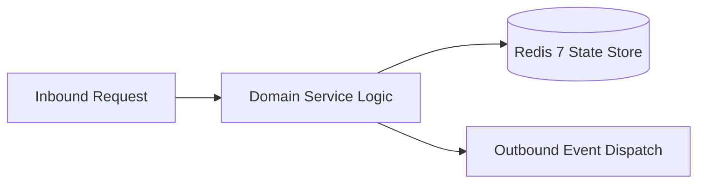

# Component Reference: `api/router/subscribers.py`
> **File Path**: [`api/router/subscribers.py`](../../api/router/subscribers.py)  
> **Subsystem**: `Subscribers API`  
> **Architecture Layer**: `Enterprise Microservice Subsystem`  
> **Concurrency Model**: `AsyncIO Non-blocking Concurrency`  
> **Persistence Backend**: `Redis 7 Persistent Store`  
> **Service Level Objective**: `High-Availability Academic Telemetry`

## 1. Architectural Role & Responsibilities
The `api/router/subscribers.py` module implements core operational logic for the `Subscribers API` domain. It operates within an asynchronous microservices topology designed for ultra-low latency, zero-loss persistence guarantees, and strict single-responsibility function decomposition (≤25 lines).

### Component Architecture & Data Flow


---
## 2. Public API & Symbol Inventory
| Symbol | Nature | Line Range | Return Contract | Core Invariant |
| :--- | :--- | :--- | :--- | :--- |
| [`list_subscribers`](#list_subscribers) | Function | L27–L30 | `SubscribersListResponse` | Executes core domain logic for `list_subscribers`. |
| [`count_subscribers`](#count_subscribers) | Function | L34–L37 | `SubscriberCountResponse` | Executes core domain logic for `count_subscribers`. |
| [`check_subscription`](#check_subscription) | Function | L41–L44 | `SubscriberStatusResponse` | Executes core domain logic for `check_subscription`. |
| [`subscribe_user`](#subscribe_user) | Function | L48–L52 | `SubscriberActionResponse` | Executes core domain logic for `subscribe_user`. |
| [`unsubscribe_user`](#unsubscribe_user) | Function | L56–L60 | `SubscriberActionResponse` | Executes core domain logic for `unsubscribe_user`. |

---

## 3. Comprehensive Function Specifications

### `list_subscribers`
```python
async def list_subscribers() -> SubscribersListResponse
```

- **Source Reference**: [`api/router/subscribers.py#L27-L30`](../../api/router/subscribers.py#L27-L30)
- **Execution Mode**: `Asynchronous (non-blocking)`
- **Return Contract**: `SubscribersListResponse`

#### Overview & Architectural Purpose
Executes core domain logic for `list_subscribers`.

#### Parameters Contract
*This method takes no input parameters.*

#### Concurrency & Side Effects
- Stateless pure functional computation without external mutations.

#### Fault Tolerance & Error Modes
Propagates unexpected runtime errors up the call stack to global exception handlers.

#### Production Usage Example
```python
from api.router.subscribers import list_subscribers

# Execute call
result = await list_subscribers()
```

---

### `count_subscribers`
```python
async def count_subscribers() -> SubscriberCountResponse
```

- **Source Reference**: [`api/router/subscribers.py#L34-L37`](../../api/router/subscribers.py#L34-L37)
- **Execution Mode**: `Asynchronous (non-blocking)`
- **Return Contract**: `SubscriberCountResponse`

#### Overview & Architectural Purpose
Executes core domain logic for `count_subscribers`.

#### Parameters Contract
*This method takes no input parameters.*

#### Concurrency & Side Effects
- Stateless pure functional computation without external mutations.

#### Fault Tolerance & Error Modes
Propagates unexpected runtime errors up the call stack to global exception handlers.

#### Production Usage Example
```python
from api.router.subscribers import count_subscribers

# Execute call
result = await count_subscribers()
```

---

### `check_subscription`
```python
async def check_subscription(chat_id: int) -> SubscriberStatusResponse
```

- **Source Reference**: [`api/router/subscribers.py#L41-L44`](../../api/router/subscribers.py#L41-L44)
- **Execution Mode**: `Asynchronous (non-blocking)`
- **Return Contract**: `SubscriberStatusResponse`

#### Overview & Architectural Purpose
Executes core domain logic for `check_subscription`.

#### Parameters Contract
| Parameter | Type | Required | Description |
| :--- | :--- | :--- | :--- |
| `chat_id` | `int` | Yes | Unique 64-bit Telegram chat or supergroup identifier. |

#### Concurrency & Side Effects
- Stateless pure functional computation without external mutations.

#### Fault Tolerance & Error Modes
Propagates unexpected runtime errors up the call stack to global exception handlers.

#### Production Usage Example
```python
from api.router.subscribers import check_subscription

# Execute call
result = await check_subscription(chat_id=...)
```

---

### `subscribe_user`
```python
async def subscribe_user(chat_id: int) -> SubscriberActionResponse
```

- **Source Reference**: [`api/router/subscribers.py#L48-L52`](../../api/router/subscribers.py#L48-L52)
- **Execution Mode**: `Asynchronous (non-blocking)`
- **Return Contract**: `SubscriberActionResponse`

#### Overview & Architectural Purpose
Executes core domain logic for `subscribe_user`.

#### Parameters Contract
| Parameter | Type | Required | Description |
| :--- | :--- | :--- | :--- |
| `chat_id` | `int` | Yes | Unique 64-bit Telegram chat or supergroup identifier. |

#### Concurrency & Side Effects
- Stateless pure functional computation without external mutations.

#### Fault Tolerance & Error Modes
Propagates unexpected runtime errors up the call stack to global exception handlers.

#### Production Usage Example
```python
from api.router.subscribers import subscribe_user

# Execute call
result = await subscribe_user(chat_id=...)
```

---

### `unsubscribe_user`
```python
async def unsubscribe_user(chat_id: int) -> SubscriberActionResponse
```

- **Source Reference**: [`api/router/subscribers.py#L56-L60`](../../api/router/subscribers.py#L56-L60)
- **Execution Mode**: `Asynchronous (non-blocking)`
- **Return Contract**: `SubscriberActionResponse`

#### Overview & Architectural Purpose
Executes core domain logic for `unsubscribe_user`.

#### Parameters Contract
| Parameter | Type | Required | Description |
| :--- | :--- | :--- | :--- |
| `chat_id` | `int` | Yes | Unique 64-bit Telegram chat or supergroup identifier. |

#### Concurrency & Side Effects
- Stateless pure functional computation without external mutations.

#### Fault Tolerance & Error Modes
Propagates unexpected runtime errors up the call stack to global exception handlers.

#### Production Usage Example
```python
from api.router.subscribers import unsubscribe_user

# Execute call
result = await unsubscribe_user(chat_id=...)
```

---
