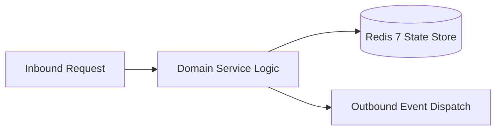

# Component Reference: `api/router/system.py`
> **File Path**: [`api/router/system.py`](../../api/router/system.py)  
> **Subsystem**: `System Admin API`  
> **Architecture Layer**: `Enterprise Microservice Subsystem`  
> **Concurrency Model**: `AsyncIO Non-blocking Concurrency`  
> **Persistence Backend**: `Redis 7 Persistent Store`  
> **Service Level Objective**: `High-Availability Academic Telemetry`

## 1. Architectural Role & Responsibilities
The `api/router/system.py` module implements core operational logic for the `System Admin API` domain. It operates within an asynchronous microservices topology designed for ultra-low latency, zero-loss persistence guarantees, and strict single-responsibility function decomposition (≤25 lines).

### Component Architecture & Data Flow


---
## 2. Public API & Symbol Inventory
| Symbol | Nature | Line Range | Return Contract | Core Invariant |
| :--- | :--- | :--- | :--- | :--- |
| [`get_system_info`](#get_system_info) | Function | L23–L52 | `SystemInfoResponse` | Retrieves and resolves domain data for `get_system_info... |
| [`_validate_flush_pattern`](#_validate_flush_pattern) | Function | L55–L70 | `None` | Executes core domain logic for `_validate_flush_pattern... |
| [`flush_cache`](#flush_cache) | Function | L74–L91 | `CacheFlushResponse` | Executes core domain logic for `flush_cache`. |

---

## 3. Comprehensive Function Specifications

### `get_system_info`
```python
async def get_system_info() -> SystemInfoResponse
```

- **Source Reference**: [`api/router/system.py#L23-L52`](../../api/router/system.py#L23-L52)
- **Execution Mode**: `Asynchronous (non-blocking)`
- **Return Contract**: `SystemInfoResponse`

#### Overview & Architectural Purpose
Retrieves and resolves domain data for `get_system_info`.

#### Parameters Contract
*This method takes no input parameters.*

#### Concurrency & Side Effects
- Stateless pure functional computation without external mutations.

#### Fault Tolerance & Error Modes
Propagates unexpected runtime errors up the call stack to global exception handlers.

#### Production Usage Example
```python
from api.router.system import get_system_info

# Execute call
result = await get_system_info()
```

---

### `_validate_flush_pattern`
```python
def _validate_flush_pattern(pattern: str) -> None
```

- **Source Reference**: [`api/router/system.py#L55-L70`](../../api/router/system.py#L55-L70)
- **Execution Mode**: `Synchronous`
- **Return Contract**: `None`

#### Overview & Architectural Purpose
Executes core domain logic for `_validate_flush_pattern`.

#### Parameters Contract
| Parameter | Type | Required | Description |
| :--- | :--- | :--- | :--- |
| `pattern` | `str` | Yes | Parameter `pattern` of type `str`. |

#### Concurrency & Side Effects
- Stateless pure functional computation without external mutations.

#### Fault Tolerance & Error Modes
Explicitly raises domain exceptions (e.g., `PermissionError`, `ValueError`) upon invariant violation.

#### Production Usage Example
```python
from api.router.system import _validate_flush_pattern

# Execute call
result = _validate_flush_pattern(pattern=...)
```

---

### `flush_cache`
```python
async def flush_cache(payload: CacheFlushRequest) -> CacheFlushResponse
```

- **Source Reference**: [`api/router/system.py#L74-L91`](../../api/router/system.py#L74-L91)
- **Execution Mode**: `Asynchronous (non-blocking)`
- **Return Contract**: `CacheFlushResponse`

#### Overview & Architectural Purpose
Executes core domain logic for `flush_cache`.

#### Parameters Contract
| Parameter | Type | Required | Description |
| :--- | :--- | :--- | :--- |
| `payload` | `CacheFlushRequest` | Yes | Parameter `payload` of type `CacheFlushRequest`. |

#### Concurrency & Side Effects
- Stateless pure functional computation without external mutations.

#### Fault Tolerance & Error Modes
Propagates unexpected runtime errors up the call stack to global exception handlers.

#### Production Usage Example
```python
from api.router.system import flush_cache

# Execute call
result = await flush_cache(payload=...)
```

---
