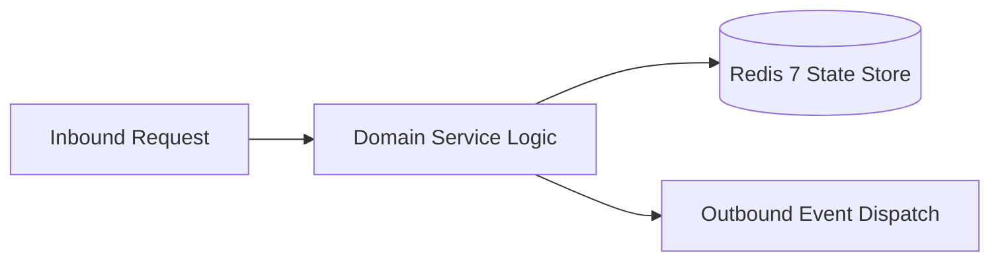

# Component Reference: `api/router/teachers.py`
> **File Path**: [`api/router/teachers.py`](../../api/router/teachers.py)  
> **Subsystem**: `Teachers API`  
> **Architecture Layer**: `Enterprise Microservice Subsystem`  
> **Concurrency Model**: `AsyncIO Non-blocking Concurrency`  
> **Persistence Backend**: `Redis 7 Persistent Store`  
> **Service Level Objective**: `High-Availability Academic Telemetry`

## 1. Architectural Role & Responsibilities
The `api/router/teachers.py` module implements core operational logic for the `Teachers API` domain. It operates within an asynchronous microservices topology designed for ultra-low latency, zero-loss persistence guarantees, and strict single-responsibility function decomposition (≤25 lines).

### Component Architecture & Data Flow


---
## 2. Public API & Symbol Inventory
| Symbol | Nature | Line Range | Return Contract | Core Invariant |
| :--- | :--- | :--- | :--- | :--- |
| [`list_teachers`](#list_teachers) | Function | L28–L41 | `TeachersResponse` | Executes core domain logic for `list_teachers`. |
| [`search_teachers`](#search_teachers) | Function | L45–L65 | `TeacherSearchResponse` | Executes core domain logic for `search_teachers`. |
| [`get_teacher`](#get_teacher) | Function | L69–L86 | `TeacherSingleResponse` | Retrieves and resolves domain data for `get_teacher`. |
| [`add_custom_teacher`](#add_custom_teacher) | Function | L90–L104 | `TeacherSingleResponse` | Executes core domain logic for `add_custom_teacher`. |
| [`remove_custom_teacher`](#remove_custom_teacher) | Function | L108–L120 | `dict[str, str]` | Executes core domain logic for `remove_custom_teacher`. |
| [`refresh_teachers`](#refresh_teachers) | Function | L124–L136 | `TeachersRefreshResponse` | Executes core domain logic for `refresh_teachers`. |

---

## 3. Comprehensive Function Specifications

### `list_teachers`
```python
async def list_teachers(force_refresh: bool = Query(default=False)) -> TeachersResponse
```

- **Source Reference**: [`api/router/teachers.py#L28-L41`](../../api/router/teachers.py#L28-L41)
- **Execution Mode**: `Asynchronous (non-blocking)`
- **Return Contract**: `TeachersResponse`

#### Overview & Architectural Purpose
Executes core domain logic for `list_teachers`.

#### Parameters Contract
| Parameter | Type | Required | Description |
| :--- | :--- | :--- | :--- |
| `force_refresh` | `bool` | Yes | Parameter `force_refresh` of type `bool`. |

#### Concurrency & Side Effects
- Stateless pure functional computation without external mutations.

#### Fault Tolerance & Error Modes
Propagates unexpected runtime errors up the call stack to global exception handlers.

#### Production Usage Example
```python
from api.router.teachers import list_teachers

# Execute call
result = await list_teachers(force_refresh=...)
```

---

### `search_teachers`
```python
async def search_teachers( q: str = Query(..., min_length=2, description="Search query substring"), ) -> TeacherSearchResponse
```

- **Source Reference**: [`api/router/teachers.py#L45-L65`](../../api/router/teachers.py#L45-L65)
- **Execution Mode**: `Asynchronous (non-blocking)`
- **Return Contract**: `TeacherSearchResponse`

#### Overview & Architectural Purpose
Executes core domain logic for `search_teachers`.

#### Parameters Contract
| Parameter | Type | Required | Description |
| :--- | :--- | :--- | :--- |
| `q` | `str` | Yes | Parameter `q` of type `str`. |

#### Concurrency & Side Effects
- Stateless pure functional computation without external mutations.

#### Fault Tolerance & Error Modes
Propagates unexpected runtime errors up the call stack to global exception handlers.

#### Production Usage Example
```python
from api.router.teachers import search_teachers

# Execute call
result = await search_teachers(q=...)
```

---

### `get_teacher`
```python
async def get_teacher(last_name: str) -> TeacherSingleResponse
```

- **Source Reference**: [`api/router/teachers.py#L69-L86`](../../api/router/teachers.py#L69-L86)
- **Execution Mode**: `Asynchronous (non-blocking)`
- **Return Contract**: `TeacherSingleResponse`

#### Overview & Architectural Purpose
Retrieves and resolves domain data for `get_teacher`.

#### Parameters Contract
| Parameter | Type | Required | Description |
| :--- | :--- | :--- | :--- |
| `last_name` | `str` | Yes | Parameter `last_name` of type `str`. |

#### Concurrency & Side Effects
- Stateless pure functional computation without external mutations.

#### Fault Tolerance & Error Modes
Explicitly raises domain exceptions (e.g., `PermissionError`, `ValueError`) upon invariant violation.

#### Production Usage Example
```python
from api.router.teachers import get_teacher

# Execute call
result = await get_teacher(last_name=...)
```

---

### `add_custom_teacher`
```python
async def add_custom_teacher(payload: CustomTeacherCreateRequest) -> TeacherSingleResponse
```

- **Source Reference**: [`api/router/teachers.py#L90-L104`](../../api/router/teachers.py#L90-L104)
- **Execution Mode**: `Asynchronous (non-blocking)`
- **Return Contract**: `TeacherSingleResponse`

#### Overview & Architectural Purpose
Executes core domain logic for `add_custom_teacher`.

#### Parameters Contract
| Parameter | Type | Required | Description |
| :--- | :--- | :--- | :--- |
| `payload` | `CustomTeacherCreateRequest` | Yes | Parameter `payload` of type `CustomTeacherCreateRequest`. |

#### Concurrency & Side Effects
- Stateless pure functional computation without external mutations.

#### Fault Tolerance & Error Modes
Propagates unexpected runtime errors up the call stack to global exception handlers.

#### Production Usage Example
```python
from api.router.teachers import add_custom_teacher

# Execute call
result = await add_custom_teacher(payload=...)
```

---

### `remove_custom_teacher`
```python
async def remove_custom_teacher(last_name: str) -> dict[str, str]
```

- **Source Reference**: [`api/router/teachers.py#L108-L120`](../../api/router/teachers.py#L108-L120)
- **Execution Mode**: `Asynchronous (non-blocking)`
- **Return Contract**: `dict[str, str]`

#### Overview & Architectural Purpose
Executes core domain logic for `remove_custom_teacher`.

#### Parameters Contract
| Parameter | Type | Required | Description |
| :--- | :--- | :--- | :--- |
| `last_name` | `str` | Yes | Parameter `last_name` of type `str`. |

#### Concurrency & Side Effects
- Stateless pure functional computation without external mutations.

#### Fault Tolerance & Error Modes
Propagates unexpected runtime errors up the call stack to global exception handlers.

#### Production Usage Example
```python
from api.router.teachers import remove_custom_teacher

# Execute call
result = await remove_custom_teacher(last_name=...)
```

---

### `refresh_teachers`
```python
async def refresh_teachers() -> TeachersRefreshResponse
```

- **Source Reference**: [`api/router/teachers.py#L124-L136`](../../api/router/teachers.py#L124-L136)
- **Execution Mode**: `Asynchronous (non-blocking)`
- **Return Contract**: `TeachersRefreshResponse`

#### Overview & Architectural Purpose
Executes core domain logic for `refresh_teachers`.

#### Parameters Contract
*This method takes no input parameters.*

#### Concurrency & Side Effects
- Stateless pure functional computation without external mutations.

#### Fault Tolerance & Error Modes
Propagates unexpected runtime errors up the call stack to global exception handlers.

#### Production Usage Example
```python
from api.router.teachers import refresh_teachers

# Execute call
result = await refresh_teachers()
```

---
