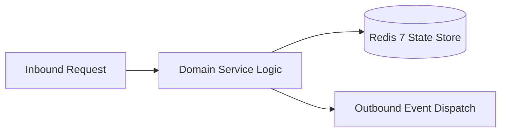

# Component Reference: `bot/commands.py`
> **File Path**: [`bot/commands.py`](../../bot/commands.py)  
> **Subsystem**: `Bot Menu Registry`  
> **Architecture Layer**: `Enterprise Microservice Subsystem`  
> **Concurrency Model**: `AsyncIO Non-blocking Concurrency`  
> **Persistence Backend**: `Redis 7 Persistent Store`  
> **Service Level Objective**: `High-Availability Academic Telemetry`

## 1. Architectural Role & Responsibilities
The `bot/commands.py` module implements core operational logic for the `Bot Menu Registry` domain. It operates within an asynchronous microservices topology designed for ultra-low latency, zero-loss persistence guarantees, and strict single-responsibility function decomposition (≤25 lines).

### Component Architecture & Data Flow


---
## 2. Public API & Symbol Inventory
| Symbol | Nature | Line Range | Return Contract | Core Invariant |
| :--- | :--- | :--- | :--- | :--- |
| [`get_default_user_commands`](#get_default_user_commands) | Function | L18–L26 | `list[BotCommand]` | Retrieves and resolves domain data for `get_default_use... |
| [`get_admin_commands`](#get_admin_commands) | Function | L29–L38 | `list[BotCommand]` | Retrieves and resolves domain data for `get_admin_comma... |
| [`register_bot_commands`](#register_bot_commands) | Function | L41–L48 | `None` | Executes core domain logic for `register_bot_commands`. |

---

## 3. Comprehensive Function Specifications

### `get_default_user_commands`
```python
def get_default_user_commands() -> list[BotCommand]
```

- **Source Reference**: [`bot/commands.py#L18-L26`](../../bot/commands.py#L18-L26)
- **Execution Mode**: `Synchronous`
- **Return Contract**: `list[BotCommand]`

#### Overview & Architectural Purpose
Retrieves and resolves domain data for `get_default_user_commands`.

#### Parameters Contract
*This method takes no input parameters.*

#### Concurrency & Side Effects
- Stateless pure functional computation without external mutations.

#### Fault Tolerance & Error Modes
Propagates unexpected runtime errors up the call stack to global exception handlers.

#### Production Usage Example
```python
from bot.commands import get_default_user_commands

# Execute call
result = get_default_user_commands()
```

---

### `get_admin_commands`
```python
def get_admin_commands() -> list[BotCommand]
```

- **Source Reference**: [`bot/commands.py#L29-L38`](../../bot/commands.py#L29-L38)
- **Execution Mode**: `Synchronous`
- **Return Contract**: `list[BotCommand]`

#### Overview & Architectural Purpose
Retrieves and resolves domain data for `get_admin_commands`.

#### Parameters Contract
*This method takes no input parameters.*

#### Concurrency & Side Effects
- Stateless pure functional computation without external mutations.

#### Fault Tolerance & Error Modes
Propagates unexpected runtime errors up the call stack to global exception handlers.

#### Production Usage Example
```python
from bot.commands import get_admin_commands

# Execute call
result = get_admin_commands()
```

---

### `register_bot_commands`
```python
async def register_bot_commands(bot: Bot) -> None
```

- **Source Reference**: [`bot/commands.py#L41-L48`](../../bot/commands.py#L41-L48)
- **Execution Mode**: `Asynchronous (non-blocking)`
- **Return Contract**: `None`

#### Overview & Architectural Purpose
Executes core domain logic for `register_bot_commands`.

#### Parameters Contract
| Parameter | Type | Required | Description |
| :--- | :--- | :--- | :--- |
| `bot` | `Bot` | Yes | Parameter `bot` of type `Bot`. |

#### Concurrency & Side Effects
- Emits structured telemetry events to system logging subsystem.

#### Fault Tolerance & Error Modes
Encapsulates faults within `try/except` blocks, logging errors and returning safe fallback defaults.

#### Production Usage Example
```python
from bot.commands import register_bot_commands

# Execute call
result = await register_bot_commands(bot=...)
```

---
