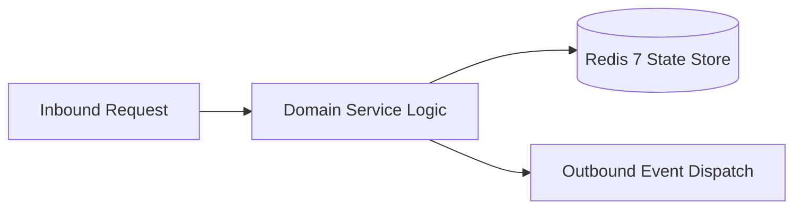

# Component Reference: `bot/filters/auth.py`
> **File Path**: [`bot/filters/auth.py`](../../bot/filters/auth.py)  
> **Subsystem**: `Bot Auth Filters`  
> **Architecture Layer**: `Enterprise Microservice Subsystem`  
> **Concurrency Model**: `AsyncIO Non-blocking Concurrency`  
> **Persistence Backend**: `Redis 7 Persistent Store`  
> **Service Level Objective**: `High-Availability Academic Telemetry`

## 1. Architectural Role & Responsibilities
The `bot/filters/auth.py` module implements core operational logic for the `Bot Auth Filters` domain. It operates within an asynchronous microservices topology designed for ultra-low latency, zero-loss persistence guarantees, and strict single-responsibility function decomposition (≤25 lines).

### Component Architecture & Data Flow


---
## 2. Public API & Symbol Inventory
| Symbol | Nature | Line Range | Return Contract | Core Invariant |
| :--- | :--- | :--- | :--- | :--- |
| [`AuthFilter.__call__`](#authfilter__call__) | Method | L17–L31 | `bool` | Executes core domain logic for `__call__`. |
| [`ClassmateAuthFilter.__call__`](#classmateauthfilter__call__) | Method | L37–L51 | `bool` | Executes core domain logic for `__call__`. |
| [`AttendanceAuthFilter.__call__`](#attendanceauthfilter__call__) | Method | L57–L73 | `bool` | Executes core domain logic for `__call__`. |

---

## 3. Comprehensive Function Specifications

## Class Model: `AuthFilter`

Encapsulates domain entities and data transfer logic for `AuthFilter`.

### `AuthFilter.__call__`
```python
async def __call__(self, event: Message | CallbackQuery) -> bool
```

- **Source Reference**: [`bot/filters/auth.py#L17-L31`](../../bot/filters/auth.py#L17-L31)
- **Execution Mode**: `Asynchronous (non-blocking)`
- **Return Contract**: `bool`

#### Overview & Architectural Purpose
Executes core domain logic for `__call__`.

#### Parameters Contract
| Parameter | Type | Required | Description |
| :--- | :--- | :--- | :--- |
| `event` | `Message | CallbackQuery` | Yes | Parameter `event` of type `Message | CallbackQuery`. |

#### Concurrency & Side Effects
- Stateless pure functional computation without external mutations.

#### Fault Tolerance & Error Modes
Propagates unexpected runtime errors up the call stack to global exception handlers.

#### Production Usage Example
```python
from bot.filters.auth import __call__

# Execute call
result = await __call__(event=...)
```

---

## Class Model: `ClassmateAuthFilter`

Encapsulates domain entities and data transfer logic for `ClassmateAuthFilter`.

### `ClassmateAuthFilter.__call__`
```python
async def __call__(self, event: Message | CallbackQuery) -> bool
```

- **Source Reference**: [`bot/filters/auth.py#L37-L51`](../../bot/filters/auth.py#L37-L51)
- **Execution Mode**: `Asynchronous (non-blocking)`
- **Return Contract**: `bool`

#### Overview & Architectural Purpose
Executes core domain logic for `__call__`.

#### Parameters Contract
| Parameter | Type | Required | Description |
| :--- | :--- | :--- | :--- |
| `event` | `Message | CallbackQuery` | Yes | Parameter `event` of type `Message | CallbackQuery`. |

#### Concurrency & Side Effects
- Stateless pure functional computation without external mutations.

#### Fault Tolerance & Error Modes
Propagates unexpected runtime errors up the call stack to global exception handlers.

#### Production Usage Example
```python
from bot.filters.auth import __call__

# Execute call
result = await __call__(event=...)
```

---

## Class Model: `AttendanceAuthFilter`

Encapsulates domain entities and data transfer logic for `AttendanceAuthFilter`.

### `AttendanceAuthFilter.__call__`
```python
async def __call__(self, event: Message | CallbackQuery) -> bool
```

- **Source Reference**: [`bot/filters/auth.py#L57-L73`](../../bot/filters/auth.py#L57-L73)
- **Execution Mode**: `Asynchronous (non-blocking)`
- **Return Contract**: `bool`

#### Overview & Architectural Purpose
Executes core domain logic for `__call__`.

#### Parameters Contract
| Parameter | Type | Required | Description |
| :--- | :--- | :--- | :--- |
| `event` | `Message | CallbackQuery` | Yes | Parameter `event` of type `Message | CallbackQuery`. |

#### Concurrency & Side Effects
- Stateless pure functional computation without external mutations.

#### Fault Tolerance & Error Modes
Propagates unexpected runtime errors up the call stack to global exception handlers.

#### Production Usage Example
```python
from bot.filters.auth import __call__

# Execute call
result = await __call__(event=...)
```

---
