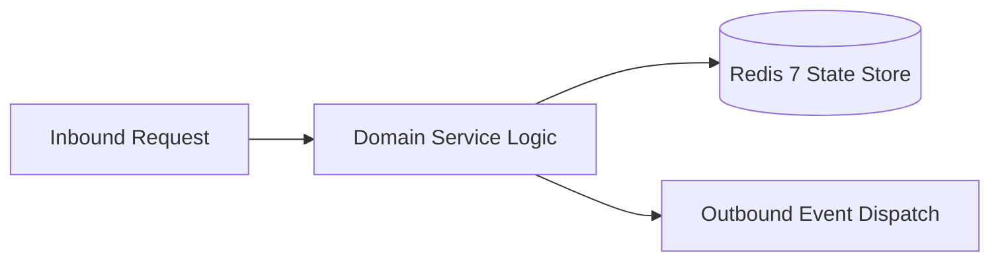

# Component Reference: `bot/handlers/admin/attendance.py`
> **File Path**: [`bot/handlers/admin/attendance.py`](../../bot/handlers/admin/attendance.py)  
> **Subsystem**: `Headman Attendance Polling`  
> **Architecture Layer**: `Enterprise Microservice Subsystem`  
> **Concurrency Model**: `AsyncIO Non-blocking Concurrency`  
> **Persistence Backend**: `Redis 7 Persistent Store`  
> **Service Level Objective**: `High-Availability Academic Telemetry`

## 1. Architectural Role & Responsibilities
The `bot/handlers/admin/attendance.py` module implements core operational logic for the `Headman Attendance Polling` domain. It operates within an asynchronous microservices topology designed for ultra-low latency, zero-loss persistence guarantees, and strict single-responsibility function decomposition (≤25 lines).

### Component Architecture & Data Flow


---
## 2. Public API & Symbol Inventory
| Symbol | Nature | Line Range | Return Contract | Core Invariant |
| :--- | :--- | :--- | :--- | :--- |
| [`_async_commit_and_update`](#_async_commit_and_update) | Function | L45–L69 | `None` | Executes core domain logic for `_async_commit_and_updat... |
| [`_instant_topic_sync`](#_instant_topic_sync) | Function | L72–L90 | `None` | Executes core domain logic for `_instant_topic_sync`. |
| [`get_partner_admin_id`](#get_partner_admin_id) | Function | L93–L111 | `int | None` | Retrieves and resolves domain data for `get_partner_adm... |
| [`notify_partner_about_attendance`](#notify_partner_about_attendance) | Function | L114–L140 | `None` | Executes core domain logic for `notify_partner_about_at... |
| [`finish_and_notify`](#finish_and_notify) | Function | L143–L167 | `None` | Executes core domain logic for `finish_and_notify`. |
| [`show_attendance_menu`](#show_attendance_menu) | Function | L172–L191 | `None` | Executes core domain logic for `show_attendance_menu`. |
| [`cb_select_day`](#cb_select_day) | Function | L195–L215 | `None` | Handles Telegram inline callback query events for `cb_s... |
| [`parse_start_callback`](#parse_start_callback) | Function | L218–L234 | `Any` | Parses and extracts structured entities from `parse_sta... |
| [`get_initiator_title`](#get_initiator_title) | Function | L237–L249 | `str` | Retrieves and resolves domain data for `get_initiator_t... |
| [`check_session_ownership`](#check_session_ownership) | Function | L252–L271 | `bool` | Executes core domain logic for `check_session_ownership... |
| [`_resolve_lesson_title_for_start`](#_resolve_lesson_title_for_start) | Function | L275–L288 | `str` | Executes core domain logic for `_resolve_lesson_title_f... |
| [`_ensure_session_available`](#_ensure_session_available) | Function | L291–L307 | `bool` | Executes core domain logic for `_ensure_session_availab... |
| [`_init_session_safe`](#_init_session_safe) | Function | L310–L326 | `Any` | Executes core domain logic for `_init_session_safe`. |
| [`cb_start_attendance`](#cb_start_attendance) | Function | L330–L352 | `None` | Handles Telegram inline callback query events for `cb_s... |
| [`cb_mark_student`](#cb_mark_student) | Function | L356–L380 | `None` | Handles Telegram inline callback query events for `cb_m... |
| [`cb_step_back`](#cb_step_back) | Function | L384–L407 | `None` | Handles Telegram inline callback query events for `cb_s... |
| [`cb_all_present`](#cb_all_present) | Function | L411–L431 | `None` | Handles Telegram inline callback query events for `cb_a... |
| [`notify_partner_about_cancellation`](#notify_partner_about_cancellation) | Function | L434–L460 | `None` | Executes core domain logic for `notify_partner_about_ca... |
| [`cb_cancel_lesson`](#cb_cancel_lesson) | Function | L464–L482 | `None` | Handles Telegram inline callback query events for `cb_c... |
| [`cb_abort_survey`](#cb_abort_survey) | Function | L486–L506 | `None` | Handles Telegram inline callback query events for `cb_a... |
| [`cb_close_menu`](#cb_close_menu) | Function | L510–L523 | `None` | Handles Telegram inline callback query events for `cb_c... |

---

## 3. Comprehensive Function Specifications

### `_async_commit_and_update`
```python
async def _async_commit_and_update( message: Message | None, session, stats: dict[str, int] ) -> None
```

- **Source Reference**: [`bot/handlers/admin/attendance.py#L45-L69`](../../bot/handlers/admin/attendance.py#L45-L69)
- **Execution Mode**: `Asynchronous (non-blocking)`
- **Return Contract**: `None`

#### Overview & Architectural Purpose
Executes core domain logic for `_async_commit_and_update`.

#### Parameters Contract
| Parameter | Type | Required | Description |
| :--- | :--- | :--- | :--- |
| `message` | `Message | None` | Yes | Aiogram Message event object encapsulating inbound user payload. |
| `session` | `Any` | Yes | Active domain session instance containing current student index and marks. |
| `stats` | `dict[str, int]` | Yes | Parameter `stats` of type `dict[str, int]`. |

#### Concurrency & Side Effects
- Emits structured telemetry events to system logging subsystem.

#### Fault Tolerance & Error Modes
Encapsulates faults within `try/except` blocks, logging errors and returning safe fallback defaults.

#### Production Usage Example
```python
from bot.handlers.admin.attendance import _async_commit_and_update

# Execute call
result = await _async_commit_and_update(message=..., session=..., stats=...)
```

---

### `_instant_topic_sync`
```python
async def _instant_topic_sync(session) -> None
```

- **Source Reference**: [`bot/handlers/admin/attendance.py#L72-L90`](../../bot/handlers/admin/attendance.py#L72-L90)
- **Execution Mode**: `Asynchronous (non-blocking)`
- **Return Contract**: `None`

#### Overview & Architectural Purpose
Executes core domain logic for `_instant_topic_sync`.

#### Parameters Contract
| Parameter | Type | Required | Description |
| :--- | :--- | :--- | :--- |
| `session` | `Any` | Yes | Active domain session instance containing current student index and marks. |

#### Concurrency & Side Effects
- Emits structured telemetry events to system logging subsystem.

#### Fault Tolerance & Error Modes
Encapsulates faults within `try/except` blocks, logging errors and returning safe fallback defaults.

#### Production Usage Example
```python
from bot.handlers.admin.attendance import _instant_topic_sync

# Execute call
result = await _instant_topic_sync(session=...)
```

---

### `get_partner_admin_id`
```python
def get_partner_admin_id(current_user_id: int) -> int | None
```

- **Source Reference**: [`bot/handlers/admin/attendance.py#L93-L111`](../../bot/handlers/admin/attendance.py#L93-L111)
- **Execution Mode**: `Synchronous`
- **Return Contract**: `int | None`

#### Overview & Architectural Purpose
Retrieves and resolves domain data for `get_partner_admin_id`.

#### Parameters Contract
| Parameter | Type | Required | Description |
| :--- | :--- | :--- | :--- |
| `current_user_id` | `int` | Yes | Parameter `current_user_id` of type `int`. |

#### Concurrency & Side Effects
- Stateless pure functional computation without external mutations.

#### Fault Tolerance & Error Modes
Propagates unexpected runtime errors up the call stack to global exception handlers.

#### Production Usage Example
```python
from bot.handlers.admin.attendance import get_partner_admin_id

# Execute call
result = get_partner_admin_id(current_user_id=...)
```

---

### `notify_partner_about_attendance`
```python
async def notify_partner_about_attendance( session, stats: dict[str, int], user_full_name: str | None = None ) -> None
```

- **Source Reference**: [`bot/handlers/admin/attendance.py#L114-L140`](../../bot/handlers/admin/attendance.py#L114-L140)
- **Execution Mode**: `Asynchronous (non-blocking)`
- **Return Contract**: `None`

#### Overview & Architectural Purpose
Executes core domain logic for `notify_partner_about_attendance`.

#### Parameters Contract
| Parameter | Type | Required | Description |
| :--- | :--- | :--- | :--- |
| `session` | `Any` | Yes | Active domain session instance containing current student index and marks. |
| `stats` | `dict[str, int]` | Yes | Parameter `stats` of type `dict[str, int]`. |
| `user_full_name` | `str | None` | Yes | Parameter `user_full_name` of type `str | None`. |

#### Concurrency & Side Effects
- Emits structured telemetry events to system logging subsystem.

#### Fault Tolerance & Error Modes
Encapsulates faults within `try/except` blocks, logging errors and returning safe fallback defaults.

#### Production Usage Example
```python
from bot.handlers.admin.attendance import notify_partner_about_attendance

# Execute call
result = await notify_partner_about_attendance(session=..., stats=..., user_full_name=...)
```

---

### `finish_and_notify`
```python
async def finish_and_notify(cb: CallbackQuery, session) -> None
```

- **Source Reference**: [`bot/handlers/admin/attendance.py#L143-L167`](../../bot/handlers/admin/attendance.py#L143-L167)
- **Execution Mode**: `Asynchronous (non-blocking)`
- **Return Contract**: `None`

#### Overview & Architectural Purpose
Executes core domain logic for `finish_and_notify`.

#### Parameters Contract
| Parameter | Type | Required | Description |
| :--- | :--- | :--- | :--- |
| `cb` | `CallbackQuery` | Yes | Parameter `cb` of type `CallbackQuery`. |
| `session` | `Any` | Yes | Active domain session instance containing current student index and marks. |

#### Concurrency & Side Effects
- Emits structured telemetry events to system logging subsystem.

#### Fault Tolerance & Error Modes
Encapsulates faults within `try/except` blocks, logging errors and returning safe fallback defaults.

#### Production Usage Example
```python
from bot.handlers.admin.attendance import finish_and_notify

# Execute call
result = await finish_and_notify(cb=..., session=...)
```

---

### `show_attendance_menu`
```python
async def show_attendance_menu(event: Message | CallbackQuery) -> None
```

- **Source Reference**: [`bot/handlers/admin/attendance.py#L172-L191`](../../bot/handlers/admin/attendance.py#L172-L191)
- **Execution Mode**: `Asynchronous (non-blocking)`
- **Return Contract**: `None`

#### Overview & Architectural Purpose
Executes core domain logic for `show_attendance_menu`.

#### Parameters Contract
| Parameter | Type | Required | Description |
| :--- | :--- | :--- | :--- |
| `event` | `Message | CallbackQuery` | Yes | Parameter `event` of type `Message | CallbackQuery`. |

#### Concurrency & Side Effects
- Stateless pure functional computation without external mutations.

#### Fault Tolerance & Error Modes
Propagates unexpected runtime errors up the call stack to global exception handlers.

#### Production Usage Example
```python
from bot.handlers.admin.attendance import show_attendance_menu

# Execute call
result = await show_attendance_menu(event=...)
```

---

### `cb_select_day`
```python
async def cb_select_day(cb: CallbackQuery) -> None
```

- **Source Reference**: [`bot/handlers/admin/attendance.py#L195-L215`](../../bot/handlers/admin/attendance.py#L195-L215)
- **Execution Mode**: `Asynchronous (non-blocking)`
- **Return Contract**: `None`

#### Overview & Architectural Purpose
Handles Telegram inline callback query events for `cb_select_day`.

#### Parameters Contract
| Parameter | Type | Required | Description |
| :--- | :--- | :--- | :--- |
| `cb` | `CallbackQuery` | Yes | Parameter `cb` of type `CallbackQuery`. |

#### Concurrency & Side Effects
- Stateless pure functional computation without external mutations.

#### Fault Tolerance & Error Modes
Propagates unexpected runtime errors up the call stack to global exception handlers.

#### Production Usage Example
```python
from bot.handlers.admin.attendance import cb_select_day

# Execute call
result = await cb_select_day(cb=...)
```

---

### `parse_start_callback`
```python
def parse_start_callback(data: str)
```

- **Source Reference**: [`bot/handlers/admin/attendance.py#L218-L234`](../../bot/handlers/admin/attendance.py#L218-L234)
- **Execution Mode**: `Synchronous`
- **Return Contract**: `Any`

#### Overview & Architectural Purpose
Parses and extracts structured entities from `parse_start_callback`.

#### Parameters Contract
| Parameter | Type | Required | Description |
| :--- | :--- | :--- | :--- |
| `data` | `str` | Yes | Parameter `data` of type `str`. |

#### Concurrency & Side Effects
- Stateless pure functional computation without external mutations.

#### Fault Tolerance & Error Modes
Propagates unexpected runtime errors up the call stack to global exception handlers.

#### Production Usage Example
```python
from bot.handlers.admin.attendance import parse_start_callback

# Execute call
result = parse_start_callback(data=...)
```

---

### `get_initiator_title`
```python
def get_initiator_title(initiator_id: int) -> str
```

- **Source Reference**: [`bot/handlers/admin/attendance.py#L237-L249`](../../bot/handlers/admin/attendance.py#L237-L249)
- **Execution Mode**: `Synchronous`
- **Return Contract**: `str`

#### Overview & Architectural Purpose
Retrieves and resolves domain data for `get_initiator_title`.

#### Parameters Contract
| Parameter | Type | Required | Description |
| :--- | :--- | :--- | :--- |
| `initiator_id` | `int` | Yes | Parameter `initiator_id` of type `int`. |

#### Concurrency & Side Effects
- Stateless pure functional computation without external mutations.

#### Fault Tolerance & Error Modes
Propagates unexpected runtime errors up the call stack to global exception handlers.

#### Production Usage Example
```python
from bot.handlers.admin.attendance import get_initiator_title

# Execute call
result = get_initiator_title(initiator_id=...)
```

---

### `check_session_ownership`
```python
async def check_session_ownership(cb: CallbackQuery, session) -> bool
```

- **Source Reference**: [`bot/handlers/admin/attendance.py#L252-L271`](../../bot/handlers/admin/attendance.py#L252-L271)
- **Execution Mode**: `Asynchronous (non-blocking)`
- **Return Contract**: `bool`

#### Overview & Architectural Purpose
Executes core domain logic for `check_session_ownership`.

#### Parameters Contract
| Parameter | Type | Required | Description |
| :--- | :--- | :--- | :--- |
| `cb` | `CallbackQuery` | Yes | Parameter `cb` of type `CallbackQuery`. |
| `session` | `Any` | Yes | Active domain session instance containing current student index and marks. |

#### Concurrency & Side Effects
- Stateless pure functional computation without external mutations.

#### Fault Tolerance & Error Modes
Propagates unexpected runtime errors up the call stack to global exception handlers.

#### Production Usage Example
```python
from bot.handlers.admin.attendance import check_session_ownership

# Execute call
result = await check_session_ownership(cb=..., session=...)
```

---

### `_resolve_lesson_title_for_start`
```python
async def _resolve_lesson_title_for_start(target_date, lesson_num: int) -> str
```

- **Source Reference**: [`bot/handlers/admin/attendance.py#L275-L288`](../../bot/handlers/admin/attendance.py#L275-L288)
- **Execution Mode**: `Asynchronous (non-blocking)`
- **Return Contract**: `str`

#### Overview & Architectural Purpose
Executes core domain logic for `_resolve_lesson_title_for_start`.

#### Parameters Contract
| Parameter | Type | Required | Description |
| :--- | :--- | :--- | :--- |
| `target_date` | `Any` | Yes | Target calendar date for schedule or attendance resolution (ISO-8601). |
| `lesson_num` | `int` | Yes | Academic class sequence index (1-based, 1 to 6). |

#### Concurrency & Side Effects
- Stateless pure functional computation without external mutations.

#### Fault Tolerance & Error Modes
Propagates unexpected runtime errors up the call stack to global exception handlers.

#### Production Usage Example
```python
from bot.handlers.admin.attendance import _resolve_lesson_title_for_start

# Execute call
result = await _resolve_lesson_title_for_start(target_date=..., lesson_num=...)
```

---

### `_ensure_session_available`
```python
async def _ensure_session_available(cb: CallbackQuery) -> bool
```

- **Source Reference**: [`bot/handlers/admin/attendance.py#L291-L307`](../../bot/handlers/admin/attendance.py#L291-L307)
- **Execution Mode**: `Asynchronous (non-blocking)`
- **Return Contract**: `bool`

#### Overview & Architectural Purpose
Executes core domain logic for `_ensure_session_available`.

#### Parameters Contract
| Parameter | Type | Required | Description |
| :--- | :--- | :--- | :--- |
| `cb` | `CallbackQuery` | Yes | Parameter `cb` of type `CallbackQuery`. |

#### Concurrency & Side Effects
- Stateless pure functional computation without external mutations.

#### Fault Tolerance & Error Modes
Propagates unexpected runtime errors up the call stack to global exception handlers.

#### Production Usage Example
```python
from bot.handlers.admin.attendance import _ensure_session_available

# Execute call
result = await _ensure_session_available(cb=...)
```

---

### `_init_session_safe`
```python
async def _init_session_safe(cb: CallbackQuery, target_date, lesson_num: int, title: str)
```

- **Source Reference**: [`bot/handlers/admin/attendance.py#L310-L326`](../../bot/handlers/admin/attendance.py#L310-L326)
- **Execution Mode**: `Asynchronous (non-blocking)`
- **Return Contract**: `Any`

#### Overview & Architectural Purpose
Executes core domain logic for `_init_session_safe`.

#### Parameters Contract
| Parameter | Type | Required | Description |
| :--- | :--- | :--- | :--- |
| `cb` | `CallbackQuery` | Yes | Parameter `cb` of type `CallbackQuery`. |
| `target_date` | `Any` | Yes | Target calendar date for schedule or attendance resolution (ISO-8601). |
| `lesson_num` | `int` | Yes | Academic class sequence index (1-based, 1 to 6). |
| `title` | `str` | Yes | Parameter `title` of type `str`. |

#### Concurrency & Side Effects
- Emits structured telemetry events to system logging subsystem.

#### Fault Tolerance & Error Modes
Encapsulates faults within `try/except` blocks, logging errors and returning safe fallback defaults.

#### Production Usage Example
```python
from bot.handlers.admin.attendance import _init_session_safe

# Execute call
result = await _init_session_safe(cb=..., target_date=..., lesson_num=...)
```

---

### `cb_start_attendance`
```python
async def cb_start_attendance(cb: CallbackQuery) -> None
```

- **Source Reference**: [`bot/handlers/admin/attendance.py#L330-L352`](../../bot/handlers/admin/attendance.py#L330-L352)
- **Execution Mode**: `Asynchronous (non-blocking)`
- **Return Contract**: `None`

#### Overview & Architectural Purpose
Handles Telegram inline callback query events for `cb_start_attendance`.

#### Parameters Contract
| Parameter | Type | Required | Description |
| :--- | :--- | :--- | :--- |
| `cb` | `CallbackQuery` | Yes | Parameter `cb` of type `CallbackQuery`. |

#### Concurrency & Side Effects
- Stateless pure functional computation without external mutations.

#### Fault Tolerance & Error Modes
Propagates unexpected runtime errors up the call stack to global exception handlers.

#### Production Usage Example
```python
from bot.handlers.admin.attendance import cb_start_attendance

# Execute call
result = await cb_start_attendance(cb=...)
```

---

### `cb_mark_student`
```python
async def cb_mark_student(cb: CallbackQuery) -> None
```

- **Source Reference**: [`bot/handlers/admin/attendance.py#L356-L380`](../../bot/handlers/admin/attendance.py#L356-L380)
- **Execution Mode**: `Asynchronous (non-blocking)`
- **Return Contract**: `None`

#### Overview & Architectural Purpose
Handles Telegram inline callback query events for `cb_mark_student`.

#### Parameters Contract
| Parameter | Type | Required | Description |
| :--- | :--- | :--- | :--- |
| `cb` | `CallbackQuery` | Yes | Parameter `cb` of type `CallbackQuery`. |

#### Concurrency & Side Effects
- Stateless pure functional computation without external mutations.

#### Fault Tolerance & Error Modes
Propagates unexpected runtime errors up the call stack to global exception handlers.

#### Production Usage Example
```python
from bot.handlers.admin.attendance import cb_mark_student

# Execute call
result = await cb_mark_student(cb=...)
```

---

### `cb_step_back`
```python
async def cb_step_back(cb: CallbackQuery) -> None
```

- **Source Reference**: [`bot/handlers/admin/attendance.py#L384-L407`](../../bot/handlers/admin/attendance.py#L384-L407)
- **Execution Mode**: `Asynchronous (non-blocking)`
- **Return Contract**: `None`

#### Overview & Architectural Purpose
Handles Telegram inline callback query events for `cb_step_back`.

#### Parameters Contract
| Parameter | Type | Required | Description |
| :--- | :--- | :--- | :--- |
| `cb` | `CallbackQuery` | Yes | Parameter `cb` of type `CallbackQuery`. |

#### Concurrency & Side Effects
- Stateless pure functional computation without external mutations.

#### Fault Tolerance & Error Modes
Propagates unexpected runtime errors up the call stack to global exception handlers.

#### Production Usage Example
```python
from bot.handlers.admin.attendance import cb_step_back

# Execute call
result = await cb_step_back(cb=...)
```

---

### `cb_all_present`
```python
async def cb_all_present(cb: CallbackQuery) -> None
```

- **Source Reference**: [`bot/handlers/admin/attendance.py#L411-L431`](../../bot/handlers/admin/attendance.py#L411-L431)
- **Execution Mode**: `Asynchronous (non-blocking)`
- **Return Contract**: `None`

#### Overview & Architectural Purpose
Handles Telegram inline callback query events for `cb_all_present`.

#### Parameters Contract
| Parameter | Type | Required | Description |
| :--- | :--- | :--- | :--- |
| `cb` | `CallbackQuery` | Yes | Parameter `cb` of type `CallbackQuery`. |

#### Concurrency & Side Effects
- Stateless pure functional computation without external mutations.

#### Fault Tolerance & Error Modes
Propagates unexpected runtime errors up the call stack to global exception handlers.

#### Production Usage Example
```python
from bot.handlers.admin.attendance import cb_all_present

# Execute call
result = await cb_all_present(cb=...)
```

---

### `notify_partner_about_cancellation`
```python
async def notify_partner_about_cancellation( lesson_num: int | str, user_id: int, user_full_name: str | None = None ) -> None
```

- **Source Reference**: [`bot/handlers/admin/attendance.py#L434-L460`](../../bot/handlers/admin/attendance.py#L434-L460)
- **Execution Mode**: `Asynchronous (non-blocking)`
- **Return Contract**: `None`

#### Overview & Architectural Purpose
Executes core domain logic for `notify_partner_about_cancellation`.

#### Parameters Contract
| Parameter | Type | Required | Description |
| :--- | :--- | :--- | :--- |
| `lesson_num` | `int | str` | Yes | Academic class sequence index (1-based, 1 to 6). |
| `user_id` | `int` | Yes | Unique 64-bit Telegram user identifier. |
| `user_full_name` | `str | None` | Yes | Parameter `user_full_name` of type `str | None`. |

#### Concurrency & Side Effects
- Emits structured telemetry events to system logging subsystem.

#### Fault Tolerance & Error Modes
Encapsulates faults within `try/except` blocks, logging errors and returning safe fallback defaults.

#### Production Usage Example
```python
from bot.handlers.admin.attendance import notify_partner_about_cancellation

# Execute call
result = await notify_partner_about_cancellation(lesson_num=..., user_id=..., user_full_name=...)
```

---

### `cb_cancel_lesson`
```python
async def cb_cancel_lesson(cb: CallbackQuery) -> None
```

- **Source Reference**: [`bot/handlers/admin/attendance.py#L464-L482`](../../bot/handlers/admin/attendance.py#L464-L482)
- **Execution Mode**: `Asynchronous (non-blocking)`
- **Return Contract**: `None`

#### Overview & Architectural Purpose
Handles Telegram inline callback query events for `cb_cancel_lesson`.

#### Parameters Contract
| Parameter | Type | Required | Description |
| :--- | :--- | :--- | :--- |
| `cb` | `CallbackQuery` | Yes | Parameter `cb` of type `CallbackQuery`. |

#### Concurrency & Side Effects
- Stateless pure functional computation without external mutations.

#### Fault Tolerance & Error Modes
Propagates unexpected runtime errors up the call stack to global exception handlers.

#### Production Usage Example
```python
from bot.handlers.admin.attendance import cb_cancel_lesson

# Execute call
result = await cb_cancel_lesson(cb=...)
```

---

### `cb_abort_survey`
```python
async def cb_abort_survey(cb: CallbackQuery) -> None
```

- **Source Reference**: [`bot/handlers/admin/attendance.py#L486-L506`](../../bot/handlers/admin/attendance.py#L486-L506)
- **Execution Mode**: `Asynchronous (non-blocking)`
- **Return Contract**: `None`

#### Overview & Architectural Purpose
Handles Telegram inline callback query events for `cb_abort_survey`.

#### Parameters Contract
| Parameter | Type | Required | Description |
| :--- | :--- | :--- | :--- |
| `cb` | `CallbackQuery` | Yes | Parameter `cb` of type `CallbackQuery`. |

#### Concurrency & Side Effects
- Stateless pure functional computation without external mutations.

#### Fault Tolerance & Error Modes
Propagates unexpected runtime errors up the call stack to global exception handlers.

#### Production Usage Example
```python
from bot.handlers.admin.attendance import cb_abort_survey

# Execute call
result = await cb_abort_survey(cb=...)
```

---

### `cb_close_menu`
```python
async def cb_close_menu(cb: CallbackQuery) -> None
```

- **Source Reference**: [`bot/handlers/admin/attendance.py#L510-L523`](../../bot/handlers/admin/attendance.py#L510-L523)
- **Execution Mode**: `Asynchronous (non-blocking)`
- **Return Contract**: `None`

#### Overview & Architectural Purpose
Handles Telegram inline callback query events for `cb_close_menu`.

#### Parameters Contract
| Parameter | Type | Required | Description |
| :--- | :--- | :--- | :--- |
| `cb` | `CallbackQuery` | Yes | Parameter `cb` of type `CallbackQuery`. |

#### Concurrency & Side Effects
- Stateless pure functional computation without external mutations.

#### Fault Tolerance & Error Modes
Propagates unexpected runtime errors up the call stack to global exception handlers.

#### Production Usage Example
```python
from bot.handlers.admin.attendance import cb_close_menu

# Execute call
result = await cb_close_menu(cb=...)
```

---
