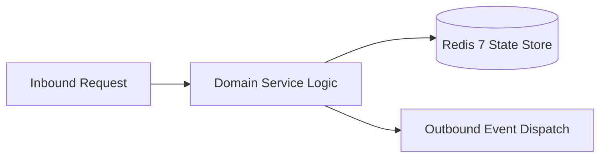

# Component Reference: `bot/handlers/admin/gamification.py`
> **File Path**: [`bot/handlers/admin/gamification.py`](../../bot/handlers/admin/gamification.py)
> **Subsystem**: `Achievement Rules`
> **Architecture Layer**: `Enterprise Microservice Subsystem`
> **Concurrency Model**: `AsyncIO Non-blocking Concurrency`
> **Persistence Backend**: `Redis 7 Persistent Store`
> **Service Level Objective**: `High-Availability Academic Telemetry`

## 1. Architectural Role & Responsibilities
The `bot/handlers/admin/gamification.py` module implements core operational logic for the `Achievement Rules` domain. It operates within an asynchronous microservices topology designed for ultra-low latency, zero-loss persistence guarantees, and strict single-responsibility function decomposition (≤25 lines).

### Component Architecture & Data Flow


---
## 2. Public API & Symbol Inventory
| Symbol | Nature | Line Range | Return Contract | Core Invariant |
| :--- | :--- | :--- | :--- | :--- |
| [`_render`](#_render) | Function | L28–L34 | `None` | Executes core domain logic for `_render`. |
| [`_load_target`](#_load_target) | Function | L37–L42 | `StudentTarget | None` | Executes core domain logic for `_load_target`. |
| [`_show_card`](#_show_card) | Function | L45–L52 | `None` | Executes core domain logic for `_show_card`. |
| [`game_students`](#game_students) | Function | L56–L64 | `None` | Executes core domain logic for `game_students`. |
| [`game_card`](#game_card) | Function | L68–L78 | `None` | Executes core domain logic for `game_card`. |
| [`game_ask_amount`](#game_ask_amount) | Function | L82–L98 | `None` | Executes core domain logic for `game_ask_amount`. |
| [`game_enter_amount`](#game_enter_amount) | Function | L102–L121 | `None` | Executes core domain logic for `game_enter_amount`. |
| [`_delete_quietly`](#_delete_quietly) | Function | L124–L129 | `None` | Executes core domain logic for `_delete_quietly`. |
| [`_edit_panel`](#_edit_panel) | Function | L132–L138 | `None` | Executes core domain logic for `_edit_panel`. |
| [`_apply_amount`](#_apply_amount) | Function | L141–L147 | `None` | Executes core domain logic for `_apply_amount`. |
| [`_edit_card`](#_edit_card) | Function | L150–L155 | `None` | Executes core domain logic for `_edit_card`. |
| [`game_bonus`](#game_bonus) | Function | L159–L172 | `None` | Executes core domain logic for `game_bonus`. |
| [`game_reset`](#game_reset) | Function | L176–L188 | `None` | Executes core domain logic for `game_reset`. |
| [`game_categories`](#game_categories) | Function | L192–L204 | `None` | Executes core domain logic for `game_categories`. |
| [`_show_category`](#_show_category) | Function | L207–L213 | `None` | Executes core domain logic for `_show_category`. |
| [`game_category`](#game_category) | Function | L217–L225 | `None` | Executes core domain logic for `game_category`. |
| [`game_toggle`](#game_toggle) | Function | L229–L242 | `None` | Executes core domain logic for `game_toggle`. |

---

## 3. Comprehensive Function Specifications

### `_render`
```python
async def _render(call: CallbackQuery, text: str, markup: InlineKeyboardMarkup) -> None
```

- **Source Reference**: [`bot/handlers/admin/gamification.py#L28-L34`](../../bot/handlers/admin/gamification.py#L28-L34)
- **Execution Mode**: `Asynchronous (non-blocking)`
- **Return Contract**: `None`

#### Overview & Architectural Purpose
Executes core domain logic for `_render`.

#### Parameters Contract
| Parameter | Type | Required | Description |
| :--- | :--- | :--- | :--- |
| `call` | `CallbackQuery` | Yes | Parameter `call` of type `CallbackQuery`. |
| `text` | `str` | Yes | Parameter `text` of type `str`. |
| `markup` | `InlineKeyboardMarkup` | Yes | Parameter `markup` of type `InlineKeyboardMarkup`. |

#### Concurrency & Side Effects
- Emits structured telemetry events to system logging subsystem.

#### Fault Tolerance & Error Modes
Encapsulates faults within `try/except` blocks, logging errors and returning safe fallback defaults.

#### Production Usage Example
```python
from bot.handlers.admin.gamification import _render

# Execute call
result = await _render(call=..., text=..., markup=...)
```

---

### `_load_target`
```python
async def _load_target(call: CallbackQuery, idx: int) -> StudentTarget | None
```

- **Source Reference**: [`bot/handlers/admin/gamification.py#L37-L42`](../../bot/handlers/admin/gamification.py#L37-L42)
- **Execution Mode**: `Asynchronous (non-blocking)`
- **Return Contract**: `StudentTarget | None`

#### Overview & Architectural Purpose
Executes core domain logic for `_load_target`.

#### Parameters Contract
| Parameter | Type | Required | Description |
| :--- | :--- | :--- | :--- |
| `call` | `CallbackQuery` | Yes | Parameter `call` of type `CallbackQuery`. |
| `idx` | `int` | Yes | Parameter `idx` of type `int`. |

#### Concurrency & Side Effects
- Stateless pure functional computation without external mutations.

#### Fault Tolerance & Error Modes
Propagates unexpected runtime errors up the call stack to global exception handlers.

#### Production Usage Example
```python
from bot.handlers.admin.gamification import _load_target

# Execute call
result = await _load_target(call=..., idx=...)
```

---

### `_show_card`
```python
async def _show_card(call: CallbackQuery, idx: int) -> None
```

- **Source Reference**: [`bot/handlers/admin/gamification.py#L45-L52`](../../bot/handlers/admin/gamification.py#L45-L52)
- **Execution Mode**: `Asynchronous (non-blocking)`
- **Return Contract**: `None`

#### Overview & Architectural Purpose
Executes core domain logic for `_show_card`.

#### Parameters Contract
| Parameter | Type | Required | Description |
| :--- | :--- | :--- | :--- |
| `call` | `CallbackQuery` | Yes | Parameter `call` of type `CallbackQuery`. |
| `idx` | `int` | Yes | Parameter `idx` of type `int`. |

#### Concurrency & Side Effects
- Stateless pure functional computation without external mutations.

#### Fault Tolerance & Error Modes
Propagates unexpected runtime errors up the call stack to global exception handlers.

#### Production Usage Example
```python
from bot.handlers.admin.gamification import _show_card

# Execute call
result = await _show_card(call=..., idx=...)
```

---

### `game_students`
```python
async def game_students(call: CallbackQuery) -> None
```

- **Source Reference**: [`bot/handlers/admin/gamification.py#L56-L64`](../../bot/handlers/admin/gamification.py#L56-L64)
- **Execution Mode**: `Asynchronous (non-blocking)`
- **Return Contract**: `None`

#### Overview & Architectural Purpose
Executes core domain logic for `game_students`.

#### Parameters Contract
| Parameter | Type | Required | Description |
| :--- | :--- | :--- | :--- |
| `call` | `CallbackQuery` | Yes | Parameter `call` of type `CallbackQuery`. |

#### Concurrency & Side Effects
- Stateless pure functional computation without external mutations.

#### Fault Tolerance & Error Modes
Propagates unexpected runtime errors up the call stack to global exception handlers.

#### Production Usage Example
```python
from bot.handlers.admin.gamification import game_students

# Execute call
result = await game_students(call=...)
```

---

### `game_card`
```python
async def game_card(call: CallbackQuery, callback_data: tgame.GameAdminCallback, state: FSMContext) -> None
```

- **Source Reference**: [`bot/handlers/admin/gamification.py#L68-L78`](../../bot/handlers/admin/gamification.py#L68-L78)
- **Execution Mode**: `Asynchronous (non-blocking)`
- **Return Contract**: `None`

#### Overview & Architectural Purpose
Executes core domain logic for `game_card`.

#### Parameters Contract
| Parameter | Type | Required | Description |
| :--- | :--- | :--- | :--- |
| `call` | `CallbackQuery` | Yes | Parameter `call` of type `CallbackQuery`. |
| `callback_data` | `tgame.GameAdminCallback` | Yes | Parameter `callback_data` of type `tgame.GameAdminCallback`. |
| `state` | `FSMContext` | Yes | Aiogram FSM context manager for dialog state persistence. |

#### Concurrency & Side Effects
- Stateless pure functional computation without external mutations.

#### Fault Tolerance & Error Modes
Propagates unexpected runtime errors up the call stack to global exception handlers.

#### Production Usage Example
```python
from bot.handlers.admin.gamification import game_card

# Execute call
result = await game_card(call=..., callback_data=..., state=...)
```

---

### `game_ask_amount`
```python
async def game_ask_amount(call: CallbackQuery, callback_data: tgame.GameAdminCallback, state: FSMContext) -> None
```

- **Source Reference**: [`bot/handlers/admin/gamification.py#L82-L98`](../../bot/handlers/admin/gamification.py#L82-L98)
- **Execution Mode**: `Asynchronous (non-blocking)`
- **Return Contract**: `None`

#### Overview & Architectural Purpose
Executes core domain logic for `game_ask_amount`.

#### Parameters Contract
| Parameter | Type | Required | Description |
| :--- | :--- | :--- | :--- |
| `call` | `CallbackQuery` | Yes | Parameter `call` of type `CallbackQuery`. |
| `callback_data` | `tgame.GameAdminCallback` | Yes | Parameter `callback_data` of type `tgame.GameAdminCallback`. |
| `state` | `FSMContext` | Yes | Aiogram FSM context manager for dialog state persistence. |

#### Concurrency & Side Effects
- Stateless pure functional computation without external mutations.

#### Fault Tolerance & Error Modes
Propagates unexpected runtime errors up the call stack to global exception handlers.

#### Production Usage Example
```python
from bot.handlers.admin.gamification import game_ask_amount

# Execute call
result = await game_ask_amount(call=..., callback_data=..., state=...)
```

---

### `game_enter_amount`
```python
async def game_enter_amount(message: Message, state: FSMContext) -> None
```

- **Source Reference**: [`bot/handlers/admin/gamification.py#L102-L121`](../../bot/handlers/admin/gamification.py#L102-L121)
- **Execution Mode**: `Asynchronous (non-blocking)`
- **Return Contract**: `None`

#### Overview & Architectural Purpose
Executes core domain logic for `game_enter_amount`.

#### Parameters Contract
| Parameter | Type | Required | Description |
| :--- | :--- | :--- | :--- |
| `message` | `Message` | Yes | Aiogram Message event object encapsulating inbound user payload. |
| `state` | `FSMContext` | Yes | Aiogram FSM context manager for dialog state persistence. |

#### Concurrency & Side Effects
- Stateless pure functional computation without external mutations.

#### Fault Tolerance & Error Modes
Propagates unexpected runtime errors up the call stack to global exception handlers.

#### Production Usage Example
```python
from bot.handlers.admin.gamification import game_enter_amount

# Execute call
result = await game_enter_amount(message=..., state=...)
```

---

### `_delete_quietly`
```python
async def _delete_quietly(message: Message) -> None
```

- **Source Reference**: [`bot/handlers/admin/gamification.py#L124-L129`](../../bot/handlers/admin/gamification.py#L124-L129)
- **Execution Mode**: `Asynchronous (non-blocking)`
- **Return Contract**: `None`

#### Overview & Architectural Purpose
Executes core domain logic for `_delete_quietly`.

#### Parameters Contract
| Parameter | Type | Required | Description |
| :--- | :--- | :--- | :--- |
| `message` | `Message` | Yes | Aiogram Message event object encapsulating inbound user payload. |

#### Concurrency & Side Effects
- Emits structured telemetry events to system logging subsystem.

#### Fault Tolerance & Error Modes
Encapsulates faults within `try/except` blocks, logging errors and returning safe fallback defaults.

#### Production Usage Example
```python
from bot.handlers.admin.gamification import _delete_quietly

# Execute call
result = await _delete_quietly(message=...)
```

---

### `_edit_panel`
```python
async def _edit_panel(message: Message, panel_id: int, text: str, markup: InlineKeyboardMarkup | None) -> None
```

- **Source Reference**: [`bot/handlers/admin/gamification.py#L132-L138`](../../bot/handlers/admin/gamification.py#L132-L138)
- **Execution Mode**: `Asynchronous (non-blocking)`
- **Return Contract**: `None`

#### Overview & Architectural Purpose
Executes core domain logic for `_edit_panel`.

#### Parameters Contract
| Parameter | Type | Required | Description |
| :--- | :--- | :--- | :--- |
| `message` | `Message` | Yes | Aiogram Message event object encapsulating inbound user payload. |
| `panel_id` | `int` | Yes | Parameter `panel_id` of type `int`. |
| `text` | `str` | Yes | Parameter `text` of type `str`. |
| `markup` | `InlineKeyboardMarkup | None` | Yes | Parameter `markup` of type `InlineKeyboardMarkup | None`. |

#### Concurrency & Side Effects
- Emits structured telemetry events to system logging subsystem.

#### Fault Tolerance & Error Modes
Encapsulates faults within `try/except` blocks, logging errors and returning safe fallback defaults.

#### Production Usage Example
```python
from bot.handlers.admin.gamification import _edit_panel

# Execute call
result = await _edit_panel(message=..., panel_id=..., text=...)
```

---

### `_apply_amount`
```python
async def _apply_amount(message: Message, target: StudentTarget, kind: str, parsed: tuple[bool, int]) -> None
```

- **Source Reference**: [`bot/handlers/admin/gamification.py#L141-L147`](../../bot/handlers/admin/gamification.py#L141-L147)
- **Execution Mode**: `Asynchronous (non-blocking)`
- **Return Contract**: `None`

#### Overview & Architectural Purpose
Executes core domain logic for `_apply_amount`.

#### Parameters Contract
| Parameter | Type | Required | Description |
| :--- | :--- | :--- | :--- |
| `message` | `Message` | Yes | Aiogram Message event object encapsulating inbound user payload. |
| `target` | `StudentTarget` | Yes | Parameter `target` of type `StudentTarget`. |
| `kind` | `str` | Yes | Parameter `kind` of type `str`. |
| `parsed` | `tuple[bool, int]` | Yes | Parameter `parsed` of type `tuple[bool, int]`. |

#### Concurrency & Side Effects
- Stateless pure functional computation without external mutations.

#### Fault Tolerance & Error Modes
Propagates unexpected runtime errors up the call stack to global exception handlers.

#### Production Usage Example
```python
from bot.handlers.admin.gamification import _apply_amount

# Execute call
result = await _apply_amount(message=..., target=..., kind=...)
```

---

### `_edit_card`
```python
async def _edit_card(message: Message, panel_id: int, idx: int) -> None
```

- **Source Reference**: [`bot/handlers/admin/gamification.py#L150-L155`](../../bot/handlers/admin/gamification.py#L150-L155)
- **Execution Mode**: `Asynchronous (non-blocking)`
- **Return Contract**: `None`

#### Overview & Architectural Purpose
Executes core domain logic for `_edit_card`.

#### Parameters Contract
| Parameter | Type | Required | Description |
| :--- | :--- | :--- | :--- |
| `message` | `Message` | Yes | Aiogram Message event object encapsulating inbound user payload. |
| `panel_id` | `int` | Yes | Parameter `panel_id` of type `int`. |
| `idx` | `int` | Yes | Parameter `idx` of type `int`. |

#### Concurrency & Side Effects
- Stateless pure functional computation without external mutations.

#### Fault Tolerance & Error Modes
Propagates unexpected runtime errors up the call stack to global exception handlers.

#### Production Usage Example
```python
from bot.handlers.admin.gamification import _edit_card

# Execute call
result = await _edit_card(message=..., panel_id=..., idx=...)
```

---

### `game_bonus`
```python
async def game_bonus(call: CallbackQuery, callback_data: tgame.GameAdminCallback) -> None
```

- **Source Reference**: [`bot/handlers/admin/gamification.py#L159-L172`](../../bot/handlers/admin/gamification.py#L159-L172)
- **Execution Mode**: `Asynchronous (non-blocking)`
- **Return Contract**: `None`

#### Overview & Architectural Purpose
Executes core domain logic for `game_bonus`.

#### Parameters Contract
| Parameter | Type | Required | Description |
| :--- | :--- | :--- | :--- |
| `call` | `CallbackQuery` | Yes | Parameter `call` of type `CallbackQuery`. |
| `callback_data` | `tgame.GameAdminCallback` | Yes | Parameter `callback_data` of type `tgame.GameAdminCallback`. |

#### Concurrency & Side Effects
- Stateless pure functional computation without external mutations.

#### Fault Tolerance & Error Modes
Propagates unexpected runtime errors up the call stack to global exception handlers.

#### Production Usage Example
```python
from bot.handlers.admin.gamification import game_bonus

# Execute call
result = await game_bonus(call=..., callback_data=...)
```

---

### `game_reset`
```python
async def game_reset(call: CallbackQuery, callback_data: tgame.GameAdminCallback) -> None
```

- **Source Reference**: [`bot/handlers/admin/gamification.py#L176-L188`](../../bot/handlers/admin/gamification.py#L176-L188)
- **Execution Mode**: `Asynchronous (non-blocking)`
- **Return Contract**: `None`

#### Overview & Architectural Purpose
Executes core domain logic for `game_reset`.

#### Parameters Contract
| Parameter | Type | Required | Description |
| :--- | :--- | :--- | :--- |
| `call` | `CallbackQuery` | Yes | Parameter `call` of type `CallbackQuery`. |
| `callback_data` | `tgame.GameAdminCallback` | Yes | Parameter `callback_data` of type `tgame.GameAdminCallback`. |

#### Concurrency & Side Effects
- Stateless pure functional computation without external mutations.

#### Fault Tolerance & Error Modes
Propagates unexpected runtime errors up the call stack to global exception handlers.

#### Production Usage Example
```python
from bot.handlers.admin.gamification import game_reset

# Execute call
result = await game_reset(call=..., callback_data=...)
```

---

### `game_categories`
```python
async def game_categories(call: CallbackQuery, callback_data: tgame.GameAdminCallback) -> None
```

- **Source Reference**: [`bot/handlers/admin/gamification.py#L192-L204`](../../bot/handlers/admin/gamification.py#L192-L204)
- **Execution Mode**: `Asynchronous (non-blocking)`
- **Return Contract**: `None`

#### Overview & Architectural Purpose
Executes core domain logic for `game_categories`.

#### Parameters Contract
| Parameter | Type | Required | Description |
| :--- | :--- | :--- | :--- |
| `call` | `CallbackQuery` | Yes | Parameter `call` of type `CallbackQuery`. |
| `callback_data` | `tgame.GameAdminCallback` | Yes | Parameter `callback_data` of type `tgame.GameAdminCallback`. |

#### Concurrency & Side Effects
- Stateless pure functional computation without external mutations.

#### Fault Tolerance & Error Modes
Propagates unexpected runtime errors up the call stack to global exception handlers.

#### Production Usage Example
```python
from bot.handlers.admin.gamification import game_categories

# Execute call
result = await game_categories(call=..., callback_data=...)
```

---

### `_show_category`
```python
async def _show_category(call: CallbackQuery, idx: int, category: str) -> None
```

- **Source Reference**: [`bot/handlers/admin/gamification.py#L207-L213`](../../bot/handlers/admin/gamification.py#L207-L213)
- **Execution Mode**: `Asynchronous (non-blocking)`
- **Return Contract**: `None`

#### Overview & Architectural Purpose
Executes core domain logic for `_show_category`.

#### Parameters Contract
| Parameter | Type | Required | Description |
| :--- | :--- | :--- | :--- |
| `call` | `CallbackQuery` | Yes | Parameter `call` of type `CallbackQuery`. |
| `idx` | `int` | Yes | Parameter `idx` of type `int`. |
| `category` | `str` | Yes | Parameter `category` of type `str`. |

#### Concurrency & Side Effects
- Stateless pure functional computation without external mutations.

#### Fault Tolerance & Error Modes
Propagates unexpected runtime errors up the call stack to global exception handlers.

#### Production Usage Example
```python
from bot.handlers.admin.gamification import _show_category

# Execute call
result = await _show_category(call=..., idx=..., category=...)
```

---

### `game_category`
```python
async def game_category(call: CallbackQuery, callback_data: tgame.GameAdminCallback) -> None
```

- **Source Reference**: [`bot/handlers/admin/gamification.py#L217-L225`](../../bot/handlers/admin/gamification.py#L217-L225)
- **Execution Mode**: `Asynchronous (non-blocking)`
- **Return Contract**: `None`

#### Overview & Architectural Purpose
Executes core domain logic for `game_category`.

#### Parameters Contract
| Parameter | Type | Required | Description |
| :--- | :--- | :--- | :--- |
| `call` | `CallbackQuery` | Yes | Parameter `call` of type `CallbackQuery`. |
| `callback_data` | `tgame.GameAdminCallback` | Yes | Parameter `callback_data` of type `tgame.GameAdminCallback`. |

#### Concurrency & Side Effects
- Stateless pure functional computation without external mutations.

#### Fault Tolerance & Error Modes
Propagates unexpected runtime errors up the call stack to global exception handlers.

#### Production Usage Example
```python
from bot.handlers.admin.gamification import game_category

# Execute call
result = await game_category(call=..., callback_data=...)
```

---

### `game_toggle`
```python
async def game_toggle(call: CallbackQuery, callback_data: tgame.GameAdminCallback) -> None
```

- **Source Reference**: [`bot/handlers/admin/gamification.py#L229-L242`](../../bot/handlers/admin/gamification.py#L229-L242)
- **Execution Mode**: `Asynchronous (non-blocking)`
- **Return Contract**: `None`

#### Overview & Architectural Purpose
Executes core domain logic for `game_toggle`.

#### Parameters Contract
| Parameter | Type | Required | Description |
| :--- | :--- | :--- | :--- |
| `call` | `CallbackQuery` | Yes | Parameter `call` of type `CallbackQuery`. |
| `callback_data` | `tgame.GameAdminCallback` | Yes | Parameter `callback_data` of type `tgame.GameAdminCallback`. |

#### Concurrency & Side Effects
- Stateless pure functional computation without external mutations.

#### Fault Tolerance & Error Modes
Propagates unexpected runtime errors up the call stack to global exception handlers.

#### Production Usage Example
```python
from bot.handlers.admin.gamification import game_toggle

# Execute call
result = await game_toggle(call=..., callback_data=...)
```

---
