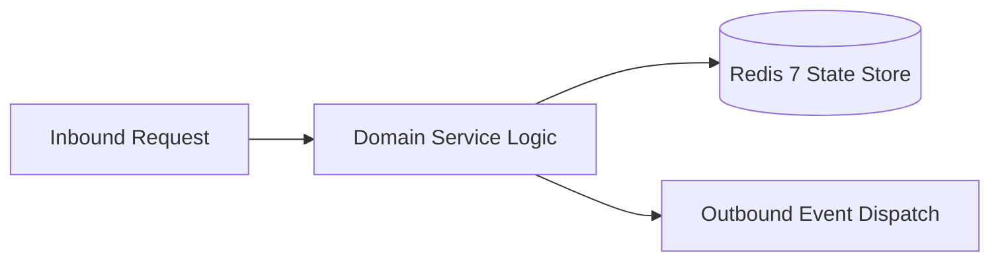

# Component Reference: `bot/handlers/admin/gamification.py`
> **File Path**: [`bot/handlers/admin/gamification.py`](../../bot/handlers/admin/gamification.py)
> **Subsystem**: `Achievement Rules`
> **Architecture Layer**: `Enterprise Microservice Subsystem`
> **Concurrency Model**: `AsyncIO Non-blocking Concurrency`
> **Persistence Backend**: `Redis 7 Persistent Store`
> **Service Level Objective**: `High-Availability Academic Telemetry`

## 1. Architectural Role & Responsibilities
The `bot/handlers/admin/gamification.py` module implements core operational logic for the `Achievement Rules` domain. It operates within an asynchronous microservices topology designed for ultra-low latency, zero-loss persistence guarantees, and strict single-responsibility function decomposition (≤25 lines).

### Component Architecture & Data Flow


---
## 2. Public API & Symbol Inventory
| Symbol | Nature | Line Range | Return Contract | Core Invariant |
| :--- | :--- | :--- | :--- | :--- |
| [`_render`](#_render) | Function | L25–L31 | `None` | Executes core domain logic for `_render`. |
| [`_load_target`](#_load_target) | Function | L34–L39 | `StudentTarget | None` | Executes core domain logic for `_load_target`. |
| [`_show_card`](#_show_card) | Function | L42–L49 | `None` | Executes core domain logic for `_show_card`. |
| [`game_students`](#game_students) | Function | L53–L61 | `None` | Executes core domain logic for `game_students`. |
| [`game_card`](#game_card) | Function | L65–L73 | `None` | Executes core domain logic for `game_card`. |
| [`game_noop`](#game_noop) | Function | L77–L83 | `None` | Executes core domain logic for `game_noop`. |
| [`game_bonus`](#game_bonus) | Function | L87–L100 | `None` | Executes core domain logic for `game_bonus`. |
| [`game_reset`](#game_reset) | Function | L104–L116 | `None` | Executes core domain logic for `game_reset`. |
| [`game_categories`](#game_categories) | Function | L120–L132 | `None` | Executes core domain logic for `game_categories`. |
| [`_show_category`](#_show_category) | Function | L135–L141 | `None` | Executes core domain logic for `_show_category`. |
| [`game_category`](#game_category) | Function | L145–L153 | `None` | Executes core domain logic for `game_category`. |
| [`game_toggle`](#game_toggle) | Function | L157–L170 | `None` | Executes core domain logic for `game_toggle`. |

---

## 3. Comprehensive Function Specifications

### `_render`
```python
async def _render(call: CallbackQuery, text: str, markup: InlineKeyboardMarkup) -> None
```

- **Source Reference**: [`bot/handlers/admin/gamification.py#L25-L31`](../../bot/handlers/admin/gamification.py#L25-L31)
- **Execution Mode**: `Asynchronous (non-blocking)`
- **Return Contract**: `None`

#### Overview & Architectural Purpose
Executes core domain logic for `_render`.

#### Parameters Contract
| Parameter | Type | Required | Description |
| :--- | :--- | :--- | :--- |
| `call` | `CallbackQuery` | Yes | Parameter `call` of type `CallbackQuery`. |
| `text` | `str` | Yes | Parameter `text` of type `str`. |
| `markup` | `InlineKeyboardMarkup` | Yes | Parameter `markup` of type `InlineKeyboardMarkup`. |

#### Concurrency & Side Effects
- Emits structured telemetry events to system logging subsystem.

#### Fault Tolerance & Error Modes
Encapsulates faults within `try/except` blocks, logging errors and returning safe fallback defaults.

#### Production Usage Example
```python
from bot.handlers.admin.gamification import _render

# Execute call
result = await _render(call=..., text=..., markup=...)
```

---

### `_load_target`
```python
async def _load_target(call: CallbackQuery, idx: int) -> StudentTarget | None
```

- **Source Reference**: [`bot/handlers/admin/gamification.py#L34-L39`](../../bot/handlers/admin/gamification.py#L34-L39)
- **Execution Mode**: `Asynchronous (non-blocking)`
- **Return Contract**: `StudentTarget | None`

#### Overview & Architectural Purpose
Executes core domain logic for `_load_target`.

#### Parameters Contract
| Parameter | Type | Required | Description |
| :--- | :--- | :--- | :--- |
| `call` | `CallbackQuery` | Yes | Parameter `call` of type `CallbackQuery`. |
| `idx` | `int` | Yes | Parameter `idx` of type `int`. |

#### Concurrency & Side Effects
- Stateless pure functional computation without external mutations.

#### Fault Tolerance & Error Modes
Propagates unexpected runtime errors up the call stack to global exception handlers.

#### Production Usage Example
```python
from bot.handlers.admin.gamification import _load_target

# Execute call
result = await _load_target(call=..., idx=...)
```

---

### `_show_card`
```python
async def _show_card(call: CallbackQuery, idx: int) -> None
```

- **Source Reference**: [`bot/handlers/admin/gamification.py#L42-L49`](../../bot/handlers/admin/gamification.py#L42-L49)
- **Execution Mode**: `Asynchronous (non-blocking)`
- **Return Contract**: `None`

#### Overview & Architectural Purpose
Executes core domain logic for `_show_card`.

#### Parameters Contract
| Parameter | Type | Required | Description |
| :--- | :--- | :--- | :--- |
| `call` | `CallbackQuery` | Yes | Parameter `call` of type `CallbackQuery`. |
| `idx` | `int` | Yes | Parameter `idx` of type `int`. |

#### Concurrency & Side Effects
- Stateless pure functional computation without external mutations.

#### Fault Tolerance & Error Modes
Propagates unexpected runtime errors up the call stack to global exception handlers.

#### Production Usage Example
```python
from bot.handlers.admin.gamification import _show_card

# Execute call
result = await _show_card(call=..., idx=...)
```

---

### `game_students`
```python
async def game_students(call: CallbackQuery) -> None
```

- **Source Reference**: [`bot/handlers/admin/gamification.py#L53-L61`](../../bot/handlers/admin/gamification.py#L53-L61)
- **Execution Mode**: `Asynchronous (non-blocking)`
- **Return Contract**: `None`

#### Overview & Architectural Purpose
Executes core domain logic for `game_students`.

#### Parameters Contract
| Parameter | Type | Required | Description |
| :--- | :--- | :--- | :--- |
| `call` | `CallbackQuery` | Yes | Parameter `call` of type `CallbackQuery`. |

#### Concurrency & Side Effects
- Stateless pure functional computation without external mutations.

#### Fault Tolerance & Error Modes
Propagates unexpected runtime errors up the call stack to global exception handlers.

#### Production Usage Example
```python
from bot.handlers.admin.gamification import game_students

# Execute call
result = await game_students(call=...)
```

---

### `game_card`
```python
async def game_card(call: CallbackQuery, callback_data: tgame.GameAdminCallback) -> None
```

- **Source Reference**: [`bot/handlers/admin/gamification.py#L65-L73`](../../bot/handlers/admin/gamification.py#L65-L73)
- **Execution Mode**: `Asynchronous (non-blocking)`
- **Return Contract**: `None`

#### Overview & Architectural Purpose
Executes core domain logic for `game_card`.

#### Parameters Contract
| Parameter | Type | Required | Description |
| :--- | :--- | :--- | :--- |
| `call` | `CallbackQuery` | Yes | Parameter `call` of type `CallbackQuery`. |
| `callback_data` | `tgame.GameAdminCallback` | Yes | Parameter `callback_data` of type `tgame.GameAdminCallback`. |

#### Concurrency & Side Effects
- Stateless pure functional computation without external mutations.

#### Fault Tolerance & Error Modes
Propagates unexpected runtime errors up the call stack to global exception handlers.

#### Production Usage Example
```python
from bot.handlers.admin.gamification import game_card

# Execute call
result = await game_card(call=..., callback_data=...)
```

---

### `game_noop`
```python
async def game_noop(call: CallbackQuery) -> None
```

- **Source Reference**: [`bot/handlers/admin/gamification.py#L77-L83`](../../bot/handlers/admin/gamification.py#L77-L83)
- **Execution Mode**: `Asynchronous (non-blocking)`
- **Return Contract**: `None`

#### Overview & Architectural Purpose
Executes core domain logic for `game_noop`.

#### Parameters Contract
| Parameter | Type | Required | Description |
| :--- | :--- | :--- | :--- |
| `call` | `CallbackQuery` | Yes | Parameter `call` of type `CallbackQuery`. |

#### Concurrency & Side Effects
- Stateless pure functional computation without external mutations.

#### Fault Tolerance & Error Modes
Propagates unexpected runtime errors up the call stack to global exception handlers.

#### Production Usage Example
```python
from bot.handlers.admin.gamification import game_noop

# Execute call
result = await game_noop(call=...)
```

---

### `game_bonus`
```python
async def game_bonus(call: CallbackQuery, callback_data: tgame.GameAdminCallback) -> None
```

- **Source Reference**: [`bot/handlers/admin/gamification.py#L87-L100`](../../bot/handlers/admin/gamification.py#L87-L100)
- **Execution Mode**: `Asynchronous (non-blocking)`
- **Return Contract**: `None`

#### Overview & Architectural Purpose
Executes core domain logic for `game_bonus`.

#### Parameters Contract
| Parameter | Type | Required | Description |
| :--- | :--- | :--- | :--- |
| `call` | `CallbackQuery` | Yes | Parameter `call` of type `CallbackQuery`. |
| `callback_data` | `tgame.GameAdminCallback` | Yes | Parameter `callback_data` of type `tgame.GameAdminCallback`. |

#### Concurrency & Side Effects
- Stateless pure functional computation without external mutations.

#### Fault Tolerance & Error Modes
Propagates unexpected runtime errors up the call stack to global exception handlers.

#### Production Usage Example
```python
from bot.handlers.admin.gamification import game_bonus

# Execute call
result = await game_bonus(call=..., callback_data=...)
```

---

### `game_reset`
```python
async def game_reset(call: CallbackQuery, callback_data: tgame.GameAdminCallback) -> None
```

- **Source Reference**: [`bot/handlers/admin/gamification.py#L104-L116`](../../bot/handlers/admin/gamification.py#L104-L116)
- **Execution Mode**: `Asynchronous (non-blocking)`
- **Return Contract**: `None`

#### Overview & Architectural Purpose
Executes core domain logic for `game_reset`.

#### Parameters Contract
| Parameter | Type | Required | Description |
| :--- | :--- | :--- | :--- |
| `call` | `CallbackQuery` | Yes | Parameter `call` of type `CallbackQuery`. |
| `callback_data` | `tgame.GameAdminCallback` | Yes | Parameter `callback_data` of type `tgame.GameAdminCallback`. |

#### Concurrency & Side Effects
- Stateless pure functional computation without external mutations.

#### Fault Tolerance & Error Modes
Propagates unexpected runtime errors up the call stack to global exception handlers.

#### Production Usage Example
```python
from bot.handlers.admin.gamification import game_reset

# Execute call
result = await game_reset(call=..., callback_data=...)
```

---

### `game_categories`
```python
async def game_categories(call: CallbackQuery, callback_data: tgame.GameAdminCallback) -> None
```

- **Source Reference**: [`bot/handlers/admin/gamification.py#L120-L132`](../../bot/handlers/admin/gamification.py#L120-L132)
- **Execution Mode**: `Asynchronous (non-blocking)`
- **Return Contract**: `None`

#### Overview & Architectural Purpose
Executes core domain logic for `game_categories`.

#### Parameters Contract
| Parameter | Type | Required | Description |
| :--- | :--- | :--- | :--- |
| `call` | `CallbackQuery` | Yes | Parameter `call` of type `CallbackQuery`. |
| `callback_data` | `tgame.GameAdminCallback` | Yes | Parameter `callback_data` of type `tgame.GameAdminCallback`. |

#### Concurrency & Side Effects
- Stateless pure functional computation without external mutations.

#### Fault Tolerance & Error Modes
Propagates unexpected runtime errors up the call stack to global exception handlers.

#### Production Usage Example
```python
from bot.handlers.admin.gamification import game_categories

# Execute call
result = await game_categories(call=..., callback_data=...)
```

---

### `_show_category`
```python
async def _show_category(call: CallbackQuery, idx: int, category: str) -> None
```

- **Source Reference**: [`bot/handlers/admin/gamification.py#L135-L141`](../../bot/handlers/admin/gamification.py#L135-L141)
- **Execution Mode**: `Asynchronous (non-blocking)`
- **Return Contract**: `None`

#### Overview & Architectural Purpose
Executes core domain logic for `_show_category`.

#### Parameters Contract
| Parameter | Type | Required | Description |
| :--- | :--- | :--- | :--- |
| `call` | `CallbackQuery` | Yes | Parameter `call` of type `CallbackQuery`. |
| `idx` | `int` | Yes | Parameter `idx` of type `int`. |
| `category` | `str` | Yes | Parameter `category` of type `str`. |

#### Concurrency & Side Effects
- Stateless pure functional computation without external mutations.

#### Fault Tolerance & Error Modes
Propagates unexpected runtime errors up the call stack to global exception handlers.

#### Production Usage Example
```python
from bot.handlers.admin.gamification import _show_category

# Execute call
result = await _show_category(call=..., idx=..., category=...)
```

---

### `game_category`
```python
async def game_category(call: CallbackQuery, callback_data: tgame.GameAdminCallback) -> None
```

- **Source Reference**: [`bot/handlers/admin/gamification.py#L145-L153`](../../bot/handlers/admin/gamification.py#L145-L153)
- **Execution Mode**: `Asynchronous (non-blocking)`
- **Return Contract**: `None`

#### Overview & Architectural Purpose
Executes core domain logic for `game_category`.

#### Parameters Contract
| Parameter | Type | Required | Description |
| :--- | :--- | :--- | :--- |
| `call` | `CallbackQuery` | Yes | Parameter `call` of type `CallbackQuery`. |
| `callback_data` | `tgame.GameAdminCallback` | Yes | Parameter `callback_data` of type `tgame.GameAdminCallback`. |

#### Concurrency & Side Effects
- Stateless pure functional computation without external mutations.

#### Fault Tolerance & Error Modes
Propagates unexpected runtime errors up the call stack to global exception handlers.

#### Production Usage Example
```python
from bot.handlers.admin.gamification import game_category

# Execute call
result = await game_category(call=..., callback_data=...)
```

---

### `game_toggle`
```python
async def game_toggle(call: CallbackQuery, callback_data: tgame.GameAdminCallback) -> None
```

- **Source Reference**: [`bot/handlers/admin/gamification.py#L157-L170`](../../bot/handlers/admin/gamification.py#L157-L170)
- **Execution Mode**: `Asynchronous (non-blocking)`
- **Return Contract**: `None`

#### Overview & Architectural Purpose
Executes core domain logic for `game_toggle`.

#### Parameters Contract
| Parameter | Type | Required | Description |
| :--- | :--- | :--- | :--- |
| `call` | `CallbackQuery` | Yes | Parameter `call` of type `CallbackQuery`. |
| `callback_data` | `tgame.GameAdminCallback` | Yes | Parameter `callback_data` of type `tgame.GameAdminCallback`. |

#### Concurrency & Side Effects
- Stateless pure functional computation without external mutations.

#### Fault Tolerance & Error Modes
Propagates unexpected runtime errors up the call stack to global exception handlers.

#### Production Usage Example
```python
from bot.handlers.admin.gamification import game_toggle

# Execute call
result = await game_toggle(call=..., callback_data=...)
```

---
