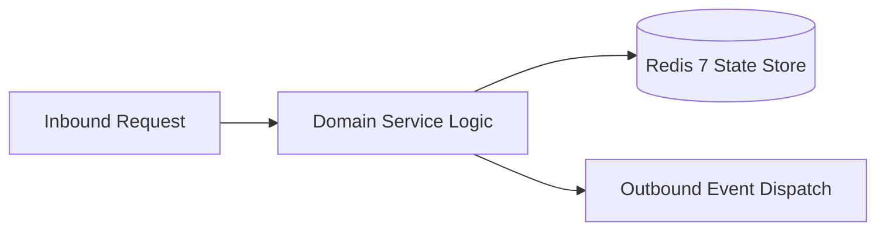

# Component Reference: `bot/handlers/admin/mute.py`
> **File Path**: [`bot/handlers/admin/mute.py`](../../bot/handlers/admin/mute.py)  
> **Subsystem**: `Moderation Ban Engine`  
> **Architecture Layer**: `Enterprise Microservice Subsystem`  
> **Concurrency Model**: `AsyncIO Non-blocking Concurrency`  
> **Persistence Backend**: `Redis 7 Persistent Store`  
> **Service Level Objective**: `High-Availability Academic Telemetry`

## 1. Architectural Role & Responsibilities
The `bot/handlers/admin/mute.py` module implements core operational logic for the `Moderation Ban Engine` domain. It operates within an asynchronous microservices topology designed for ultra-low latency, zero-loss persistence guarantees, and strict single-responsibility function decomposition (≤25 lines).

### Component Architecture & Data Flow


---
## 2. Public API & Symbol Inventory
| Symbol | Nature | Line Range | Return Contract | Core Invariant |
| :--- | :--- | :--- | :--- | :--- |
| [`cache_user_from_message`](#cache_user_from_message) | Function | L21–L32 | `None` | Executes core domain logic for `cache_user_from_message... |
| [`_find_in_admins`](#_find_in_admins) | Function | L35–L47 | `tuple[int, str] | None` | Executes core domain logic for `_find_in_admins`. |
| [`_find_in_registry`](#_find_in_registry) | Function | L50–L60 | `tuple[int, str] | None` | Executes core domain logic for `_find_in_registry`. |
| [`resolve_user_id_by_username`](#resolve_user_id_by_username) | Function | L63–L72 | `tuple[int, str] | None` | Executes core domain logic for `resolve_user_id_by_user... |
| [`_resolve_from_entities`](#_resolve_from_entities) | Function | L76–L83 | `tuple[int, str] | None` | Executes core domain logic for `_resolve_from_entities`... |
| [`resolve_target_identity`](#resolve_target_identity) | Function | L86–L98 | `tuple[int | None, str]` | Executes core domain logic for `resolve_target_identity... |
| [`_strip_mute_prefix`](#_strip_mute_prefix) | Function | L101–L107 | `str` | Executes core domain logic for `_strip_mute_prefix`. |
| [`parse_reply_mute_args`](#parse_reply_mute_args) | Function | L110–L119 | `tuple[str, str]` | Parses and extracts structured entities from `parse_rep... |
| [`parse_standalone_mute_args`](#parse_standalone_mute_args) | Function | L122–L136 | `tuple[int | None, str, str, str]` | Parses and extracts structured entities from `parse_sta... |
| [`extract_target_id_and_args`](#extract_target_id_and_args) | Function | L139–L145 | `tuple[int | None, str, str, str]` | Executes core domain logic for `extract_target_id_and_a... |
| [`apply_user_restriction`](#apply_user_restriction) | Function | L148–L156 | `None` | Executes core domain logic for `apply_user_restriction`... |
| [`_apply_unmute_permissions`](#_apply_unmute_permissions) | Function | L159–L166 | `None` | Executes core domain logic for `_apply_unmute_permissio... |
| [`send_mute_notification`](#send_mute_notification) | Function | L169–L175 | `None` | Dispatches notification message via Telegram API for `s... |
| [`_safe_delete_message`](#_safe_delete_message) | Function | L178–L189 | `None` | Executes core domain logic for `_safe_delete_message`. |
| [`_build_mute_report`](#_build_mute_report) | Function | L192–L199 | `str` | Executes core domain logic for `_build_mute_report`. |
| [`is_mute_command`](#is_mute_command) | Function | L202–L207 | `bool` | Executes core domain logic for `is_mute_command`. |
| [`is_unmute_command`](#is_unmute_command) | Function | L210–L215 | `bool` | Executes core domain logic for `is_unmute_command`. |
| [`cmd_mute_user`](#cmd_mute_user) | Function | L219–L236 | `None` | Processes inbound Telegram slash command for `cmd_mute_... |
| [`cmd_unmute_user`](#cmd_unmute_user) | Function | L240–L256 | `None` | Processes inbound Telegram slash command for `cmd_unmut... |

---

## 3. Comprehensive Function Specifications

### `cache_user_from_message`
```python
def cache_user_from_message(message: Message) -> None
```

- **Source Reference**: [`bot/handlers/admin/mute.py#L21-L32`](../../bot/handlers/admin/mute.py#L21-L32)
- **Execution Mode**: `Synchronous`
- **Return Contract**: `None`

#### Overview & Architectural Purpose
Executes core domain logic for `cache_user_from_message`.

#### Parameters Contract
| Parameter | Type | Required | Description |
| :--- | :--- | :--- | :--- |
| `message` | `Message` | Yes | Aiogram Message event object encapsulating inbound user payload. |

#### Concurrency & Side Effects
- Stateless pure functional computation without external mutations.

#### Fault Tolerance & Error Modes
Propagates unexpected runtime errors up the call stack to global exception handlers.

#### Production Usage Example
```python
from bot.handlers.admin.mute import cache_user_from_message

# Execute call
result = cache_user_from_message(message=...)
```

---

### `_find_in_admins`
```python
async def _find_in_admins(bot, chat_id: int, clean: str) -> tuple[int, str] | None
```

- **Source Reference**: [`bot/handlers/admin/mute.py#L35-L47`](../../bot/handlers/admin/mute.py#L35-L47)
- **Execution Mode**: `Asynchronous (non-blocking)`
- **Return Contract**: `tuple[int, str] | None`

#### Overview & Architectural Purpose
Executes core domain logic for `_find_in_admins`.

#### Parameters Contract
| Parameter | Type | Required | Description |
| :--- | :--- | :--- | :--- |
| `bot` | `Any` | Yes | Parameter `bot` of type `Any`. |
| `chat_id` | `int` | Yes | Unique 64-bit Telegram chat or supergroup identifier. |
| `clean` | `str` | Yes | Parameter `clean` of type `str`. |

#### Concurrency & Side Effects
- Emits structured telemetry events to system logging subsystem.

#### Fault Tolerance & Error Modes
Encapsulates faults within `try/except` blocks, logging errors and returning safe fallback defaults.

#### Production Usage Example
```python
from bot.handlers.admin.mute import _find_in_admins

# Execute call
result = await _find_in_admins(bot=..., chat_id=..., clean=...)
```

---

### `_find_in_registry`
```python
def _find_in_registry(clean: str) -> tuple[int, str] | None
```

- **Source Reference**: [`bot/handlers/admin/mute.py#L50-L60`](../../bot/handlers/admin/mute.py#L50-L60)
- **Execution Mode**: `Synchronous`
- **Return Contract**: `tuple[int, str] | None`

#### Overview & Architectural Purpose
Executes core domain logic for `_find_in_registry`.

#### Parameters Contract
| Parameter | Type | Required | Description |
| :--- | :--- | :--- | :--- |
| `clean` | `str` | Yes | Parameter `clean` of type `str`. |

#### Concurrency & Side Effects
- Stateless pure functional computation without external mutations.

#### Fault Tolerance & Error Modes
Propagates unexpected runtime errors up the call stack to global exception handlers.

#### Production Usage Example
```python
from bot.handlers.admin.mute import _find_in_registry

# Execute call
result = _find_in_registry(clean=...)
```

---

### `resolve_user_id_by_username`
```python
async def resolve_user_id_by_username(bot, chat_id: int, username: str) -> tuple[int, str] | None
```

- **Source Reference**: [`bot/handlers/admin/mute.py#L63-L72`](../../bot/handlers/admin/mute.py#L63-L72)
- **Execution Mode**: `Asynchronous (non-blocking)`
- **Return Contract**: `tuple[int, str] | None`

#### Overview & Architectural Purpose
Executes core domain logic for `resolve_user_id_by_username`.

#### Parameters Contract
| Parameter | Type | Required | Description |
| :--- | :--- | :--- | :--- |
| `bot` | `Any` | Yes | Parameter `bot` of type `Any`. |
| `chat_id` | `int` | Yes | Unique 64-bit Telegram chat or supergroup identifier. |
| `username` | `str` | Yes | Parameter `username` of type `str`. |

#### Concurrency & Side Effects
- Stateless pure functional computation without external mutations.

#### Fault Tolerance & Error Modes
Propagates unexpected runtime errors up the call stack to global exception handlers.

#### Production Usage Example
```python
from bot.handlers.admin.mute import resolve_user_id_by_username

# Execute call
result = await resolve_user_id_by_username(bot=..., chat_id=..., username=...)
```

---

### `_resolve_from_entities`
```python
def _resolve_from_entities(message: Message) -> tuple[int, str] | None
```

- **Source Reference**: [`bot/handlers/admin/mute.py#L76-L83`](../../bot/handlers/admin/mute.py#L76-L83)
- **Execution Mode**: `Synchronous`
- **Return Contract**: `tuple[int, str] | None`

#### Overview & Architectural Purpose
Executes core domain logic for `_resolve_from_entities`.

#### Parameters Contract
| Parameter | Type | Required | Description |
| :--- | :--- | :--- | :--- |
| `message` | `Message` | Yes | Aiogram Message event object encapsulating inbound user payload. |

#### Concurrency & Side Effects
- Stateless pure functional computation without external mutations.

#### Fault Tolerance & Error Modes
Propagates unexpected runtime errors up the call stack to global exception handlers.

#### Production Usage Example
```python
from bot.handlers.admin.mute import _resolve_from_entities

# Execute call
result = _resolve_from_entities(message=...)
```

---

### `resolve_target_identity`
```python
async def resolve_target_identity(message: Message, target_raw: str) -> tuple[int | None, str]
```

- **Source Reference**: [`bot/handlers/admin/mute.py#L86-L98`](../../bot/handlers/admin/mute.py#L86-L98)
- **Execution Mode**: `Asynchronous (non-blocking)`
- **Return Contract**: `tuple[int | None, str]`

#### Overview & Architectural Purpose
Executes core domain logic for `resolve_target_identity`.

#### Parameters Contract
| Parameter | Type | Required | Description |
| :--- | :--- | :--- | :--- |
| `message` | `Message` | Yes | Aiogram Message event object encapsulating inbound user payload. |
| `target_raw` | `str` | Yes | Parameter `target_raw` of type `str`. |

#### Concurrency & Side Effects
- Stateless pure functional computation without external mutations.

#### Fault Tolerance & Error Modes
Propagates unexpected runtime errors up the call stack to global exception handlers.

#### Production Usage Example
```python
from bot.handlers.admin.mute import resolve_target_identity

# Execute call
result = await resolve_target_identity(message=..., target_raw=...)
```

---

### `_strip_mute_prefix`
```python
def _strip_mute_prefix(text: str) -> str
```

- **Source Reference**: [`bot/handlers/admin/mute.py#L101-L107`](../../bot/handlers/admin/mute.py#L101-L107)
- **Execution Mode**: `Synchronous`
- **Return Contract**: `str`

#### Overview & Architectural Purpose
Executes core domain logic for `_strip_mute_prefix`.

#### Parameters Contract
| Parameter | Type | Required | Description |
| :--- | :--- | :--- | :--- |
| `text` | `str` | Yes | Parameter `text` of type `str`. |

#### Concurrency & Side Effects
- Stateless pure functional computation without external mutations.

#### Fault Tolerance & Error Modes
Propagates unexpected runtime errors up the call stack to global exception handlers.

#### Production Usage Example
```python
from bot.handlers.admin.mute import _strip_mute_prefix

# Execute call
result = _strip_mute_prefix(text=...)
```

---

### `parse_reply_mute_args`
```python
def parse_reply_mute_args(text: str) -> tuple[str, str]
```

- **Source Reference**: [`bot/handlers/admin/mute.py#L110-L119`](../../bot/handlers/admin/mute.py#L110-L119)
- **Execution Mode**: `Synchronous`
- **Return Contract**: `tuple[str, str]`

#### Overview & Architectural Purpose
Parses and extracts structured entities from `parse_reply_mute_args`.

#### Parameters Contract
| Parameter | Type | Required | Description |
| :--- | :--- | :--- | :--- |
| `text` | `str` | Yes | Parameter `text` of type `str`. |

#### Concurrency & Side Effects
- Stateless pure functional computation without external mutations.

#### Fault Tolerance & Error Modes
Propagates unexpected runtime errors up the call stack to global exception handlers.

#### Production Usage Example
```python
from bot.handlers.admin.mute import parse_reply_mute_args

# Execute call
result = parse_reply_mute_args(text=...)
```

---

### `parse_standalone_mute_args`
```python
async def parse_standalone_mute_args(message: Message) -> tuple[int | None, str, str, str]
```

- **Source Reference**: [`bot/handlers/admin/mute.py#L122-L136`](../../bot/handlers/admin/mute.py#L122-L136)
- **Execution Mode**: `Asynchronous (non-blocking)`
- **Return Contract**: `tuple[int | None, str, str, str]`

#### Overview & Architectural Purpose
Parses and extracts structured entities from `parse_standalone_mute_args`.

#### Parameters Contract
| Parameter | Type | Required | Description |
| :--- | :--- | :--- | :--- |
| `message` | `Message` | Yes | Aiogram Message event object encapsulating inbound user payload. |

#### Concurrency & Side Effects
- Stateless pure functional computation without external mutations.

#### Fault Tolerance & Error Modes
Propagates unexpected runtime errors up the call stack to global exception handlers.

#### Production Usage Example
```python
from bot.handlers.admin.mute import parse_standalone_mute_args

# Execute call
result = await parse_standalone_mute_args(message=...)
```

---

### `extract_target_id_and_args`
```python
async def extract_target_id_and_args(message: Message) -> tuple[int | None, str, str, str]
```

- **Source Reference**: [`bot/handlers/admin/mute.py#L139-L145`](../../bot/handlers/admin/mute.py#L139-L145)
- **Execution Mode**: `Asynchronous (non-blocking)`
- **Return Contract**: `tuple[int | None, str, str, str]`

#### Overview & Architectural Purpose
Executes core domain logic for `extract_target_id_and_args`.

#### Parameters Contract
| Parameter | Type | Required | Description |
| :--- | :--- | :--- | :--- |
| `message` | `Message` | Yes | Aiogram Message event object encapsulating inbound user payload. |

#### Concurrency & Side Effects
- Stateless pure functional computation without external mutations.

#### Fault Tolerance & Error Modes
Propagates unexpected runtime errors up the call stack to global exception handlers.

#### Production Usage Example
```python
from bot.handlers.admin.mute import extract_target_id_and_args

# Execute call
result = await extract_target_id_and_args(message=...)
```

---

### `apply_user_restriction`
```python
async def apply_user_restriction(bot, chat_id: int, user_id: int, duration_sec: int) -> None
```

- **Source Reference**: [`bot/handlers/admin/mute.py#L148-L156`](../../bot/handlers/admin/mute.py#L148-L156)
- **Execution Mode**: `Asynchronous (non-blocking)`
- **Return Contract**: `None`

#### Overview & Architectural Purpose
Executes core domain logic for `apply_user_restriction`.

#### Parameters Contract
| Parameter | Type | Required | Description |
| :--- | :--- | :--- | :--- |
| `bot` | `Any` | Yes | Parameter `bot` of type `Any`. |
| `chat_id` | `int` | Yes | Unique 64-bit Telegram chat or supergroup identifier. |
| `user_id` | `int` | Yes | Unique 64-bit Telegram user identifier. |
| `duration_sec` | `int` | Yes | Audio duration in seconds for message formatting. |

#### Concurrency & Side Effects
- Stateless pure functional computation without external mutations.

#### Fault Tolerance & Error Modes
Propagates unexpected runtime errors up the call stack to global exception handlers.

#### Production Usage Example
```python
from bot.handlers.admin.mute import apply_user_restriction

# Execute call
result = await apply_user_restriction(bot=..., chat_id=..., user_id=...)
```

---

### `_apply_unmute_permissions`
```python
async def _apply_unmute_permissions(bot, chat_id: int, user_id: int) -> None
```

- **Source Reference**: [`bot/handlers/admin/mute.py#L159-L166`](../../bot/handlers/admin/mute.py#L159-L166)
- **Execution Mode**: `Asynchronous (non-blocking)`
- **Return Contract**: `None`

#### Overview & Architectural Purpose
Executes core domain logic for `_apply_unmute_permissions`.

#### Parameters Contract
| Parameter | Type | Required | Description |
| :--- | :--- | :--- | :--- |
| `bot` | `Any` | Yes | Parameter `bot` of type `Any`. |
| `chat_id` | `int` | Yes | Unique 64-bit Telegram chat or supergroup identifier. |
| `user_id` | `int` | Yes | Unique 64-bit Telegram user identifier. |

#### Concurrency & Side Effects
- Stateless pure functional computation without external mutations.

#### Fault Tolerance & Error Modes
Propagates unexpected runtime errors up the call stack to global exception handlers.

#### Production Usage Example
```python
from bot.handlers.admin.mute import _apply_unmute_permissions

# Execute call
result = await _apply_unmute_permissions(bot=..., chat_id=..., user_id=...)
```

---

### `send_mute_notification`
```python
async def send_mute_notification(message: Message, res_text: str) -> None
```

- **Source Reference**: [`bot/handlers/admin/mute.py#L169-L175`](../../bot/handlers/admin/mute.py#L169-L175)
- **Execution Mode**: `Asynchronous (non-blocking)`
- **Return Contract**: `None`

#### Overview & Architectural Purpose
Dispatches notification message via Telegram API for `send_mute_notification`.

#### Parameters Contract
| Parameter | Type | Required | Description |
| :--- | :--- | :--- | :--- |
| `message` | `Message` | Yes | Aiogram Message event object encapsulating inbound user payload. |
| `res_text` | `str` | Yes | Parameter `res_text` of type `str`. |

#### Concurrency & Side Effects
- Stateless pure functional computation without external mutations.

#### Fault Tolerance & Error Modes
Propagates unexpected runtime errors up the call stack to global exception handlers.

#### Production Usage Example
```python
from bot.handlers.admin.mute import send_mute_notification

# Execute call
result = await send_mute_notification(message=..., res_text=...)
```

---

### `_safe_delete_message`
```python
async def _safe_delete_message(message: Message) -> None
```

- **Source Reference**: [`bot/handlers/admin/mute.py#L178-L189`](../../bot/handlers/admin/mute.py#L178-L189)
- **Execution Mode**: `Asynchronous (non-blocking)`
- **Return Contract**: `None`

#### Overview & Architectural Purpose
Executes core domain logic for `_safe_delete_message`.

#### Parameters Contract
| Parameter | Type | Required | Description |
| :--- | :--- | :--- | :--- |
| `message` | `Message` | Yes | Aiogram Message event object encapsulating inbound user payload. |

#### Concurrency & Side Effects
- Emits structured telemetry events to system logging subsystem.

#### Fault Tolerance & Error Modes
Encapsulates faults within `try/except` blocks, logging errors and returning safe fallback defaults.

#### Production Usage Example
```python
from bot.handlers.admin.mute import _safe_delete_message

# Execute call
result = await _safe_delete_message(message=...)
```

---

### `_build_mute_report`
```python
def _build_mute_report(target_name: str, time_raw: str, reason: str) -> str
```

- **Source Reference**: [`bot/handlers/admin/mute.py#L192-L199`](../../bot/handlers/admin/mute.py#L192-L199)
- **Execution Mode**: `Synchronous`
- **Return Contract**: `str`

#### Overview & Architectural Purpose
Executes core domain logic for `_build_mute_report`.

#### Parameters Contract
| Parameter | Type | Required | Description |
| :--- | :--- | :--- | :--- |
| `target_name` | `str` | Yes | Parameter `target_name` of type `str`. |
| `time_raw` | `str` | Yes | Parameter `time_raw` of type `str`. |
| `reason` | `str` | Yes | Parameter `reason` of type `str`. |

#### Concurrency & Side Effects
- Stateless pure functional computation without external mutations.

#### Fault Tolerance & Error Modes
Propagates unexpected runtime errors up the call stack to global exception handlers.

#### Production Usage Example
```python
from bot.handlers.admin.mute import _build_mute_report

# Execute call
result = _build_mute_report(target_name=..., time_raw=..., reason=...)
```

---

### `is_mute_command`
```python
def is_mute_command(text: str | None) -> bool
```

- **Source Reference**: [`bot/handlers/admin/mute.py#L202-L207`](../../bot/handlers/admin/mute.py#L202-L207)
- **Execution Mode**: `Synchronous`
- **Return Contract**: `bool`

#### Overview & Architectural Purpose
Executes core domain logic for `is_mute_command`.

#### Parameters Contract
| Parameter | Type | Required | Description |
| :--- | :--- | :--- | :--- |
| `text` | `str | None` | Yes | Parameter `text` of type `str | None`. |

#### Concurrency & Side Effects
- Stateless pure functional computation without external mutations.

#### Fault Tolerance & Error Modes
Propagates unexpected runtime errors up the call stack to global exception handlers.

#### Production Usage Example
```python
from bot.handlers.admin.mute import is_mute_command

# Execute call
result = is_mute_command(text=...)
```

---

### `is_unmute_command`
```python
def is_unmute_command(text: str | None) -> bool
```

- **Source Reference**: [`bot/handlers/admin/mute.py#L210-L215`](../../bot/handlers/admin/mute.py#L210-L215)
- **Execution Mode**: `Synchronous`
- **Return Contract**: `bool`

#### Overview & Architectural Purpose
Executes core domain logic for `is_unmute_command`.

#### Parameters Contract
| Parameter | Type | Required | Description |
| :--- | :--- | :--- | :--- |
| `text` | `str | None` | Yes | Parameter `text` of type `str | None`. |

#### Concurrency & Side Effects
- Stateless pure functional computation without external mutations.

#### Fault Tolerance & Error Modes
Propagates unexpected runtime errors up the call stack to global exception handlers.

#### Production Usage Example
```python
from bot.handlers.admin.mute import is_unmute_command

# Execute call
result = is_unmute_command(text=...)
```

---

### `cmd_mute_user`
```python
async def cmd_mute_user(message: Message) -> None
```

- **Source Reference**: [`bot/handlers/admin/mute.py#L219-L236`](../../bot/handlers/admin/mute.py#L219-L236)
- **Execution Mode**: `Asynchronous (non-blocking)`
- **Return Contract**: `None`

#### Overview & Architectural Purpose
Processes inbound Telegram slash command for `cmd_mute_user`.

#### Parameters Contract
| Parameter | Type | Required | Description |
| :--- | :--- | :--- | :--- |
| `message` | `Message` | Yes | Aiogram Message event object encapsulating inbound user payload. |

#### Concurrency & Side Effects
- Emits structured telemetry events to system logging subsystem.

#### Fault Tolerance & Error Modes
Encapsulates faults within `try/except` blocks, logging errors and returning safe fallback defaults.

#### Production Usage Example
```python
from bot.handlers.admin.mute import cmd_mute_user

# Execute call
result = await cmd_mute_user(message=...)
```

---

### `cmd_unmute_user`
```python
async def cmd_unmute_user(message: Message) -> None
```

- **Source Reference**: [`bot/handlers/admin/mute.py#L240-L256`](../../bot/handlers/admin/mute.py#L240-L256)
- **Execution Mode**: `Asynchronous (non-blocking)`
- **Return Contract**: `None`

#### Overview & Architectural Purpose
Processes inbound Telegram slash command for `cmd_unmute_user`.

#### Parameters Contract
| Parameter | Type | Required | Description |
| :--- | :--- | :--- | :--- |
| `message` | `Message` | Yes | Aiogram Message event object encapsulating inbound user payload. |

#### Concurrency & Side Effects
- Emits structured telemetry events to system logging subsystem.

#### Fault Tolerance & Error Modes
Encapsulates faults within `try/except` blocks, logging errors and returning safe fallback defaults.

#### Production Usage Example
```python
from bot.handlers.admin.mute import cmd_unmute_user

# Execute call
result = await cmd_unmute_user(message=...)
```

---
