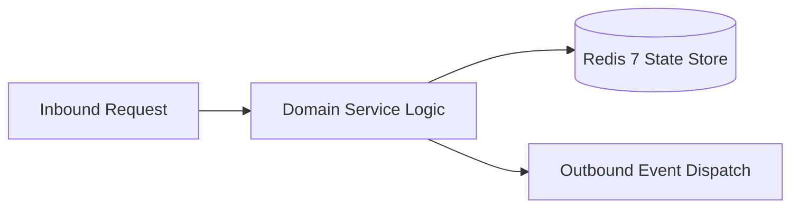

# Component Reference: `bot/handlers/admin/panel.py`
> **File Path**: [`bot/handlers/admin/panel.py`](../../bot/handlers/admin/panel.py)  
> **Subsystem**: `Admin Control Panel`  
> **Architecture Layer**: `Enterprise Microservice Subsystem`  
> **Concurrency Model**: `AsyncIO Non-blocking Concurrency`  
> **Persistence Backend**: `Redis 7 Persistent Store`  
> **Service Level Objective**: `High-Availability Academic Telemetry`

## 1. Architectural Role & Responsibilities
The `bot/handlers/admin/panel.py` module implements core operational logic for the `Admin Control Panel` domain. It operates within an asynchronous microservices topology designed for ultra-low latency, zero-loss persistence guarantees, and strict single-responsibility function decomposition (≤25 lines).

### Component Architecture & Data Flow


---
## 2. Public API & Symbol Inventory
| Symbol | Nature | Line Range | Return Contract | Core Invariant |
| :--- | :--- | :--- | :--- | :--- |
| [`_ack_admin_callback`](#_ack_admin_callback) | Function | L24–L32 | `None` | Executes core domain logic for `_ack_admin_callback`. |
| [`_safe_edit_admin_message`](#_safe_edit_admin_message) | Function | L35–L47 | `None` | Executes core domain logic for `_safe_edit_admin_messag... |
| [`format_admin_panel_text`](#format_admin_panel_text) | Function | L50–L65 | `str` | Formats message payload and presentation markup for `fo... |
| [`cb_admin_menu`](#cb_admin_menu) | Function | L70–L84 | `None` | Handles Telegram inline callback query events for `cb_a... |
| [`cb_admin_sync`](#cb_admin_sync) | Function | L88–L98 | `None` | Handles Telegram inline callback query events for `cb_a... |
| [`_get_redis_memory_stat`](#_get_redis_memory_stat) | Function | L101–L111 | `str` | Executes core domain logic for `_get_redis_memory_stat`... |
| [`_collect_health_summary`](#_collect_health_summary) | Function | L114–L136 | `str` | Executes core domain logic for `_collect_health_summary... |
| [`cb_admin_status`](#cb_admin_status) | Function | L140–L145 | `None` | Handles Telegram inline callback query events for `cb_a... |
| [`cb_admin_force_topic`](#cb_admin_force_topic) | Function | L149–L155 | `None` | Handles Telegram inline callback query events for `cb_a... |
| [`cb_admin_recreate_topic`](#cb_admin_recreate_topic) | Function | L159–L166 | `None` | Handles Telegram inline callback query events for `cb_a... |
| [`cb_admin_force_exam`](#cb_admin_force_exam) | Function | L170–L177 | `None` | Handles Telegram inline callback query events for `cb_a... |
| [`cb_admin_recreate_exam`](#cb_admin_recreate_exam) | Function | L181–L188 | `None` | Handles Telegram inline callback query events for `cb_a... |
| [`cb_admin_force_att_topic`](#cb_admin_force_att_topic) | Function | L192–L199 | `None` | Handles Telegram inline callback query events for `cb_a... |
| [`cb_admin_recreate_att_topic`](#cb_admin_recreate_att_topic) | Function | L203–L210 | `None` | Handles Telegram inline callback query events for `cb_a... |
| [`_build_custom_teachers_view`](#_build_custom_teachers_view) | Function | L225–L237 | `tuple[str, list]` | Executes core domain logic for `_build_custom_teachers_... |
| [`cb_admin_list_custom`](#cb_admin_list_custom) | Function | L241–L253 | `None` | Handles Telegram inline callback query events for `cb_a... |
| [`cb_admin_delete_teacher`](#cb_admin_delete_teacher) | Function | L257–L268 | `None` | Handles Telegram inline callback query events for `cb_a... |
| [`cb_admin_edit_teacher`](#cb_admin_edit_teacher) | Function | L272–L293 | `None` | Handles Telegram inline callback query events for `cb_a... |
| [`cb_admin_start_add_teacher`](#cb_admin_start_add_teacher) | Function | L297–L313 | `None` | Handles Telegram inline callback query events for `cb_a... |
| [`msg_admin_got_teacher_name`](#msg_admin_got_teacher_name) | Function | L317–L332 | `None` | Executes core domain logic for `msg_admin_got_teacher_n... |
| [`msg_admin_got_teacher_link`](#msg_admin_got_teacher_link) | Function | L336–L358 | `None` | Executes core domain logic for `msg_admin_got_teacher_l... |
| [`_build_unbound_students_kb`](#_build_unbound_students_kb) | Function | L365–L377 | `InlineKeyboardMarkup` | Executes core domain logic for `_build_unbound_students... |
| [`cb_admin_list_students_for_binding`](#cb_admin_list_students_for_binding) | Function | L381–L391 | `None` | Handles Telegram inline callback query events for `cb_a... |
| [`cb_admin_select_student`](#cb_admin_select_student) | Function | L395–L413 | `None` | Handles Telegram inline callback query events for `cb_a... |
| [`msg_admin_got_student_id`](#msg_admin_got_student_id) | Function | L417–L437 | `None` | Executes core domain logic for `msg_admin_got_student_i... |

---

## 3. Comprehensive Function Specifications

### `_ack_admin_callback`
```python
async def _ack_admin_callback(callback: CallbackQuery, text: str | None = None) -> None
```

- **Source Reference**: [`bot/handlers/admin/panel.py#L24-L32`](../../bot/handlers/admin/panel.py#L24-L32)
- **Execution Mode**: `Asynchronous (non-blocking)`
- **Return Contract**: `None`

#### Overview & Architectural Purpose
Executes core domain logic for `_ack_admin_callback`.

#### Parameters Contract
| Parameter | Type | Required | Description |
| :--- | :--- | :--- | :--- |
| `callback` | `CallbackQuery` | Yes | Parameter `callback` of type `CallbackQuery`. |
| `text` | `str | None` | Yes | Parameter `text` of type `str | None`. |

#### Concurrency & Side Effects
- Emits structured telemetry events to system logging subsystem.

#### Fault Tolerance & Error Modes
Encapsulates faults within `try/except` blocks, logging errors and returning safe fallback defaults.

#### Production Usage Example
```python
from bot.handlers.admin.panel import _ack_admin_callback

# Execute call
result = await _ack_admin_callback(callback=..., text=...)
```

---

### `_safe_edit_admin_message`
```python
async def _safe_edit_admin_message( message: Message | None, text: str, reply_markup: InlineKeyboardMarkup | None = None ) -> None
```

- **Source Reference**: [`bot/handlers/admin/panel.py#L35-L47`](../../bot/handlers/admin/panel.py#L35-L47)
- **Execution Mode**: `Asynchronous (non-blocking)`
- **Return Contract**: `None`

#### Overview & Architectural Purpose
Executes core domain logic for `_safe_edit_admin_message`.

#### Parameters Contract
| Parameter | Type | Required | Description |
| :--- | :--- | :--- | :--- |
| `message` | `Message | None` | Yes | Aiogram Message event object encapsulating inbound user payload. |
| `text` | `str` | Yes | Parameter `text` of type `str`. |
| `reply_markup` | `InlineKeyboardMarkup | None` | Yes | Parameter `reply_markup` of type `InlineKeyboardMarkup | None`. |

#### Concurrency & Side Effects
- Emits structured telemetry events to system logging subsystem.

#### Fault Tolerance & Error Modes
Encapsulates faults within `try/except` blocks, logging errors and returning safe fallback defaults.

#### Production Usage Example
```python
from bot.handlers.admin.panel import _safe_edit_admin_message

# Execute call
result = await _safe_edit_admin_message(message=..., text=..., reply_markup=...)
```

---

### `format_admin_panel_text`
```python
def format_admin_panel_text(status_note: str = "") -> str
```

- **Source Reference**: [`bot/handlers/admin/panel.py#L50-L65`](../../bot/handlers/admin/panel.py#L50-L65)
- **Execution Mode**: `Synchronous`
- **Return Contract**: `str`

#### Overview & Architectural Purpose
Formats message payload and presentation markup for `format_admin_panel_text`.

#### Parameters Contract
| Parameter | Type | Required | Description |
| :--- | :--- | :--- | :--- |
| `status_note` | `str` | Yes | Parameter `status_note` of type `str`. |

#### Concurrency & Side Effects
- Stateless pure functional computation without external mutations.

#### Fault Tolerance & Error Modes
Propagates unexpected runtime errors up the call stack to global exception handlers.

#### Production Usage Example
```python
from bot.handlers.admin.panel import format_admin_panel_text

# Execute call
result = format_admin_panel_text(status_note=...)
```

---

### `cb_admin_menu`
```python
async def cb_admin_menu(event: Message | CallbackQuery) -> None
```

- **Source Reference**: [`bot/handlers/admin/panel.py#L70-L84`](../../bot/handlers/admin/panel.py#L70-L84)
- **Execution Mode**: `Asynchronous (non-blocking)`
- **Return Contract**: `None`

#### Overview & Architectural Purpose
Handles Telegram inline callback query events for `cb_admin_menu`.

#### Parameters Contract
| Parameter | Type | Required | Description |
| :--- | :--- | :--- | :--- |
| `event` | `Message | CallbackQuery` | Yes | Parameter `event` of type `Message | CallbackQuery`. |

#### Concurrency & Side Effects
- Emits structured telemetry events to system logging subsystem.

#### Fault Tolerance & Error Modes
Propagates unexpected runtime errors up the call stack to global exception handlers.

#### Production Usage Example
```python
from bot.handlers.admin.panel import cb_admin_menu

# Execute call
result = await cb_admin_menu(event=...)
```

---

### `cb_admin_sync`
```python
async def cb_admin_sync(callback: CallbackQuery) -> None
```

- **Source Reference**: [`bot/handlers/admin/panel.py#L88-L98`](../../bot/handlers/admin/panel.py#L88-L98)
- **Execution Mode**: `Asynchronous (non-blocking)`
- **Return Contract**: `None`

#### Overview & Architectural Purpose
Handles Telegram inline callback query events for `cb_admin_sync`.

#### Parameters Contract
| Parameter | Type | Required | Description |
| :--- | :--- | :--- | :--- |
| `callback` | `CallbackQuery` | Yes | Parameter `callback` of type `CallbackQuery`. |

#### Concurrency & Side Effects
- Emits structured telemetry events to system logging subsystem.

#### Fault Tolerance & Error Modes
Propagates unexpected runtime errors up the call stack to global exception handlers.

#### Production Usage Example
```python
from bot.handlers.admin.panel import cb_admin_sync

# Execute call
result = await cb_admin_sync(callback=...)
```

---

### `_get_redis_memory_stat`
```python
async def _get_redis_memory_stat() -> str
```

- **Source Reference**: [`bot/handlers/admin/panel.py#L101-L111`](../../bot/handlers/admin/panel.py#L101-L111)
- **Execution Mode**: `Asynchronous (non-blocking)`
- **Return Contract**: `str`

#### Overview & Architectural Purpose
Executes core domain logic for `_get_redis_memory_stat`.

#### Parameters Contract
*This method takes no input parameters.*

#### Concurrency & Side Effects
- Emits structured telemetry events to system logging subsystem.

#### Fault Tolerance & Error Modes
Encapsulates faults within `try/except` blocks, logging errors and returning safe fallback defaults.

#### Production Usage Example
```python
from bot.handlers.admin.panel import _get_redis_memory_stat

# Execute call
result = await _get_redis_memory_stat()
```

---

### `_collect_health_summary`
```python
async def _collect_health_summary() -> str
```

- **Source Reference**: [`bot/handlers/admin/panel.py#L114-L136`](../../bot/handlers/admin/panel.py#L114-L136)
- **Execution Mode**: `Asynchronous (non-blocking)`
- **Return Contract**: `str`

#### Overview & Architectural Purpose
Executes core domain logic for `_collect_health_summary`.

#### Parameters Contract
*This method takes no input parameters.*

#### Concurrency & Side Effects
- Mutates or reads Redis L2 key space via asynchronous connection pool.

#### Fault Tolerance & Error Modes
Propagates unexpected runtime errors up the call stack to global exception handlers.

#### Production Usage Example
```python
from bot.handlers.admin.panel import _collect_health_summary

# Execute call
result = await _collect_health_summary()
```

---

### `cb_admin_status`
```python
async def cb_admin_status(callback: CallbackQuery) -> None
```

- **Source Reference**: [`bot/handlers/admin/panel.py#L140-L145`](../../bot/handlers/admin/panel.py#L140-L145)
- **Execution Mode**: `Asynchronous (non-blocking)`
- **Return Contract**: `None`

#### Overview & Architectural Purpose
Handles Telegram inline callback query events for `cb_admin_status`.

#### Parameters Contract
| Parameter | Type | Required | Description |
| :--- | :--- | :--- | :--- |
| `callback` | `CallbackQuery` | Yes | Parameter `callback` of type `CallbackQuery`. |

#### Concurrency & Side Effects
- Stateless pure functional computation without external mutations.

#### Fault Tolerance & Error Modes
Propagates unexpected runtime errors up the call stack to global exception handlers.

#### Production Usage Example
```python
from bot.handlers.admin.panel import cb_admin_status

# Execute call
result = await cb_admin_status(callback=...)
```

---

### `cb_admin_force_topic`
```python
async def cb_admin_force_topic(callback: CallbackQuery) -> None
```

- **Source Reference**: [`bot/handlers/admin/panel.py#L149-L155`](../../bot/handlers/admin/panel.py#L149-L155)
- **Execution Mode**: `Asynchronous (non-blocking)`
- **Return Contract**: `None`

#### Overview & Architectural Purpose
Handles Telegram inline callback query events for `cb_admin_force_topic`.

#### Parameters Contract
| Parameter | Type | Required | Description |
| :--- | :--- | :--- | :--- |
| `callback` | `CallbackQuery` | Yes | Parameter `callback` of type `CallbackQuery`. |

#### Concurrency & Side Effects
- Stateless pure functional computation without external mutations.

#### Fault Tolerance & Error Modes
Propagates unexpected runtime errors up the call stack to global exception handlers.

#### Production Usage Example
```python
from bot.handlers.admin.panel import cb_admin_force_topic

# Execute call
result = await cb_admin_force_topic(callback=...)
```

---

### `cb_admin_recreate_topic`
```python
async def cb_admin_recreate_topic(callback: CallbackQuery) -> None
```

- **Source Reference**: [`bot/handlers/admin/panel.py#L159-L166`](../../bot/handlers/admin/panel.py#L159-L166)
- **Execution Mode**: `Asynchronous (non-blocking)`
- **Return Contract**: `None`

#### Overview & Architectural Purpose
Handles Telegram inline callback query events for `cb_admin_recreate_topic`.

#### Parameters Contract
| Parameter | Type | Required | Description |
| :--- | :--- | :--- | :--- |
| `callback` | `CallbackQuery` | Yes | Parameter `callback` of type `CallbackQuery`. |

#### Concurrency & Side Effects
- Stateless pure functional computation without external mutations.

#### Fault Tolerance & Error Modes
Propagates unexpected runtime errors up the call stack to global exception handlers.

#### Production Usage Example
```python
from bot.handlers.admin.panel import cb_admin_recreate_topic

# Execute call
result = await cb_admin_recreate_topic(callback=...)
```

---

### `cb_admin_force_exam`
```python
async def cb_admin_force_exam(callback: CallbackQuery) -> None
```

- **Source Reference**: [`bot/handlers/admin/panel.py#L170-L177`](../../bot/handlers/admin/panel.py#L170-L177)
- **Execution Mode**: `Asynchronous (non-blocking)`
- **Return Contract**: `None`

#### Overview & Architectural Purpose
Handles Telegram inline callback query events for `cb_admin_force_exam`.

#### Parameters Contract
| Parameter | Type | Required | Description |
| :--- | :--- | :--- | :--- |
| `callback` | `CallbackQuery` | Yes | Parameter `callback` of type `CallbackQuery`. |

#### Concurrency & Side Effects
- Stateless pure functional computation without external mutations.

#### Fault Tolerance & Error Modes
Propagates unexpected runtime errors up the call stack to global exception handlers.

#### Production Usage Example
```python
from bot.handlers.admin.panel import cb_admin_force_exam

# Execute call
result = await cb_admin_force_exam(callback=...)
```

---

### `cb_admin_recreate_exam`
```python
async def cb_admin_recreate_exam(callback: CallbackQuery) -> None
```

- **Source Reference**: [`bot/handlers/admin/panel.py#L181-L188`](../../bot/handlers/admin/panel.py#L181-L188)
- **Execution Mode**: `Asynchronous (non-blocking)`
- **Return Contract**: `None`

#### Overview & Architectural Purpose
Handles Telegram inline callback query events for `cb_admin_recreate_exam`.

#### Parameters Contract
| Parameter | Type | Required | Description |
| :--- | :--- | :--- | :--- |
| `callback` | `CallbackQuery` | Yes | Parameter `callback` of type `CallbackQuery`. |

#### Concurrency & Side Effects
- Stateless pure functional computation without external mutations.

#### Fault Tolerance & Error Modes
Propagates unexpected runtime errors up the call stack to global exception handlers.

#### Production Usage Example
```python
from bot.handlers.admin.panel import cb_admin_recreate_exam

# Execute call
result = await cb_admin_recreate_exam(callback=...)
```

---

### `cb_admin_force_att_topic`
```python
async def cb_admin_force_att_topic(callback: CallbackQuery) -> None
```

- **Source Reference**: [`bot/handlers/admin/panel.py#L192-L199`](../../bot/handlers/admin/panel.py#L192-L199)
- **Execution Mode**: `Asynchronous (non-blocking)`
- **Return Contract**: `None`

#### Overview & Architectural Purpose
Handles Telegram inline callback query events for `cb_admin_force_att_topic`.

#### Parameters Contract
| Parameter | Type | Required | Description |
| :--- | :--- | :--- | :--- |
| `callback` | `CallbackQuery` | Yes | Parameter `callback` of type `CallbackQuery`. |

#### Concurrency & Side Effects
- Stateless pure functional computation without external mutations.

#### Fault Tolerance & Error Modes
Propagates unexpected runtime errors up the call stack to global exception handlers.

#### Production Usage Example
```python
from bot.handlers.admin.panel import cb_admin_force_att_topic

# Execute call
result = await cb_admin_force_att_topic(callback=...)
```

---

### `cb_admin_recreate_att_topic`
```python
async def cb_admin_recreate_att_topic(callback: CallbackQuery) -> None
```

- **Source Reference**: [`bot/handlers/admin/panel.py#L203-L210`](../../bot/handlers/admin/panel.py#L203-L210)
- **Execution Mode**: `Asynchronous (non-blocking)`
- **Return Contract**: `None`

#### Overview & Architectural Purpose
Handles Telegram inline callback query events for `cb_admin_recreate_att_topic`.

#### Parameters Contract
| Parameter | Type | Required | Description |
| :--- | :--- | :--- | :--- |
| `callback` | `CallbackQuery` | Yes | Parameter `callback` of type `CallbackQuery`. |

#### Concurrency & Side Effects
- Stateless pure functional computation without external mutations.

#### Fault Tolerance & Error Modes
Propagates unexpected runtime errors up the call stack to global exception handlers.

#### Production Usage Example
```python
from bot.handlers.admin.panel import cb_admin_recreate_att_topic

# Execute call
result = await cb_admin_recreate_att_topic(callback=...)
```

---

## Class Model: `AddTeacherState`

Encapsulates domain entities and data transfer logic for `AddTeacherState`.

### `_build_custom_teachers_view`
```python
def _build_custom_teachers_view(custom: dict) -> tuple[str, list]
```

- **Source Reference**: [`bot/handlers/admin/panel.py#L225-L237`](../../bot/handlers/admin/panel.py#L225-L237)
- **Execution Mode**: `Synchronous`
- **Return Contract**: `tuple[str, list]`

#### Overview & Architectural Purpose
Executes core domain logic for `_build_custom_teachers_view`.

#### Parameters Contract
| Parameter | Type | Required | Description |
| :--- | :--- | :--- | :--- |
| `custom` | `dict` | Yes | Parameter `custom` of type `dict`. |

#### Concurrency & Side Effects
- Stateless pure functional computation without external mutations.

#### Fault Tolerance & Error Modes
Propagates unexpected runtime errors up the call stack to global exception handlers.

#### Production Usage Example
```python
from bot.handlers.admin.panel import _build_custom_teachers_view

# Execute call
result = _build_custom_teachers_view(custom=...)
```

---

### `cb_admin_list_custom`
```python
async def cb_admin_list_custom(callback: CallbackQuery) -> None
```

- **Source Reference**: [`bot/handlers/admin/panel.py#L241-L253`](../../bot/handlers/admin/panel.py#L241-L253)
- **Execution Mode**: `Asynchronous (non-blocking)`
- **Return Contract**: `None`

#### Overview & Architectural Purpose
Handles Telegram inline callback query events for `cb_admin_list_custom`.

#### Parameters Contract
| Parameter | Type | Required | Description |
| :--- | :--- | :--- | :--- |
| `callback` | `CallbackQuery` | Yes | Parameter `callback` of type `CallbackQuery`. |

#### Concurrency & Side Effects
- Stateless pure functional computation without external mutations.

#### Fault Tolerance & Error Modes
Propagates unexpected runtime errors up the call stack to global exception handlers.

#### Production Usage Example
```python
from bot.handlers.admin.panel import cb_admin_list_custom

# Execute call
result = await cb_admin_list_custom(callback=...)
```

---

### `cb_admin_delete_teacher`
```python
async def cb_admin_delete_teacher(callback: CallbackQuery) -> None
```

- **Source Reference**: [`bot/handlers/admin/panel.py#L257-L268`](../../bot/handlers/admin/panel.py#L257-L268)
- **Execution Mode**: `Asynchronous (non-blocking)`
- **Return Contract**: `None`

#### Overview & Architectural Purpose
Handles Telegram inline callback query events for `cb_admin_delete_teacher`.

#### Parameters Contract
| Parameter | Type | Required | Description |
| :--- | :--- | :--- | :--- |
| `callback` | `CallbackQuery` | Yes | Parameter `callback` of type `CallbackQuery`. |

#### Concurrency & Side Effects
- Stateless pure functional computation without external mutations.

#### Fault Tolerance & Error Modes
Propagates unexpected runtime errors up the call stack to global exception handlers.

#### Production Usage Example
```python
from bot.handlers.admin.panel import cb_admin_delete_teacher

# Execute call
result = await cb_admin_delete_teacher(callback=...)
```

---

### `cb_admin_edit_teacher`
```python
async def cb_admin_edit_teacher(callback: CallbackQuery, state: FSMContext) -> None
```

- **Source Reference**: [`bot/handlers/admin/panel.py#L272-L293`](../../bot/handlers/admin/panel.py#L272-L293)
- **Execution Mode**: `Asynchronous (non-blocking)`
- **Return Contract**: `None`

#### Overview & Architectural Purpose
Handles Telegram inline callback query events for `cb_admin_edit_teacher`.

#### Parameters Contract
| Parameter | Type | Required | Description |
| :--- | :--- | :--- | :--- |
| `callback` | `CallbackQuery` | Yes | Parameter `callback` of type `CallbackQuery`. |
| `state` | `FSMContext` | Yes | Aiogram FSM context manager for dialog state persistence. |

#### Concurrency & Side Effects
- Stateless pure functional computation without external mutations.

#### Fault Tolerance & Error Modes
Propagates unexpected runtime errors up the call stack to global exception handlers.

#### Production Usage Example
```python
from bot.handlers.admin.panel import cb_admin_edit_teacher

# Execute call
result = await cb_admin_edit_teacher(callback=..., state=...)
```

---

### `cb_admin_start_add_teacher`
```python
async def cb_admin_start_add_teacher(callback: CallbackQuery, state: FSMContext) -> None
```

- **Source Reference**: [`bot/handlers/admin/panel.py#L297-L313`](../../bot/handlers/admin/panel.py#L297-L313)
- **Execution Mode**: `Asynchronous (non-blocking)`
- **Return Contract**: `None`

#### Overview & Architectural Purpose
Handles Telegram inline callback query events for `cb_admin_start_add_teacher`.

#### Parameters Contract
| Parameter | Type | Required | Description |
| :--- | :--- | :--- | :--- |
| `callback` | `CallbackQuery` | Yes | Parameter `callback` of type `CallbackQuery`. |
| `state` | `FSMContext` | Yes | Aiogram FSM context manager for dialog state persistence. |

#### Concurrency & Side Effects
- Stateless pure functional computation without external mutations.

#### Fault Tolerance & Error Modes
Propagates unexpected runtime errors up the call stack to global exception handlers.

#### Production Usage Example
```python
from bot.handlers.admin.panel import cb_admin_start_add_teacher

# Execute call
result = await cb_admin_start_add_teacher(callback=..., state=...)
```

---

### `msg_admin_got_teacher_name`
```python
async def msg_admin_got_teacher_name(message: Message, state: FSMContext) -> None
```

- **Source Reference**: [`bot/handlers/admin/panel.py#L317-L332`](../../bot/handlers/admin/panel.py#L317-L332)
- **Execution Mode**: `Asynchronous (non-blocking)`
- **Return Contract**: `None`

#### Overview & Architectural Purpose
Executes core domain logic for `msg_admin_got_teacher_name`.

#### Parameters Contract
| Parameter | Type | Required | Description |
| :--- | :--- | :--- | :--- |
| `message` | `Message` | Yes | Aiogram Message event object encapsulating inbound user payload. |
| `state` | `FSMContext` | Yes | Aiogram FSM context manager for dialog state persistence. |

#### Concurrency & Side Effects
- Stateless pure functional computation without external mutations.

#### Fault Tolerance & Error Modes
Propagates unexpected runtime errors up the call stack to global exception handlers.

#### Production Usage Example
```python
from bot.handlers.admin.panel import msg_admin_got_teacher_name

# Execute call
result = await msg_admin_got_teacher_name(message=..., state=...)
```

---

### `msg_admin_got_teacher_link`
```python
async def msg_admin_got_teacher_link(message: Message, state: FSMContext) -> None
```

- **Source Reference**: [`bot/handlers/admin/panel.py#L336-L358`](../../bot/handlers/admin/panel.py#L336-L358)
- **Execution Mode**: `Asynchronous (non-blocking)`
- **Return Contract**: `None`

#### Overview & Architectural Purpose
Executes core domain logic for `msg_admin_got_teacher_link`.

#### Parameters Contract
| Parameter | Type | Required | Description |
| :--- | :--- | :--- | :--- |
| `message` | `Message` | Yes | Aiogram Message event object encapsulating inbound user payload. |
| `state` | `FSMContext` | Yes | Aiogram FSM context manager for dialog state persistence. |

#### Concurrency & Side Effects
- Stateless pure functional computation without external mutations.

#### Fault Tolerance & Error Modes
Propagates unexpected runtime errors up the call stack to global exception handlers.

#### Production Usage Example
```python
from bot.handlers.admin.panel import msg_admin_got_teacher_link

# Execute call
result = await msg_admin_got_teacher_link(message=..., state=...)
```

---

## Class Model: `BindStudentState`

Encapsulates domain entities and data transfer logic for `BindStudentState`.

### `_build_unbound_students_kb`
```python
def _build_unbound_students_kb() -> InlineKeyboardMarkup
```

- **Source Reference**: [`bot/handlers/admin/panel.py#L365-L377`](../../bot/handlers/admin/panel.py#L365-L377)
- **Execution Mode**: `Synchronous`
- **Return Contract**: `InlineKeyboardMarkup`

#### Overview & Architectural Purpose
Executes core domain logic for `_build_unbound_students_kb`.

#### Parameters Contract
*This method takes no input parameters.*

#### Concurrency & Side Effects
- Stateless pure functional computation without external mutations.

#### Fault Tolerance & Error Modes
Propagates unexpected runtime errors up the call stack to global exception handlers.

#### Production Usage Example
```python
from bot.handlers.admin.panel import _build_unbound_students_kb

# Execute call
result = _build_unbound_students_kb()
```

---

### `cb_admin_list_students_for_binding`
```python
async def cb_admin_list_students_for_binding(callback: CallbackQuery) -> None
```

- **Source Reference**: [`bot/handlers/admin/panel.py#L381-L391`](../../bot/handlers/admin/panel.py#L381-L391)
- **Execution Mode**: `Asynchronous (non-blocking)`
- **Return Contract**: `None`

#### Overview & Architectural Purpose
Handles Telegram inline callback query events for `cb_admin_list_students_for_binding`.

#### Parameters Contract
| Parameter | Type | Required | Description |
| :--- | :--- | :--- | :--- |
| `callback` | `CallbackQuery` | Yes | Parameter `callback` of type `CallbackQuery`. |

#### Concurrency & Side Effects
- Stateless pure functional computation without external mutations.

#### Fault Tolerance & Error Modes
Propagates unexpected runtime errors up the call stack to global exception handlers.

#### Production Usage Example
```python
from bot.handlers.admin.panel import cb_admin_list_students_for_binding

# Execute call
result = await cb_admin_list_students_for_binding(callback=...)
```

---

### `cb_admin_select_student`
```python
async def cb_admin_select_student(callback: CallbackQuery, state: FSMContext) -> None
```

- **Source Reference**: [`bot/handlers/admin/panel.py#L395-L413`](../../bot/handlers/admin/panel.py#L395-L413)
- **Execution Mode**: `Asynchronous (non-blocking)`
- **Return Contract**: `None`

#### Overview & Architectural Purpose
Handles Telegram inline callback query events for `cb_admin_select_student`.

#### Parameters Contract
| Parameter | Type | Required | Description |
| :--- | :--- | :--- | :--- |
| `callback` | `CallbackQuery` | Yes | Parameter `callback` of type `CallbackQuery`. |
| `state` | `FSMContext` | Yes | Aiogram FSM context manager for dialog state persistence. |

#### Concurrency & Side Effects
- Stateless pure functional computation without external mutations.

#### Fault Tolerance & Error Modes
Propagates unexpected runtime errors up the call stack to global exception handlers.

#### Production Usage Example
```python
from bot.handlers.admin.panel import cb_admin_select_student

# Execute call
result = await cb_admin_select_student(callback=..., state=...)
```

---

### `msg_admin_got_student_id`
```python
async def msg_admin_got_student_id(message: Message, state: FSMContext) -> None
```

- **Source Reference**: [`bot/handlers/admin/panel.py#L417-L437`](../../bot/handlers/admin/panel.py#L417-L437)
- **Execution Mode**: `Asynchronous (non-blocking)`
- **Return Contract**: `None`

#### Overview & Architectural Purpose
Executes core domain logic for `msg_admin_got_student_id`.

#### Parameters Contract
| Parameter | Type | Required | Description |
| :--- | :--- | :--- | :--- |
| `message` | `Message` | Yes | Aiogram Message event object encapsulating inbound user payload. |
| `state` | `FSMContext` | Yes | Aiogram FSM context manager for dialog state persistence. |

#### Concurrency & Side Effects
- Stateless pure functional computation without external mutations.

#### Fault Tolerance & Error Modes
Propagates unexpected runtime errors up the call stack to global exception handlers.

#### Production Usage Example
```python
from bot.handlers.admin.panel import msg_admin_got_student_id

# Execute call
result = await msg_admin_got_student_id(message=..., state=...)
```

---
