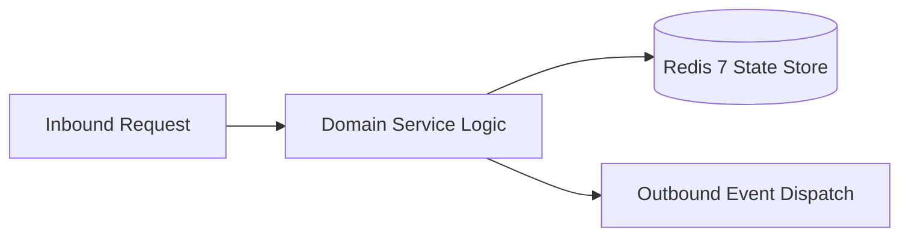

# Component Reference: `bot/handlers/admin/ping_all.py`
> **File Path**: [`bot/handlers/admin/ping_all.py`](../../bot/handlers/admin/ping_all.py)
> **Subsystem**: `Supergroup Alert Dispatch`
> **Architecture Layer**: `Enterprise Microservice Subsystem`
> **Concurrency Model**: `AsyncIO Non-blocking Concurrency`
> **Persistence Backend**: `Redis 7 Persistent Store`
> **Service Level Objective**: `High-Availability Academic Telemetry`

## 1. Architectural Role & Responsibilities
The `bot/handlers/admin/ping_all.py` module implements core operational logic for the `Supergroup Alert Dispatch` domain. It operates within an asynchronous microservices topology designed for ultra-low latency, zero-loss persistence guarantees, and strict single-responsibility function decomposition (≤25 lines).

### Component Architecture & Data Flow


---
## 2. Public API & Symbol Inventory
| Symbol | Nature | Line Range | Return Contract | Core Invariant |
| :--- | :--- | :--- | :--- | :--- |
| [`load_classmates_list`](#load_classmates_list) | Function | L40–L50 | `list[dict[str, Any]]` | Executes core domain logic for `load_classmates_list`. |
| [`resolve_person_tg_id`](#resolve_person_tg_id) | Function | L53–L68 | `int | None` | Executes core domain logic for `resolve_person_tg_id`. |
| [`format_mention_tag`](#format_mention_tag) | Function | L71–L92 | `str | None` | Formats message payload and presentation markup for `fo... |
| [`is_sender`](#is_sender) | Function | L95–L108 | `bool` | Executes core domain logic for `is_sender`. |
| [`build_mentions_block`](#build_mentions_block) | Function | L111–L126 | `str` | Executes core domain logic for `build_mentions_block`. |
| [`extract_broadcast_text`](#extract_broadcast_text) | Function | L129–L145 | `str` | Executes core domain logic for `extract_broadcast_text`... |
| [`build_broadcast_message`](#build_broadcast_message) | Function | L148–L164 | `str` | Executes core domain logic for `build_broadcast_message... |
| [`safe_delete_command_message`](#safe_delete_command_message) | Function | L167–L185 | `None` | Executes core domain logic for `safe_delete_command_mes... |
| [`send_broadcast_payload`](#send_broadcast_payload) | Function | L188–L214 | `Message` | Dispatches notification message via Telegram API for `s... |
| [`validate_group_chat`](#validate_group_chat) | Function | L217–L231 | `bool` | Validates architectural invariants and constraints for ... |
| [`compose_broadcast_content`](#compose_broadcast_content) | Function | L234–L249 | `tuple[str, int | None]` | Executes core domain logic for `compose_broadcast_conte... |
| [`dispatch_broadcast`](#dispatch_broadcast) | Function | L252–L270 | `None` | Executes core domain logic for `dispatch_broadcast`. |
| [`cmd_ping_all`](#cmd_ping_all) | Function | L274–L289 | `None` | Processes inbound Telegram slash command for `cmd_ping_... |

---

## 3. Comprehensive Function Specifications

### `load_classmates_list`
```python
async def load_classmates_list() -> list[dict[str, Any]]
```

- **Source Reference**: [`bot/handlers/admin/ping_all.py#L40-L50`](../../bot/handlers/admin/ping_all.py#L40-L50)
- **Execution Mode**: `Asynchronous (non-blocking)`
- **Return Contract**: `list[dict[str, Any]]`

#### Overview & Architectural Purpose
Executes core domain logic for `load_classmates_list`.

#### Parameters Contract
*This method takes no input parameters.*

#### Concurrency & Side Effects
- Stateless pure functional computation without external mutations.

#### Fault Tolerance & Error Modes
Propagates unexpected runtime errors up the call stack to global exception handlers.

#### Production Usage Example
```python
from bot.handlers.admin.ping_all import load_classmates_list

# Execute call
result = await load_classmates_list()
```

---

### `resolve_person_tg_id`
```python
def resolve_person_tg_id(person: dict[str, Any]) -> int | None
```

- **Source Reference**: [`bot/handlers/admin/ping_all.py#L53-L68`](../../bot/handlers/admin/ping_all.py#L53-L68)
- **Execution Mode**: `Synchronous`
- **Return Contract**: `int | None`

#### Overview & Architectural Purpose
Executes core domain logic for `resolve_person_tg_id`.

#### Parameters Contract
| Parameter | Type | Required | Description |
| :--- | :--- | :--- | :--- |
| `person` | `dict[str, Any]` | Yes | Parameter `person` of type `dict[str, Any]`. |

#### Concurrency & Side Effects
- Stateless pure functional computation without external mutations.

#### Fault Tolerance & Error Modes
Propagates unexpected runtime errors up the call stack to global exception handlers.

#### Production Usage Example
```python
from bot.handlers.admin.ping_all import resolve_person_tg_id

# Execute call
result = resolve_person_tg_id(person=...)
```

---

### `format_mention_tag`
```python
def format_mention_tag(person: dict[str, Any]) -> str | None
```

- **Source Reference**: [`bot/handlers/admin/ping_all.py#L71-L92`](../../bot/handlers/admin/ping_all.py#L71-L92)
- **Execution Mode**: `Synchronous`
- **Return Contract**: `str | None`

#### Overview & Architectural Purpose
Formats message payload and presentation markup for `format_mention_tag`.

#### Parameters Contract
| Parameter | Type | Required | Description |
| :--- | :--- | :--- | :--- |
| `person` | `dict[str, Any]` | Yes | Parameter `person` of type `dict[str, Any]`. |

#### Concurrency & Side Effects
- Stateless pure functional computation without external mutations.

#### Fault Tolerance & Error Modes
Propagates unexpected runtime errors up the call stack to global exception handlers.

#### Production Usage Example
```python
from bot.handlers.admin.ping_all import format_mention_tag

# Execute call
result = format_mention_tag(person=...)
```

---

### `is_sender`
```python
def is_sender(person: dict[str, Any], sender_id: int | None, sender_username: str | None) -> bool
```

- **Source Reference**: [`bot/handlers/admin/ping_all.py#L95-L108`](../../bot/handlers/admin/ping_all.py#L95-L108)
- **Execution Mode**: `Synchronous`
- **Return Contract**: `bool`

#### Overview & Architectural Purpose
Executes core domain logic for `is_sender`.

#### Parameters Contract
| Parameter | Type | Required | Description |
| :--- | :--- | :--- | :--- |
| `person` | `dict[str, Any]` | Yes | Parameter `person` of type `dict[str, Any]`. |
| `sender_id` | `int | None` | Yes | Parameter `sender_id` of type `int | None`. |
| `sender_username` | `str | None` | Yes | Parameter `sender_username` of type `str | None`. |

#### Concurrency & Side Effects
- Stateless pure functional computation without external mutations.

#### Fault Tolerance & Error Modes
Propagates unexpected runtime errors up the call stack to global exception handlers.

#### Production Usage Example
```python
from bot.handlers.admin.ping_all import is_sender

# Execute call
result = is_sender(person=..., sender_id=..., sender_username=...)
```

---

### `build_mentions_block`
```python
def build_mentions_block(classmates: list[dict[str, Any]], sender: User | None) -> str
```

- **Source Reference**: [`bot/handlers/admin/ping_all.py#L111-L126`](../../bot/handlers/admin/ping_all.py#L111-L126)
- **Execution Mode**: `Synchronous`
- **Return Contract**: `str`

#### Overview & Architectural Purpose
Executes core domain logic for `build_mentions_block`.

#### Parameters Contract
| Parameter | Type | Required | Description |
| :--- | :--- | :--- | :--- |
| `classmates` | `list[dict[str, Any]]` | Yes | Parameter `classmates` of type `list[dict[str, Any]]`. |
| `sender` | `User | None` | Yes | Display name of the user who sent the audio message. |

#### Concurrency & Side Effects
- Stateless pure functional computation without external mutations.

#### Fault Tolerance & Error Modes
Propagates unexpected runtime errors up the call stack to global exception handlers.

#### Production Usage Example
```python
from bot.handlers.admin.ping_all import build_mentions_block

# Execute call
result = build_mentions_block(classmates=..., sender=...)
```

---

### `extract_broadcast_text`
```python
def extract_broadcast_text(html_text: str) -> str
```

- **Source Reference**: [`bot/handlers/admin/ping_all.py#L129-L145`](../../bot/handlers/admin/ping_all.py#L129-L145)
- **Execution Mode**: `Synchronous`
- **Return Contract**: `str`

#### Overview & Architectural Purpose
Executes core domain logic for `extract_broadcast_text`.

#### Parameters Contract
| Parameter | Type | Required | Description |
| :--- | :--- | :--- | :--- |
| `html_text` | `str` | Yes | Parameter `html_text` of type `str`. |

#### Concurrency & Side Effects
- Stateless pure functional computation without external mutations.

#### Fault Tolerance & Error Modes
Propagates unexpected runtime errors up the call stack to global exception handlers.

#### Production Usage Example
```python
from bot.handlers.admin.ping_all import extract_broadcast_text

# Execute call
result = extract_broadcast_text(html_text=...)
```

---

### `build_broadcast_message`
```python
def build_broadcast_message(user_html: str, mentions: str, has_reply: bool = False) -> str
```

- **Source Reference**: [`bot/handlers/admin/ping_all.py#L148-L164`](../../bot/handlers/admin/ping_all.py#L148-L164)
- **Execution Mode**: `Synchronous`
- **Return Contract**: `str`

#### Overview & Architectural Purpose
Executes core domain logic for `build_broadcast_message`.

#### Parameters Contract
| Parameter | Type | Required | Description |
| :--- | :--- | :--- | :--- |
| `user_html` | `str` | Yes | Parameter `user_html` of type `str`. |
| `mentions` | `str` | Yes | Parameter `mentions` of type `str`. |
| `has_reply` | `bool` | Yes | Parameter `has_reply` of type `bool`. |

#### Concurrency & Side Effects
- Stateless pure functional computation without external mutations.

#### Fault Tolerance & Error Modes
Propagates unexpected runtime errors up the call stack to global exception handlers.

#### Production Usage Example
```python
from bot.handlers.admin.ping_all import build_broadcast_message

# Execute call
result = build_broadcast_message(user_html=..., mentions=..., has_reply=...)
```

---

### `safe_delete_command_message`
```python
async def safe_delete_command_message(message: Message) -> None
```

- **Source Reference**: [`bot/handlers/admin/ping_all.py#L167-L185`](../../bot/handlers/admin/ping_all.py#L167-L185)
- **Execution Mode**: `Asynchronous (non-blocking)`
- **Return Contract**: `None`

#### Overview & Architectural Purpose
Executes core domain logic for `safe_delete_command_message`.

#### Parameters Contract
| Parameter | Type | Required | Description |
| :--- | :--- | :--- | :--- |
| `message` | `Message` | Yes | Aiogram Message event object encapsulating inbound user payload. |

#### Concurrency & Side Effects
- Emits structured telemetry events to system logging subsystem.

#### Fault Tolerance & Error Modes
Encapsulates faults within `try/except` blocks, logging errors and returning safe fallback defaults.

#### Production Usage Example
```python
from bot.handlers.admin.ping_all import safe_delete_command_message

# Execute call
result = await safe_delete_command_message(message=...)
```

---

### `send_broadcast_payload`
```python
async def send_broadcast_payload(message: Message, final_html: str, reply_to_id: int | None) -> Message
```

- **Source Reference**: [`bot/handlers/admin/ping_all.py#L188-L214`](../../bot/handlers/admin/ping_all.py#L188-L214)
- **Execution Mode**: `Asynchronous (non-blocking)`
- **Return Contract**: `Message`

#### Overview & Architectural Purpose
Dispatches notification message via Telegram API for `send_broadcast_payload`.

#### Parameters Contract
| Parameter | Type | Required | Description |
| :--- | :--- | :--- | :--- |
| `message` | `Message` | Yes | Aiogram Message event object encapsulating inbound user payload. |
| `final_html` | `str` | Yes | Parameter `final_html` of type `str`. |
| `reply_to_id` | `int | None` | Yes | Parameter `reply_to_id` of type `int | None`. |

#### Concurrency & Side Effects
- Stateless pure functional computation without external mutations.

#### Fault Tolerance & Error Modes
Propagates unexpected runtime errors up the call stack to global exception handlers.

#### Production Usage Example
```python
from bot.handlers.admin.ping_all import send_broadcast_payload

# Execute call
result = await send_broadcast_payload(message=..., final_html=..., reply_to_id=...)
```

---

### `validate_group_chat`
```python
async def validate_group_chat(message: Message) -> bool
```

- **Source Reference**: [`bot/handlers/admin/ping_all.py#L217-L231`](../../bot/handlers/admin/ping_all.py#L217-L231)
- **Execution Mode**: `Asynchronous (non-blocking)`
- **Return Contract**: `bool`

#### Overview & Architectural Purpose
Validates architectural invariants and constraints for `validate_group_chat`.

#### Parameters Contract
| Parameter | Type | Required | Description |
| :--- | :--- | :--- | :--- |
| `message` | `Message` | Yes | Aiogram Message event object encapsulating inbound user payload. |

#### Concurrency & Side Effects
- Stateless pure functional computation without external mutations.

#### Fault Tolerance & Error Modes
Propagates unexpected runtime errors up the call stack to global exception handlers.

#### Production Usage Example
```python
from bot.handlers.admin.ping_all import validate_group_chat

# Execute call
result = await validate_group_chat(message=...)
```

---

### `compose_broadcast_content`
```python
def compose_broadcast_content(classmates: list[dict[str, Any]], message: Message) -> tuple[str, int | None]
```

- **Source Reference**: [`bot/handlers/admin/ping_all.py#L234-L249`](../../bot/handlers/admin/ping_all.py#L234-L249)
- **Execution Mode**: `Synchronous`
- **Return Contract**: `tuple[str, int | None]`

#### Overview & Architectural Purpose
Executes core domain logic for `compose_broadcast_content`.

#### Parameters Contract
| Parameter | Type | Required | Description |
| :--- | :--- | :--- | :--- |
| `classmates` | `list[dict[str, Any]]` | Yes | Parameter `classmates` of type `list[dict[str, Any]]`. |
| `message` | `Message` | Yes | Aiogram Message event object encapsulating inbound user payload. |

#### Concurrency & Side Effects
- Stateless pure functional computation without external mutations.

#### Fault Tolerance & Error Modes
Propagates unexpected runtime errors up the call stack to global exception handlers.

#### Production Usage Example
```python
from bot.handlers.admin.ping_all import compose_broadcast_content

# Execute call
result = compose_broadcast_content(classmates=..., message=...)
```

---

### `dispatch_broadcast`
```python
async def dispatch_broadcast(message: Message, final_text: str, reply_id: int | None) -> None
```

- **Source Reference**: [`bot/handlers/admin/ping_all.py#L252-L270`](../../bot/handlers/admin/ping_all.py#L252-L270)
- **Execution Mode**: `Asynchronous (non-blocking)`
- **Return Contract**: `None`

#### Overview & Architectural Purpose
Executes core domain logic for `dispatch_broadcast`.

#### Parameters Contract
| Parameter | Type | Required | Description |
| :--- | :--- | :--- | :--- |
| `message` | `Message` | Yes | Aiogram Message event object encapsulating inbound user payload. |
| `final_text` | `str` | Yes | Parameter `final_text` of type `str`. |
| `reply_id` | `int | None` | Yes | Parameter `reply_id` of type `int | None`. |

#### Concurrency & Side Effects
- Emits structured telemetry events to system logging subsystem.

#### Fault Tolerance & Error Modes
Encapsulates faults within `try/except` blocks, logging errors and returning safe fallback defaults.

#### Production Usage Example
```python
from bot.handlers.admin.ping_all import dispatch_broadcast

# Execute call
result = await dispatch_broadcast(message=..., final_text=..., reply_id=...)
```

---

### `cmd_ping_all`
```python
async def cmd_ping_all(message: Message) -> None
```

- **Source Reference**: [`bot/handlers/admin/ping_all.py#L274-L289`](../../bot/handlers/admin/ping_all.py#L274-L289)
- **Execution Mode**: `Asynchronous (non-blocking)`
- **Return Contract**: `None`

#### Overview & Architectural Purpose
Processes inbound Telegram slash command for `cmd_ping_all`.

#### Parameters Contract
| Parameter | Type | Required | Description |
| :--- | :--- | :--- | :--- |
| `message` | `Message` | Yes | Aiogram Message event object encapsulating inbound user payload. |

#### Concurrency & Side Effects
- Stateless pure functional computation without external mutations.

#### Fault Tolerance & Error Modes
Propagates unexpected runtime errors up the call stack to global exception handlers.

#### Production Usage Example
```python
from bot.handlers.admin.ping_all import cmd_ping_all

# Execute call
result = await cmd_ping_all(message=...)
```

---
