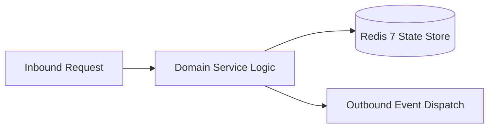

# Component Reference: `bot/handlers/admin/testers.py`
> **File Path**: [`bot/handlers/admin/testers.py`](../../bot/handlers/admin/testers.py)
> **Subsystem**: `Tester Management Flow`
> **Architecture Layer**: `Enterprise Microservice Subsystem`
> **Concurrency Model**: `AsyncIO Non-blocking Concurrency`
> **Persistence Backend**: `Redis 7 Persistent Store`
> **Service Level Objective**: `High-Availability Academic Telemetry`

## 1. Architectural Role & Responsibilities
The `bot/handlers/admin/testers.py` module implements core operational logic for the `Tester Management Flow` domain. It operates within an asynchronous microservices topology designed for ultra-low latency, zero-loss persistence guarantees, and strict single-responsibility function decomposition (≤25 lines).

### Component Architecture & Data Flow


---
## 2. Public API & Symbol Inventory
| Symbol | Nature | Line Range | Return Contract | Core Invariant |
| :--- | :--- | :--- | :--- | :--- |
| [`_get_admin_key`](#_get_admin_key) | Function | L40–L42 | `str` | Executes core domain logic for `_get_admin_key`. |
| [`_build_testers_panel`](#_build_testers_panel) | Function | L45–L57 | `tuple[str, InlineKeyboardMarkup]` | Executes core domain logic for `_build_testers_panel`. |
| [`cmd_list_testers`](#cmd_list_testers) | Function | L61–L73 | `None` | Processes inbound Telegram slash command for `cmd_list_... |
| [`cmd_add_tester`](#cmd_add_tester) | Function | L77–L99 | `None` | Processes inbound Telegram slash command for `cmd_add_t... |
| [`cmd_del_tester`](#cmd_del_tester) | Function | L103–L122 | `None` | Processes inbound Telegram slash command for `cmd_del_t... |
| [`cmd_open_swagger`](#cmd_open_swagger) | Function | L126–L137 | `None` | Processes inbound Telegram slash command for `cmd_open_... |
| [`cb_admin_testers`](#cb_admin_testers) | Function | L141–L154 | `None` | Handles Telegram inline callback query events for `cb_a... |
| [`cb_start_add_tester`](#cb_start_add_tester) | Function | L158–L170 | `None` | Handles Telegram inline callback query events for `cb_s... |
| [`process_tester_id_input`](#process_tester_id_input) | Function | L174–L196 | `None` | Executes core domain logic for `process_tester_id_input... |
| [`cb_delete_tester`](#cb_delete_tester) | Function | L200–L217 | `None` | Handles Telegram inline callback query events for `cb_d... |

---

## 3. Comprehensive Function Specifications

### `_get_admin_key`
```python
def _get_admin_key(user_id: int) -> str
```

- **Source Reference**: [`bot/handlers/admin/testers.py#L40-L42`](../../bot/handlers/admin/testers.py#L40-L42)
- **Execution Mode**: `Synchronous`
- **Return Contract**: `str`

#### Overview & Architectural Purpose
Executes core domain logic for `_get_admin_key`.

#### Parameters Contract
| Parameter | Type | Required | Description |
| :--- | :--- | :--- | :--- |
| `user_id` | `int` | Yes | Unique 64-bit Telegram user identifier. |

#### Concurrency & Side Effects
- Stateless pure functional computation without external mutations.

#### Fault Tolerance & Error Modes
Propagates unexpected runtime errors up the call stack to global exception handlers.

#### Production Usage Example
```python
from bot.handlers.admin.testers import _get_admin_key

# Execute call
result = _get_admin_key(user_id=...)
```

---

### `_build_testers_panel`
```python
async def _build_testers_panel(user_id: int) -> tuple[str, InlineKeyboardMarkup]
```

- **Source Reference**: [`bot/handlers/admin/testers.py#L45-L57`](../../bot/handlers/admin/testers.py#L45-L57)
- **Execution Mode**: `Asynchronous (non-blocking)`
- **Return Contract**: `tuple[str, InlineKeyboardMarkup]`

#### Overview & Architectural Purpose
Executes core domain logic for `_build_testers_panel`.

#### Parameters Contract
| Parameter | Type | Required | Description |
| :--- | :--- | :--- | :--- |
| `user_id` | `int` | Yes | Unique 64-bit Telegram user identifier. |

#### Concurrency & Side Effects
- Stateless pure functional computation without external mutations.

#### Fault Tolerance & Error Modes
Propagates unexpected runtime errors up the call stack to global exception handlers.

#### Production Usage Example
```python
from bot.handlers.admin.testers import _build_testers_panel

# Execute call
result = await _build_testers_panel(user_id=...)
```

---

### `cmd_list_testers`
```python
async def cmd_list_testers(message: Message) -> None
```

- **Source Reference**: [`bot/handlers/admin/testers.py#L61-L73`](../../bot/handlers/admin/testers.py#L61-L73)
- **Execution Mode**: `Asynchronous (non-blocking)`
- **Return Contract**: `None`

#### Overview & Architectural Purpose
Processes inbound Telegram slash command for `cmd_list_testers`.

#### Parameters Contract
| Parameter | Type | Required | Description |
| :--- | :--- | :--- | :--- |
| `message` | `Message` | Yes | Aiogram Message event object encapsulating inbound user payload. |

#### Concurrency & Side Effects
- Stateless pure functional computation without external mutations.

#### Fault Tolerance & Error Modes
Propagates unexpected runtime errors up the call stack to global exception handlers.

#### Production Usage Example
```python
from bot.handlers.admin.testers import cmd_list_testers

# Execute call
result = await cmd_list_testers(message=...)
```

---

### `cmd_add_tester`
```python
async def cmd_add_tester(message: Message) -> None
```

- **Source Reference**: [`bot/handlers/admin/testers.py#L77-L99`](../../bot/handlers/admin/testers.py#L77-L99)
- **Execution Mode**: `Asynchronous (non-blocking)`
- **Return Contract**: `None`

#### Overview & Architectural Purpose
Processes inbound Telegram slash command for `cmd_add_tester`.

#### Parameters Contract
| Parameter | Type | Required | Description |
| :--- | :--- | :--- | :--- |
| `message` | `Message` | Yes | Aiogram Message event object encapsulating inbound user payload. |

#### Concurrency & Side Effects
- Stateless pure functional computation without external mutations.

#### Fault Tolerance & Error Modes
Propagates unexpected runtime errors up the call stack to global exception handlers.

#### Production Usage Example
```python
from bot.handlers.admin.testers import cmd_add_tester

# Execute call
result = await cmd_add_tester(message=...)
```

---

### `cmd_del_tester`
```python
async def cmd_del_tester(message: Message) -> None
```

- **Source Reference**: [`bot/handlers/admin/testers.py#L103-L122`](../../bot/handlers/admin/testers.py#L103-L122)
- **Execution Mode**: `Asynchronous (non-blocking)`
- **Return Contract**: `None`

#### Overview & Architectural Purpose
Processes inbound Telegram slash command for `cmd_del_tester`.

#### Parameters Contract
| Parameter | Type | Required | Description |
| :--- | :--- | :--- | :--- |
| `message` | `Message` | Yes | Aiogram Message event object encapsulating inbound user payload. |

#### Concurrency & Side Effects
- Stateless pure functional computation without external mutations.

#### Fault Tolerance & Error Modes
Propagates unexpected runtime errors up the call stack to global exception handlers.

#### Production Usage Example
```python
from bot.handlers.admin.testers import cmd_del_tester

# Execute call
result = await cmd_del_tester(message=...)
```

---

### `cmd_open_swagger`
```python
async def cmd_open_swagger(message: Message) -> None
```

- **Source Reference**: [`bot/handlers/admin/testers.py#L126-L137`](../../bot/handlers/admin/testers.py#L126-L137)
- **Execution Mode**: `Asynchronous (non-blocking)`
- **Return Contract**: `None`

#### Overview & Architectural Purpose
Processes inbound Telegram slash command for `cmd_open_swagger`.

#### Parameters Contract
| Parameter | Type | Required | Description |
| :--- | :--- | :--- | :--- |
| `message` | `Message` | Yes | Aiogram Message event object encapsulating inbound user payload. |

#### Concurrency & Side Effects
- Stateless pure functional computation without external mutations.

#### Fault Tolerance & Error Modes
Propagates unexpected runtime errors up the call stack to global exception handlers.

#### Production Usage Example
```python
from bot.handlers.admin.testers import cmd_open_swagger

# Execute call
result = await cmd_open_swagger(message=...)
```

---

### `cb_admin_testers`
```python
async def cb_admin_testers(callback: CallbackQuery) -> None
```

- **Source Reference**: [`bot/handlers/admin/testers.py#L141-L154`](../../bot/handlers/admin/testers.py#L141-L154)
- **Execution Mode**: `Asynchronous (non-blocking)`
- **Return Contract**: `None`

#### Overview & Architectural Purpose
Handles Telegram inline callback query events for `cb_admin_testers`.

#### Parameters Contract
| Parameter | Type | Required | Description |
| :--- | :--- | :--- | :--- |
| `callback` | `CallbackQuery` | Yes | Parameter `callback` of type `CallbackQuery`. |

#### Concurrency & Side Effects
- Stateless pure functional computation without external mutations.

#### Fault Tolerance & Error Modes
Propagates unexpected runtime errors up the call stack to global exception handlers.

#### Production Usage Example
```python
from bot.handlers.admin.testers import cb_admin_testers

# Execute call
result = await cb_admin_testers(callback=...)
```

---

### `cb_start_add_tester`
```python
async def cb_start_add_tester(callback: CallbackQuery, state: FSMContext) -> None
```

- **Source Reference**: [`bot/handlers/admin/testers.py#L158-L170`](../../bot/handlers/admin/testers.py#L158-L170)
- **Execution Mode**: `Asynchronous (non-blocking)`
- **Return Contract**: `None`

#### Overview & Architectural Purpose
Handles Telegram inline callback query events for `cb_start_add_tester`.

#### Parameters Contract
| Parameter | Type | Required | Description |
| :--- | :--- | :--- | :--- |
| `callback` | `CallbackQuery` | Yes | Parameter `callback` of type `CallbackQuery`. |
| `state` | `FSMContext` | Yes | Aiogram FSM context manager for dialog state persistence. |

#### Concurrency & Side Effects
- Stateless pure functional computation without external mutations.

#### Fault Tolerance & Error Modes
Propagates unexpected runtime errors up the call stack to global exception handlers.

#### Production Usage Example
```python
from bot.handlers.admin.testers import cb_start_add_tester

# Execute call
result = await cb_start_add_tester(callback=..., state=...)
```

---

### `process_tester_id_input`
```python
async def process_tester_id_input(message: Message, state: FSMContext) -> None
```

- **Source Reference**: [`bot/handlers/admin/testers.py#L174-L196`](../../bot/handlers/admin/testers.py#L174-L196)
- **Execution Mode**: `Asynchronous (non-blocking)`
- **Return Contract**: `None`

#### Overview & Architectural Purpose
Executes core domain logic for `process_tester_id_input`.

#### Parameters Contract
| Parameter | Type | Required | Description |
| :--- | :--- | :--- | :--- |
| `message` | `Message` | Yes | Aiogram Message event object encapsulating inbound user payload. |
| `state` | `FSMContext` | Yes | Aiogram FSM context manager for dialog state persistence. |

#### Concurrency & Side Effects
- Stateless pure functional computation without external mutations.

#### Fault Tolerance & Error Modes
Propagates unexpected runtime errors up the call stack to global exception handlers.

#### Production Usage Example
```python
from bot.handlers.admin.testers import process_tester_id_input

# Execute call
result = await process_tester_id_input(message=..., state=...)
```

---

### `cb_delete_tester`
```python
async def cb_delete_tester(callback: CallbackQuery) -> None
```

- **Source Reference**: [`bot/handlers/admin/testers.py#L200-L217`](../../bot/handlers/admin/testers.py#L200-L217)
- **Execution Mode**: `Asynchronous (non-blocking)`
- **Return Contract**: `None`

#### Overview & Architectural Purpose
Handles Telegram inline callback query events for `cb_delete_tester`.

#### Parameters Contract
| Parameter | Type | Required | Description |
| :--- | :--- | :--- | :--- |
| `callback` | `CallbackQuery` | Yes | Parameter `callback` of type `CallbackQuery`. |

#### Concurrency & Side Effects
- Stateless pure functional computation without external mutations.

#### Fault Tolerance & Error Modes
Propagates unexpected runtime errors up the call stack to global exception handlers.

#### Production Usage Example
```python
from bot.handlers.admin.testers import cb_delete_tester

# Execute call
result = await cb_delete_tester(callback=...)
```

---
