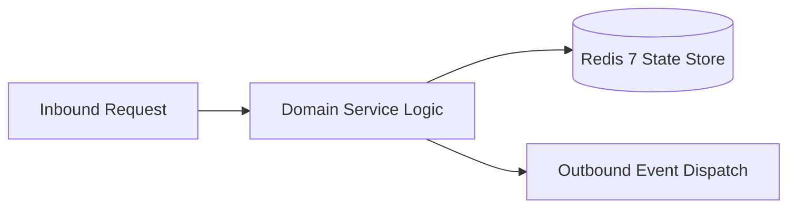

# Component Reference: `bot/handlers/errors.py`
> **File Path**: [`bot/handlers/errors.py`](../../bot/handlers/errors.py)
> **Subsystem**: `Global Error Trapper`
> **Architecture Layer**: `Enterprise Microservice Subsystem`
> **Concurrency Model**: `AsyncIO Non-blocking Concurrency`
> **Persistence Backend**: `Redis 7 Persistent Store`
> **Service Level Objective**: `High-Availability Academic Telemetry`

## 1. Architectural Role & Responsibilities
The `bot/handlers/errors.py` module implements core operational logic for the `Global Error Trapper` domain. It operates within an asynchronous microservices topology designed for ultra-low latency, zero-loss persistence guarantees, and strict single-responsibility function decomposition (≤25 lines).

### Component Architecture & Data Flow


---
## 2. Public API & Symbol Inventory
| Symbol | Nature | Line Range | Return Contract | Core Invariant |
| :--- | :--- | :--- | :--- | :--- |
| [`_notify_callback_error`](#_notify_callback_error) | Function | L18–L31 | `None` | Executes core domain logic for `_notify_callback_error`... |
| [`_notify_message_error`](#_notify_message_error) | Function | L34–L47 | `None` | Executes core domain logic for `_notify_message_error`. |
| [`_dispatch_error_alert`](#_dispatch_error_alert) | Function | L50–L67 | `None` | Executes core domain logic for `_dispatch_error_alert`. |
| [`_is_stale_callback`](#_is_stale_callback) | Function | L70–L77 | `bool` | Executes core domain logic for `_is_stale_callback`. |
| [`global_error_handler`](#global_error_handler) | Function | L81–L103 | `bool` | Executes core domain logic for `global_error_handler`. |

---

## 3. Comprehensive Function Specifications

### `_notify_callback_error`
```python
async def _notify_callback_error(cb) -> None
```

- **Source Reference**: [`bot/handlers/errors.py#L18-L31`](../../bot/handlers/errors.py#L18-L31)
- **Execution Mode**: `Asynchronous (non-blocking)`
- **Return Contract**: `None`

#### Overview & Architectural Purpose
Executes core domain logic for `_notify_callback_error`.

#### Parameters Contract
| Parameter | Type | Required | Description |
| :--- | :--- | :--- | :--- |
| `cb` | `Any` | Yes | Parameter `cb` of type `Any`. |

#### Concurrency & Side Effects
- Emits structured telemetry events to system logging subsystem.

#### Fault Tolerance & Error Modes
Encapsulates faults within `try/except` blocks, logging errors and returning safe fallback defaults.

#### Production Usage Example
```python
from bot.handlers.errors import _notify_callback_error

# Execute call
result = await _notify_callback_error(cb=...)
```

---

### `_notify_message_error`
```python
async def _notify_message_error(msg) -> None
```

- **Source Reference**: [`bot/handlers/errors.py#L34-L47`](../../bot/handlers/errors.py#L34-L47)
- **Execution Mode**: `Asynchronous (non-blocking)`
- **Return Contract**: `None`

#### Overview & Architectural Purpose
Executes core domain logic for `_notify_message_error`.

#### Parameters Contract
| Parameter | Type | Required | Description |
| :--- | :--- | :--- | :--- |
| `msg` | `Any` | Yes | Parameter `msg` of type `Any`. |

#### Concurrency & Side Effects
- Emits structured telemetry events to system logging subsystem.

#### Fault Tolerance & Error Modes
Encapsulates faults within `try/except` blocks, logging errors and returning safe fallback defaults.

#### Production Usage Example
```python
from bot.handlers.errors import _notify_message_error

# Execute call
result = await _notify_message_error(msg=...)
```

---

### `_dispatch_error_alert`
```python
async def _dispatch_error_alert(exc: Exception) -> None
```

- **Source Reference**: [`bot/handlers/errors.py#L50-L67`](../../bot/handlers/errors.py#L50-L67)
- **Execution Mode**: `Asynchronous (non-blocking)`
- **Return Contract**: `None`

#### Overview & Architectural Purpose
Executes core domain logic for `_dispatch_error_alert`.

#### Parameters Contract
| Parameter | Type | Required | Description |
| :--- | :--- | :--- | :--- |
| `exc` | `Exception` | Yes | Parameter `exc` of type `Exception`. |

#### Concurrency & Side Effects
- Emits structured telemetry events to system logging subsystem.

#### Fault Tolerance & Error Modes
Encapsulates faults within `try/except` blocks, logging errors and returning safe fallback defaults.

#### Production Usage Example
```python
from bot.handlers.errors import _dispatch_error_alert

# Execute call
result = await _dispatch_error_alert(exc=...)
```

---

### `_is_stale_callback`
```python
def _is_stale_callback(exc: Exception) -> bool
```

- **Source Reference**: [`bot/handlers/errors.py#L70-L77`](../../bot/handlers/errors.py#L70-L77)
- **Execution Mode**: `Synchronous`
- **Return Contract**: `bool`

#### Overview & Architectural Purpose
Executes core domain logic for `_is_stale_callback`.

#### Parameters Contract
| Parameter | Type | Required | Description |
| :--- | :--- | :--- | :--- |
| `exc` | `Exception` | Yes | Parameter `exc` of type `Exception`. |

#### Concurrency & Side Effects
- Stateless pure functional computation without external mutations.

#### Fault Tolerance & Error Modes
Propagates unexpected runtime errors up the call stack to global exception handlers.

#### Production Usage Example
```python
from bot.handlers.errors import _is_stale_callback

# Execute call
result = _is_stale_callback(exc=...)
```

---

### `global_error_handler`
```python
async def global_error_handler(event: ErrorEvent) -> bool
```

- **Source Reference**: [`bot/handlers/errors.py#L81-L103`](../../bot/handlers/errors.py#L81-L103)
- **Execution Mode**: `Asynchronous (non-blocking)`
- **Return Contract**: `bool`

#### Overview & Architectural Purpose
Executes core domain logic for `global_error_handler`.

#### Parameters Contract
| Parameter | Type | Required | Description |
| :--- | :--- | :--- | :--- |
| `event` | `ErrorEvent` | Yes | Parameter `event` of type `ErrorEvent`. |

#### Concurrency & Side Effects
- Emits structured telemetry events to system logging subsystem.

#### Fault Tolerance & Error Modes
Propagates unexpected runtime errors up the call stack to global exception handlers.

#### Production Usage Example
```python
from bot.handlers.errors import global_error_handler

# Execute call
result = await global_error_handler(event=...)
```

---
