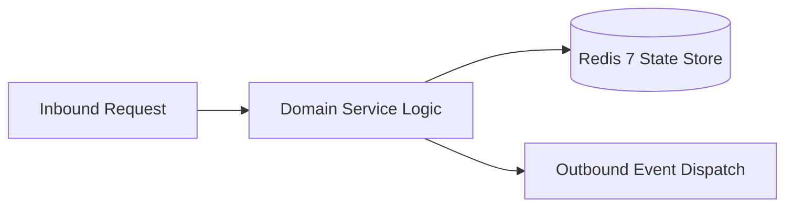

# Component Reference: `bot/handlers/errors.py`
> **File Path**: [`bot/handlers/errors.py`](../../bot/handlers/errors.py)  
> **Subsystem**: `Global Error Trapper`  
> **Architecture Layer**: `Enterprise Microservice Subsystem`  
> **Concurrency Model**: `AsyncIO Non-blocking Concurrency`  
> **Persistence Backend**: `Redis 7 Persistent Store`  
> **Service Level Objective**: `High-Availability Academic Telemetry`

## 1. Architectural Role & Responsibilities
The `bot/handlers/errors.py` module implements core operational logic for the `Global Error Trapper` domain. It operates within an asynchronous microservices topology designed for ultra-low latency, zero-loss persistence guarantees, and strict single-responsibility function decomposition (≤25 lines).

### Component Architecture & Data Flow


---
## 2. Public API & Symbol Inventory
| Symbol | Nature | Line Range | Return Contract | Core Invariant |
| :--- | :--- | :--- | :--- | :--- |
| [`global_error_handler`](#global_error_handler) | Function | L18–L32 | `bool` | Executes core domain logic for `global_error_handler`. |

---

## 3. Comprehensive Function Specifications

### `global_error_handler`
```python
async def global_error_handler(event: ErrorEvent) -> bool
```

- **Source Reference**: [`bot/handlers/errors.py#L18-L32`](../../bot/handlers/errors.py#L18-L32)
- **Execution Mode**: `Asynchronous (non-blocking)`
- **Return Contract**: `bool`

#### Overview & Architectural Purpose
Executes core domain logic for `global_error_handler`.

#### Parameters Contract
| Parameter | Type | Required | Description |
| :--- | :--- | :--- | :--- |
| `event` | `ErrorEvent` | Yes | Parameter `event` of type `ErrorEvent`. |

#### Concurrency & Side Effects
- Emits structured telemetry events to system logging subsystem.

#### Fault Tolerance & Error Modes
Encapsulates faults within `try/except` blocks, logging errors and returning safe fallback defaults.

#### Production Usage Example
```python
from bot.handlers.errors import global_error_handler

# Execute call
result = await global_error_handler(event=...)
```

---
