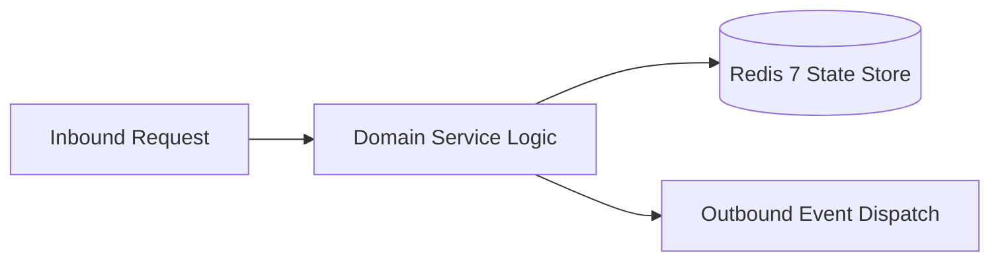

# Component Reference: `bot/handlers/user/attendance.py`
> **File Path**: [`bot/handlers/user/attendance.py`](../../bot/handlers/user/attendance.py)
> **Subsystem**: `User Attendance Flow`
> **Architecture Layer**: `Enterprise Microservice Subsystem`
> **Concurrency Model**: `AsyncIO Non-blocking Concurrency`
> **Persistence Backend**: `Redis 7 Persistent Store`
> **Service Level Objective**: `High-Availability Academic Telemetry`

## 1. Architectural Role & Responsibilities
The `bot/handlers/user/attendance.py` module implements core operational logic for the `User Attendance Flow` domain. It operates within an asynchronous microservices topology designed for ultra-low latency, zero-loss persistence guarantees, and strict single-responsibility function decomposition (≤25 lines).

### Component Architecture & Data Flow


---
## 2. Public API & Symbol Inventory
| Symbol | Nature | Line Range | Return Contract | Core Invariant |
| :--- | :--- | :--- | :--- | :--- |
| [`_calculate_attendance_percent`](#_calculate_attendance_percent) | Function | L38–L54 | `str` | Executes core domain logic for `_calculate_attendance_p... |
| [`_format_personal_month_breakdown`](#_format_personal_month_breakdown) | Function | L57–L78 | `str` | Executes core domain logic for `_format_personal_month_... |
| [`_format_card_header_and_summary`](#_format_card_header_and_summary) | Function | L81–L91 | `str` | Executes core domain logic for `_format_card_header_and... |
| [`format_personal_attendance_card`](#format_personal_attendance_card) | Function | L94–L106 | `str` | Formats message payload and presentation markup for `fo... |
| [`get_personal_attendance_kb`](#get_personal_attendance_kb) | Function | L109–L121 | `InlineKeyboardMarkup` | Retrieves and resolves domain data for `get_personal_at... |
| [`_resolve_student_fio`](#_resolve_student_fio) | Function | L124–L142 | `str | None` | Executes core domain logic for `_resolve_student_fio`. |
| [`_respond_personal_attendance`](#_respond_personal_attendance) | Function | L145–L151 | `None` | Executes core domain logic for `_respond_personal_atten... |
| [`cmd_my_attendance`](#cmd_my_attendance) | Function | L155–L170 | `None` | Processes inbound Telegram slash command for `cmd_my_at... |
| [`cb_my_attendance_refresh`](#cb_my_attendance_refresh) | Function | L174–L195 | `None` | Handles Telegram inline callback query events for `cb_m... |
| [`cb_att_topic_refresh`](#cb_att_topic_refresh) | Function | L199–L213 | `None` | Handles Telegram inline callback query events for `cb_a... |

---

## 3. Comprehensive Function Specifications

### `_calculate_attendance_percent`
```python
def _calculate_attendance_percent(p: int, o: int, u: int, total: int) -> str
```

- **Source Reference**: [`bot/handlers/user/attendance.py#L38-L54`](../../bot/handlers/user/attendance.py#L38-L54)
- **Execution Mode**: `Synchronous`
- **Return Contract**: `str`

#### Overview & Architectural Purpose
Executes core domain logic for `_calculate_attendance_percent`.

#### Parameters Contract
| Parameter | Type | Required | Description |
| :--- | :--- | :--- | :--- |
| `p` | `int` | Yes | Parameter `p` of type `int`. |
| `o` | `int` | Yes | Parameter `o` of type `int`. |
| `u` | `int` | Yes | Parameter `u` of type `int`. |
| `total` | `int` | Yes | Parameter `total` of type `int`. |

#### Concurrency & Side Effects
- Stateless pure functional computation without external mutations.

#### Fault Tolerance & Error Modes
Propagates unexpected runtime errors up the call stack to global exception handlers.

#### Production Usage Example
```python
from bot.handlers.user.attendance import _calculate_attendance_percent

# Execute call
result = _calculate_attendance_percent(p=..., o=..., u=...)
```

---

### `_format_personal_month_breakdown`
```python
def _format_personal_month_breakdown(months: dict[str, dict[str, int]]) -> str
```

- **Source Reference**: [`bot/handlers/user/attendance.py#L57-L78`](../../bot/handlers/user/attendance.py#L57-L78)
- **Execution Mode**: `Synchronous`
- **Return Contract**: `str`

#### Overview & Architectural Purpose
Executes core domain logic for `_format_personal_month_breakdown`.

#### Parameters Contract
| Parameter | Type | Required | Description |
| :--- | :--- | :--- | :--- |
| `months` | `dict[str, dict[str, int]]` | Yes | Parameter `months` of type `dict[str, dict[str, int]]`. |

#### Concurrency & Side Effects
- Stateless pure functional computation without external mutations.

#### Fault Tolerance & Error Modes
Propagates unexpected runtime errors up the call stack to global exception handlers.

#### Production Usage Example
```python
from bot.handlers.user.attendance import _format_personal_month_breakdown

# Execute call
result = _format_personal_month_breakdown(months=...)
```

---

### `_format_card_header_and_summary`
```python
def _format_card_header_and_summary(fio: str, p: int, o: int, u: int, n: int) -> str
```

- **Source Reference**: [`bot/handlers/user/attendance.py#L81-L91`](../../bot/handlers/user/attendance.py#L81-L91)
- **Execution Mode**: `Synchronous`
- **Return Contract**: `str`

#### Overview & Architectural Purpose
Executes core domain logic for `_format_card_header_and_summary`.

#### Parameters Contract
| Parameter | Type | Required | Description |
| :--- | :--- | :--- | :--- |
| `fio` | `str` | Yes | Full canonical name of the student in Cyrillic nominative format. |
| `p` | `int` | Yes | Parameter `p` of type `int`. |
| `o` | `int` | Yes | Parameter `o` of type `int`. |
| `u` | `int` | Yes | Parameter `u` of type `int`. |
| `n` | `int` | Yes | Parameter `n` of type `int`. |

#### Concurrency & Side Effects
- Stateless pure functional computation without external mutations.

#### Fault Tolerance & Error Modes
Propagates unexpected runtime errors up the call stack to global exception handlers.

#### Production Usage Example
```python
from bot.handlers.user.attendance import _format_card_header_and_summary

# Execute call
result = _format_card_header_and_summary(fio=..., p=..., o=...)
```

---

### `format_personal_attendance_card`
```python
def format_personal_attendance_card(fio: str, student_data: dict[str, Any]) -> str
```

- **Source Reference**: [`bot/handlers/user/attendance.py#L94-L106`](../../bot/handlers/user/attendance.py#L94-L106)
- **Execution Mode**: `Synchronous`
- **Return Contract**: `str`

#### Overview & Architectural Purpose
Formats message payload and presentation markup for `format_personal_attendance_card`.

#### Parameters Contract
| Parameter | Type | Required | Description |
| :--- | :--- | :--- | :--- |
| `fio` | `str` | Yes | Full canonical name of the student in Cyrillic nominative format. |
| `student_data` | `dict[str, Any]` | Yes | Parameter `student_data` of type `dict[str, Any]`. |

#### Concurrency & Side Effects
- Stateless pure functional computation without external mutations.

#### Fault Tolerance & Error Modes
Propagates unexpected runtime errors up the call stack to global exception handlers.

#### Production Usage Example
```python
from bot.handlers.user.attendance import format_personal_attendance_card

# Execute call
result = format_personal_attendance_card(fio=..., student_data=...)
```

---

### `get_personal_attendance_kb`
```python
def get_personal_attendance_kb() -> InlineKeyboardMarkup
```

- **Source Reference**: [`bot/handlers/user/attendance.py#L109-L121`](../../bot/handlers/user/attendance.py#L109-L121)
- **Execution Mode**: `Synchronous`
- **Return Contract**: `InlineKeyboardMarkup`

#### Overview & Architectural Purpose
Retrieves and resolves domain data for `get_personal_attendance_kb`.

#### Parameters Contract
*This method takes no input parameters.*

#### Concurrency & Side Effects
- Stateless pure functional computation without external mutations.

#### Fault Tolerance & Error Modes
Propagates unexpected runtime errors up the call stack to global exception handlers.

#### Production Usage Example
```python
from bot.handlers.user.attendance import get_personal_attendance_kb

# Execute call
result = get_personal_attendance_kb()
```

---

### `_resolve_student_fio`
```python
def _resolve_student_fio(user, student: dict[str, Any] | None = None) -> str | None
```

- **Source Reference**: [`bot/handlers/user/attendance.py#L124-L142`](../../bot/handlers/user/attendance.py#L124-L142)
- **Execution Mode**: `Synchronous`
- **Return Contract**: `str | None`

#### Overview & Architectural Purpose
Executes core domain logic for `_resolve_student_fio`.

#### Parameters Contract
| Parameter | Type | Required | Description |
| :--- | :--- | :--- | :--- |
| `user` | `Any` | Yes | Parameter `user` of type `Any`. |
| `student` | `dict[str, Any] | None` | Yes | Parameter `student` of type `dict[str, Any] | None`. |

#### Concurrency & Side Effects
- Stateless pure functional computation without external mutations.

#### Fault Tolerance & Error Modes
Propagates unexpected runtime errors up the call stack to global exception handlers.

#### Production Usage Example
```python
from bot.handlers.user.attendance import _resolve_student_fio

# Execute call
result = _resolve_student_fio(user=..., student=...)
```

---

### `_respond_personal_attendance`
```python
async def _respond_personal_attendance(message: Message, fio: str, data: dict[str, Any]) -> None
```

- **Source Reference**: [`bot/handlers/user/attendance.py#L145-L151`](../../bot/handlers/user/attendance.py#L145-L151)
- **Execution Mode**: `Asynchronous (non-blocking)`
- **Return Contract**: `None`

#### Overview & Architectural Purpose
Executes core domain logic for `_respond_personal_attendance`.

#### Parameters Contract
| Parameter | Type | Required | Description |
| :--- | :--- | :--- | :--- |
| `message` | `Message` | Yes | Aiogram Message event object encapsulating inbound user payload. |
| `fio` | `str` | Yes | Full canonical name of the student in Cyrillic nominative format. |
| `data` | `dict[str, Any]` | Yes | Parameter `data` of type `dict[str, Any]`. |

#### Concurrency & Side Effects
- Stateless pure functional computation without external mutations.

#### Fault Tolerance & Error Modes
Propagates unexpected runtime errors up the call stack to global exception handlers.

#### Production Usage Example
```python
from bot.handlers.user.attendance import _respond_personal_attendance

# Execute call
result = await _respond_personal_attendance(message=..., fio=..., data=...)
```

---

### `cmd_my_attendance`
```python
async def cmd_my_attendance(message: Message) -> None
```

- **Source Reference**: [`bot/handlers/user/attendance.py#L155-L170`](../../bot/handlers/user/attendance.py#L155-L170)
- **Execution Mode**: `Asynchronous (non-blocking)`
- **Return Contract**: `None`

#### Overview & Architectural Purpose
Processes inbound Telegram slash command for `cmd_my_attendance`.

#### Parameters Contract
| Parameter | Type | Required | Description |
| :--- | :--- | :--- | :--- |
| `message` | `Message` | Yes | Aiogram Message event object encapsulating inbound user payload. |

#### Concurrency & Side Effects
- Stateless pure functional computation without external mutations.

#### Fault Tolerance & Error Modes
Propagates unexpected runtime errors up the call stack to global exception handlers.

#### Production Usage Example
```python
from bot.handlers.user.attendance import cmd_my_attendance

# Execute call
result = await cmd_my_attendance(message=...)
```

---

### `cb_my_attendance_refresh`
```python
async def cb_my_attendance_refresh(callback: CallbackQuery) -> None
```

- **Source Reference**: [`bot/handlers/user/attendance.py#L174-L195`](../../bot/handlers/user/attendance.py#L174-L195)
- **Execution Mode**: `Asynchronous (non-blocking)`
- **Return Contract**: `None`

#### Overview & Architectural Purpose
Handles Telegram inline callback query events for `cb_my_attendance_refresh`.

#### Parameters Contract
| Parameter | Type | Required | Description |
| :--- | :--- | :--- | :--- |
| `callback` | `CallbackQuery` | Yes | Parameter `callback` of type `CallbackQuery`. |

#### Concurrency & Side Effects
- Emits structured telemetry events to system logging subsystem.

#### Fault Tolerance & Error Modes
Encapsulates faults within `try/except` blocks, logging errors and returning safe fallback defaults.

#### Production Usage Example
```python
from bot.handlers.user.attendance import cb_my_attendance_refresh

# Execute call
result = await cb_my_attendance_refresh(callback=...)
```

---

### `cb_att_topic_refresh`
```python
async def cb_att_topic_refresh(callback: CallbackQuery) -> None
```

- **Source Reference**: [`bot/handlers/user/attendance.py#L199-L213`](../../bot/handlers/user/attendance.py#L199-L213)
- **Execution Mode**: `Asynchronous (non-blocking)`
- **Return Contract**: `None`

#### Overview & Architectural Purpose
Handles Telegram inline callback query events for `cb_att_topic_refresh`.

#### Parameters Contract
| Parameter | Type | Required | Description |
| :--- | :--- | :--- | :--- |
| `callback` | `CallbackQuery` | Yes | Parameter `callback` of type `CallbackQuery`. |

#### Concurrency & Side Effects
- Stateless pure functional computation without external mutations.

#### Fault Tolerance & Error Modes
Propagates unexpected runtime errors up the call stack to global exception handlers.

#### Production Usage Example
```python
from bot.handlers.user.attendance import cb_att_topic_refresh

# Execute call
result = await cb_att_topic_refresh(callback=...)
```

---
