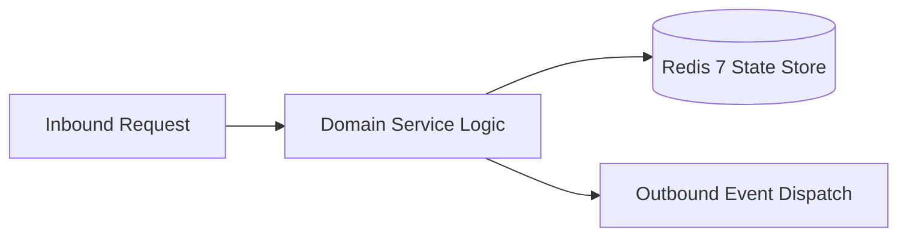

# Component Reference: `bot/handlers/user/auth_fallback.py`
> **File Path**: [`bot/handlers/user/auth_fallback.py`](../../bot/handlers/user/auth_fallback.py)  
> **Subsystem**: `Fallback Auth Flow`  
> **Architecture Layer**: `Enterprise Microservice Subsystem`  
> **Concurrency Model**: `AsyncIO Non-blocking Concurrency`  
> **Persistence Backend**: `Redis 7 Persistent Store`  
> **Service Level Objective**: `High-Availability Academic Telemetry`

## 1. Architectural Role & Responsibilities
The `bot/handlers/user/auth_fallback.py` module implements core operational logic for the `Fallback Auth Flow` domain. It operates within an asynchronous microservices topology designed for ultra-low latency, zero-loss persistence guarantees, and strict single-responsibility function decomposition (≤25 lines).

### Component Architecture & Data Flow


---
## 2. Public API & Symbol Inventory
| Symbol | Nature | Line Range | Return Contract | Core Invariant |
| :--- | :--- | :--- | :--- | :--- |
| [`unauth_fallback`](#unauth_fallback) | Function | L20–L33 | `None` | Executes core domain logic for `unauth_fallback`. |

---

## 3. Comprehensive Function Specifications

### `unauth_fallback`
```python
async def unauth_fallback(message: Message) -> None
```

- **Source Reference**: [`bot/handlers/user/auth_fallback.py#L20-L33`](../../bot/handlers/user/auth_fallback.py#L20-L33)
- **Execution Mode**: `Asynchronous (non-blocking)`
- **Return Contract**: `None`

#### Overview & Architectural Purpose
Executes core domain logic for `unauth_fallback`.

#### Parameters Contract
| Parameter | Type | Required | Description |
| :--- | :--- | :--- | :--- |
| `message` | `Message` | Yes | Aiogram Message event object encapsulating inbound user payload. |

#### Concurrency & Side Effects
- Emits structured telemetry events to system logging subsystem.

#### Fault Tolerance & Error Modes
Propagates unexpected runtime errors up the call stack to global exception handlers.

#### Production Usage Example
```python
from bot.handlers.user.auth_fallback import unauth_fallback

# Execute call
result = await unauth_fallback(message=...)
```

---
