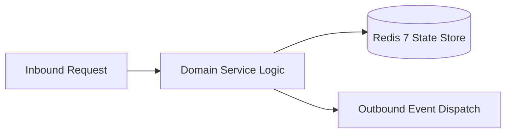

# Component Reference: `bot/handlers/user/hw_solver.py`
> **File Path**: [`bot/handlers/user/hw_solver.py`](../../bot/handlers/user/hw_solver.py)  
> **Subsystem**: `AI Homework Flow`  
> **Architecture Layer**: `Enterprise Microservice Subsystem`  
> **Concurrency Model**: `AsyncIO Non-blocking Concurrency`  
> **Persistence Backend**: `Redis 7 Persistent Store`  
> **Service Level Objective**: `High-Availability Academic Telemetry`

## 1. Architectural Role & Responsibilities
The `bot/handlers/user/hw_solver.py` module implements core operational logic for the `AI Homework Flow` domain. It operates within an asynchronous microservices topology designed for ultra-low latency, zero-loss persistence guarantees, and strict single-responsibility function decomposition (≤25 lines).

### Component Architecture & Data Flow


---
## 2. Public API & Symbol Inventory
| Symbol | Nature | Line Range | Return Contract | Core Invariant |
| :--- | :--- | :--- | :--- | :--- |
| [`combine_prompt_and_instructions`](#combine_prompt_and_instructions) | Function | L32–L38 | `str` | Executes core domain logic for `combine_prompt_and_inst... |
| [`is_valid_homework_prompt`](#is_valid_homework_prompt) | Function | L41–L58 | `bool` | Executes core domain logic for `is_valid_homework_promp... |
| [`extract_media_meta`](#extract_media_meta) | Function | L61–L70 | `tuple[str | None, str | None, str | None, str | None, int]` | Executes core domain logic for `extract_media_meta`. |
| [`compute_content_hash`](#compute_content_hash) | Function | L73–L80 | `str` | Executes core domain logic for `compute_content_hash`. |
| [`is_hw_allowed`](#is_hw_allowed) | Function | L83–L96 | `bool` | Executes core domain logic for `is_hw_allowed`. |
| [`acknowledge_hw_task`](#acknowledge_hw_task) | Function | L99–L108 | `None` | Executes core domain logic for `acknowledge_hw_task`. |
| [`dispatch_hw_task`](#dispatch_hw_task) | Function | L111–L132 | `None` | Executes core domain logic for `dispatch_hw_task`. |
| [`validate_hw_file_size`](#validate_hw_file_size) | Function | L135–L148 | `bool` | Validates architectural invariants and constraints for ... |
| [`handle_new_homework`](#handle_new_homework) | Function | L155–L175 | `None` | Executes core domain logic for `handle_new_homework`. |

---

## 3. Comprehensive Function Specifications

### `combine_prompt_and_instructions`
```python
def combine_prompt_and_instructions(msg: Message, target: Message) -> str
```

- **Source Reference**: [`bot/handlers/user/hw_solver.py#L32-L38`](../../bot/handlers/user/hw_solver.py#L32-L38)
- **Execution Mode**: `Synchronous`
- **Return Contract**: `str`

#### Overview & Architectural Purpose
Executes core domain logic for `combine_prompt_and_instructions`.

#### Parameters Contract
| Parameter | Type | Required | Description |
| :--- | :--- | :--- | :--- |
| `msg` | `Message` | Yes | Parameter `msg` of type `Message`. |
| `target` | `Message` | Yes | Parameter `target` of type `Message`. |

#### Concurrency & Side Effects
- Stateless pure functional computation without external mutations.

#### Fault Tolerance & Error Modes
Propagates unexpected runtime errors up the call stack to global exception handlers.

#### Production Usage Example
```python
from bot.handlers.user.hw_solver import combine_prompt_and_instructions

# Execute call
result = combine_prompt_and_instructions(msg=..., target=...)
```

---

### `is_valid_homework_prompt`
```python
def is_valid_homework_prompt(text: str | None, has_media: bool) -> bool
```

- **Source Reference**: [`bot/handlers/user/hw_solver.py#L41-L58`](../../bot/handlers/user/hw_solver.py#L41-L58)
- **Execution Mode**: `Synchronous`
- **Return Contract**: `bool`

#### Overview & Architectural Purpose
Executes core domain logic for `is_valid_homework_prompt`.

#### Parameters Contract
| Parameter | Type | Required | Description |
| :--- | :--- | :--- | :--- |
| `text` | `str | None` | Yes | Parameter `text` of type `str | None`. |
| `has_media` | `bool` | Yes | Parameter `has_media` of type `bool`. |

#### Concurrency & Side Effects
- Stateless pure functional computation without external mutations.

#### Fault Tolerance & Error Modes
Propagates unexpected runtime errors up the call stack to global exception handlers.

#### Production Usage Example
```python
from bot.handlers.user.hw_solver import is_valid_homework_prompt

# Execute call
result = is_valid_homework_prompt(text=..., has_media=...)
```

---

### `extract_media_meta`
```python
def extract_media_meta(msg: Message, target: Message) -> tuple[str | None, str | None, str | None, str | None, int]
```

- **Source Reference**: [`bot/handlers/user/hw_solver.py#L61-L70`](../../bot/handlers/user/hw_solver.py#L61-L70)
- **Execution Mode**: `Synchronous`
- **Return Contract**: `tuple[str | None, str | None, str | None, str | None, int]`

#### Overview & Architectural Purpose
Executes core domain logic for `extract_media_meta`.

#### Parameters Contract
| Parameter | Type | Required | Description |
| :--- | :--- | :--- | :--- |
| `msg` | `Message` | Yes | Parameter `msg` of type `Message`. |
| `target` | `Message` | Yes | Parameter `target` of type `Message`. |

#### Concurrency & Side Effects
- Stateless pure functional computation without external mutations.

#### Fault Tolerance & Error Modes
Propagates unexpected runtime errors up the call stack to global exception handlers.

#### Production Usage Example
```python
from bot.handlers.user.hw_solver import extract_media_meta

# Execute call
result = extract_media_meta(msg=..., target=...)
```

---

### `compute_content_hash`
```python
def compute_content_hash(text: str | None, unique_id: str | None) -> str
```

- **Source Reference**: [`bot/handlers/user/hw_solver.py#L73-L80`](../../bot/handlers/user/hw_solver.py#L73-L80)
- **Execution Mode**: `Synchronous`
- **Return Contract**: `str`

#### Overview & Architectural Purpose
Executes core domain logic for `compute_content_hash`.

#### Parameters Contract
| Parameter | Type | Required | Description |
| :--- | :--- | :--- | :--- |
| `text` | `str | None` | Yes | Parameter `text` of type `str | None`. |
| `unique_id` | `str | None` | Yes | Parameter `unique_id` of type `str | None`. |

#### Concurrency & Side Effects
- Stateless pure functional computation without external mutations.

#### Fault Tolerance & Error Modes
Propagates unexpected runtime errors up the call stack to global exception handlers.

#### Production Usage Example
```python
from bot.handlers.user.hw_solver import compute_content_hash

# Execute call
result = compute_content_hash(text=..., unique_id=...)
```

---

### `is_hw_allowed`
```python
async def is_hw_allowed(msg: Message, target: Message, user_id: int) -> bool
```

- **Source Reference**: [`bot/handlers/user/hw_solver.py#L83-L96`](../../bot/handlers/user/hw_solver.py#L83-L96)
- **Execution Mode**: `Asynchronous (non-blocking)`
- **Return Contract**: `bool`

#### Overview & Architectural Purpose
Executes core domain logic for `is_hw_allowed`.

#### Parameters Contract
| Parameter | Type | Required | Description |
| :--- | :--- | :--- | :--- |
| `msg` | `Message` | Yes | Parameter `msg` of type `Message`. |
| `target` | `Message` | Yes | Parameter `target` of type `Message`. |
| `user_id` | `int` | Yes | Unique 64-bit Telegram user identifier. |

#### Concurrency & Side Effects
- Emits structured telemetry events to system logging subsystem.

#### Fault Tolerance & Error Modes
Propagates unexpected runtime errors up the call stack to global exception handlers.

#### Production Usage Example
```python
from bot.handlers.user.hw_solver import is_hw_allowed

# Execute call
result = await is_hw_allowed(msg=..., target=..., user_id=...)
```

---

### `acknowledge_hw_task`
```python
async def acknowledge_hw_task(bot: Bot, msg: Message) -> None
```

- **Source Reference**: [`bot/handlers/user/hw_solver.py#L99-L108`](../../bot/handlers/user/hw_solver.py#L99-L108)
- **Execution Mode**: `Asynchronous (non-blocking)`
- **Return Contract**: `None`

#### Overview & Architectural Purpose
Executes core domain logic for `acknowledge_hw_task`.

#### Parameters Contract
| Parameter | Type | Required | Description |
| :--- | :--- | :--- | :--- |
| `bot` | `Bot` | Yes | Parameter `bot` of type `Bot`. |
| `msg` | `Message` | Yes | Parameter `msg` of type `Message`. |

#### Concurrency & Side Effects
- Emits structured telemetry events to system logging subsystem.

#### Fault Tolerance & Error Modes
Encapsulates faults within `try/except` blocks, logging errors and returning safe fallback defaults.

#### Production Usage Example
```python
from bot.handlers.user.hw_solver import acknowledge_hw_task

# Execute call
result = await acknowledge_hw_task(bot=..., msg=...)
```

---

### `dispatch_hw_task`
```python
async def dispatch_hw_task( bot: Bot, msg: Message, user_id: int, prompt: str, meta: tuple[str | None, str | None, str | None, int] ) -> None
```

- **Source Reference**: [`bot/handlers/user/hw_solver.py#L111-L132`](../../bot/handlers/user/hw_solver.py#L111-L132)
- **Execution Mode**: `Asynchronous (non-blocking)`
- **Return Contract**: `None`

#### Overview & Architectural Purpose
Executes core domain logic for `dispatch_hw_task`.

#### Parameters Contract
| Parameter | Type | Required | Description |
| :--- | :--- | :--- | :--- |
| `bot` | `Bot` | Yes | Parameter `bot` of type `Bot`. |
| `msg` | `Message` | Yes | Parameter `msg` of type `Message`. |
| `user_id` | `int` | Yes | Unique 64-bit Telegram user identifier. |
| `prompt` | `str` | Yes | Parameter `prompt` of type `str`. |
| `meta` | `tuple[str | None, str | None, str | None, int]` | Yes | Parameter `meta` of type `tuple[str | None, str | None, str | None, int]`. |

#### Concurrency & Side Effects
- Stateless pure functional computation without external mutations.

#### Fault Tolerance & Error Modes
Propagates unexpected runtime errors up the call stack to global exception handlers.

#### Production Usage Example
```python
from bot.handlers.user.hw_solver import dispatch_hw_task

# Execute call
result = await dispatch_hw_task(bot=..., msg=..., user_id=...)
```

---

### `validate_hw_file_size`
```python
async def validate_hw_file_size(bot: Bot, msg: Message, f_size: int, f_name: str | None) -> bool
```

- **Source Reference**: [`bot/handlers/user/hw_solver.py#L135-L148`](../../bot/handlers/user/hw_solver.py#L135-L148)
- **Execution Mode**: `Asynchronous (non-blocking)`
- **Return Contract**: `bool`

#### Overview & Architectural Purpose
Validates architectural invariants and constraints for `validate_hw_file_size`.

#### Parameters Contract
| Parameter | Type | Required | Description |
| :--- | :--- | :--- | :--- |
| `bot` | `Bot` | Yes | Parameter `bot` of type `Bot`. |
| `msg` | `Message` | Yes | Parameter `msg` of type `Message`. |
| `f_size` | `int` | Yes | Parameter `f_size` of type `int`. |
| `f_name` | `str | None` | Yes | Parameter `f_name` of type `str | None`. |

#### Concurrency & Side Effects
- Emits structured telemetry events to system logging subsystem.

#### Fault Tolerance & Error Modes
Encapsulates faults within `try/except` blocks, logging errors and returning safe fallback defaults.

#### Production Usage Example
```python
from bot.handlers.user.hw_solver import validate_hw_file_size

# Execute call
result = await validate_hw_file_size(bot=..., msg=..., f_size=...)
```

---

### `handle_new_homework`
```python
async def handle_new_homework(msg: Message, bot: Bot) -> None
```

- **Source Reference**: [`bot/handlers/user/hw_solver.py#L155-L175`](../../bot/handlers/user/hw_solver.py#L155-L175)
- **Execution Mode**: `Asynchronous (non-blocking)`
- **Return Contract**: `None`

#### Overview & Architectural Purpose
Executes core domain logic for `handle_new_homework`.

#### Parameters Contract
| Parameter | Type | Required | Description |
| :--- | :--- | :--- | :--- |
| `msg` | `Message` | Yes | Parameter `msg` of type `Message`. |
| `bot` | `Bot` | Yes | Parameter `bot` of type `Bot`. |

#### Concurrency & Side Effects
- Emits structured telemetry events to system logging subsystem.

#### Fault Tolerance & Error Modes
Propagates unexpected runtime errors up the call stack to global exception handlers.

#### Production Usage Example
```python
from bot.handlers.user.hw_solver import handle_new_homework

# Execute call
result = await handle_new_homework(msg=..., bot=...)
```

---
