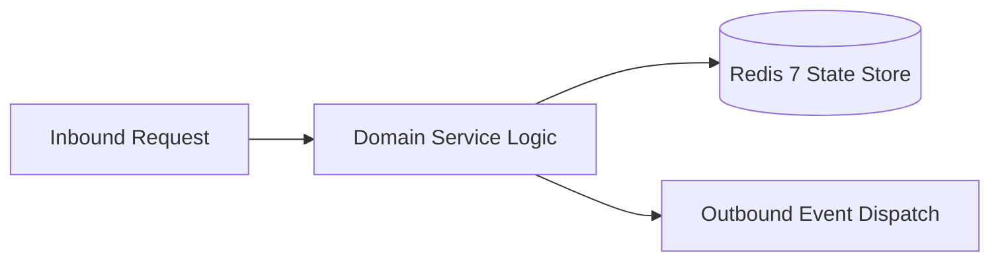

# Component Reference: `bot/handlers/user/profile.py`
> **File Path**: [`bot/handlers/user/profile.py`](../../bot/handlers/user/profile.py)
> **Subsystem**: `Student Profile Flow`
> **Architecture Layer**: `Enterprise Microservice Subsystem`
> **Concurrency Model**: `AsyncIO Non-blocking Concurrency`
> **Persistence Backend**: `Redis 7 Persistent Store`
> **Service Level Objective**: `High-Availability Academic Telemetry`

## 1. Architectural Role & Responsibilities
The `bot/handlers/user/profile.py` module implements core operational logic for the `Student Profile Flow` domain. It operates within an asynchronous microservices topology designed for ultra-low latency, zero-loss persistence guarantees, and strict single-responsibility function decomposition (≤25 lines).

### Component Architecture & Data Flow


---
## 2. Public API & Symbol Inventory
| Symbol | Nature | Line Range | Return Contract | Core Invariant |
| :--- | :--- | :--- | :--- | :--- |
| [`_build_miniapp_keyboard`](#_build_miniapp_keyboard) | Function | L32–L39 | `InlineKeyboardMarkup` | Executes core domain logic for `_build_miniapp_keyboard... |
| [`_format_profile_achievements`](#_format_profile_achievements) | Function | L42–L51 | `str` | Executes core domain logic for `_format_profile_achieve... |
| [`_render_ascii_progress`](#_render_ascii_progress) | Function | L54–L61 | `str` | Executes core domain logic for `_render_ascii_progress`... |
| [`_format_profile_message`](#_format_profile_message) | Function | L64–L83 | `str` | Executes core domain logic for `_format_profile_message... |
| [`handle_profile_command`](#handle_profile_command) | Function | L87–L107 | `None` | Executes core domain logic for `handle_profile_command`... |
| [`_format_leaderboard_row`](#_format_leaderboard_row) | Function | L110–L114 | `str` | Executes core domain logic for `_format_leaderboard_row... |
| [`_format_leaderboard_message`](#_format_leaderboard_message) | Function | L117–L131 | `str` | Executes core domain logic for `_format_leaderboard_mes... |
| [`handle_leaderboard_command`](#handle_leaderboard_command) | Function | L135–L146 | `None` | Executes core domain logic for `handle_leaderboard_comm... |

---

## 3. Comprehensive Function Specifications

### `_build_miniapp_keyboard`
```python
def _build_miniapp_keyboard() -> InlineKeyboardMarkup
```

- **Source Reference**: [`bot/handlers/user/profile.py#L32-L39`](../../bot/handlers/user/profile.py#L32-L39)
- **Execution Mode**: `Synchronous`
- **Return Contract**: `InlineKeyboardMarkup`

#### Overview & Architectural Purpose
Executes core domain logic for `_build_miniapp_keyboard`.

#### Parameters Contract
*This method takes no input parameters.*

#### Concurrency & Side Effects
- Stateless pure functional computation without external mutations.

#### Fault Tolerance & Error Modes
Propagates unexpected runtime errors up the call stack to global exception handlers.

#### Production Usage Example
```python
from bot.handlers.user.profile import _build_miniapp_keyboard

# Execute call
result = _build_miniapp_keyboard()
```

---

### `_format_profile_achievements`
```python
def _format_profile_achievements(ach_ids: list[str]) -> str
```

- **Source Reference**: [`bot/handlers/user/profile.py#L42-L51`](../../bot/handlers/user/profile.py#L42-L51)
- **Execution Mode**: `Synchronous`
- **Return Contract**: `str`

#### Overview & Architectural Purpose
Executes core domain logic for `_format_profile_achievements`.

#### Parameters Contract
| Parameter | Type | Required | Description |
| :--- | :--- | :--- | :--- |
| `ach_ids` | `list[str]` | Yes | Parameter `ach_ids` of type `list[str]`. |

#### Concurrency & Side Effects
- Stateless pure functional computation without external mutations.

#### Fault Tolerance & Error Modes
Propagates unexpected runtime errors up the call stack to global exception handlers.

#### Production Usage Example
```python
from bot.handlers.user.profile import _format_profile_achievements

# Execute call
result = _format_profile_achievements(ach_ids=...)
```

---

### `_render_ascii_progress`
```python
def _render_ascii_progress(current: int, total: int, length: int = 10) -> str
```

- **Source Reference**: [`bot/handlers/user/profile.py#L54-L61`](../../bot/handlers/user/profile.py#L54-L61)
- **Execution Mode**: `Synchronous`
- **Return Contract**: `str`

#### Overview & Architectural Purpose
Executes core domain logic for `_render_ascii_progress`.

#### Parameters Contract
| Parameter | Type | Required | Description |
| :--- | :--- | :--- | :--- |
| `current` | `int` | Yes | Parameter `current` of type `int`. |
| `total` | `int` | Yes | Parameter `total` of type `int`. |
| `length` | `int` | Yes | Parameter `length` of type `int`. |

#### Concurrency & Side Effects
- Stateless pure functional computation without external mutations.

#### Fault Tolerance & Error Modes
Propagates unexpected runtime errors up the call stack to global exception handlers.

#### Production Usage Example
```python
from bot.handlers.user.profile import _render_ascii_progress

# Execute call
result = _render_ascii_progress(current=..., total=..., length=...)
```

---

### `_format_profile_message`
```python
def _format_profile_message(p) -> str
```

- **Source Reference**: [`bot/handlers/user/profile.py#L64-L83`](../../bot/handlers/user/profile.py#L64-L83)
- **Execution Mode**: `Synchronous`
- **Return Contract**: `str`

#### Overview & Architectural Purpose
Executes core domain logic for `_format_profile_message`.

#### Parameters Contract
| Parameter | Type | Required | Description |
| :--- | :--- | :--- | :--- |
| `p` | `Any` | Yes | Parameter `p` of type `Any`. |

#### Concurrency & Side Effects
- Stateless pure functional computation without external mutations.

#### Fault Tolerance & Error Modes
Propagates unexpected runtime errors up the call stack to global exception handlers.

#### Production Usage Example
```python
from bot.handlers.user.profile import _format_profile_message

# Execute call
result = _format_profile_message(p=...)
```

---

### `handle_profile_command`
```python
async def handle_profile_command(message: Message) -> None
```

- **Source Reference**: [`bot/handlers/user/profile.py#L87-L107`](../../bot/handlers/user/profile.py#L87-L107)
- **Execution Mode**: `Asynchronous (non-blocking)`
- **Return Contract**: `None`

#### Overview & Architectural Purpose
Executes core domain logic for `handle_profile_command`.

#### Parameters Contract
| Parameter | Type | Required | Description |
| :--- | :--- | :--- | :--- |
| `message` | `Message` | Yes | Aiogram Message event object encapsulating inbound user payload. |

#### Concurrency & Side Effects
- Stateless pure functional computation without external mutations.

#### Fault Tolerance & Error Modes
Propagates unexpected runtime errors up the call stack to global exception handlers.

#### Production Usage Example
```python
from bot.handlers.user.profile import handle_profile_command

# Execute call
result = await handle_profile_command(message=...)
```

---

### `_format_leaderboard_row`
```python
def _format_leaderboard_row(idx: int, p) -> str
```

- **Source Reference**: [`bot/handlers/user/profile.py#L110-L114`](../../bot/handlers/user/profile.py#L110-L114)
- **Execution Mode**: `Synchronous`
- **Return Contract**: `str`

#### Overview & Architectural Purpose
Executes core domain logic for `_format_leaderboard_row`.

#### Parameters Contract
| Parameter | Type | Required | Description |
| :--- | :--- | :--- | :--- |
| `idx` | `int` | Yes | Parameter `idx` of type `int`. |
| `p` | `Any` | Yes | Parameter `p` of type `Any`. |

#### Concurrency & Side Effects
- Stateless pure functional computation without external mutations.

#### Fault Tolerance & Error Modes
Propagates unexpected runtime errors up the call stack to global exception handlers.

#### Production Usage Example
```python
from bot.handlers.user.profile import _format_leaderboard_row

# Execute call
result = _format_leaderboard_row(idx=..., p=...)
```

---

### `_format_leaderboard_message`
```python
def _format_leaderboard_message(profiles: list) -> str
```

- **Source Reference**: [`bot/handlers/user/profile.py#L117-L131`](../../bot/handlers/user/profile.py#L117-L131)
- **Execution Mode**: `Synchronous`
- **Return Contract**: `str`

#### Overview & Architectural Purpose
Executes core domain logic for `_format_leaderboard_message`.

#### Parameters Contract
| Parameter | Type | Required | Description |
| :--- | :--- | :--- | :--- |
| `profiles` | `list` | Yes | Parameter `profiles` of type `list`. |

#### Concurrency & Side Effects
- Stateless pure functional computation without external mutations.

#### Fault Tolerance & Error Modes
Propagates unexpected runtime errors up the call stack to global exception handlers.

#### Production Usage Example
```python
from bot.handlers.user.profile import _format_leaderboard_message

# Execute call
result = _format_leaderboard_message(profiles=...)
```

---

### `handle_leaderboard_command`
```python
async def handle_leaderboard_command(message: Message) -> None
```

- **Source Reference**: [`bot/handlers/user/profile.py#L135-L146`](../../bot/handlers/user/profile.py#L135-L146)
- **Execution Mode**: `Asynchronous (non-blocking)`
- **Return Contract**: `None`

#### Overview & Architectural Purpose
Executes core domain logic for `handle_leaderboard_command`.

#### Parameters Contract
| Parameter | Type | Required | Description |
| :--- | :--- | :--- | :--- |
| `message` | `Message` | Yes | Aiogram Message event object encapsulating inbound user payload. |

#### Concurrency & Side Effects
- Stateless pure functional computation without external mutations.

#### Fault Tolerance & Error Modes
Propagates unexpected runtime errors up the call stack to global exception handlers.

#### Production Usage Example
```python
from bot.handlers.user.profile import handle_leaderboard_command

# Execute call
result = await handle_leaderboard_command(message=...)
```

---
