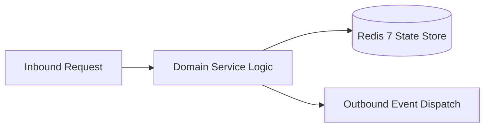

# Component Reference: `bot/handlers/user/public_copy.py`
> **File Path**: [`bot/handlers/user/public_copy.py`](../../bot/handlers/user/public_copy.py)  
> **Subsystem**: `Public Sharing Flow`  
> **Architecture Layer**: `Enterprise Microservice Subsystem`  
> **Concurrency Model**: `AsyncIO Non-blocking Concurrency`  
> **Persistence Backend**: `Redis 7 Persistent Store`  
> **Service Level Objective**: `High-Availability Academic Telemetry`

## 1. Architectural Role & Responsibilities
The `bot/handlers/user/public_copy.py` module implements core operational logic for the `Public Sharing Flow` domain. It operates within an asynchronous microservices topology designed for ultra-low latency, zero-loss persistence guarantees, and strict single-responsibility function decomposition (≤25 lines).

### Component Architecture & Data Flow


---
## 2. Public API & Symbol Inventory
| Symbol | Nature | Line Range | Return Contract | Core Invariant |
| :--- | :--- | :--- | :--- | :--- |
| [`cb_public_copy_value`](#cb_public_copy_value) | Function | L19–L33 | `None` | Handles Telegram inline callback query events for `cb_p... |

---

## 3. Comprehensive Function Specifications

### `cb_public_copy_value`
```python
async def cb_public_copy_value(callback: CallbackQuery) -> None
```

- **Source Reference**: [`bot/handlers/user/public_copy.py#L19-L33`](../../bot/handlers/user/public_copy.py#L19-L33)
- **Execution Mode**: `Asynchronous (non-blocking)`
- **Return Contract**: `None`

#### Overview & Architectural Purpose
Handles Telegram inline callback query events for `cb_public_copy_value`.

#### Parameters Contract
| Parameter | Type | Required | Description |
| :--- | :--- | :--- | :--- |
| `callback` | `CallbackQuery` | Yes | Parameter `callback` of type `CallbackQuery`. |

#### Concurrency & Side Effects
- Emits structured telemetry events to system logging subsystem.

#### Fault Tolerance & Error Modes
Propagates unexpected runtime errors up the call stack to global exception handlers.

#### Production Usage Example
```python
from bot.handlers.user.public_copy import cb_public_copy_value

# Execute call
result = await cb_public_copy_value(callback=...)
```

---
