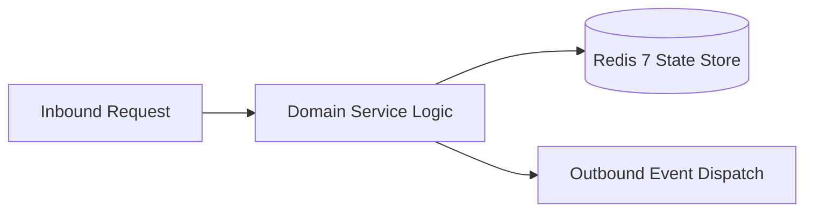

# Component Reference: `bot/handlers/user/schedule.py`
> **File Path**: [`bot/handlers/user/schedule.py`](../../bot/handlers/user/schedule.py)
> **Subsystem**: `User Schedule Flow`
> **Architecture Layer**: `Enterprise Microservice Subsystem`
> **Concurrency Model**: `AsyncIO Non-blocking Concurrency`
> **Persistence Backend**: `Redis 7 Persistent Store`
> **Service Level Objective**: `High-Availability Academic Telemetry`

## 1. Architectural Role & Responsibilities
The `bot/handlers/user/schedule.py` module implements core operational logic for the `User Schedule Flow` domain. It operates within an asynchronous microservices topology designed for ultra-low latency, zero-loss persistence guarantees, and strict single-responsibility function decomposition (≤25 lines).

### Component Architecture & Data Flow


---
## 2. Public API & Symbol Inventory
| Symbol | Nature | Line Range | Return Contract | Core Invariant |
| :--- | :--- | :--- | :--- | :--- |
| [`get_day_schedule_cached`](#get_day_schedule_cached) | Function | L46–L71 | `tuple[str, list[Lesson]]` | Retrieves and resolves domain data for `get_day_schedul... |
| [`_ack_callback`](#_ack_callback) | Function | L74–L90 | `None` | Executes core domain logic for `_ack_callback`. |
| [`edit_or_answer`](#edit_or_answer) | Function | L93–L119 | `None` | Executes core domain logic for `edit_or_answer`. |
| [`_greet_new_student`](#_greet_new_student) | Function | L122–L140 | `None` | Executes core domain logic for `_greet_new_student`. |
| [`_show_access_denied`](#_show_access_denied) | Function | L143–L160 | `None` | Executes core domain logic for `_show_access_denied`. |
| [`_show_tester_cabinet`](#_show_tester_cabinet) | Function | L163–L181 | `None` | Executes core domain logic for `_show_tester_cabinet`. |
| [`_send_today_schedule`](#_send_today_schedule) | Function | L184–L204 | `None` | Executes core domain logic for `_send_today_schedule`. |
| [`cmd_start`](#cmd_start) | Function | L209–L234 | `None` | Processes inbound Telegram slash command for `cmd_start... |
| [`cmd_my_api_key`](#cmd_my_api_key) | Function | L239–L254 | `None` | Processes inbound Telegram slash command for `cmd_my_ap... |
| [`cb_show_tester_key`](#cb_show_tester_key) | Function | L258–L271 | `None` | Handles Telegram inline callback query events for `cb_s... |
| [`cb_toggle_notify`](#cb_toggle_notify) | Function | L275–L304 | `None` | Handles Telegram inline callback query events for `cb_t... |
| [`cmd_notice`](#cmd_notice) | Function | L308–L326 | `None` | Processes inbound Telegram slash command for `cmd_notic... |
| [`cb_notice_toggle`](#cb_notice_toggle) | Function | L330–L350 | `None` | Handles Telegram inline callback query events for `cb_n... |
| [`cb_today`](#cb_today) | Function | L354–L369 | `None` | Handles Telegram inline callback query events for `cb_t... |
| [`cb_tomorrow`](#cb_tomorrow) | Function | L373–L388 | `None` | Handles Telegram inline callback query events for `cb_t... |
| [`cb_week`](#cb_week) | Function | L392–L416 | `None` | Handles Telegram inline callback query events for `cb_w... |
| [`cb_week_next`](#cb_week_next) | Function | L420–L444 | `None` | Handles Telegram inline callback query events for `cb_w... |
| [`_refresh_and_format_schedule`](#_refresh_and_format_schedule) | Function | L447–L472 | `tuple[str, list[Lesson], int]` | Executes core domain logic for `_refresh_and_format_sch... |
| [`cb_refresh`](#cb_refresh) | Function | L476–L492 | `None` | Handles Telegram inline callback query events for `cb_r... |
| [`format_help_text`](#format_help_text) | Function | L495–L518 | `str` | Formats message payload and presentation markup for `fo... |
| [`cmd_help`](#cmd_help) | Function | L522–L538 | `None` | Processes inbound Telegram slash command for `cmd_help`... |
| [`handle_user_text_message`](#handle_user_text_message) | Function | L542–L567 | `None` | Executes core domain logic for `handle_user_text_messag... |

---

## 3. Comprehensive Function Specifications

### `get_day_schedule_cached`
```python
async def get_day_schedule_cached(target_date: date) -> tuple[str, list[Lesson]]
```

- **Source Reference**: [`bot/handlers/user/schedule.py#L46-L71`](../../bot/handlers/user/schedule.py#L46-L71)
- **Execution Mode**: `Asynchronous (non-blocking)`
- **Return Contract**: `tuple[str, list[Lesson]]`

#### Overview & Architectural Purpose
Retrieves and resolves domain data for `get_day_schedule_cached`.

#### Parameters Contract
| Parameter | Type | Required | Description |
| :--- | :--- | :--- | :--- |
| `target_date` | `date` | Yes | Target calendar date for schedule or attendance resolution (ISO-8601). |

#### Concurrency & Side Effects
- Emits structured telemetry events to system logging subsystem.

#### Fault Tolerance & Error Modes
Encapsulates faults within `try/except` blocks, logging errors and returning safe fallback defaults.

#### Production Usage Example
```python
from bot.handlers.user.schedule import get_day_schedule_cached

# Execute call
result = await get_day_schedule_cached(target_date=...)
```

---

### `_ack_callback`
```python
async def _ack_callback(callback: CallbackQuery, text: str | None = None) -> None
```

- **Source Reference**: [`bot/handlers/user/schedule.py#L74-L90`](../../bot/handlers/user/schedule.py#L74-L90)
- **Execution Mode**: `Asynchronous (non-blocking)`
- **Return Contract**: `None`

#### Overview & Architectural Purpose
Executes core domain logic for `_ack_callback`.

#### Parameters Contract
| Parameter | Type | Required | Description |
| :--- | :--- | :--- | :--- |
| `callback` | `CallbackQuery` | Yes | Parameter `callback` of type `CallbackQuery`. |
| `text` | `str | None` | Yes | Parameter `text` of type `str | None`. |

#### Concurrency & Side Effects
- Emits structured telemetry events to system logging subsystem.

#### Fault Tolerance & Error Modes
Encapsulates faults within `try/except` blocks, logging errors and returning safe fallback defaults.

#### Production Usage Example
```python
from bot.handlers.user.schedule import _ack_callback

# Execute call
result = await _ack_callback(callback=..., text=...)
```

---

### `edit_or_answer`
```python
async def edit_or_answer( callback: CallbackQuery, text: str, lessons: list[Lesson] | None = None, week_offset: int = 0 ) -> None
```

- **Source Reference**: [`bot/handlers/user/schedule.py#L93-L119`](../../bot/handlers/user/schedule.py#L93-L119)
- **Execution Mode**: `Asynchronous (non-blocking)`
- **Return Contract**: `None`

#### Overview & Architectural Purpose
Executes core domain logic for `edit_or_answer`.

#### Parameters Contract
| Parameter | Type | Required | Description |
| :--- | :--- | :--- | :--- |
| `callback` | `CallbackQuery` | Yes | Parameter `callback` of type `CallbackQuery`. |
| `text` | `str` | Yes | Parameter `text` of type `str`. |
| `lessons` | `list[Lesson] | None` | Yes | Parameter `lessons` of type `list[Lesson] | None`. |
| `week_offset` | `int` | Yes | Parameter `week_offset` of type `int`. |

#### Concurrency & Side Effects
- Emits structured telemetry events to system logging subsystem.

#### Fault Tolerance & Error Modes
Encapsulates faults within `try/except` blocks, logging errors and returning safe fallback defaults.

#### Production Usage Example
```python
from bot.handlers.user.schedule import edit_or_answer

# Execute call
result = await edit_or_answer(callback=..., text=..., lessons=...)
```

---

### `_greet_new_student`
```python
async def _greet_new_student(message: Message, student: dict) -> None
```

- **Source Reference**: [`bot/handlers/user/schedule.py#L122-L140`](../../bot/handlers/user/schedule.py#L122-L140)
- **Execution Mode**: `Asynchronous (non-blocking)`
- **Return Contract**: `None`

#### Overview & Architectural Purpose
Executes core domain logic for `_greet_new_student`.

#### Parameters Contract
| Parameter | Type | Required | Description |
| :--- | :--- | :--- | :--- |
| `message` | `Message` | Yes | Aiogram Message event object encapsulating inbound user payload. |
| `student` | `dict` | Yes | Parameter `student` of type `dict`. |

#### Concurrency & Side Effects
- Stateless pure functional computation without external mutations.

#### Fault Tolerance & Error Modes
Propagates unexpected runtime errors up the call stack to global exception handlers.

#### Production Usage Example
```python
from bot.handlers.user.schedule import _greet_new_student

# Execute call
result = await _greet_new_student(message=..., student=...)
```

---

### `_show_access_denied`
```python
async def _show_access_denied(message: Message, uid: int) -> None
```

- **Source Reference**: [`bot/handlers/user/schedule.py#L143-L160`](../../bot/handlers/user/schedule.py#L143-L160)
- **Execution Mode**: `Asynchronous (non-blocking)`
- **Return Contract**: `None`

#### Overview & Architectural Purpose
Executes core domain logic for `_show_access_denied`.

#### Parameters Contract
| Parameter | Type | Required | Description |
| :--- | :--- | :--- | :--- |
| `message` | `Message` | Yes | Aiogram Message event object encapsulating inbound user payload. |
| `uid` | `int` | Yes | Parameter `uid` of type `int`. |

#### Concurrency & Side Effects
- Stateless pure functional computation without external mutations.

#### Fault Tolerance & Error Modes
Propagates unexpected runtime errors up the call stack to global exception handlers.

#### Production Usage Example
```python
from bot.handlers.user.schedule import _show_access_denied

# Execute call
result = await _show_access_denied(message=..., uid=...)
```

---

### `_show_tester_cabinet`
```python
async def _show_tester_cabinet(message: Message, uid: int) -> None
```

- **Source Reference**: [`bot/handlers/user/schedule.py#L163-L181`](../../bot/handlers/user/schedule.py#L163-L181)
- **Execution Mode**: `Asynchronous (non-blocking)`
- **Return Contract**: `None`

#### Overview & Architectural Purpose
Executes core domain logic for `_show_tester_cabinet`.

#### Parameters Contract
| Parameter | Type | Required | Description |
| :--- | :--- | :--- | :--- |
| `message` | `Message` | Yes | Aiogram Message event object encapsulating inbound user payload. |
| `uid` | `int` | Yes | Parameter `uid` of type `int`. |

#### Concurrency & Side Effects
- Stateless pure functional computation without external mutations.

#### Fault Tolerance & Error Modes
Propagates unexpected runtime errors up the call stack to global exception handlers.

#### Production Usage Example
```python
from bot.handlers.user.schedule import _show_tester_cabinet

# Execute call
result = await _show_tester_cabinet(message=..., uid=...)
```

---

### `_send_today_schedule`
```python
async def _send_today_schedule(message: Message, uid: int, is_tester: bool) -> None
```

- **Source Reference**: [`bot/handlers/user/schedule.py#L184-L204`](../../bot/handlers/user/schedule.py#L184-L204)
- **Execution Mode**: `Asynchronous (non-blocking)`
- **Return Contract**: `None`

#### Overview & Architectural Purpose
Executes core domain logic for `_send_today_schedule`.

#### Parameters Contract
| Parameter | Type | Required | Description |
| :--- | :--- | :--- | :--- |
| `message` | `Message` | Yes | Aiogram Message event object encapsulating inbound user payload. |
| `uid` | `int` | Yes | Parameter `uid` of type `int`. |
| `is_tester` | `bool` | Yes | Parameter `is_tester` of type `bool`. |

#### Concurrency & Side Effects
- Stateless pure functional computation without external mutations.

#### Fault Tolerance & Error Modes
Propagates unexpected runtime errors up the call stack to global exception handlers.

#### Production Usage Example
```python
from bot.handlers.user.schedule import _send_today_schedule

# Execute call
result = await _send_today_schedule(message=..., uid=..., is_tester=...)
```

---

### `cmd_start`
```python
async def cmd_start(message: Message) -> None
```

- **Source Reference**: [`bot/handlers/user/schedule.py#L209-L234`](../../bot/handlers/user/schedule.py#L209-L234)
- **Execution Mode**: `Asynchronous (non-blocking)`
- **Return Contract**: `None`

#### Overview & Architectural Purpose
Processes inbound Telegram slash command for `cmd_start`.

#### Parameters Contract
| Parameter | Type | Required | Description |
| :--- | :--- | :--- | :--- |
| `message` | `Message` | Yes | Aiogram Message event object encapsulating inbound user payload. |

#### Concurrency & Side Effects
- Stateless pure functional computation without external mutations.

#### Fault Tolerance & Error Modes
Propagates unexpected runtime errors up the call stack to global exception handlers.

#### Production Usage Example
```python
from bot.handlers.user.schedule import cmd_start

# Execute call
result = await cmd_start(message=...)
```

---

### `cmd_my_api_key`
```python
async def cmd_my_api_key(message: Message) -> None
```

- **Source Reference**: [`bot/handlers/user/schedule.py#L239-L254`](../../bot/handlers/user/schedule.py#L239-L254)
- **Execution Mode**: `Asynchronous (non-blocking)`
- **Return Contract**: `None`

#### Overview & Architectural Purpose
Processes inbound Telegram slash command for `cmd_my_api_key`.

#### Parameters Contract
| Parameter | Type | Required | Description |
| :--- | :--- | :--- | :--- |
| `message` | `Message` | Yes | Aiogram Message event object encapsulating inbound user payload. |

#### Concurrency & Side Effects
- Stateless pure functional computation without external mutations.

#### Fault Tolerance & Error Modes
Propagates unexpected runtime errors up the call stack to global exception handlers.

#### Production Usage Example
```python
from bot.handlers.user.schedule import cmd_my_api_key

# Execute call
result = await cmd_my_api_key(message=...)
```

---

### `cb_show_tester_key`
```python
async def cb_show_tester_key(callback: CallbackQuery) -> None
```

- **Source Reference**: [`bot/handlers/user/schedule.py#L258-L271`](../../bot/handlers/user/schedule.py#L258-L271)
- **Execution Mode**: `Asynchronous (non-blocking)`
- **Return Contract**: `None`

#### Overview & Architectural Purpose
Handles Telegram inline callback query events for `cb_show_tester_key`.

#### Parameters Contract
| Parameter | Type | Required | Description |
| :--- | :--- | :--- | :--- |
| `callback` | `CallbackQuery` | Yes | Parameter `callback` of type `CallbackQuery`. |

#### Concurrency & Side Effects
- Stateless pure functional computation without external mutations.

#### Fault Tolerance & Error Modes
Propagates unexpected runtime errors up the call stack to global exception handlers.

#### Production Usage Example
```python
from bot.handlers.user.schedule import cb_show_tester_key

# Execute call
result = await cb_show_tester_key(callback=...)
```

---

### `cb_toggle_notify`
```python
async def cb_toggle_notify(callback: CallbackQuery) -> None
```

- **Source Reference**: [`bot/handlers/user/schedule.py#L275-L304`](../../bot/handlers/user/schedule.py#L275-L304)
- **Execution Mode**: `Asynchronous (non-blocking)`
- **Return Contract**: `None`

#### Overview & Architectural Purpose
Handles Telegram inline callback query events for `cb_toggle_notify`.

#### Parameters Contract
| Parameter | Type | Required | Description |
| :--- | :--- | :--- | :--- |
| `callback` | `CallbackQuery` | Yes | Parameter `callback` of type `CallbackQuery`. |

#### Concurrency & Side Effects
- Emits structured telemetry events to system logging subsystem.

#### Fault Tolerance & Error Modes
Encapsulates faults within `try/except` blocks, logging errors and returning safe fallback defaults.

#### Production Usage Example
```python
from bot.handlers.user.schedule import cb_toggle_notify

# Execute call
result = await cb_toggle_notify(callback=...)
```

---

### `cmd_notice`
```python
async def cmd_notice(message: Message) -> None
```

- **Source Reference**: [`bot/handlers/user/schedule.py#L308-L326`](../../bot/handlers/user/schedule.py#L308-L326)
- **Execution Mode**: `Asynchronous (non-blocking)`
- **Return Contract**: `None`

#### Overview & Architectural Purpose
Processes inbound Telegram slash command for `cmd_notice`.

#### Parameters Contract
| Parameter | Type | Required | Description |
| :--- | :--- | :--- | :--- |
| `message` | `Message` | Yes | Aiogram Message event object encapsulating inbound user payload. |

#### Concurrency & Side Effects
- Stateless pure functional computation without external mutations.

#### Fault Tolerance & Error Modes
Propagates unexpected runtime errors up the call stack to global exception handlers.

#### Production Usage Example
```python
from bot.handlers.user.schedule import cmd_notice

# Execute call
result = await cmd_notice(message=...)
```

---

### `cb_notice_toggle`
```python
async def cb_notice_toggle(callback: CallbackQuery) -> None
```

- **Source Reference**: [`bot/handlers/user/schedule.py#L330-L350`](../../bot/handlers/user/schedule.py#L330-L350)
- **Execution Mode**: `Asynchronous (non-blocking)`
- **Return Contract**: `None`

#### Overview & Architectural Purpose
Handles Telegram inline callback query events for `cb_notice_toggle`.

#### Parameters Contract
| Parameter | Type | Required | Description |
| :--- | :--- | :--- | :--- |
| `callback` | `CallbackQuery` | Yes | Parameter `callback` of type `CallbackQuery`. |

#### Concurrency & Side Effects
- Emits structured telemetry events to system logging subsystem.

#### Fault Tolerance & Error Modes
Encapsulates faults within `try/except` blocks, logging errors and returning safe fallback defaults.

#### Production Usage Example
```python
from bot.handlers.user.schedule import cb_notice_toggle

# Execute call
result = await cb_notice_toggle(callback=...)
```

---

### `cb_today`
```python
async def cb_today(callback: CallbackQuery) -> None
```

- **Source Reference**: [`bot/handlers/user/schedule.py#L354-L369`](../../bot/handlers/user/schedule.py#L354-L369)
- **Execution Mode**: `Asynchronous (non-blocking)`
- **Return Contract**: `None`

#### Overview & Architectural Purpose
Handles Telegram inline callback query events for `cb_today`.

#### Parameters Contract
| Parameter | Type | Required | Description |
| :--- | :--- | :--- | :--- |
| `callback` | `CallbackQuery` | Yes | Parameter `callback` of type `CallbackQuery`. |

#### Concurrency & Side Effects
- Emits structured telemetry events to system logging subsystem.

#### Fault Tolerance & Error Modes
Propagates unexpected runtime errors up the call stack to global exception handlers.

#### Production Usage Example
```python
from bot.handlers.user.schedule import cb_today

# Execute call
result = await cb_today(callback=...)
```

---

### `cb_tomorrow`
```python
async def cb_tomorrow(callback: CallbackQuery) -> None
```

- **Source Reference**: [`bot/handlers/user/schedule.py#L373-L388`](../../bot/handlers/user/schedule.py#L373-L388)
- **Execution Mode**: `Asynchronous (non-blocking)`
- **Return Contract**: `None`

#### Overview & Architectural Purpose
Handles Telegram inline callback query events for `cb_tomorrow`.

#### Parameters Contract
| Parameter | Type | Required | Description |
| :--- | :--- | :--- | :--- |
| `callback` | `CallbackQuery` | Yes | Parameter `callback` of type `CallbackQuery`. |

#### Concurrency & Side Effects
- Emits structured telemetry events to system logging subsystem.

#### Fault Tolerance & Error Modes
Propagates unexpected runtime errors up the call stack to global exception handlers.

#### Production Usage Example
```python
from bot.handlers.user.schedule import cb_tomorrow

# Execute call
result = await cb_tomorrow(callback=...)
```

---

### `cb_week`
```python
async def cb_week(callback: CallbackQuery) -> None
```

- **Source Reference**: [`bot/handlers/user/schedule.py#L392-L416`](../../bot/handlers/user/schedule.py#L392-L416)
- **Execution Mode**: `Asynchronous (non-blocking)`
- **Return Contract**: `None`

#### Overview & Architectural Purpose
Handles Telegram inline callback query events for `cb_week`.

#### Parameters Contract
| Parameter | Type | Required | Description |
| :--- | :--- | :--- | :--- |
| `callback` | `CallbackQuery` | Yes | Parameter `callback` of type `CallbackQuery`. |

#### Concurrency & Side Effects
- Emits structured telemetry events to system logging subsystem.

#### Fault Tolerance & Error Modes
Propagates unexpected runtime errors up the call stack to global exception handlers.

#### Production Usage Example
```python
from bot.handlers.user.schedule import cb_week

# Execute call
result = await cb_week(callback=...)
```

---

### `cb_week_next`
```python
async def cb_week_next(callback: CallbackQuery) -> None
```

- **Source Reference**: [`bot/handlers/user/schedule.py#L420-L444`](../../bot/handlers/user/schedule.py#L420-L444)
- **Execution Mode**: `Asynchronous (non-blocking)`
- **Return Contract**: `None`

#### Overview & Architectural Purpose
Handles Telegram inline callback query events for `cb_week_next`.

#### Parameters Contract
| Parameter | Type | Required | Description |
| :--- | :--- | :--- | :--- |
| `callback` | `CallbackQuery` | Yes | Parameter `callback` of type `CallbackQuery`. |

#### Concurrency & Side Effects
- Emits structured telemetry events to system logging subsystem.

#### Fault Tolerance & Error Modes
Propagates unexpected runtime errors up the call stack to global exception handlers.

#### Production Usage Example
```python
from bot.handlers.user.schedule import cb_week_next

# Execute call
result = await cb_week_next(callback=...)
```

---

### `_refresh_and_format_schedule`
```python
async def _refresh_and_format_schedule(now: date) -> tuple[str, list[Lesson], int]
```

- **Source Reference**: [`bot/handlers/user/schedule.py#L447-L472`](../../bot/handlers/user/schedule.py#L447-L472)
- **Execution Mode**: `Asynchronous (non-blocking)`
- **Return Contract**: `tuple[str, list[Lesson], int]`

#### Overview & Architectural Purpose
Executes core domain logic for `_refresh_and_format_schedule`.

#### Parameters Contract
| Parameter | Type | Required | Description |
| :--- | :--- | :--- | :--- |
| `now` | `date` | Yes | Parameter `now` of type `date`. |

#### Concurrency & Side Effects
- Emits structured telemetry events to system logging subsystem.

#### Fault Tolerance & Error Modes
Encapsulates faults within `try/except` blocks, logging errors and returning safe fallback defaults.

#### Production Usage Example
```python
from bot.handlers.user.schedule import _refresh_and_format_schedule

# Execute call
result = await _refresh_and_format_schedule(now=...)
```

---

### `cb_refresh`
```python
async def cb_refresh(callback: CallbackQuery) -> None
```

- **Source Reference**: [`bot/handlers/user/schedule.py#L476-L492`](../../bot/handlers/user/schedule.py#L476-L492)
- **Execution Mode**: `Asynchronous (non-blocking)`
- **Return Contract**: `None`

#### Overview & Architectural Purpose
Handles Telegram inline callback query events for `cb_refresh`.

#### Parameters Contract
| Parameter | Type | Required | Description |
| :--- | :--- | :--- | :--- |
| `callback` | `CallbackQuery` | Yes | Parameter `callback` of type `CallbackQuery`. |

#### Concurrency & Side Effects
- Emits structured telemetry events to system logging subsystem.

#### Fault Tolerance & Error Modes
Propagates unexpected runtime errors up the call stack to global exception handlers.

#### Production Usage Example
```python
from bot.handlers.user.schedule import cb_refresh

# Execute call
result = await cb_refresh(callback=...)
```

---

### `format_help_text`
```python
def format_help_text(is_admin: bool) -> str
```

- **Source Reference**: [`bot/handlers/user/schedule.py#L495-L518`](../../bot/handlers/user/schedule.py#L495-L518)
- **Execution Mode**: `Synchronous`
- **Return Contract**: `str`

#### Overview & Architectural Purpose
Formats message payload and presentation markup for `format_help_text`.

#### Parameters Contract
| Parameter | Type | Required | Description |
| :--- | :--- | :--- | :--- |
| `is_admin` | `bool` | Yes | Parameter `is_admin` of type `bool`. |

#### Concurrency & Side Effects
- Stateless pure functional computation without external mutations.

#### Fault Tolerance & Error Modes
Propagates unexpected runtime errors up the call stack to global exception handlers.

#### Production Usage Example
```python
from bot.handlers.user.schedule import format_help_text

# Execute call
result = format_help_text(is_admin=...)
```

---

### `cmd_help`
```python
async def cmd_help(message: Message) -> None
```

- **Source Reference**: [`bot/handlers/user/schedule.py#L522-L538`](../../bot/handlers/user/schedule.py#L522-L538)
- **Execution Mode**: `Asynchronous (non-blocking)`
- **Return Contract**: `None`

#### Overview & Architectural Purpose
Processes inbound Telegram slash command for `cmd_help`.

#### Parameters Contract
| Parameter | Type | Required | Description |
| :--- | :--- | :--- | :--- |
| `message` | `Message` | Yes | Aiogram Message event object encapsulating inbound user payload. |

#### Concurrency & Side Effects
- Stateless pure functional computation without external mutations.

#### Fault Tolerance & Error Modes
Propagates unexpected runtime errors up the call stack to global exception handlers.

#### Production Usage Example
```python
from bot.handlers.user.schedule import cmd_help

# Execute call
result = await cmd_help(message=...)
```

---

### `handle_user_text_message`
```python
async def handle_user_text_message(message: Message) -> None
```

- **Source Reference**: [`bot/handlers/user/schedule.py#L542-L567`](../../bot/handlers/user/schedule.py#L542-L567)
- **Execution Mode**: `Asynchronous (non-blocking)`
- **Return Contract**: `None`

#### Overview & Architectural Purpose
Executes core domain logic for `handle_user_text_message`.

#### Parameters Contract
| Parameter | Type | Required | Description |
| :--- | :--- | :--- | :--- |
| `message` | `Message` | Yes | Aiogram Message event object encapsulating inbound user payload. |

#### Concurrency & Side Effects
- Stateless pure functional computation without external mutations.

#### Fault Tolerance & Error Modes
Propagates unexpected runtime errors up the call stack to global exception handlers.

#### Production Usage Example
```python
from bot.handlers.user.schedule import handle_user_text_message

# Execute call
result = await handle_user_text_message(message=...)
```

---
