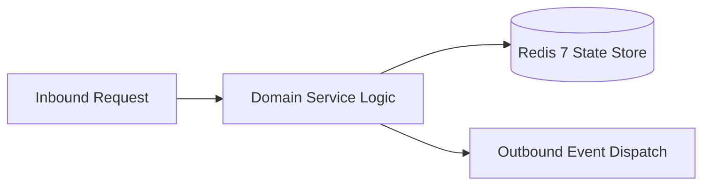

# Component Reference: `bot/handlers/user/voice_transcribe.py`
> **File Path**: [`bot/handlers/user/voice_transcribe.py`](../../bot/handlers/user/voice_transcribe.py)
> **Subsystem**: `Voice Transcription Handler`
> **Architecture Layer**: `Telegram User Media Ingress`
> **Concurrency Model**: `Aiogram 3 Async Inbound Event Loop + Per-User Rate Limiting`
> **Persistence Backend**: `Stateless Telegram Ingress & Memory In-Flight State`
> **Service Level Objective**: `Sub-100ms Telegram Message Ingress & Auto-Splitting`

## 1. Architectural Role & Responsibilities
The `bot/handlers/user/voice_transcribe.py` module implements core operational logic for the `Voice Transcription Handler` domain. It operates within an asynchronous microservices topology designed for ultra-low latency, zero-loss persistence guarantees, and strict single-responsibility function decomposition (≤25 lines).

### Component Architecture & Data Flow


---
## 2. Public API & Symbol Inventory
| Symbol | Nature | Line Range | Return Contract | Core Invariant |
| :--- | :--- | :--- | :--- | :--- |
| [`AudioMeta.__init__`](#audiometa__init__) | Method | L47–L74 | `Any` | Executes core domain logic for `__init__`. |
| [`AudioMeta.__iter__`](#audiometa__iter__) | Method | L76–L86 | `Any` | Executes core domain logic for `__iter__`. |
| [`is_allowed_chat`](#is_allowed_chat) | Function | L89–L99 | `bool` | Executes core domain logic for `is_allowed_chat`. |
| [`extract_audio_meta`](#extract_audio_meta) | Function | L102–L128 | `AudioMeta` | Extracts audio or video note metadata from inbound Tele... |
| [`acquire_user_slot`](#acquire_user_slot) | Function | L131–L150 | `bool` | Atomically reserves an in-flight transcription slot for... |
| [`release_user_slot`](#release_user_slot) | Function | L153–L166 | `None` | Releases the in-flight transcription slot after process... |
| [`validate_audio_limits`](#validate_audio_limits) | Function | L169–L188 | `str | None` | Validates audio duration and payload size against safet... |
| [`log_voice_request`](#log_voice_request) | Function | L191–L206 | `None` | Executes core domain logic for `log_voice_request`. |
| [`_resolve_temp_audio_dir`](#_resolve_temp_audio_dir) | Function | L209–L222 | `str` | Executes core domain logic for `_resolve_temp_audio_dir... |
| [`_determine_audio_extension`](#_determine_audio_extension) | Function | L225–L238 | `str` | Executes core domain logic for `_determine_audio_extens... |
| [`download_temp_audio`](#download_temp_audio) | Function | L241–L265 | `str` | Downloads Telegram media payload directly to RAM-disk (... |
| [`cleanup_temp_file`](#cleanup_temp_file) | Function | L268–L282 | `None` | Safely unlinks temporary audio file from ephemeral stor... |
| [`send_overflow_chunks`](#send_overflow_chunks) | Function | L285–L297 | `None` | Sends subsequent chunks of long transcription to Telegr... |
| [`deliver_transcription`](#deliver_transcription) | Function | L300–L324 | `None` | Delivers formatted transcription text with automatic mu... |
| [`_download_and_transcribe`](#_download_and_transcribe) | Function | L327–L345 | `str` | Executes core domain logic for `_download_and_transcrib... |
| [`process_audio_pipeline`](#process_audio_pipeline) | Function | L348–L375 | `None` | Executes core domain logic for `process_audio_pipeline`... |
| [`_check_and_acquire_voice`](#_check_and_acquire_voice) | Function | L378–L399 | `bool` | Executes core domain logic for `_check_and_acquire_voic... |
| [`handle_voice_or_video_note`](#handle_voice_or_video_note) | Function | L403–L424 | `None` | Executes core domain logic for `handle_voice_or_video_n... |

---

## 3. Comprehensive Function Specifications

## Class Model: `AudioMeta`

Encapsulates domain entities and data transfer logic for `AudioMeta`.

### `AudioMeta.__init__`
```python
def __init__( self, file_id: str, duration: int, sender: str, file_size: int = 0, user_id: int = 0, username: str = "",
```

- **Source Reference**: [`bot/handlers/user/voice_transcribe.py#L47-L74`](../../bot/handlers/user/voice_transcribe.py#L47-L74)
- **Execution Mode**: `Synchronous`
- **Return Contract**: `Any`

#### Overview & Architectural Purpose
Executes core domain logic for `__init__`.

#### Parameters Contract
| Parameter | Type | Required | Description |
| :--- | :--- | :--- | :--- |
| `file_id` | `str` | Yes | Parameter `file_id` of type `str`. |
| `duration` | `int` | Yes | Audio duration in seconds. |
| `sender` | `str` | Yes | Display name of the user who sent the audio message. |
| `file_size` | `int` | Yes | Size of the audio file in bytes. |
| `user_id` | `int` | Yes | Unique 64-bit Telegram user identifier. |
| `username` | `str` | Yes | Parameter `username` of type `str`. |
| `chat_id` | `int` | Yes | Unique 64-bit Telegram chat or supergroup identifier. |
| `thread_id` | `int | None` | Yes | Parameter `thread_id` of type `int | None`. |
| `media_type` | `str` | Yes | Parameter `media_type` of type `str`. |

#### Concurrency & Side Effects
- Stateless pure functional computation without external mutations.

#### Fault Tolerance & Error Modes
Propagates unexpected runtime errors up the call stack to global exception handlers.

#### Production Usage Example
```python
from bot.handlers.user.voice_transcribe import __init__

# Execute call
result = __init__(file_id=..., duration=..., sender=...)
```

---

### `AudioMeta.__iter__`
```python
def __iter__(self)
```

- **Source Reference**: [`bot/handlers/user/voice_transcribe.py#L76-L86`](../../bot/handlers/user/voice_transcribe.py#L76-L86)
- **Execution Mode**: `Synchronous`
- **Return Contract**: `Any`

#### Overview & Architectural Purpose
Executes core domain logic for `__iter__`.

#### Parameters Contract
*This method takes no input parameters.*

#### Concurrency & Side Effects
- Stateless pure functional computation without external mutations.

#### Fault Tolerance & Error Modes
Propagates unexpected runtime errors up the call stack to global exception handlers.

#### Production Usage Example
```python
from bot.handlers.user.voice_transcribe import __iter__

# Execute call
result = __iter__()
```

---

### `is_allowed_chat`
```python
def is_allowed_chat(chat_id: int, chat_type: str) -> bool
```

- **Source Reference**: [`bot/handlers/user/voice_transcribe.py#L89-L99`](../../bot/handlers/user/voice_transcribe.py#L89-L99)
- **Execution Mode**: `Synchronous`
- **Return Contract**: `bool`

#### Overview & Architectural Purpose
Executes core domain logic for `is_allowed_chat`.

#### Parameters Contract
| Parameter | Type | Required | Description |
| :--- | :--- | :--- | :--- |
| `chat_id` | `int` | Yes | Unique 64-bit Telegram chat or supergroup identifier. |
| `chat_type` | `str` | Yes | Parameter `chat_type` of type `str`. |

#### Concurrency & Side Effects
- Stateless pure functional computation without external mutations.

#### Fault Tolerance & Error Modes
Propagates unexpected runtime errors up the call stack to global exception handlers.

#### Production Usage Example
```python
from bot.handlers.user.voice_transcribe import is_allowed_chat

# Execute call
result = is_allowed_chat(chat_id=..., chat_type=...)
```

---

### `extract_audio_meta`
```python
def extract_audio_meta(message: Message) -> AudioMeta
```

- **Source Reference**: [`bot/handlers/user/voice_transcribe.py#L102-L128`](../../bot/handlers/user/voice_transcribe.py#L102-L128)
- **Execution Mode**: `Synchronous`
- **Return Contract**: `AudioMeta`

#### Overview & Architectural Purpose
Extracts audio or video note metadata from inbound Telegram message.

#### Parameters Contract
| Parameter | Type | Required | Description |
| :--- | :--- | :--- | :--- |
| `message` | `Message` | Yes | Aiogram Message event object encapsulating inbound user payload. |

#### Concurrency & Side Effects
- Stateless pure functional computation without external mutations.

#### Fault Tolerance & Error Modes
Propagates unexpected runtime errors up the call stack to global exception handlers.

#### Production Usage Example
```python
from bot.handlers.user.voice_transcribe import extract_audio_meta

# Execute call
result = extract_audio_meta(message=...)
```

---

### `acquire_user_slot`
```python
def acquire_user_slot(user_id: int) -> bool
```

- **Source Reference**: [`bot/handlers/user/voice_transcribe.py#L131-L150`](../../bot/handlers/user/voice_transcribe.py#L131-L150)
- **Execution Mode**: `Synchronous`
- **Return Contract**: `bool`

#### Overview & Architectural Purpose
Atomically reserves an in-flight transcription slot for user.

#### Parameters Contract
| Parameter | Type | Required | Description |
| :--- | :--- | :--- | :--- |
| `user_id` | `int` | Yes | Unique 64-bit Telegram user identifier. |

#### Concurrency & Side Effects
- Stateless pure functional computation without external mutations.

#### Fault Tolerance & Error Modes
Propagates unexpected runtime errors up the call stack to global exception handlers.

#### Production Usage Example
```python
from bot.handlers.user.voice_transcribe import acquire_user_slot

# Execute call
result = acquire_user_slot(user_id=...)
```

---

### `release_user_slot`
```python
def release_user_slot(user_id: int) -> None
```

- **Source Reference**: [`bot/handlers/user/voice_transcribe.py#L153-L166`](../../bot/handlers/user/voice_transcribe.py#L153-L166)
- **Execution Mode**: `Synchronous`
- **Return Contract**: `None`

#### Overview & Architectural Purpose
Releases the in-flight transcription slot after processing completes.

#### Parameters Contract
| Parameter | Type | Required | Description |
| :--- | :--- | :--- | :--- |
| `user_id` | `int` | Yes | Unique 64-bit Telegram user identifier. |

#### Concurrency & Side Effects
- Stateless pure functional computation without external mutations.

#### Fault Tolerance & Error Modes
Propagates unexpected runtime errors up the call stack to global exception handlers.

#### Production Usage Example
```python
from bot.handlers.user.voice_transcribe import release_user_slot

# Execute call
result = release_user_slot(user_id=...)
```

---

### `validate_audio_limits`
```python
def validate_audio_limits(duration: int, file_size: int, sender: str) -> str | None
```

- **Source Reference**: [`bot/handlers/user/voice_transcribe.py#L169-L188`](../../bot/handlers/user/voice_transcribe.py#L169-L188)
- **Execution Mode**: `Synchronous`
- **Return Contract**: `str | None`

#### Overview & Architectural Purpose
Validates audio duration and payload size against safety boundaries.

#### Parameters Contract
| Parameter | Type | Required | Description |
| :--- | :--- | :--- | :--- |
| `duration` | `int` | Yes | Audio duration in seconds. |
| `file_size` | `int` | Yes | Size of the audio file in bytes. |
| `sender` | `str` | Yes | Display name of the user who sent the audio message. |

#### Concurrency & Side Effects
- Emits structured telemetry events to system logging subsystem.

#### Fault Tolerance & Error Modes
Propagates unexpected runtime errors up the call stack to global exception handlers.

#### Production Usage Example
```python
from bot.handlers.user.voice_transcribe import validate_audio_limits

# Execute call
result = validate_audio_limits(duration=..., file_size=..., sender=...)
```

---

### `log_voice_request`
```python
def log_voice_request(meta: AudioMeta) -> None
```

- **Source Reference**: [`bot/handlers/user/voice_transcribe.py#L191-L206`](../../bot/handlers/user/voice_transcribe.py#L191-L206)
- **Execution Mode**: `Synchronous`
- **Return Contract**: `None`

#### Overview & Architectural Purpose
Executes core domain logic for `log_voice_request`.

#### Parameters Contract
| Parameter | Type | Required | Description |
| :--- | :--- | :--- | :--- |
| `meta` | `AudioMeta` | Yes | Parameter `meta` of type `AudioMeta`. |

#### Concurrency & Side Effects
- Emits structured telemetry events to system logging subsystem.

#### Fault Tolerance & Error Modes
Propagates unexpected runtime errors up the call stack to global exception handlers.

#### Production Usage Example
```python
from bot.handlers.user.voice_transcribe import log_voice_request

# Execute call
result = log_voice_request(meta=...)
```

---

### `_resolve_temp_audio_dir`
```python
def _resolve_temp_audio_dir() -> str
```

- **Source Reference**: [`bot/handlers/user/voice_transcribe.py#L209-L222`](../../bot/handlers/user/voice_transcribe.py#L209-L222)
- **Execution Mode**: `Synchronous`
- **Return Contract**: `str`

#### Overview & Architectural Purpose
Executes core domain logic for `_resolve_temp_audio_dir`.

#### Parameters Contract
*This method takes no input parameters.*

#### Concurrency & Side Effects
- Stateless pure functional computation without external mutations.

#### Fault Tolerance & Error Modes
Propagates unexpected runtime errors up the call stack to global exception handlers.

#### Production Usage Example
```python
from bot.handlers.user.voice_transcribe import _resolve_temp_audio_dir

# Execute call
result = _resolve_temp_audio_dir()
```

---

### `_determine_audio_extension`
```python
def _determine_audio_extension(file_path: str | None) -> str
```

- **Source Reference**: [`bot/handlers/user/voice_transcribe.py#L225-L238`](../../bot/handlers/user/voice_transcribe.py#L225-L238)
- **Execution Mode**: `Synchronous`
- **Return Contract**: `str`

#### Overview & Architectural Purpose
Executes core domain logic for `_determine_audio_extension`.

#### Parameters Contract
| Parameter | Type | Required | Description |
| :--- | :--- | :--- | :--- |
| `file_path` | `str | None` | Yes | Parameter `file_path` of type `str | None`. |

#### Concurrency & Side Effects
- Stateless pure functional computation without external mutations.

#### Fault Tolerance & Error Modes
Propagates unexpected runtime errors up the call stack to global exception handlers.

#### Production Usage Example
```python
from bot.handlers.user.voice_transcribe import _determine_audio_extension

# Execute call
result = _determine_audio_extension(file_path=...)
```

---

### `download_temp_audio`
```python
async def download_temp_audio(file_id: str) -> str
```

- **Source Reference**: [`bot/handlers/user/voice_transcribe.py#L241-L265`](../../bot/handlers/user/voice_transcribe.py#L241-L265)
- **Execution Mode**: `Asynchronous (non-blocking)`
- **Return Contract**: `str`

#### Overview & Architectural Purpose
Downloads Telegram media payload directly to RAM-disk (/dev/shm).

#### Parameters Contract
| Parameter | Type | Required | Description |
| :--- | :--- | :--- | :--- |
| `file_id` | `str` | Yes | Parameter `file_id` of type `str`. |

#### Concurrency & Side Effects
- Emits structured telemetry events to system logging subsystem.

#### Fault Tolerance & Error Modes
Propagates unexpected runtime errors up the call stack to global exception handlers.

#### Production Usage Example
```python
from bot.handlers.user.voice_transcribe import download_temp_audio

# Execute call
result = await download_temp_audio(file_id=...)
```

---

### `cleanup_temp_file`
```python
def cleanup_temp_file(path: str) -> None
```

- **Source Reference**: [`bot/handlers/user/voice_transcribe.py#L268-L282`](../../bot/handlers/user/voice_transcribe.py#L268-L282)
- **Execution Mode**: `Synchronous`
- **Return Contract**: `None`

#### Overview & Architectural Purpose
Safely unlinks temporary audio file from ephemeral storage.

#### Parameters Contract
| Parameter | Type | Required | Description |
| :--- | :--- | :--- | :--- |
| `path` | `str` | Yes | Parameter `path` of type `str`. |

#### Concurrency & Side Effects
- Emits structured telemetry events to system logging subsystem.

#### Fault Tolerance & Error Modes
Encapsulates faults within `try/except` blocks, logging errors and returning safe fallback defaults.

#### Production Usage Example
```python
from bot.handlers.user.voice_transcribe import cleanup_temp_file

# Execute call
result = cleanup_temp_file(path=...)
```

---

### `send_overflow_chunks`
```python
async def send_overflow_chunks(message: Message, chunks: list[str]) -> None
```

- **Source Reference**: [`bot/handlers/user/voice_transcribe.py#L285-L297`](../../bot/handlers/user/voice_transcribe.py#L285-L297)
- **Execution Mode**: `Asynchronous (non-blocking)`
- **Return Contract**: `None`

#### Overview & Architectural Purpose
Sends subsequent chunks of long transcription to Telegram topic.

#### Parameters Contract
| Parameter | Type | Required | Description |
| :--- | :--- | :--- | :--- |
| `message` | `Message` | Yes | Aiogram Message event object encapsulating inbound user payload. |
| `chunks` | `list[str]` | Yes | Parameter `chunks` of type `list[str]`. |

#### Concurrency & Side Effects
- Stateless pure functional computation without external mutations.

#### Fault Tolerance & Error Modes
Propagates unexpected runtime errors up the call stack to global exception handlers.

#### Production Usage Example
```python
from bot.handlers.user.voice_transcribe import send_overflow_chunks

# Execute call
result = await send_overflow_chunks(message=..., chunks=...)
```

---

### `deliver_transcription`
```python
async def deliver_transcription( message: Message, status_msg: Message, sender_name: str, duration: int, text: str, ) -> None
```

- **Source Reference**: [`bot/handlers/user/voice_transcribe.py#L300-L324`](../../bot/handlers/user/voice_transcribe.py#L300-L324)
- **Execution Mode**: `Asynchronous (non-blocking)`
- **Return Contract**: `None`

#### Overview & Architectural Purpose
Delivers formatted transcription text with automatic multi-chunk splitting.

#### Parameters Contract
| Parameter | Type | Required | Description |
| :--- | :--- | :--- | :--- |
| `message` | `Message` | Yes | Aiogram Message event object encapsulating inbound user payload. |
| `status_msg` | `Message` | Yes | Aiogram Message instance displaying transient progress status. |
| `sender_name` | `str` | Yes | Display name of the sender for message formatting. |
| `duration` | `int` | Yes | Audio duration in seconds. |
| `text` | `str` | Yes | Parameter `text` of type `str`. |

#### Concurrency & Side Effects
- Stateless pure functional computation without external mutations.

#### Fault Tolerance & Error Modes
Propagates unexpected runtime errors up the call stack to global exception handlers.

#### Production Usage Example
```python
from bot.handlers.user.voice_transcribe import deliver_transcription

# Execute call
result = await deliver_transcription(message=..., status_msg=..., sender_name=...)
```

---

### `_download_and_transcribe`
```python
async def _download_and_transcribe(file_id: str) -> str
```

- **Source Reference**: [`bot/handlers/user/voice_transcribe.py#L327-L345`](../../bot/handlers/user/voice_transcribe.py#L327-L345)
- **Execution Mode**: `Asynchronous (non-blocking)`
- **Return Contract**: `str`

#### Overview & Architectural Purpose
Executes core domain logic for `_download_and_transcribe`.

#### Parameters Contract
| Parameter | Type | Required | Description |
| :--- | :--- | :--- | :--- |
| `file_id` | `str` | Yes | Parameter `file_id` of type `str`. |

#### Concurrency & Side Effects
- Stateless pure functional computation without external mutations.

#### Fault Tolerance & Error Modes
Encapsulates faults within `try/except` blocks, logging errors and returning safe fallback defaults.

#### Production Usage Example
```python
from bot.handlers.user.voice_transcribe import _download_and_transcribe

# Execute call
result = await _download_and_transcribe(file_id=...)
```

---

### `process_audio_pipeline`
```python
async def process_audio_pipeline( file_id: str, sender: str, duration: int, message: Message, status_msg: Message, user_id: int = 0, ) -> None
```

- **Source Reference**: [`bot/handlers/user/voice_transcribe.py#L348-L375`](../../bot/handlers/user/voice_transcribe.py#L348-L375)
- **Execution Mode**: `Asynchronous (non-blocking)`
- **Return Contract**: `None`

#### Overview & Architectural Purpose
Executes core domain logic for `process_audio_pipeline`.

#### Parameters Contract
| Parameter | Type | Required | Description |
| :--- | :--- | :--- | :--- |
| `file_id` | `str` | Yes | Parameter `file_id` of type `str`. |
| `sender` | `str` | Yes | Display name of the user who sent the audio message. |
| `duration` | `int` | Yes | Audio duration in seconds. |
| `message` | `Message` | Yes | Aiogram Message event object encapsulating inbound user payload. |
| `status_msg` | `Message` | Yes | Aiogram Message instance displaying transient progress status. |
| `user_id` | `int` | Yes | Unique 64-bit Telegram user identifier. |

#### Concurrency & Side Effects
- Emits structured telemetry events to system logging subsystem.

#### Fault Tolerance & Error Modes
Encapsulates faults within `try/except` blocks, logging errors and returning safe fallback defaults.

#### Production Usage Example
```python
from bot.handlers.user.voice_transcribe import process_audio_pipeline

# Execute call
result = await process_audio_pipeline(file_id=..., sender=..., duration=...)
```

---

### `_check_and_acquire_voice`
```python
async def _check_and_acquire_voice(message: Message, meta: AudioMeta) -> bool
```

- **Source Reference**: [`bot/handlers/user/voice_transcribe.py#L378-L399`](../../bot/handlers/user/voice_transcribe.py#L378-L399)
- **Execution Mode**: `Asynchronous (non-blocking)`
- **Return Contract**: `bool`

#### Overview & Architectural Purpose
Executes core domain logic for `_check_and_acquire_voice`.

#### Parameters Contract
| Parameter | Type | Required | Description |
| :--- | :--- | :--- | :--- |
| `message` | `Message` | Yes | Aiogram Message event object encapsulating inbound user payload. |
| `meta` | `AudioMeta` | Yes | Parameter `meta` of type `AudioMeta`. |

#### Concurrency & Side Effects
- Emits structured telemetry events to system logging subsystem.

#### Fault Tolerance & Error Modes
Propagates unexpected runtime errors up the call stack to global exception handlers.

#### Production Usage Example
```python
from bot.handlers.user.voice_transcribe import _check_and_acquire_voice

# Execute call
result = await _check_and_acquire_voice(message=..., meta=...)
```

---

### `handle_voice_or_video_note`
```python
async def handle_voice_or_video_note(message: Message) -> None
```

- **Source Reference**: [`bot/handlers/user/voice_transcribe.py#L403-L424`](../../bot/handlers/user/voice_transcribe.py#L403-L424)
- **Execution Mode**: `Asynchronous (non-blocking)`
- **Return Contract**: `None`

#### Overview & Architectural Purpose
Executes core domain logic for `handle_voice_or_video_note`.

#### Parameters Contract
| Parameter | Type | Required | Description |
| :--- | :--- | :--- | :--- |
| `message` | `Message` | Yes | Aiogram Message event object encapsulating inbound user payload. |

#### Concurrency & Side Effects
- Stateless pure functional computation without external mutations.

#### Fault Tolerance & Error Modes
Propagates unexpected runtime errors up the call stack to global exception handlers.

#### Production Usage Example
```python
from bot.handlers.user.voice_transcribe import handle_voice_or_video_note

# Execute call
result = await handle_voice_or_video_note(message=...)
```

---
