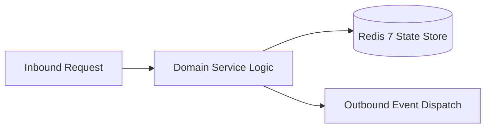

# Component Reference: `bot/middlewares/achievements.py`
> **File Path**: [`bot/middlewares/achievements.py`](../../bot/middlewares/achievements.py)
> **Subsystem**: `Achievement Rules`
> **Architecture Layer**: `Enterprise Microservice Subsystem`
> **Concurrency Model**: `AsyncIO Non-blocking Concurrency`
> **Persistence Backend**: `Redis 7 Persistent Store`
> **Service Level Objective**: `High-Availability Academic Telemetry`

## 1. Architectural Role & Responsibilities
The `bot/middlewares/achievements.py` module implements core operational logic for the `Achievement Rules` domain. It operates within an asynchronous microservices topology designed for ultra-low latency, zero-loss persistence guarantees, and strict single-responsibility function decomposition (≤25 lines).

### Component Architecture & Data Flow


---
## 2. Public API & Symbol Inventory
| Symbol | Nature | Line Range | Return Contract | Core Invariant |
| :--- | :--- | :--- | :--- | :--- |
| [`_spawn`](#_spawn) | Function | L29–L33 | `None` | Executes core domain logic for `_spawn`. |
| [`_activity_for`](#_activity_for) | Function | L36–L50 | `Coroutine[Any, Any, None] | None` | Executes core domain logic for `_activity_for`. |
| [`AchievementActivityMiddleware.__call__`](#achievementactivitymiddleware__call__) | Method | L56–L66 | `Any` | Executes core domain logic for `__call__`. |

---

## 3. Comprehensive Function Specifications

### `_spawn`
```python
def _spawn(coro: Coroutine[Any, Any, None]) -> None
```

- **Source Reference**: [`bot/middlewares/achievements.py#L29-L33`](../../bot/middlewares/achievements.py#L29-L33)
- **Execution Mode**: `Synchronous`
- **Return Contract**: `None`

#### Overview & Architectural Purpose
Executes core domain logic for `_spawn`.

#### Parameters Contract
| Parameter | Type | Required | Description |
| :--- | :--- | :--- | :--- |
| `coro` | `Coroutine[Any, Any, None]` | Yes | Parameter `coro` of type `Coroutine[Any, Any, None]`. |

#### Concurrency & Side Effects
- Stateless pure functional computation without external mutations.

#### Fault Tolerance & Error Modes
Propagates unexpected runtime errors up the call stack to global exception handlers.

#### Production Usage Example
```python
from bot.middlewares.achievements import _spawn

# Execute call
result = _spawn(coro=...)
```

---

### `_activity_for`
```python
def _activity_for(event: TelegramObject) -> Coroutine[Any, Any, None] | None
```

- **Source Reference**: [`bot/middlewares/achievements.py#L36-L50`](../../bot/middlewares/achievements.py#L36-L50)
- **Execution Mode**: `Synchronous`
- **Return Contract**: `Coroutine[Any, Any, None] | None`

#### Overview & Architectural Purpose
Executes core domain logic for `_activity_for`.

#### Parameters Contract
| Parameter | Type | Required | Description |
| :--- | :--- | :--- | :--- |
| `event` | `TelegramObject` | Yes | Parameter `event` of type `TelegramObject`. |

#### Concurrency & Side Effects
- Stateless pure functional computation without external mutations.

#### Fault Tolerance & Error Modes
Propagates unexpected runtime errors up the call stack to global exception handlers.

#### Production Usage Example
```python
from bot.middlewares.achievements import _activity_for

# Execute call
result = _activity_for(event=...)
```

---

## Class Model: `AchievementActivityMiddleware`

Encapsulates domain entities and data transfer logic for `AchievementActivityMiddleware`.

### `AchievementActivityMiddleware.__call__`
```python
async def __call__( self, handler: Callable[[TelegramObject, dict[str, Any]], Awaitable[Any]], event: TelegramObject, data: dict[str, Any], ) -> Any
```

- **Source Reference**: [`bot/middlewares/achievements.py#L56-L66`](../../bot/middlewares/achievements.py#L56-L66)
- **Execution Mode**: `Asynchronous (non-blocking)`
- **Return Contract**: `Any`

#### Overview & Architectural Purpose
Executes core domain logic for `__call__`.

#### Parameters Contract
| Parameter | Type | Required | Description |
| :--- | :--- | :--- | :--- |
| `handler` | `Callable[[TelegramObject, dict[str, Any]], Awaitable[Any]]` | Yes | Parameter `handler` of type `Callable[[TelegramObject, dict[str, Any]], Awaitable[Any]]`. |
| `event` | `TelegramObject` | Yes | Parameter `event` of type `TelegramObject`. |
| `data` | `dict[str, Any]` | Yes | Parameter `data` of type `dict[str, Any]`. |

#### Concurrency & Side Effects
- Stateless pure functional computation without external mutations.

#### Fault Tolerance & Error Modes
Propagates unexpected runtime errors up the call stack to global exception handlers.

#### Production Usage Example
```python
from bot.middlewares.achievements import __call__

# Execute call
result = await __call__(handler=..., event=..., data=...)
```

---
