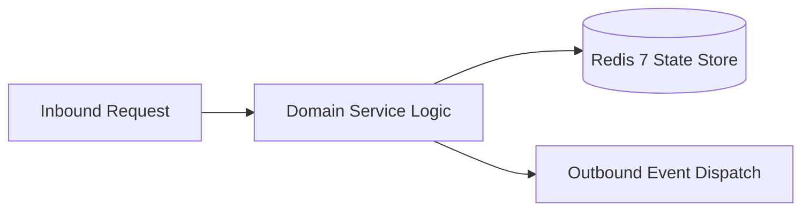

# Component Reference: `bot/middlewares/retry.py`
> **File Path**: [`bot/middlewares/retry.py`](../../bot/middlewares/retry.py)
> **Subsystem**: `Network Retry Middleware`
> **Architecture Layer**: `Enterprise Microservice Subsystem`
> **Concurrency Model**: `AsyncIO Non-blocking Concurrency`
> **Persistence Backend**: `Redis 7 Persistent Store`
> **Service Level Objective**: `High-Availability Academic Telemetry`

## 1. Architectural Role & Responsibilities
The `bot/middlewares/retry.py` module implements core operational logic for the `Network Retry Middleware` domain. It operates within an asynchronous microservices topology designed for ultra-low latency, zero-loss persistence guarantees, and strict single-responsibility function decomposition (≤25 lines).

### Component Architecture & Data Flow


---
## 2. Public API & Symbol Inventory
| Symbol | Nature | Line Range | Return Contract | Core Invariant |
| :--- | :--- | :--- | :--- | :--- |
| [`RetryAfterMiddleware.__call__`](#retryaftermiddleware__call__) | Method | L24–L48 | `Any` | Executes core domain logic for `__call__`. |

---

## 3. Comprehensive Function Specifications

## Class Model: `RetryAfterMiddleware`

Encapsulates domain entities and data transfer logic for `RetryAfterMiddleware`.

### `RetryAfterMiddleware.__call__`
```python
async def __call__( self, handler: Callable[[TelegramObject, dict[str, Any]], Awaitable[Any]], event: TelegramObject, data: dict[str, Any], ) -> Any
```

- **Source Reference**: [`bot/middlewares/retry.py#L24-L48`](../../bot/middlewares/retry.py#L24-L48)
- **Execution Mode**: `Asynchronous (non-blocking)`
- **Return Contract**: `Any`

#### Overview & Architectural Purpose
Executes core domain logic for `__call__`.

#### Parameters Contract
| Parameter | Type | Required | Description |
| :--- | :--- | :--- | :--- |
| `handler` | `Callable[[TelegramObject, dict[str, Any]], Awaitable[Any]]` | Yes | Parameter `handler` of type `Callable[[TelegramObject, dict[str, Any]], Awaitable[Any]]`. |
| `event` | `TelegramObject` | Yes | Parameter `event` of type `TelegramObject`. |
| `data` | `dict[str, Any]` | Yes | Parameter `data` of type `dict[str, Any]`. |

#### Concurrency & Side Effects
- Emits structured telemetry events to system logging subsystem.

#### Fault Tolerance & Error Modes
Explicitly raises domain exceptions (e.g., `PermissionError`, `ValueError`) upon invariant violation.

#### Production Usage Example
```python
from bot.middlewares.retry import __call__

# Execute call
result = await __call__(handler=..., event=..., data=...)
```

---
