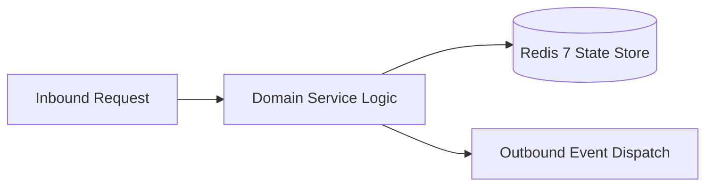

# Component Reference: `bot/middlewares/throttling.py`
> **File Path**: [`bot/middlewares/throttling.py`](../../bot/middlewares/throttling.py)  
> **Subsystem**: `Throttling Middleware`  
> **Architecture Layer**: `Enterprise Microservice Subsystem`  
> **Concurrency Model**: `AsyncIO Non-blocking Concurrency`  
> **Persistence Backend**: `Redis 7 Persistent Store`  
> **Service Level Objective**: `High-Availability Academic Telemetry`

## 1. Architectural Role & Responsibilities
The `bot/middlewares/throttling.py` module implements core operational logic for the `Throttling Middleware` domain. It operates within an asynchronous microservices topology designed for ultra-low latency, zero-loss persistence guarantees, and strict single-responsibility function decomposition (≤25 lines).

### Component Architecture & Data Flow


---
## 2. Public API & Symbol Inventory
| Symbol | Nature | Line Range | Return Contract | Core Invariant |
| :--- | :--- | :--- | :--- | :--- |
| [`_determine_cooldown`](#_determine_cooldown) | Function | L30–L46 | `float` | Executes core domain logic for `_determine_cooldown`. |
| [`CallbackThrottleMiddleware.__init__`](#callbackthrottlemiddleware__init__) | Method | L52–L60 | `None` | Executes core domain logic for `__init__`. |
| [`CallbackThrottleMiddleware._cleanup_old_entries`](#callbackthrottlemiddleware_cleanup_old_entries) | Method | L62–L77 | `None` | Executes core domain logic for `_cleanup_old_entries`. |
| [`CallbackThrottleMiddleware._handle_callback_throttle`](#callbackthrottlemiddleware_handle_callback_throttle) | Method | L79–L105 | `bool` | Executes core domain logic for `_handle_callback_thrott... |
| [`CallbackThrottleMiddleware.__call__`](#callbackthrottlemiddleware__call__) | Method | L107–L125 | `Any` | Executes core domain logic for `__call__`. |

---

## 3. Comprehensive Function Specifications

### `_determine_cooldown`
```python
def _determine_cooldown(cb_data: str) -> float
```

- **Source Reference**: [`bot/middlewares/throttling.py#L30-L46`](../../bot/middlewares/throttling.py#L30-L46)
- **Execution Mode**: `Synchronous`
- **Return Contract**: `float`

#### Overview & Architectural Purpose
Executes core domain logic for `_determine_cooldown`.

#### Parameters Contract
| Parameter | Type | Required | Description |
| :--- | :--- | :--- | :--- |
| `cb_data` | `str` | Yes | Parameter `cb_data` of type `str`. |

#### Concurrency & Side Effects
- Stateless pure functional computation without external mutations.

#### Fault Tolerance & Error Modes
Propagates unexpected runtime errors up the call stack to global exception handlers.

#### Production Usage Example
```python
from bot.middlewares.throttling import _determine_cooldown

# Execute call
result = _determine_cooldown(cb_data=...)
```

---

## Class Model: `CallbackThrottleMiddleware`

Encapsulates domain entities and data transfer logic for `CallbackThrottleMiddleware`.

### `CallbackThrottleMiddleware.__init__`
```python
def __init__(self) -> None
```

- **Source Reference**: [`bot/middlewares/throttling.py#L52-L60`](../../bot/middlewares/throttling.py#L52-L60)
- **Execution Mode**: `Synchronous`
- **Return Contract**: `None`

#### Overview & Architectural Purpose
Executes core domain logic for `__init__`.

#### Parameters Contract
*This method takes no input parameters.*

#### Concurrency & Side Effects
- Stateless pure functional computation without external mutations.

#### Fault Tolerance & Error Modes
Propagates unexpected runtime errors up the call stack to global exception handlers.

#### Production Usage Example
```python
from bot.middlewares.throttling import __init__

# Execute call
result = __init__()
```

---

### `CallbackThrottleMiddleware._cleanup_old_entries`
```python
def _cleanup_old_entries(self, now: float) -> None
```

- **Source Reference**: [`bot/middlewares/throttling.py#L62-L77`](../../bot/middlewares/throttling.py#L62-L77)
- **Execution Mode**: `Synchronous`
- **Return Contract**: `None`

#### Overview & Architectural Purpose
Executes core domain logic for `_cleanup_old_entries`.

#### Parameters Contract
| Parameter | Type | Required | Description |
| :--- | :--- | :--- | :--- |
| `now` | `float` | Yes | Parameter `now` of type `float`. |

#### Concurrency & Side Effects
- Stateless pure functional computation without external mutations.

#### Fault Tolerance & Error Modes
Propagates unexpected runtime errors up the call stack to global exception handlers.

#### Production Usage Example
```python
from bot.middlewares.throttling import _cleanup_old_entries

# Execute call
result = _cleanup_old_entries(now=...)
```

---

### `CallbackThrottleMiddleware._handle_callback_throttle`
```python
async def _handle_callback_throttle( self, event: CallbackQuery, now: float ) -> bool
```

- **Source Reference**: [`bot/middlewares/throttling.py#L79-L105`](../../bot/middlewares/throttling.py#L79-L105)
- **Execution Mode**: `Asynchronous (non-blocking)`
- **Return Contract**: `bool`

#### Overview & Architectural Purpose
Executes core domain logic for `_handle_callback_throttle`.

#### Parameters Contract
| Parameter | Type | Required | Description |
| :--- | :--- | :--- | :--- |
| `event` | `CallbackQuery` | Yes | Parameter `event` of type `CallbackQuery`. |
| `now` | `float` | Yes | Parameter `now` of type `float`. |

#### Concurrency & Side Effects
- Emits structured telemetry events to system logging subsystem.

#### Fault Tolerance & Error Modes
Propagates unexpected runtime errors up the call stack to global exception handlers.

#### Production Usage Example
```python
from bot.middlewares.throttling import _handle_callback_throttle

# Execute call
result = await _handle_callback_throttle(event=..., now=...)
```

---

### `CallbackThrottleMiddleware.__call__`
```python
async def __call__( self, handler: Callable[[TelegramObject, dict[str, Any]], Awaitable[Any]], event: TelegramObject, data: dict[str, Any], ) -> Any
```

- **Source Reference**: [`bot/middlewares/throttling.py#L107-L125`](../../bot/middlewares/throttling.py#L107-L125)
- **Execution Mode**: `Asynchronous (non-blocking)`
- **Return Contract**: `Any`

#### Overview & Architectural Purpose
Executes core domain logic for `__call__`.

#### Parameters Contract
| Parameter | Type | Required | Description |
| :--- | :--- | :--- | :--- |
| `handler` | `Callable[[TelegramObject, dict[str, Any]], Awaitable[Any]]` | Yes | Parameter `handler` of type `Callable[[TelegramObject, dict[str, Any]], Awaitable[Any]]`. |
| `event` | `TelegramObject` | Yes | Parameter `event` of type `TelegramObject`. |
| `data` | `dict[str, Any]` | Yes | Parameter `data` of type `dict[str, Any]`. |

#### Concurrency & Side Effects
- Stateless pure functional computation without external mutations.

#### Fault Tolerance & Error Modes
Propagates unexpected runtime errors up the call stack to global exception handlers.

#### Production Usage Example
```python
from bot.middlewares.throttling import __call__

# Execute call
result = await __call__(handler=..., event=..., data=...)
```

---
