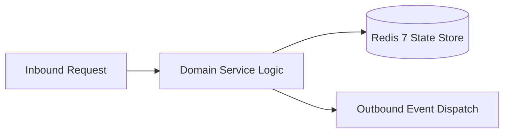

# Component Reference: `bot/middlewares/tracing.py`
> **File Path**: [`bot/middlewares/tracing.py`](../../bot/middlewares/tracing.py)
> **Subsystem**: `Telemetry Tracing Middleware`
> **Architecture Layer**: `Enterprise Microservice Subsystem`
> **Concurrency Model**: `AsyncIO Non-blocking Concurrency`
> **Persistence Backend**: `Redis 7 Persistent Store`
> **Service Level Objective**: `High-Availability Academic Telemetry`

## 1. Architectural Role & Responsibilities
The `bot/middlewares/tracing.py` module implements core operational logic for the `Telemetry Tracing Middleware` domain. It operates within an asynchronous microservices topology designed for ultra-low latency, zero-loss persistence guarantees, and strict single-responsibility function decomposition (≤25 lines).

### Component Architecture & Data Flow


---
## 2. Public API & Symbol Inventory
| Symbol | Nature | Line Range | Return Contract | Core Invariant |
| :--- | :--- | :--- | :--- | :--- |
| [`_extract_callback_attrs`](#_extract_callback_attrs) | Function | L21–L35 | `tuple[str, dict[str, Any]]` | Executes core domain logic for `_extract_callback_attrs... |
| [`_extract_message_attrs`](#_extract_message_attrs) | Function | L38–L52 | `tuple[str, dict[str, Any]]` | Executes core domain logic for `_extract_message_attrs`... |
| [`TracingMiddleware.__call__`](#tracingmiddleware__call__) | Method | L58–L73 | `Any` | Executes core domain logic for `__call__`. |

---

## 3. Comprehensive Function Specifications

### `_extract_callback_attrs`
```python
def _extract_callback_attrs(query: CallbackQuery) -> tuple[str, dict[str, Any]]
```

- **Source Reference**: [`bot/middlewares/tracing.py#L21-L35`](../../bot/middlewares/tracing.py#L21-L35)
- **Execution Mode**: `Synchronous`
- **Return Contract**: `tuple[str, dict[str, Any]]`

#### Overview & Architectural Purpose
Executes core domain logic for `_extract_callback_attrs`.

#### Parameters Contract
| Parameter | Type | Required | Description |
| :--- | :--- | :--- | :--- |
| `query` | `CallbackQuery` | Yes | Parameter `query` of type `CallbackQuery`. |

#### Concurrency & Side Effects
- Stateless pure functional computation without external mutations.

#### Fault Tolerance & Error Modes
Propagates unexpected runtime errors up the call stack to global exception handlers.

#### Production Usage Example
```python
from bot.middlewares.tracing import _extract_callback_attrs

# Execute call
result = _extract_callback_attrs(query=...)
```

---

### `_extract_message_attrs`
```python
def _extract_message_attrs(message: Message) -> tuple[str, dict[str, Any]]
```

- **Source Reference**: [`bot/middlewares/tracing.py#L38-L52`](../../bot/middlewares/tracing.py#L38-L52)
- **Execution Mode**: `Synchronous`
- **Return Contract**: `tuple[str, dict[str, Any]]`

#### Overview & Architectural Purpose
Executes core domain logic for `_extract_message_attrs`.

#### Parameters Contract
| Parameter | Type | Required | Description |
| :--- | :--- | :--- | :--- |
| `message` | `Message` | Yes | Aiogram Message event object encapsulating inbound user payload. |

#### Concurrency & Side Effects
- Stateless pure functional computation without external mutations.

#### Fault Tolerance & Error Modes
Propagates unexpected runtime errors up the call stack to global exception handlers.

#### Production Usage Example
```python
from bot.middlewares.tracing import _extract_message_attrs

# Execute call
result = _extract_message_attrs(message=...)
```

---

## Class Model: `TracingMiddleware`

Encapsulates domain entities and data transfer logic for `TracingMiddleware`.

### `TracingMiddleware.__call__`
```python
async def __call__( self, handler: Callable[[TelegramObject, dict[str, Any]], Awaitable[Any]], event: TelegramObject, data: dict[str, Any], ) -> Any
```

- **Source Reference**: [`bot/middlewares/tracing.py#L58-L73`](../../bot/middlewares/tracing.py#L58-L73)
- **Execution Mode**: `Asynchronous (non-blocking)`
- **Return Contract**: `Any`

#### Overview & Architectural Purpose
Executes core domain logic for `__call__`.

#### Parameters Contract
| Parameter | Type | Required | Description |
| :--- | :--- | :--- | :--- |
| `handler` | `Callable[[TelegramObject, dict[str, Any]], Awaitable[Any]]` | Yes | Parameter `handler` of type `Callable[[TelegramObject, dict[str, Any]], Awaitable[Any]]`. |
| `event` | `TelegramObject` | Yes | Parameter `event` of type `TelegramObject`. |
| `data` | `dict[str, Any]` | Yes | Parameter `data` of type `dict[str, Any]`. |

#### Concurrency & Side Effects
- Stateless pure functional computation without external mutations.

#### Fault Tolerance & Error Modes
Propagates unexpected runtime errors up the call stack to global exception handlers.

#### Production Usage Example
```python
from bot.middlewares.tracing import __call__

# Execute call
result = await __call__(handler=..., event=..., data=...)
```

---
